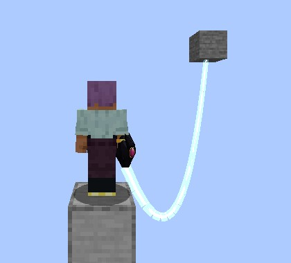
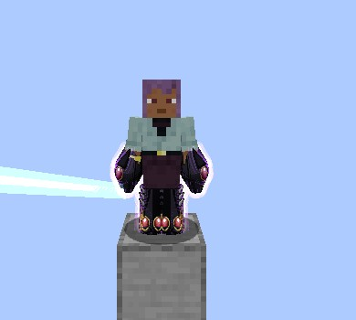
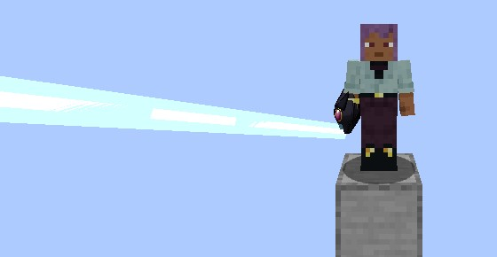

# Absorption Line

Genshirou Saji's Sacred Gear, added in **0.2.78**: Vritra's lines, which hold what they touch, drink its power and pass it on. Vritra, the
Prison Dragon, sleeps in it until he's earned. It is a Tensura **Unique Skill** (`dxdtensura:absorption_line`) with no summoned state:
the gear shows while a line is out or a power runs.

<figure markdown="span">
  { loading=lazy }
  <figcaption>A line tied to a block, hanging slack.</figcaption>
</figure>

<figure markdown="span">
  { loading=lazy }
  <figcaption>Full mastery: Vritra's set on both arms and shins.</figcaption>
</figure>

Below full mastery a black dragon head with deep-magenta eyes sits on your main arm, and the lines glow light blue from its mouth,
hanging when slack and straight at their length.

## Getting it

- **Only the reincarnation roll**, at the same odds as the other gears, and only for a
  [human](../getting-started/first-gear.md#only-in-humans).
- Learning it costs 30,000 magicules. Any number of players can hold it.
- **One Sacred Gear per player.**
- A holder reborn as another race in Tensura's race menu loses it. A Devil's Evil Piece keeps it, as Saji's did.
- It goes with the [Holy Factor](../durandal/index.md#the-holy-factor). It isn't a Longinus. Its holder counts as a dragon, so Ascalon's
  holy strike and burn hurt them.
- [Rias](../races/rias.md) makes a holder her **Pawns**, as many as their worth, when she has that many free, as Saji was Sona's four.

## Modes

| # | Mode | Opens at | Price | Cooldown where it opens / mastered |
|---|---|---|---|---|
| 0 | **Absorption Line** | the start | 1% a line | none |
| 1 | **Shadow Prison** | 40% mastery | 10% | 40 s / 20 s |
| 2 | **Blaze Black Flare** | 70% mastery | 15% | 30 s / 15 s |
| 3 | **Delete Field** | full mastery | 30% | 90 s |

Prices are a share of your max magicules.

## The lines

- **A tap** (let go within 0.3 s) acts on the first thing along your look, up to 24 blocks, stopped by the first block or a Tensura barrier:
  an enemy gets a line tied to you, an ally (your pets, subordinates, Tensura allies, a player you can't harm) a line that pours into them,
  and a block a line you swing on. A tap on something already on a line cuts it, and a tap at nothing cuts every line.
- **Holding the key** reels every line in at 5 blocks a second, down to 2.
- **Sneak and tap** with an enemy line out moves your newest enemy line's far end: onto an ally, the enemy's power flows into them
  instead of you; onto a block, the enemy is tied to the block and its power goes into the ground, and you can walk off (up to 48 blocks).
- **How many:** 1 at first, 2 at 40% mastery, 3 at 70%, **5** mastered. A new line past the count lets the oldest go.

<figure markdown="span">
  { loading=lazy }
  <figcaption>A line from the head on your arm.</figcaption>
</figure>

### The leash

A line's length is the distance when it took hold, 3 to 24 blocks.

| The enemy's max EP | What happens |
|---|---|
| Up to twice yours | It can't go past the line's length: it's pulled back and kept to the circle |
| Twice to 5 times yours | It slips: it drags the line along, still drinking, until it's 32 blocks off and the line snaps |
| 5 times yours | No line takes hold, and nothing is paid |

A player is an enemy only where PvP lets you harm them.

### Drinking and giving

**Each second** an enemy line takes 2% of its target's max magicules and max aura (4% at full mastery), and 1% of its max health, at
least 0.5, all less in proportion past your own EP: half at twice your EP, none at 5 times. The health is drunk through a wound that ignores
armour and heals whoever is at the line's far end. Magicules and aura fill them up to their max. Lines never empty a target's energy to death;
the blood is what kills. A player loses at most 1 health a second to all lines together, and Tensura's energy-drain immunities apply.

An **ally line** pours 2% of your max magicules a second into its target, up to their max, and stops while you're under 5% of yours.

### Swinging

A block line ties you to the block: past its length you're pulled back toward it, so you swing under it. Fall damage counts as normal, and
the line ends when the block breaks.

### When lines end

When they're cut, when what they hold dies, leaves or changes dimension, when their ends get 48 blocks apart, and when you die, log out,
change dimension or lose the gear. Nothing about a line is saved.

### Weakening another Sacred Gear

While your line drinks from another gear's holder, **their gear works at half**: the Boosted Gear's stacks grow half as fast, a Divide takes half,
a Twilight heal restores half, a born sword lasts half as long, a stop lasts half as long, and another lines holder's lines drink half. A
Scale Mail or a Drive already on stays on, and the White Dragon Emperor's own Divide isn't weakened.

## The powers

### Shadow Prison

Pins every enemy your lines hold for 2 seconds, up to 6 mastered (less past your EP, none at 5 times, a player 3 seconds at most). It can't
walk, jump or teleport, but can still swing and shoot. It then rests as long as it was held. A press with nothing to pin costs nothing.

### Blaze Black Flare

Lights the first enemy in your look, up to 24 blocks, with black flames that water, rain, lava, Fire Resistance and fire immunity don't touch: 1.5%
of its max health a second at 70% mastery, up to 2.5% mastered, at least 1 (a player at most 2), and **nothing it burns can heal**. They burn until you put
them out (press again on it, free), it dies or leaves, you die, leave or go 64 blocks off. Three at most, and a fourth puts out the oldest.

### Delete Field

Holds every enemy within 10 blocks of you for 8 seconds (less past your EP, a player 4 seconds at most): their skill presses are refused, a hold is
dropped, their toggled skills switch off, and a Tensura mob's spells don't appear. A Scale Mail already on stays on. It's paid even with nobody near.

## Mastery

A point a line every 8 seconds it drinks (two lines at most count), 3 for a Shadow Prison that pinned something, 5 for a black flame lit, 8 for a Delete
Field that caught an enemy. Tensura's Training Dummy and armour stands earn nothing.

## Vritra

Vritra sleeps at first and says nothing. He wakes the first time your lines drink **4 health in total from a Heavenly Dragon** (a Boosted Gear or Divine
Dividing holder, the White Dragon Emperor), or when the gear is mastered. Awake, he speaks through the speech box in purple, a few gloomy lines once each, and
the client setting that mutes Ddraig mutes him. He gives no numbers.

## Settings

Every number is in [`[absorption_line]`](../reference/configuration.md#absorption_line). `/dxdtensura max` gives it full mastery and wakes Vritra.
