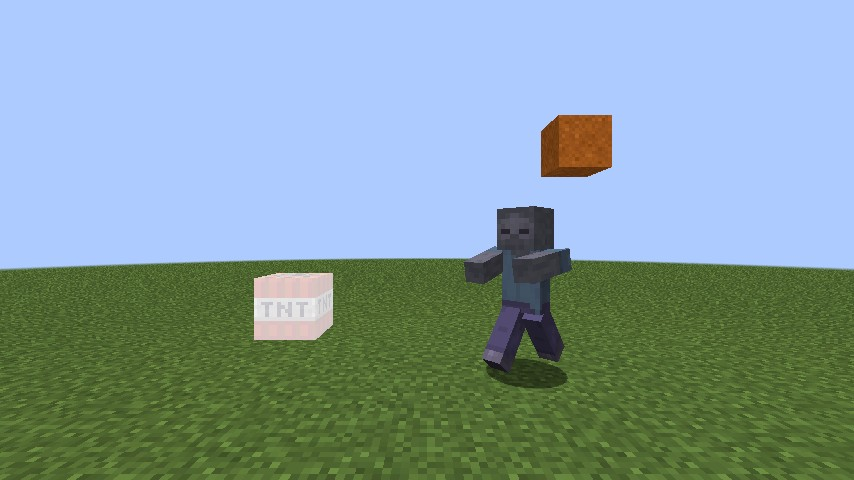
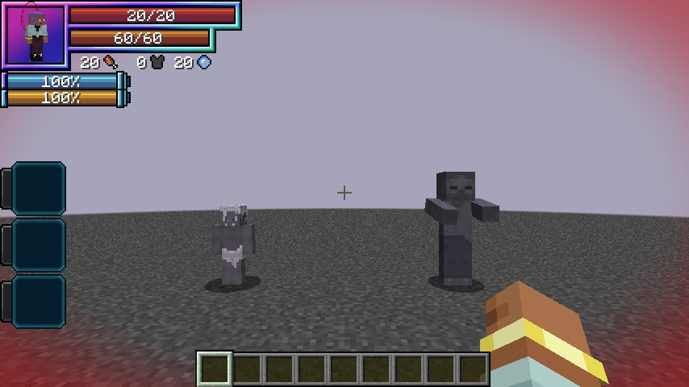
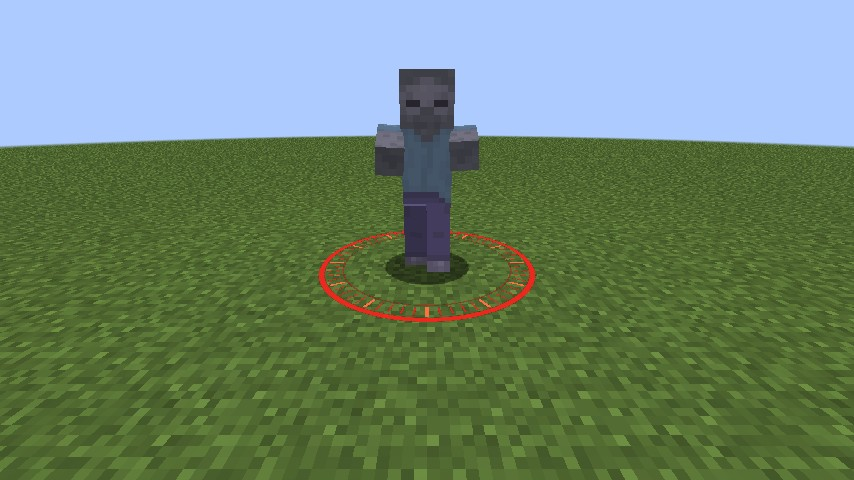
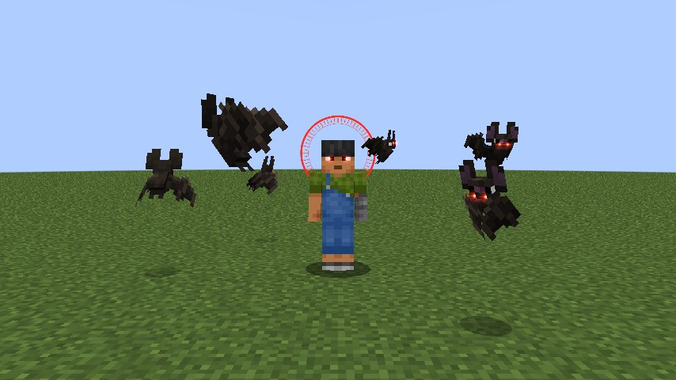
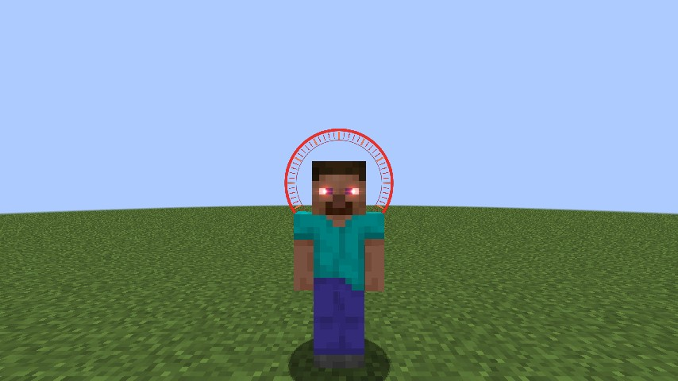
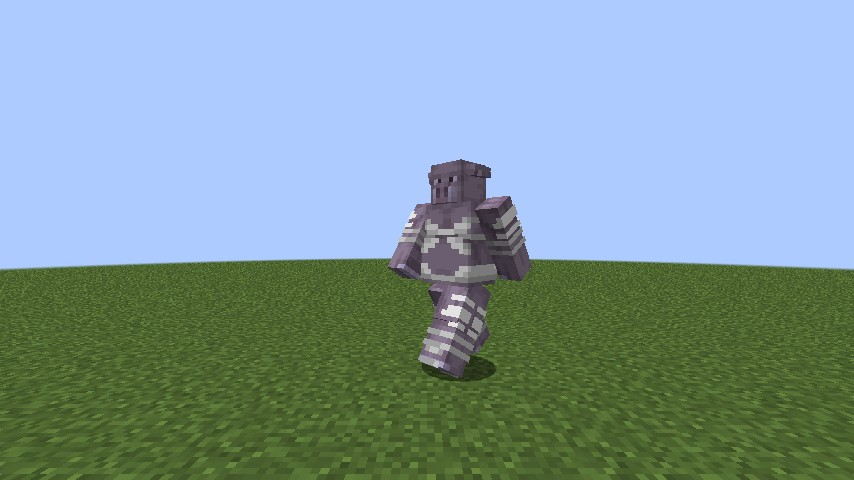
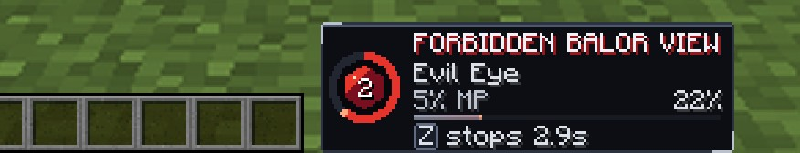

# Forbidden Balor View

Gasper Vladi's Sacred Gear, added in **0.2.13**: the Evil Eye that Stops the World. What it looks upon stops dead, hanging in the
air, until its time is up. It is a Tensura **Unique Skill** (`dxdtensura:forbidden_balor_view`) with no dragon inside: no voice, no
armour and nothing to summon. The gear shows only when it is used.

The stop is a real one, not a slow. A stopped thing doesn't move or animate at all, and holds its exact position and pose. It's
Minecraft's own `/tick freeze`, asked for each stopped thing, so Tensura's mobs and other mods' stop the same way.

<figure markdown="span">
  { loading=lazy }
  <figcaption>A zombie in mid-stride, lit TNT and a falling block, all stopped.</figcaption>
</figure>

<figure markdown="span">
  { loading=lazy }
  <figcaption>A big stop as its holder sees it: the world greys, with red at the edges.</figcaption>
</figure>

## Getting it

- **Only the reincarnation roll**, at the same odds as the other gears, and only for a
  [human](../getting-started/first-gear.md#only-in-humans).
- Learning it costs 30,000 magicules, as Tensura charges any unique skill. Any number of players can hold it.
- **One Sacred Gear per player.** A holder of another gear can't learn it: "You already carry a Sacred Gear."
- A holder reborn as another race in Tensura's race menu loses it. A Devil's Evil Piece keeps it, as Gasper's did, and so does
  Tensura's Vampire evolution.
- It goes with the [Holy Factor](../durandal/index.md#the-holy-factor). It isn't a Longinus, and it isn't draconic.
- [Rias](../races/rias.md) offers a holder her **Bishop**, as Gasper was, when a Bishop covers their worth and one is free.

## Modes

| # | Mode | Unlocks | Reach | Price | Cooldown, new to mastered |
|---|---|---|---|---|---|
| 0 | **Evil Eye** | from the start | 32 blocks | 5% | 30 s to 15 s |
| 1 | **Forbidden View** | 40% mastery | 24 blocks | 15% | 60 s to 30 s |
| 2 | **Stop the World** | 70% mastery | 20 blocks | 30% | 120 s to 60 s |

- **Evil Eye** stops the one thing you look at, and the first block in the way stops your look.
- **Forbidden View** stops everything in sight in a cone ahead of you, 90 degrees wide.
- **Stop the World** stops everything around you, even behind you or behind walls. On the [Vampire line](#the-vampire-line) it reaches 30
  blocks.

The mode key skips what isn't open yet.

<figure markdown="span">
  { loading=lazy }
  <figcaption>Evil Eye: a red clock ring on the ground under its one target.</figcaption>
</figure>

## The price

- **It's a share of your max magicules**, paid up front when something stops. It doesn't fall with mastery. The cooldown does, in a
  straight line to half at full mastery. Creative pays nothing.
- **A press that stops nothing costs nothing** and starts no cooldown, and the action bar says why: "Nothing in your sight.", "Goblin
  Lord shrugs off your gaze." (one thing too strong) or "Nothing here answers your gaze." (several).
- A mode still cooling does nothing.

## How long a stop lasts

On a target no stronger than you, **2 seconds** for a new holder, up to **6 seconds** at full mastery. A stronger target stops for
less, by its max EP (max magicules plus max aura) against yours:

| Target's max EP | The stop |
|---|---|
| Yours or less | The full time |
| Twice yours | Half the time |
| 4 times yours | A quarter of the time |
| 5 times yours or more | **Not stopped at all**, and it costs nothing |

- A target [Divide](../divine-dividing/index.md#divide) has cut is easier, since its max EP is lower.
- Things with no EP (arrows, spells, TNT, falling blocks) get the full time.
- **There's no list of bosses.** A boss follows the same sum, and no Longinus or holy sword is immune.
- **A player** is stopped for 3 seconds at most.

## The rest

A target rests for **as long as its last stop lasted**, and a player for at least 3 seconds. While it is stopped or resting, no press
and no misfire catches it: it isn't stopped again, and its stop isn't made longer. So nothing is ever frozen more than half the time,
whoever and however many are pressing.

- Things with no EP (arrows, TNT) don't rest, and neither does what died.
- A press that reaches only what is stopped or resting costs nothing, starts no cooldown and says "Time hasn't caught up with Goblin
  yet." If it also reaches something it can stop, that stops and is paid for.
- A rider and mount with one of them stopped or resting stay free together.

## What stops

**Mobs, arrows, Tensura's spells, TNT and falling blocks** all stop, at most 128 targets, nearest first.

- **What doesn't stop:** water, fire, redstone, crops, block entities and the day clock. Nor do dropped items, XP orbs, paintings, item
  frames, lightning, the Longinus Smasher's beam, the Power of Destruction Rias fires in her hunts, or Rias.
- **A Barrier's faces and a breath's pieces are no targets.** Your look passes through them to what is behind, and only the Barrier
  itself can be caught.
- **An Evil Centipede or a Tempest Serpent is its head.** A body segment in your look, cone or radius catches the head, the head's EP
  decides, and the whole creature stops together for the head's time.
- **A rider and its mount stop together.** If anything on the stack can't be stopped, none of it is.

## Who is spared

- **You, your pets, your subordinates and your Tensura allies**, and anything whose owner is spared: your own arrows keep flying, the
  TNT you lit too, and a friend's Holy Barrier, Water Wall or Kasha. An enemy's stops.
- **Never stopped by anything:** an invulnerable entity, a player in creative or spectator, one in a cutscene or with Ddraig's Bargain
  open, and the White Dragon Emperor in the middle of a change.
- **A player stops only where you could hurt them**, with PvP on.

## A stopped player

They hang where they are. They can't move, look, attack, use, change the hotbar or press a skill. A hold in progress is dropped, and a
key let go does nothing. Menus and chat stay open, and their own effects and timers run on.

A key still held does nothing either: a stopped dragon's walk clears no blocks, a cat spends no air step, and Albion's jewel isn't
channelled. Nothing can mount a stopped horse, and nothing stopped can mount or board anything.

## Hitting a stopped target

- **Damage lands at once**, through the normal hit with its armour, barriers and resistances as they stand, and anyone can hit it.
  Swords and beams land at the rate they always do.
- **The knockback waits.** Every push is added up, and when time resumes the target is thrown by the sum, with a small burst and a soft
  crack. Any other push on it in between is lost.
- A stopped target that dies is let go at once, with its knockback.

## How a stop ends

- Its time runs out.
- The holder who owns it dies, logs out or changes dimension.
- The target dies, is removed or changes dimension.

Stops aren't saved, so a restart ends them. There's no early release.

## Misfires

Until **40% mastery** the eye isn't yours to command. A hit that takes you from 30% of your max health or above to below it, and leaves
you alive, sets it off by itself, at most once a minute and never in creative. Any damage counts, a fall or fire too.

"You panic. The eye opens by itself."

- It stops everything around you, with Stop the World's reach and your mastery's time, **friends and pets too** (players only where you
  could hurt them).
- It takes Stop the World's price, or whatever magicules you have, starts Evil Eye's cooldown and earns no mastery.
- One that finds nothing, or only what is too strong, stopped already or resting, costs nothing and doesn't use up the minute.

## Mastery

You earn 8 points for a stop that caught something (not for a Training Dummy or an armour stand alone) and 1 for a hit that took health
from a target you stopped, at most once every 2 seconds. That's about 40 minutes of steady fighting. A line in chat marks 40%, 70% and
full mastery.

## The Vampire line

Gasper's bats come from his vampire half. A holder on Tensura's Vampire line (Ghoul, Vampire, Vampire Lord, Vampire Overcomer, Divine
Vampire) gets more from Stop the World:

- It reaches **30 blocks**, not 20.
- **Six small dark bats** circle you at about 2.5 blocks, each with your two red lights.

A misfire keeps the plain 20 blocks and brings no bats.

<figure markdown="span">
  { loading=lazy }
  <figcaption>Stop the World on the Vampire line, with the bats and the clock ring.</figcaption>
</figure>

## The look

Nothing is painted on your skin.

- **While one of your stops runs**, two red lights glow at your eyes, seen by others and not in your own first person.
- **Forbidden View, Stop the World and a misfire** also turn a red clock ring behind your head.
- **A stopped thing** is drained to a cold grey-violet, while its armour and held items keep their colours.
- **Your screen** gets red edges while your stop runs, and the world greys too on a big stop. When you are the one stopped it is grey with
  no red.
- A red spark and a thin ring leave your eyes as a stop starts, and two sounds mark the stop and the resume.

A shader pack replaces the drain with a flat tint, and the screen's edges and grey stay off.

<figure markdown="span">
  { loading=lazy }
  <figcaption>The two lights and, on a big stop, the ring.</figcaption>
</figure>

<figure markdown="span">
  { loading=lazy }
  <figcaption>A Tensura Orc, stopped and drained.</figcaption>
</figure>

## The panel

Right of the hotbar, while one of your stops runs or a mode is cooling, in steel and red:

- the ring round the eye is the time left on your longest stop, otherwise the longest cooldown, dimmed;
- the title **FORBIDDEN BALOR VIEW** (BALOR VIEW on a narrow screen);
- the slotted mode;
- its price and your mastery %;
- the mastery bar, gold once mastered;
- the key, with the seconds that mode stops at equal EP.

<figure markdown="span">
  { loading=lazy }
  <figcaption>The panel, 2 seconds left on an Evil Eye.</figcaption>
</figure>

## In Lore mode

In a world with [Lore mode](../lore-mode.md) on, every stop lasts **twice as long**. A player is still stopped for 3 seconds at most.

## Settings

The numbers are in [`[balor_view]`](../reference/configuration.md#balor_view).
