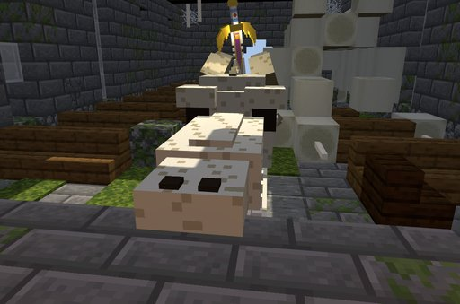

# Ascalon

Saint George's dragon-slaying sword. Anyone can wield it, but a Boosted Gear holder can keep it inside the gauntlet and
fight with its blade coming out of their fist.

## Finding it

Ascalon waits in a **ruined church**: a chapel in plains, meadows and forests, about as rare as a pillager outpost.
Inside, a dragon's skeleton lies across the nave, and Ascalon is driven down through its skull at the chancel steps,
glowing under a hole in the roof.

```
/locate structure dxdtensura:ascalon_church
```

<div class="grid" markdown>

<figure markdown="span">
  { loading=lazy }
  <figcaption>A ruined church</figcaption>
</figure>

<figure markdown="span">
  { loading=lazy }
  <figcaption>Ascalon, driven through the dragon's skull</figcaption>
</figure>

</div>

**Drawing it.** Use the skull.

- The **first church drawn from in a world gives the true Ascalon**. Every later church gives an **Ascalon Replica**.
- A Boosted Gear holder with the gauntlet out gets it straight into the gear. Anyone else gets it in hand.
- The empty skull can then be mined with a pickaxe and kept as a trophy, the **Dragon's Skull**.

## The sword

| | Ascalon | Ascalon Replica |
|---|---|---|
| Type | Tensura long sword, High Magisteel strength (22, two-handed) | the same |
| Durability | unbreakable, fire-proof, never despawns when dropped | the same |
| Dragon Slayer holy strike | +100% of the hit on dragons | +50% of the hit on dragons |

**Dragon Slayer.** A hit on a dragon adds a holy strike. Dragons are:

- the Ender Dragon (and whatever data packs add to `#dxdtensura:draconic`);
- the Dragonewt, True Dragonewt and Divine Dragon races;
- anyone holding a Heavenly Dragon's Sacred Gear (the Boosted Gear).

**It burns dragons.** A dragon holding Ascalon in either hand loses **5% of max health a second** to holy light, never
below one heart. That includes Boosted Gear holders: Ddraig warns you the first time.

**Devils too.** Ascalon burns a [Devil](../races/devil.md#holy-things) who holds it, as it burns a dragon, and its holy
strike hits Devils.

## The Blade mode

The **Ascalon Blade** mode (the Boosted Gear's mode 5) appears while you hold Ascalon or keep it in the gear.

- **Press it holding Ascalon** to put the sword into the gear.
- **Press again** to slide the blade out, or back in.
- **Sneak and press** to take the sword back out: into your hand, else your inventory, else at your feet. Handy to lend
  it.

## The blade

The blade comes out of the back of your fist, on every form and on the Scale Mail. Hinged at the knuckles, it points
ahead like a held sword while your arm hangs, and lines up with your forearm as you strike.

With the blade out and your **main hand empty**, your hand hits with it: **+2 attack**, and the sword's speed and reach.
These count as **bare-handed hits** for the gear: the Explosion multiplies them, they train mastery, fill the rage meter,
and carry the holy strike on dragons. Holding anything folds the blade away.

## Transfer into the blade

*Boosted Gear Gift.* **Sneak** and Transfer with the blade out, and your stacks go into the blade for **30 seconds**.
Its holy strike on dragons is ×2ⁿ for that time (the higher of the charge and a running Explosion, never both). It
releases the Boost like any Transfer. The panel shows `Ascalon ×32  25s` in green.

## Kept safe

- The stored sword stays through death and dismissing the gauntlet.
- A clone's copy of the gear never has it.
- Losing the Boosted Gear drops it at your feet.
