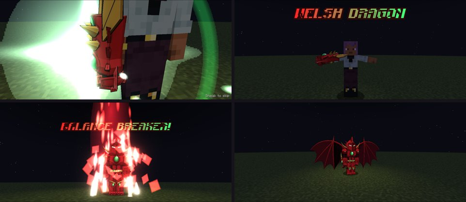
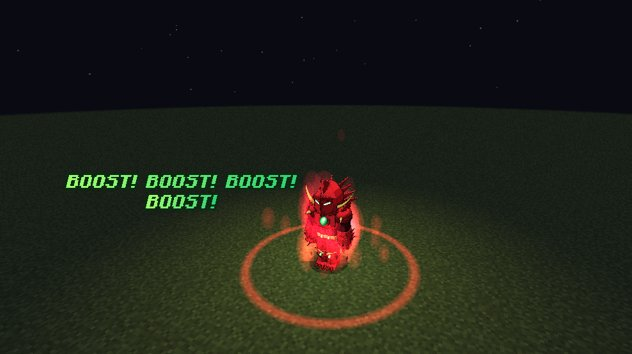

# Balance Breaker

The Boosted Gear's limit, broken: the **Red Dragon Emperor's Scale Mail** over your whole body, with dragon wings on
its back. It is the Boosted Gear's mode 4.

<figure markdown="span">
  { loading=lazy }
  <figcaption>The Scale Mail (smooth look) next to a player.</figcaption>
</figure>

## Awakening

Balance Breaker starts locked. There are two ways to unlock it.

**A crisis, in the Boosted Gear Gift.** While an Explosion runs, a hit from a **worthy enemy** that leaves you alive
under **30% health** is a crisis, and Ddraig rolls the awakening (at most once per Explosion). A worthy enemy is another
player, a boss, or anything with at least half your EP.

| Crisis | Chance |
|---|---|
| First | 10% |
| Each miss | +10% |
| Tenth | certain |

A miss gets "Not yet, partner. But I can feel it." A success puts the armour on ("Welsh Dragon Balance Breaker!"),
heals you to half health, and unlocks the Balance Breaker mode for good.

**Ddraig's Bargain.** Before the awakening, Ddraig may offer you a deal when you're close to death. It unlocks an early,
limited Scale Mail at a permanent price. See [Ddraig's Bargain](ddraig.md#ddraigs-bargain).

## Putting it on

1. **Press Balance Breaker.** A countdown starts while you keep fighting: **10 s** at first, trained down to **1 s**
   after 10 minutes worn in total. Pressing again cancels it at no cost.
2. **At zero the Scale Mail forms**, unless the gauntlet was dismissed or another transformation (or Magic
   Interference) is on you.
3. **The cutscene.** The camera takes over. The first time it is a full one of about 7 seconds: the jewel blazing on
   the gauntlet you bring to your chest, "WELSH DRAGON" with your arms spread, the armour forming with "BALANCE
   BREAKER!", then the wings spread in a wide shot. After that it is a short one of 3 seconds.
    - You stand still and can't be hurt while it plays.
    - **Sneak** skips the rest; the armour still forms.
    - Players around you see the poses and effects but keep their own camera.
    - The client setting `cutscenes` turns them off for you, and the armour forms at once.

<figure markdown="span">
  { loading=lazy }
  <figcaption>The first-time cutscene: the jewel, "WELSH DRAGON", the armour forming, and the wings.</figcaption>
</figure>

## Wearing it

| | |
|---|---|
| Armour | +20 armour, +8 toughness |
| Knockback resistance | +50% |
| Speed | a little faster |
| Flight | creative-style; the wings unfold with a whoosh as you take off, and you lean into it flying forward |
| Upkeep | 0.6% of your max magicules per second |
| Time limit | 3 minutes |

Your worn armour, elytra and cape are hidden under it.

**The Boost inside.** Charging starts by itself at the normal pace, and your bare fist gets the ×2ⁿ the whole time, no
Explosion needed. There is no body strain. Dragon Shot and Transfer still spend the stacks, and charging just carries
on. The Boost press does nothing in the armour.

## The rage meter

Taking hits fills it: a hit for your whole health bar gives 35%, counted before armour. Each bare-handed hit you land
adds a little too. It drains after 10 seconds out of a fight.

When it is full: **"Boost! Boost! Boost!"** Quick half-stack boosts (×1.41 each) take you **one stack over your cap**
(×128 in the Gift form), and that extra stack stays until the armour comes off. A dark red aura wraps you, pulsing with
each boost, and the edges of your screen throb red.

<figure markdown="span">
  { loading=lazy }
  <figcaption>A rage burst: "BOOST! BOOST! BOOST!"</figcaption>
</figure>

!!! danger "Near death"
    If the rage meter fills while you are under 20% health, something else answers instead. See
    [Juggernaut Drive](juggernaut-drive.md).

## Ending it

Press the mode again or dismiss the gauntlet. Your stacks are released (the Boost cooldown starts) and Balance Breaker
goes on a cooldown that depends on how it ended:

| How it ended | Balance Breaker cooldown |
|---|---|
| You let go within the first 1.5 minutes | 60 s |
| You let go after that | 5 minutes |
| The 3 minutes ran out | 5 minutes |
| Death, or something removed it | 60 s |
| **Your magicules ran out**: the armour shatters | 5 minutes, plus Weakness and Slowness for 60 s |
| The early Scale Mail from the Bargain ended | 10 minutes |

Letting go yourself with **under 5 seconds of magicules left** counts as running out. Ddraig warns you when you have
about 20 seconds left.

## The panel

In the armour the Sacred Gear panel reads **SCALE MAIL**:

- a gold ring for the countdown;
- the rage meter under your stacks, with the time left; the clock turns orange once letting go would cost the 5 minute
  cooldown;
- an orange ring and a gold extra pip during a rage burst;
- your Balance Breaker key, with Cancel or Release.

!!! note "Operators and testing"
    `/tensura edit ability mastery @s dxdtensura:boosted_gear max`, then get hit hard by another player or a boss during
    an Explosion until it awakens.
