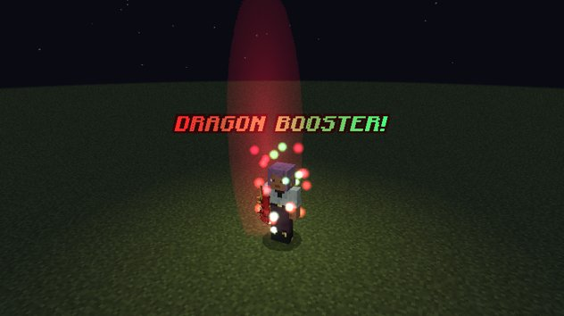
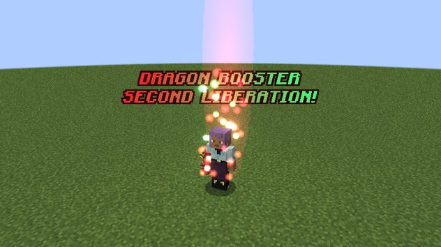

# Forms and mastery

The Boosted Gear grows with you. Using it earns Tensura **mastery** (the bar in Tensura's skill screen, out of 1,000),
and at set points the gauntlet evolves into a new form with new modes.

## The three forms

| Form | Look | When | Unlocks | Most stacks |
|---|---|---|---|---|
| **Initial** | A red gauntlet with two gold horns | from the start | Boost, Summon / Dismiss | 2 (×4) |
| **Base** | A crimson dragon claw | 40% mastery (400) | Dragon Shot; Ddraig's [Bargain](ddraig.md#ddraigs-bargain) can be offered | 5 (×32) |
| **Boosted Gear Gift** | Gold blades and spikes, a second gem | Mastered (1,000) | Transfer; [Penetrate](penetrate.md); the [Balance Breaker](balance-breaker.md) awakening | 6 (×64) |

When the gauntlet evolves, a column of red and green light streams up around you and bursts as the new form appears,
and chat tells you which mode awakened. Reaching the Base form plays the summon call, and reaching the Gift plays
"Second Liberation".

<div class="grid" markdown>

<figure markdown="span">
  { loading=lazy }
  <figcaption>Evolving into the Base form</figcaption>
</figure>

<figure markdown="span">
  { loading=lazy }
  <figcaption>Evolving into the Boosted Gear Gift</figcaption>
</figure>

</div>

## Earning mastery

| You do | Mastery |
|---|---|
| Gain a Boost stack | 1 point per stack |
| Land a melee hit during an Explosion | 1 point per hit, for the first 10 hits of each Explosion |
| Fire a Dragon Shot or Transfer that spends n stacks | n points |

All of it is **doubled by default** (`masteryGainMultiplier`). Holding the gauntlet without using it earns nothing.

## What mastery changes

- **The forms** above, with their modes and stack caps.
- **Body strain eases.** Each held stack takes 5% of your max health at mastery 0, easing to 2.5% at full mastery.
  See [Boost](modes.md#body-strain).
- **The Gift opens the late game:** Penetrate, Transfer, and the Balance Breaker awakening.

## Classic or smooth look

Every form comes in two looks: the smooth, outlined models (the default) and the classic blocky models. The first time
you hold the Boosted Gear, a screen asks which you want, with a picture of each. You can switch later with the client
setting `modelStyle`. See [Looks, cutscenes and effects](../reference/looks.md#model-style).

!!! note "Operators and testing"
    Set the mastery directly to see each form:

    ```
    /tensura edit ability mastery @s dxdtensura:boosted_gear 400   # Base form
    /tensura edit ability mastery @s dxdtensura:boosted_gear max   # Boosted Gear Gift
    /tensura edit ability mastery @s dxdtensura:boosted_gear 0     # back to Initial
    ```
