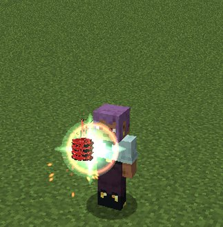

# Boosted Gear

The Red Dragon Emperor's Sacred Gear, with **Ddraig** sealed inside: a crimson gauntlet on your right arm that doubles
your power every 10 seconds. It is a Tensura **Unique Skill** (`dxdtensura:boosted_gear`).

The gauntlet grows with you. It starts as a plain red gauntlet with two gold horns, becomes a crimson dragon claw, and
finally the Boosted Gear Gift. Further on wait the Scale Mail, the dragon form of Juggernaut Drive, and powers taken from
its rival, Albion.

## Modes

| # | Mode | Unlocks | What it does |
|---|---|---|---|
| 0 | **[Boost](modes.md#boost)** | from the start | Charge a stack (×2) every 10 s, then press again for "Explosion!": your bare fist hits ×2ⁿ for 15 s |
| 1 | **[Transfer](modes.md#transfer)** | Boosted Gear Gift (100% mastery) | Give your stacks to a creature or ally you look at |
| 2 | **[Dragon Shot](modes.md#dragon-shot)** | Base form (40% mastery) | Fire a red energy ball that grows with your stacks |
| 3 | **Summon / Dismiss** | from the start | Put the gauntlet away, or bring it back |
| 4 | **[Balance Breaker](balance-breaker.md)** | awakening in a crisis, or Ddraig's Bargain | Put on the Scale Mail |
| 5 | **[Ascalon Blade](ascalon.md#the-blade-mode)** | while you hold Ascalon or keep it in the gear | Store Ascalon in the gear and slide its blade out of your fist |
| 6 | **[Divide](divide.md)** | taking Albion's power | Divide an enemy with your left hand, in the Scale Mail only |

The numbers are the mode numbers for `/ability set dxdtensura:boosted_gear <mode> <slot>`.

## Summoning and dismissing

<figure markdown="span">
  { loading=lazy }
  <figcaption>Summoning the gauntlet: the jewel's green flash and a red ring.</figcaption>
</figure>

- **While the gauntlet is away, any press summons it.** "Boosted Gear!", at no cost and with nothing else happening.
  Summoning is silent in the Initial form and plays the summon call from the Base form on.
- **The Summon / Dismiss mode puts it away** ("Boosted Gear dismissed."). It costs nothing and has no cooldown.
- Dismissing while charging clears your stacks. Dismissing during an Explosion counts as releasing the power, so the
  Boost cooldown starts.
- Tensura's cooldown badges keep counting while the gauntlet is away.

!!! info "The Passive Ability toggle"
    The skill's **Passive Ability** toggle in Tensura's Status Menu does **not** summon or dismiss the gauntlet. From
    the Boosted Gear Gift on, it switches [Penetrate](penetrate.md).

## The Sacred Gear panel

While the gauntlet is out, the panel to the right of your hotbar shows:

- a **ring** around the gauntlet's green jewel, counting down to the next stack while you charge, the seconds left in an
  Explosion, or the Boost cooldown;
- the gear's name;
- your **stacks** as red diamonds, with your power (`×2ⁿ`);
- your **form**, your mastery percentage, and a bar of your progress to the next form;
- the key of your first Boosted Gear slot, with its mode.

The panel changes in the [Scale Mail](balance-breaker.md#the-panel), in [Juggernaut Drive](juggernaut-drive.md#the-panel)
and with [Divide](divide.md). Only you see it, and **F1** hides it. On a screen too narrow for it, a one-line counter
appears left of the hotbar instead.

## Read next

- **[Forms and mastery](forms-and-mastery.md)**: how the gauntlet evolves.
- **[Boost, Transfer and Dragon Shot](modes.md)**: the core modes, with every number.
- **[Balance Breaker](balance-breaker.md)**: the Scale Mail.
- **[Ddraig and his Bargain](ddraig.md)**: your partner, and his deal.
- **[Juggernaut Drive](juggernaut-drive.md)**: the forbidden dragon form.
- **[Penetrate](penetrate.md)**: blows that go through defences.
- **[Ascalon](ascalon.md)**: the dragon-slaying sword in your gauntlet.
- **[Divide](divide.md)**: Albion's power in the Boosted Gear.

## Clones and copies

A copy of the skill on another creature starts idle. Tensura's Body Double and Reaper clones copy all of your skills,
but a clone made during your Explosion gets no stacks and no ×2ⁿ, and an Explosion never outlasts its 15 s.
