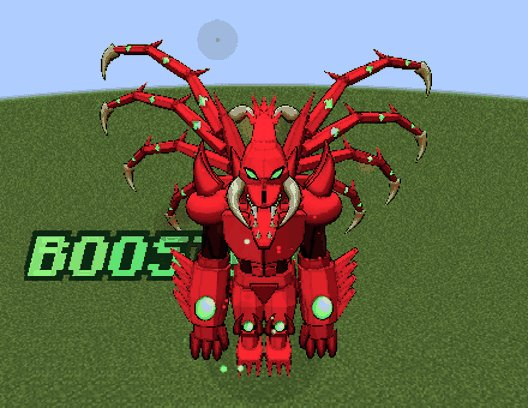
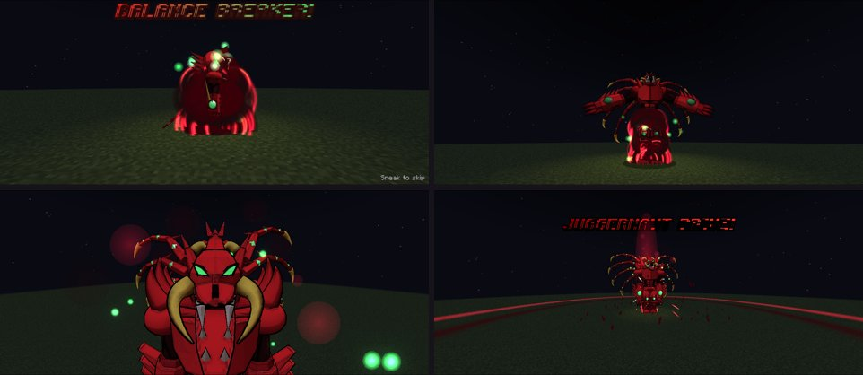
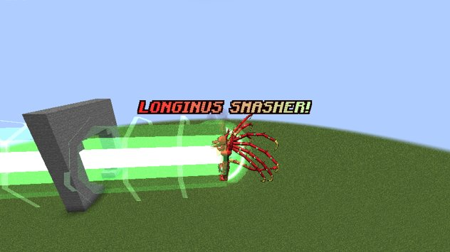
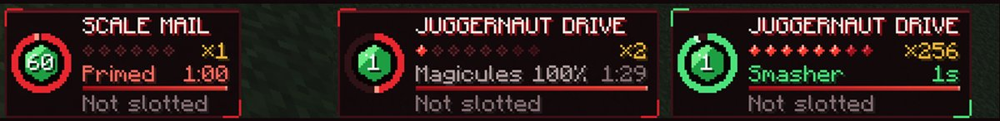

# Juggernaut Drive

The forbidden power sealed in the Boosted Gear. Inside the Scale Mail, the grudges of the gear's past hosts take you
over and you become a **dragon four times your size**. It costs a piece of your life every time.

<figure markdown="span">
  { loading=lazy }
  <figcaption>The dragon.</figcaption>
</figure>

## The first one happens to you

You don't choose your first Drive. Inside the [Scale Mail](balance-breaker.md), when the **rage meter fills while you
are under 20% health**, the past hosts chant through you instead of the rage burst ("Partner, no! Those are their
words!") and the dragon forms.

When it's over, Ddraig teaches you the words: the five lines of the incantation in chat (click one to put it in your
chat box) and a book to keep. Lost the book? `/dxdtensura incantation` gives you a new one.

## The incantation

After that you speak it yourself.

- In the Scale Mail, **type the five lines in chat**, one at a time, within 30 seconds of each other.
- Case, punctuation and spacing don't matter, but every word must be right, with nothing before or after it.
- Each line shows as a crimson broadcast to players within 64 blocks, the past hosts answer, and the last line is spoken
  in unison.
- A line off by a letter or two gets Ddraig's "Those aren't the words, partner." and stays plain chat.

**Primed, then released.** The finished incantation primes the Drive for **60 seconds**: press your **Balance Breaker**
key to release it, wherever you are. While you chant and while it is primed, your aura grows and green orbs float out of
the Scale Mail around you.

## The cutscene

As the dragon forms, the camera takes over. The first time it is a full one of about 7 seconds: a boiling crimson mass
swallows you, the dragon rises out of it with its wing-arms spread, its gems and eyes light up green in a close-up of its
head, then "JUGGERNAUT DRIVE!", the burst and its first roar as it rears up. After that it is a short one of 3 seconds.
As with Balance Breaker you stand still and can't be hurt, **Sneak** skips it, and turning `cutscenes` off forms the
dragon at once.

<figure markdown="span">
  { loading=lazy }
  <figcaption>The first-time cutscene: the crimson mass, the rise, the gems and eyes, and the burst.</figcaption>
</figure>

## The price

!!! danger "It costs your life"
    Each Drive takes **10% of your max health for good**, down to half. At half, Ddraig refuses another one.

- The debt shows as the **Shortened Lifespan** effect. `/effect clear` doesn't remove it: the effect follows the debt.
- **Becoming a dragon race** (Dragonewt and up) clears the debt.
- [Divides in the Boosted Gear](divide.md) count toward the same half.
- Operators can wipe the debt with `/dxdtensura lifespan clear [players]`.

Every Drive **heals you to full** as the dragon forms, right after taking its price.

## The dragon

- **Four times your size**: hitbox, reach and camera too.
- **+10 armour, +4 toughness**, more knockback resistance, speed, step height and jump.
- **It bursts out of tight spaces**, breaking the blocks in its way (except unbreakable ones; it follows the Dragon Shot
  block-breaking setting and `mobGriefing`).
- **The Boost climbs a stack a second**, for free, to **two stacks over your cap** (×256 in the Gift form).
- **Every bare-handed hit sends a shockwave** through everything around the target, for half the hit.
- **Your hand is the dragon's claw.** What you held is put away and items can't be used.
- **It can't fly.** The Scale Mail's flight is gone while you're the dragon; in the air, you fall.
- **It walks with slow, heavy strides.** Each footfall thuds, kicks up dust and shakes the screen of anyone within
  16 blocks, harder when it charges. Standing still it breathes, and after 6 seconds it stretches its wing-arms out wide
  and folds them back, again every 20 seconds.
- **The claws strike on their own** every 1.5 seconds at the nearest living thing within 8 blocks of the body, sparing
  your tamed pets, Tensura subordinates and teammates. A wing-arm lashes at it.
- **The dragon roars** every 20 to 40 seconds, flinging its wing-arms wide, but never over a Smasher's charge or beam.

## Longinus Smasher

With your stacks full, press the **Dragon Shot** key:

1. The chest plates part and the core charges through Ddraig's two lines, about **16.7 seconds**. You can still move and
   turn.
2. A green-white beam fires where you look: **64 blocks long, 5 blocks around**, dealing **40 × 2ⁿ** to everything in
   it. That is **10,240** at ×256.
3. It is an energy beam: armour and Physical Attack Nullification don't stop it. It bores a tunnel until it meets a
   block it can't break.

<figure markdown="span">
  { loading=lazy }
  <figcaption>Longinus Smasher.</figcaption>
</figure>

Each shot costs **10% of your max magicules** and spends the stacks; they come back a stack a second.

## No way out

- The other keys do nothing.
- It burns **3% of your max magicules a second** (nothing refills them in the dragon, not even a magicule-dense area),
  then **3% of your max spiritual health a second**.
- **There is no time limit.** It ends when Magic Interference (or a dispel) reaches it, or when your spiritual health
  reaches 10% of its max. It never kills you.
- In **creative** it costs nothing (no fuel, no life, never refused) and stops after 4 minutes, for testing.

## After it

The dragon shrinks back in a burst of red mist and you drop to your knees:

| Aftermath | How long |
|---|---|
| Weakness II, Slowness II, Mining Fatigue | 2 minutes |
| Tensura's Fragility | 2 minutes |
| Paralysis | 3 seconds |
| **Spent Dragon**: max magicules and aura halved | 2 minutes |
| **The gear goes silent**: it can't be summoned | 10 minutes |

A death in the dragon puts the aftermath off until you respawn.

!!! note "Operators"
    The silence is the Summon / Dismiss mode's Tensura cooldown, so Tensura's ability cooldown command can set it to 0.

## The panel

<figure markdown="span">
  { loading=lazy }
  <figcaption>Primed in the Scale Mail, then the dragon's fuel, then the Smasher charged.</figcaption>
</figure>

The ring counts the prime down. In the dragon the panel reads **JUGGERNAUT DRIVE**, with your stacks and the two extra
in deep crimson, the fuel (magicules in red, then life in violet) with how long it lasts, the Smasher's charge in green,
and your Dragon Shot key as Longinus Smasher. While the gear is silent, the panel stays, dimmed, counting the minutes
down.
