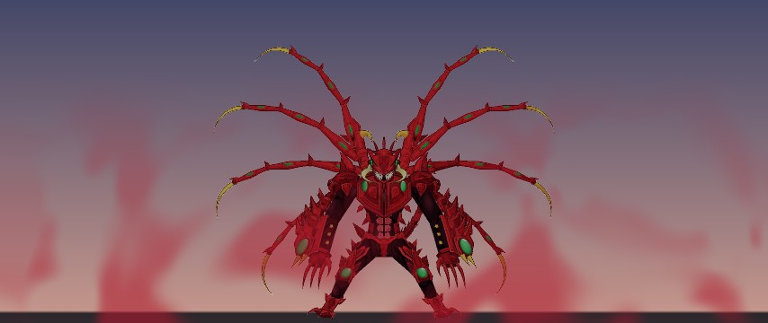
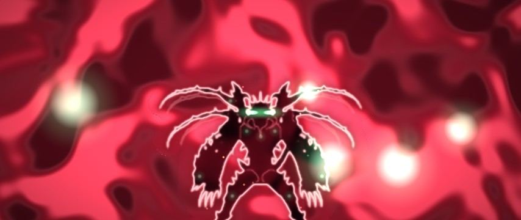
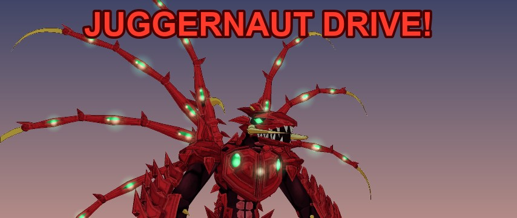
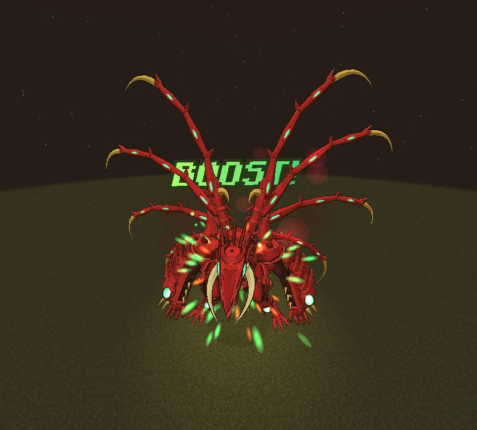
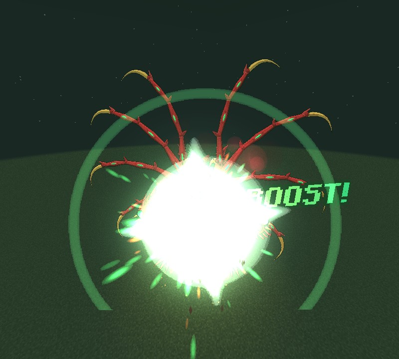
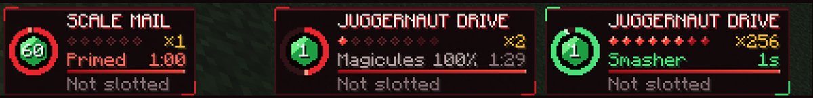

# Juggernaut Drive

The forbidden power sealed in the Boosted Gear. Inside the Scale Mail, the grudges of the gear's past hosts take you
over and you become a **dragon four times your size**. It costs a piece of your life every time.

<figure markdown="span">
  { loading=lazy }
  <figcaption>The dragon, remade in 0.4.0, as its cutscene shows it.</figcaption>
</figure>

## The first one happens to you

You don't choose your first Drive. Inside the [Scale Mail](balance-breaker.md), when the **rage meter fills while you
are under 20% health**, the past hosts chant through you instead of the rage burst ("Partner, no! Those are their
words!") and the dragon forms.

When it's over, Ddraig teaches you the words: the five lines of the incantation in chat (click one to put it in your
chat box) and a book to keep. Lost the book? `/dxdtensura incantation` gives you a new one.

## The incantation

After that you speak it yourself.

- In the Scale Mail, **type the five lines in chat**, one at a time, within 30 seconds of each other.
- Case, punctuation and spacing don't matter, but every word must be right, with nothing before or after it.
- Each line shows as a crimson broadcast to players within 64 blocks, the past hosts answer, and the last line is spoken
  in unison.
- A line off by a letter or two gets Ddraig's "Those aren't the words, partner." and stays plain chat.

**Primed, then released.** The finished incantation primes the Drive for **60 seconds**: press your **Balance Breaker**
key to release it, wherever you are. While you chant and while it is primed, your aura grows and green orbs float out of
the Scale Mail around you.

## The cutscene

As you release it, the camera takes over. The first time it is a full one of about **34 seconds**, drawn like the anime
and cut to the Drive's own song (since 0.4.0): the red mass boils up round you and you become a dark shape with a hot
outline, changing piece by piece into the dragon. The head, then an arm splitting into its plates and claws, the talons,
the spires and tail, and the wing-arms bursting out, until the real dragon stands in the world, its jewels light, and
"Juggernaut Drive!" and its first roar ring out. After that it is a short one of 3 seconds.

As with Balance Breaker you stand still and can't be hurt, **Sneak** skips it, and turning `cutscenes` off forms the
dragon at once. The dragon waits for its cutscene: it doesn't strike, roar or grow Boost while it plays, and the Drive's
clock and fuel start when it ends. Players near you see the red mass swell round you.

<figure markdown="span">
  { loading=lazy }
  <figcaption>The drawn part: you become a dark shape changing into the dragon.</figcaption>
</figure>

<figure markdown="span">
  { loading=lazy }
  <figcaption>"Juggernaut Drive!"</figcaption>
</figure>

**The song** starts with either cutscene and plays on while you're the dragon, for you and anyone near, on the Jukebox
volume slider in place of the game's music. The client setting `juggernautMusic` turns it off.

## The price

!!! danger "It costs your life"
    Each Drive takes **10% of your max health for good**, down to half. At half, Ddraig refuses another one.

- The debt shows as the **Shortened Lifespan** effect. `/effect clear` doesn't remove it: the effect follows the debt.
- **Becoming a dragon race** (Dragonewt and up) clears the debt.
- [Divides in the Boosted Gear](divide.md) count toward the same half.
- A [Nekoshou's Ki Healing](../races/nekomata.md#ki-healing) gives a little of it back, 1 point every 20 minutes.
- Operators can wipe the debt with `/dxdtensura lifespan clear [players]`.

Every Drive **heals you to full** as the dragon forms, right after taking its price.

## The dragon

- **Four times your size**: hitbox, reach and camera too.
- **+10 armour, +4 toughness**, more knockback resistance, speed, step height and jump.
- **It bursts out of tight spaces**, breaking the blocks in its way (except unbreakable ones; it follows the Dragon Shot
  block-breaking setting and `mobGriefing`).
- **It breaks what would stop it.** As it walks, a wall or cliff too tall to step over gets a hole the size of its body, with no drops.
  What it can step onto (up to 2 blocks) stays, so hills and stairs work as before. Bedrock, obsidian and blocks that hold items (chests,
  furnaces) never break. It also stops with `juggernautWalkBreaksBlocks`, `dragonShotBreaksBlocks`, `mobGriefing` or Tensura's
  `skillGriefing` off, in the Labyrinth and on land a claim mod protects.
- **The Boost climbs a stack a second**, for free, to **two stacks over your cap** (×256 in the Gift form).
- **Every bare-handed hit sends a shockwave** through everything around the target, for half the hit.
- **Your hand is the dragon's claw.** What you held is put away and items can't be used.
- **It can't fly.** The Scale Mail's flight is gone while you're the dragon; in the air, you fall.
- **Its head is a long helm** with the gold face horns and the mouth open. Remade in 0.4.0: green jewels on its
  breastplates, red shoulder spikes, and a head that looks up to 25 degrees.
- **A fire dragon's armour**, as in the Scale Mail: every hit lands 30% lighter, vanilla fire does nothing, and
  Tensura's flame spells and skills hurt half.
- **It stands hunched like a beast:** bent forward from the hips, its fan of wing-arms raised, its claws hanging, its
  legs planted wide, its head still looking where you look.
- **It walks with a heavy stomp,** a footfall every half second, each one nodding the body and dropping the fan, and
  **sprinting it runs on two legs**, quicker and deeper in the hunch. Each footfall thuds, kicks up dust and shakes the
  screen of anyone within 16 blocks, harder when it sprints. Standing still it breathes, and after 6 seconds it opens its
  fan wide pair by pair and folds it back, again every 20 seconds. (The classic look keeps its old walk.)
- **The claws strike on their own** every 1.5 seconds at the nearest living thing within 8 blocks of the body, sparing
  your tamed pets, Tensura subordinates and teammates. A wing-arm lashes at it.
- **The dragon roars** every 20 to 40 seconds: it dips, then rears back and throws its head to the sky whatever you
  look at, its fan flared and its claws flung out. Never over a Smasher's charge or beam.

## Longinus Smasher

With your stacks full, press the **Dragon Shot** key:

1. The chest plates part and the core charges through Ddraig's two lines, about **16.7 seconds**. You can still move and
   turn. The dragon sets its feet and closes its fan round the core as it draws the power in: green and orange streaks,
   grit lifting off the ground, the jewels beating with each "Boost!", and it rises behind the swelling orb until it
   stands with its arms flung wide as the name is called. The world near it glows warm, then green (with the
   [anime lens](../reference/looks.md#the-anime-lens) on), and the screen shakes harder as the charge grows.
2. A beam opens out of the chest like a horn, a white core in a soft green edge with pale wisps winding round it, where
   you look: **64 blocks long, 10 blocks around**, dealing **40 × 2ⁿ** to everything in it. That is **10,240** at ×256.
   The shot throws the dragon back and kicks a ring of dust and rubble along the ground, and it sags, spent, as the beam
   thins to a thread.
3. It is an energy beam: armour and Physical Attack Nullification don't stop it. It bores a tunnel until it meets a
   block it can't break.

<figure markdown="span">
  { loading=lazy }
  <figcaption>The charge: the fan closed round the core, a "Boost!" on every beat.</figcaption>
</figure>

<figure markdown="span">
  { loading=lazy }
  <figcaption>The orb swelling before the shot.</figcaption>
</figure>

Each shot costs **10% of your max magicules** and spends the stacks; they come back a stack a second.

## No way out

- The other keys do nothing.
- It burns **3% of your max magicules a second** (nothing refills them in the dragon, not even a magicule-dense area),
  then **3% of your max spiritual health a second**.
- **There is no time limit.** It ends when Magic Interference (or a dispel) reaches it, or when your spiritual health
  reaches 10% of its max. It never kills you.
- In **creative** it costs nothing (no fuel, no life, never refused) and stops after 4 minutes, for testing.

## After it

The dragon shrinks back in a burst of red mist and you drop to your knees:

| Aftermath | How long |
|---|---|
| Weakness II, Slowness II, Mining Fatigue | 2 minutes |
| Tensura's Fragility | 2 minutes |
| Paralysis | 3 seconds |
| **Spent Dragon**: max magicules and aura halved | 2 minutes |
| **The gear goes silent**: it can't be summoned | 10 minutes |

A death in the dragon puts the aftermath off until you respawn.

!!! note "Operators"
    The silence is the Summon / Dismiss mode's Tensura cooldown, so Tensura's ability cooldown command can set it to 0.

## The panel

<figure markdown="span">
  { loading=lazy }
  <figcaption>Primed in the Scale Mail, then the dragon's fuel, then the Smasher charged.</figcaption>
</figure>

The ring counts the prime down. In the dragon the panel reads **JUGGERNAUT DRIVE**, with your stacks and the two extra
in deep crimson, the fuel (magicules in red, then life in violet) with how long it lasts, the Smasher's charge in green,
and your Dragon Shot key as Longinus Smasher. While the gear is silent, the panel stays, dimmed, counting the minutes
down.
