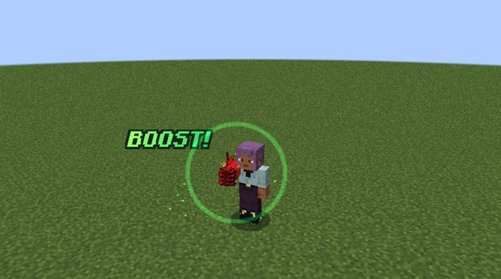
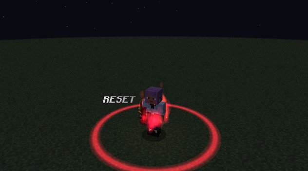
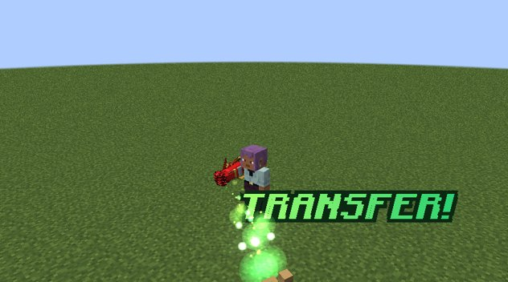
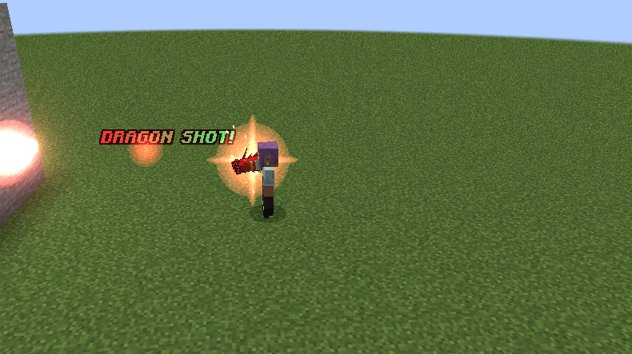

# Boost, Transfer and Dragon Shot

The Boosted Gear's core: build up power with **Boost**, then spend it in an **Explosion**, a **Transfer** or a
**Dragon Shot**. All numbers on this page are the defaults; a server can change them in the
[configuration](../reference/configuration.md#boosted_gear).

## Boost

**First press: charging.** Every 10 seconds you gain a **stack**, and each stack doubles your power: ×2, ×4, ×8 and on.
Each stack costs magicules, doubling each time. If you can't pay, the stacks wait until you can. While charging, the
power is only stored: it gives no bonus yet.

**Second press: "Explosion!"** For 15 seconds your **direct, bare-handed melee hits** deal ×2ⁿ damage, where n is your
stacks. The stacks are locked while it runs.

**When it ends: "Reset."** The stacks go back to 0 and Boost goes on a **30 second cooldown**.

A second press with 0 stacks just stops charging.

<figure markdown="span">
  { loading=lazy }
  <figcaption>BOOST!</figcaption>
</figure>

<figure markdown="span">
  { loading=lazy }
  <figcaption>EXPLOSION!</figcaption>
</figure>

<figure markdown="span">
  { loading=lazy }
  <figcaption>RESET</figcaption>
</figure>

!!! warning "Bare hands only"
    The Explosion multiplies your fist, nothing else. A held weapon, or any item in your main hand, gets no Boost. The
    gold power on the panel dims while your hand isn't empty. The one exception is [Ascalon's blade](ascalon.md#the-blade)
    coming out of the gauntlet, which counts as your fist.

### Stacks at a glance

| Stack | Power | Magicules for this stack | Dragon Shot damage | Reached by |
|---|---|---|---|---|
| 1 | ×2 | 100 | 10 | every form |
| 2 | ×4 | 200 | 20 | Initial form's cap |
| 3 | ×8 | 400 | 40 | |
| 4 | ×16 | 800 | 80 | |
| 5 | ×32 | 1,600 | 160 | Base form's cap |
| 6 | ×64 | 3,200 | 320 | Boosted Gear Gift's cap |
| 7 | ×128 | rage burst | 640 | the Gift in the [Scale Mail](balance-breaker.md#the-rage-meter), after a rage burst |
| 8 | ×256 | free | (the Smasher instead) | the Gift in [Juggernaut Drive](juggernaut-drive.md#the-dragon) |

### Body strain

Power has a price. Every stack you hold, while charging or exploding, takes **5% of your max health**, easing to
**2.5%** as your mastery grows. It never takes more than 75%. Your max health comes back when the power is released,
but health you already lost doesn't refill. The Scale Mail has no body strain.

### Releasing the power

Releasing your stored power always starts the 30 s Boost cooldown. That happens when:

- the Explosion ends;
- a Transfer or a Dragon Shot uses your stacks;
- you dismiss the gauntlet or die **during an Explosion**.

Dismissing or dying while **still charging** just clears the stacks, with no cooldown.

## Transfer

*Unlocks with the Boosted Gear Gift.*

<figure markdown="span">
  { loading=lazy }
  <figcaption>Transfer: the stream of power and TRANSFER! over the one who receives it.</figcaption>
</figure>

Gives your held stacks to the creature or player under your crosshair, up to **8 blocks** away. Allies are fine. They get
**Transferred Boost** at level n for **30 seconds**: everything they damage takes ×2ⁿ.

- If they also have their own Boost running, the higher of the two applies, never both multiplied.
- It spends your stacks and starts your Boost cooldown.
- A green-gold stream flows from your jewel into them and wraps them in green light, and **TRANSFER!** floats over them.

!!! tip "Transfer into Ascalon"
    With [Ascalon's blade](ascalon.md#transfer-into-the-blade) out, **sneak** and Transfer to put your stacks into the
    blade instead.

## Dragon Shot

*Unlocks in the Base form.*

<figure markdown="span">
  { loading=lazy }
  <figcaption>A Dragon Shot leaving the gauntlet.</figcaption>
</figure>

A straight, fast red energy ball that deals **5 × 2ⁿ magic damage**. Magic damage ignores armour. That is 160 at the
Base form's 5 stacks and 320 at the Gift's 6.

- It costs **500 magicules** and has its own **5 second cooldown**.
- With stacks, it spends them and starts the Boost cooldown.
- At 0 stacks it still fires (5 damage), and a charge that is running keeps going.
- **It explodes where it lands.** The blast grows with the stacks and hurts everything around the impact except you:
  half the shot's damage at the centre, a quarter at the edge, and less behind cover. The creature it struck takes only
  the shot itself.
- **It breaks blocks** in a blast of 1.5 blocks plus 0.5 per stack, at most 6 (about as big as TNT's at 5 stacks). It
  follows the `mobGriefing` game rule, and a server can turn it off (`dragonShotBreaksBlocks`).

In [Juggernaut Drive](juggernaut-drive.md#longinus-smasher), the Dragon Shot key fires the Longinus Smasher instead.
