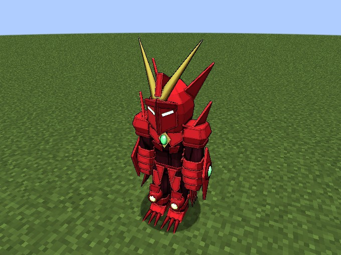
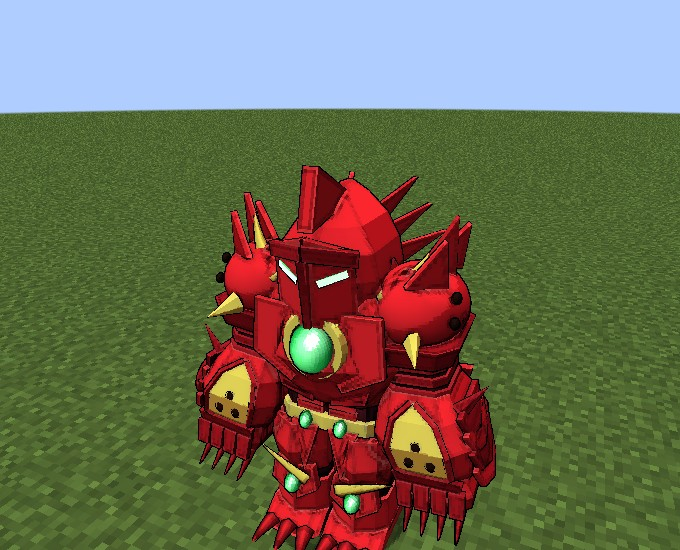
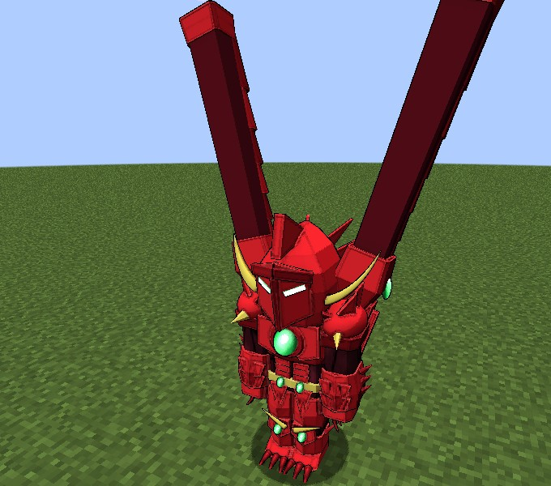
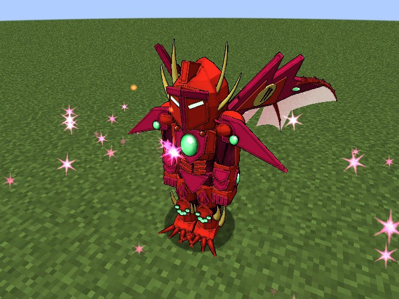
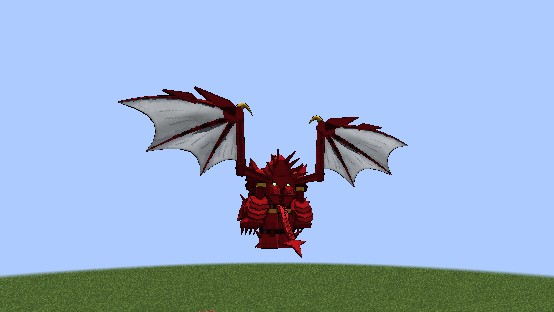
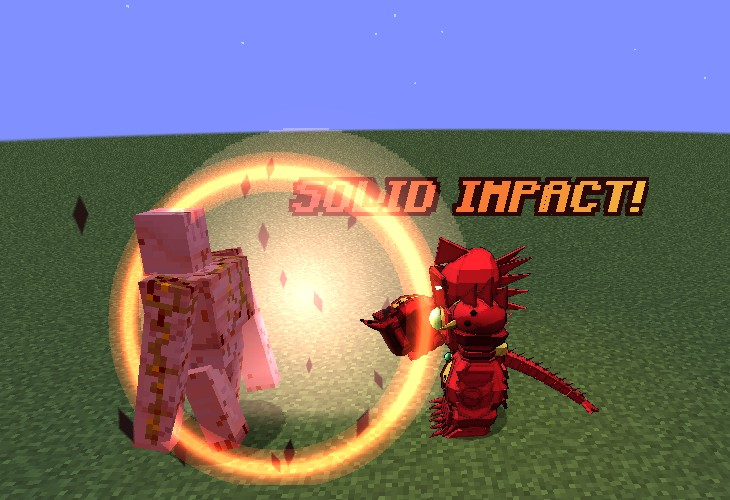
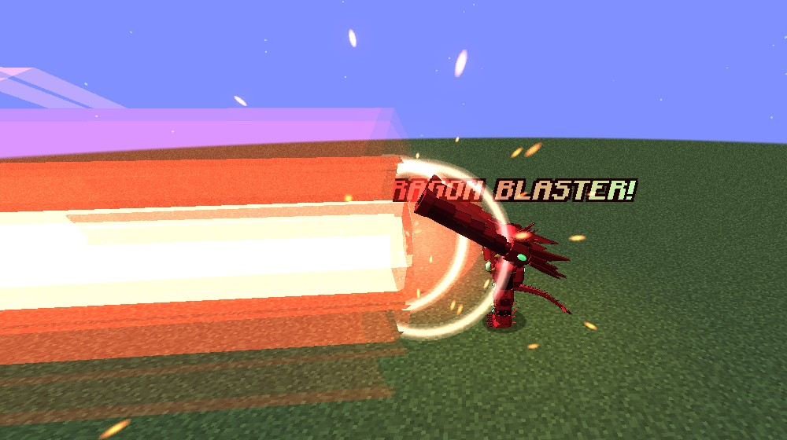
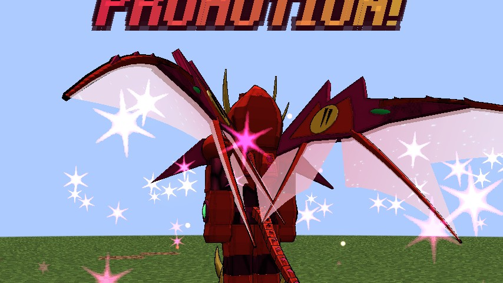
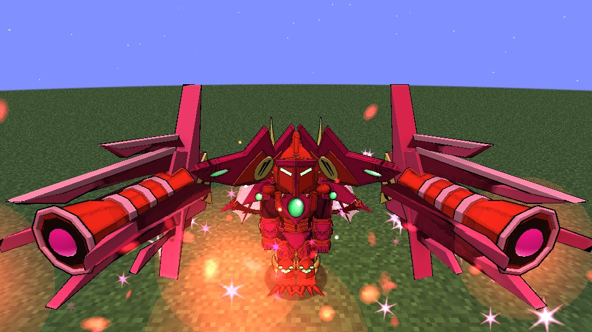
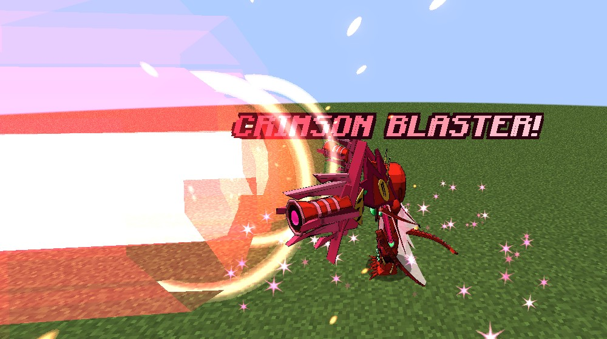

# Promotion's armour forms

Issei's **Illegal Move Triaina**, added in **0.2.35**. A [Pawn](../races/peerage.md#promotion) who wears the Boosted Gear's
[Scale Mail](balance-breaker.md) promotes in the armour, and the armour changes shape: speed in the Knight, power in the Rook, cannons on the Bishop, and all
three at once in the crimson **True Queen**.

<figure markdown="span">
  { loading=lazy }
  <figcaption>Welsh Sonic Boost Knight.</figcaption>
</figure>

<figure markdown="span">
  { loading=lazy }
  <figcaption>Welsh Dragonic Rook.</figcaption>
</figure>

<figure markdown="span">
  { loading=lazy }
  <figcaption>Welsh Blaster Bishop.</figcaption>
</figure>

<figure markdown="span">
  { loading=lazy }
  <figcaption>Cardinal Crimson Promotion, the True Queen.</figcaption>
</figure>

## How it works

You need to be a **Pawn** with **Balance Breaker on**. A [King or Rias](../races/peerage.md) can make you one.

- **In the armour you promote anywhere.** There's no King's word and no enemy ground.
- **The Evil Piece's Promotion modes change the shape.** Press the Knight, Rook or Bishop mode, and the armour becomes that form.
- **Forms change 5 seconds apart,** with no 60-second cooldown. The same press again goes back to the plain armour and ends the Promotion.
- **Each form has its own model, its own change and callouts,** and the panel's title names it: KNIGHT, ROOK, BISHOP or TRUE QUEEN.
- **Out of the armour,** the [ordinary rules](../races/peerage.md#promotion) come back: 5 seconds and the end, unless you're on enemy ground or have the word.
- The Bargain's armour takes no form, and the [Juggernaut Drive](juggernaut-drive.md) puts one away. The armour comes back plain.

!!! note "A holder's Pawns"
    A Longinus holder [grows into their Pawns](../races/peerage.md#growing-into-your-pawns). The Knight and Bishop open at 1 awake, the Rook at 3, and the True Queen at 8.

## The three forms

| | Knight | Rook | Bishop |
|---|---|---|---|
| **Call** | "ARMOR RELEASE!", then "CHANGE STAR SONIC!" | "CHANGE SOLID IMPACT!" | "CHANGE FANG BLAST!" |
| **Walking speed** | +100% | -40%, with neither the armour's speed nor the Boost's | As the Scale Mail |
| **Flight** | ×2.5 | ×0.6 | As the Scale Mail |
| **Armour** | 8 | 40 | As the Scale Mail |
| **Toughness** | 2 | 16 | As the Scale Mail |
| **Flat cut on every hit** | None | 50% | As the Scale Mail |
| **Knockback resistance** | None | Full | As the Scale Mail |
| **Also** | +1 attack speed | +8 attack | |
| **Upkeep, of max magicules a second** | 0.6% | 0.6% | 1.5% |
| **Dragon Shot's mode** | Plain Dragon Shot | [Solid Impact](#solid-impact) | [Dragon Blaster](#dragon-blaster) |

- **The Knight** sheds its plates and runs on green flames from its thrusters, longer the faster you go. The speed doesn't change your view.
- **The Rook** grows into heavy armour with gold plates, and each step lands with a puff of dust.
- **The Bishop** is the plain armour with a backpack and two big cannons.

Knight and Rook fly with the plain armour's pale wings.

<figure markdown="span">
  { loading=lazy }
  <figcaption>The Knight's green flames.</figcaption>
</figure>

<figure markdown="span">
  { loading=lazy }
  <figcaption>The Rook, in flight.</figcaption>
</figure>

## The moves

### Solid Impact

The Rook's fist, with a percussion hammer at the elbow. It takes the place of Dragon Shot's mode.

- A punch that reaches **5 blocks**, for **12 × 2ⁿ** with your n stacks, with a long throw.
- A **shockwave** of 3 blocks around the target deals half, and it breaks blocks within 2.
- It spends the stacks and **500 magicules**, and cools for **6 seconds**.
- A punch at nothing spends nothing.

<figure markdown="span">
  { loading=lazy }
  <figcaption>"SOLID IMPACT!"</figcaption>
</figure>

### Dragon Blaster

The Bishop's cannons. It takes the place of Dragon Shot's mode.

- **A 2-second charge** at half speed, with the cannons swinging down to aim.
- **Then two beams,** 4 blocks wide and up to 64 long, that meet on your crosshair, for **20 × 2ⁿ**, each target once. What's behind you isn't hit.
- It spends the stacks and **10% of your max magicules**, and cools for **10 seconds**. Too few magicules and it refuses, with nothing lost.
- A change of form, the armour's end or death during the charge cancels it, for nothing.

<figure markdown="span">
  { loading=lazy }
  <figcaption>The Dragon Blaster.</figcaption>
</figure>

## The True Queen

**Cardinal Crimson Promotion**: a deep scarlet and crimson armour with all of it at once, at a massive cost.

**Opening her.** Wear each of the three forms for **3 minutes**, counted across uses. The action bar counts it, and Ddraig says when each form is mastered and when the crimson is
ready.

**Entering.** The Queen mode pays **10% of your max magicules** and goes crimson. The first time, that's a 6-second cutscene, and Sneak skips it. After that it's a flash with pink
shards. The jewels shine pink as she forms.

**In her:**

| | |
|---|---|
| Walking speed | +100% |
| Flight | ×2.5 |
| Armour and toughness | 40 and 16 |
| Flat cut on every hit | 50% |
| Knockback resistance | Full |
| Also | +8 attack, +1 attack speed |
| Upkeep | 2.5% of max magicules a second, in place of the ordinary Queen's drain: about 28 seconds from full |

**Her moves live on the Evil Piece.** The gear's Dragon Shot mode stays the plain Dragon Shot.

- **Rook mode: Solid Impact,** with the Rook's fist for that punch, on the Rook mode's own 6 seconds.
- **Bishop mode: the Crimson Blaster,** at ×1.5, with beams 5 blocks wide, on the Bishop mode's own 10 seconds. Her wings turn forward and open into cannons with a glowing pink bore.
- **Knight mode** does nothing.

**However she ends,** a **5-minute wait** starts, with no refund. During it the Queen mode says how long is left, or gives an ordinary Queen on enemy ground or the word.

**Her show.** Pink flames from her thrusters as she moves, pink sparkles falling round her and her wings, and Ddraig's "Fang Blaster" and "Solid Impact Booster" for her moves alone. Her wings
don't flap. They only answer your movement.

**Her song.** "Cardinal Crimson Promotion" plays for as long as she lasts, on the Jukebox slider, for you and anyone near you. The client setting `trueQueenMusic` turns it off.

<figure markdown="span">
  { loading=lazy }
  <figcaption>Her wings and sparkles.</figcaption>
</figure>

<figure markdown="span">
  { loading=lazy }
  <figcaption>The Crimson Blaster charging.</figcaption>
</figure>

<figure markdown="span">
  { loading=lazy }
  <figcaption>"CRIMSON BLASTER!"</figcaption>
</figure>

## In Lore mode

With [Lore mode](../lore-mode.md) on, the forms cost far less:

- **Upkeep:** 0.1% for the Knight and Rook, 0.25% for the Bishop and 0.5% for the True Queen.
- **The True Queen** has no entry price and no wait.
- **The shots** keep their price.

## For server owners and testers

- All the numbers are in the [`[promotion_forms]`](../reference/configuration.md#promotion_forms) config section.
- `/dxdtensura max` fills the three forms' counts, and wakes all of a holder's Pawns.
- `/dxdtensura truequeen ready [targets]` ends the True Queen's wait.
