# Crimson Elegy

A second Sacred Gear of our own, added in **0.4.0**: a long curved sword in a white sheath, and you fight with it still
sheathed. Its black blade comes out only for a cut, and red only when the world goes black and white. It is a Tensura
**Unique Skill** (`dxdtensura:crimson_elegy`) with no summoned state, and only **one player in a world** can hold it.

<figure markdown="span">
  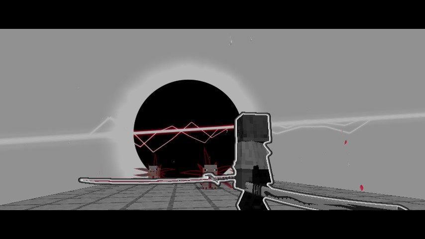{ loading=lazy }
  <figcaption>Red Rain: the Great Cut through the eclipse, in a world drained to black and white.</figcaption>
</figure>

## Getting it

- **Only the reincarnation roll**, at the same odds as the other gears, and only for a
  [human](../getting-started/first-gear.md#only-in-humans).
- **One holder per world.** While someone holds it, the roll skips it and every other way to gain it is refused: "Crimson
  Elegy already has a holder in this world." It is free again when its holder loses it or an operator releases it (an
  away holder loses it at their next login). With the server's auto-release on, a holder away for that many days loses
  it too, as with Divine Dividing.
- Learning it costs 30,000 magicules.
- **One Sacred Gear per player.** A holder reborn as another race in Tensura's race menu loses it.
- No dragon lives in it, and it isn't a Longinus.

## Modes

| # | Mode | Opens at | Price | Cooldown new / mastered |
|---|---|---|---|---|
| 0 | **Take Up / Put Away** | the start | none | none |
| 1 | **Ashen Cut** | the start | 2% | 6 s / 3 s |
| 2 | **Thunder Flash** | the start | 4% | 8 s / 4 s |
| 3 | **Red Rain** | 40% mastery, and nine petals | 12% | 20 s |

Prices are a share of your max magicules. The mode key and the [mode wheel](../getting-started/mode-wheel.md) skip Red
Rain until it opens.

## The sword

<figure markdown="span">
  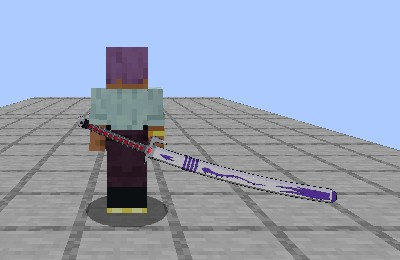{ loading=lazy }
  <figcaption>Put away: low across the back of your waist.</figcaption>
</figure>

<figure markdown="span">
  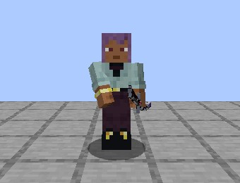{ loading=lazy }
  <figcaption>Taken up: the draw stance, the sheath at your left hip.</figcaption>
</figure>

- **Put away**, it lies low across the back of your waist, the grip at the small of your back, and sways with your stride.
- **Taken up**, you hold it in a draw stance: the sheath in your left hand at your left hip, the hilt forward. A
  left-handed player's is mirrored. In your own view the sheathed sword lies at the bottom right, its hilt toward your
  enemy, and your arm comes in for each cut.
- Taken up, it's an item in your main hand, in the selected slot or the first empty one (a full hotbar refuses it). It
  can't be dropped, stored or held by anyone else, and it goes back to your waist when you die, put it away, change slot
  or log out.
- **Its attack is 16**, rising in a line to **40** at full mastery. "The blade's attack" below is your whole attack while
  you hold it, your own strength included.
- With it taken up, clicks don't break blocks.

## The cut chain

With the sword taken up, the attack key no longer swings the game's own attack: **each click plays the next of four
cuts.**

| Cut | What it is | Hits | × the blade's attack |
|---|---|---|---|
| 1 | **The flat cut:** the black blade whips out to the right and cuts level, right to left | a 110° arc, 4.5 blocks | 0.6 |
| 2 | **The rising cut**, from low on the left up to the right | a 110° arc, 4.5 blocks | 0.6 |
| 3 | **The turning cut:** a wide level sweep with a step in. From outside, the body turns once round | a 180° arc, 4.5 blocks | 0.8 |
| 4 | **The sheathed flash:** the blade goes home, then one draw too fast to see leaves a line of purple lightning, landing on the click | a line 7 blocks long and 1.5 wide | 1.5 |

<figure markdown="span">
  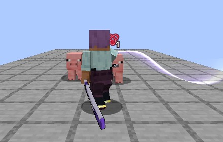{ loading=lazy }
  <figcaption>The flat cut.</figcaption>
</figure>

<figure markdown="span">
  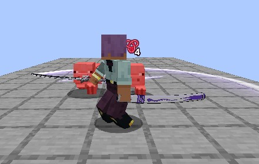{ loading=lazy }
  <figcaption>The turning cut.</figcaption>
</figure>

- A click during a cut plays as soon as it ends, and **holding the button keeps cutting**.
- 0.7 s with no click starts the chain over, and the blade goes home with its click.
- Each of the first three cuts steps you 0.4 of a block toward where you look (0.8 for the turning cut), less with a foe
  already close.
- The cuts never hit your pets, your allies or the untouchable, nor through walls. A cut in the air plays all the same.
- **Weight:** on a hit your own view holds the motion for a beat and the camera kicks (`screenShake` turns the kick off),
  each cut draws its path as a fading trail, and every foe it hits wears a short slash mark.
- With something under your crosshair that isn't alive (a boat, an item frame), the click is the game's own.

<figure markdown="span">
  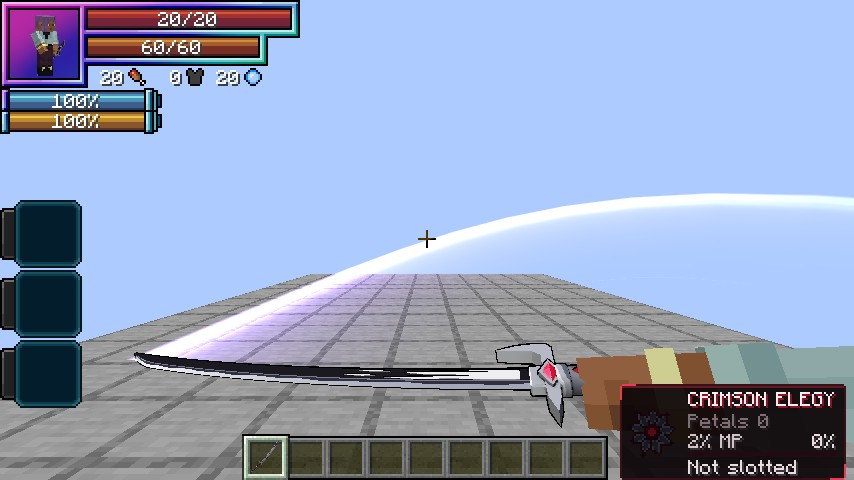{ loading=lazy }
  <figcaption>The fourth cut in your own view, and the gear's panel at the bottom right.</figcaption>
</figure>

## Ashen Cut

1. You draw the **red** blade up and back as you lean in, and the world within 24 blocks turns black and white but for
   red, for a second.
2. You dash up to **5 blocks** the way you look, stopping short of the first foe on your line and at walls.
3. A red blade of light about 7 blocks tall rises from your own, with white lightning along the ground. Every foe in a
   **120° arc within 5 blocks** is marked and held still with Forbidden Balor View's stop.
4. You're gone in a white flash, stand back where you started, and **the cut lands**: 1.5 × the blade's attack on every
   marked foe.
5. The blade slides home behind your back with a click. With the sword taken up, it then comes round to your left hip.

You can't be hurt or act until you're back, about a second. Pressed with the sword put away, it plays from your waist,
and the sword goes back there in purple sparks.

<figure markdown="span">
  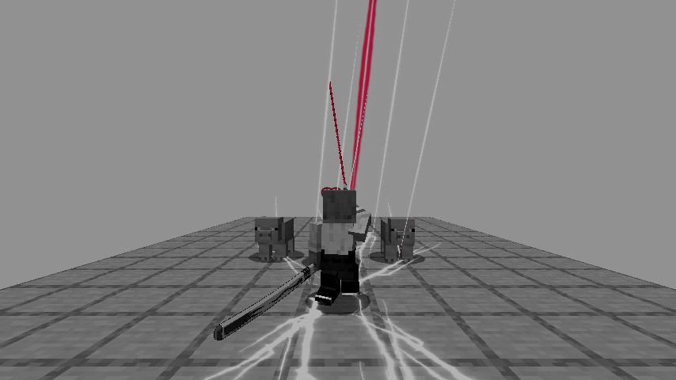{ loading=lazy }
  <figcaption>The red cut rises, the foes held still.</figcaption>
</figure>

<figure markdown="span">
  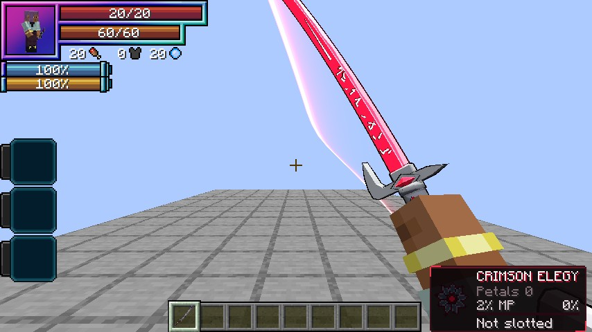{ loading=lazy }
  <figcaption>The red blade in your own view.</figcaption>
</figure>

## Thunder Flash

A dash of up to **12 blocks** through the foe you look at (or ahead to the first wall), ending 2 blocks past it, in a
streak of purple lightning. Everything along the line, 1.5 blocks wide, is cut for **1.2 ×** the blade's attack. It takes
4 ticks and you can't be hurt during them. It climbs a block, stops at walls, and never ends over the void, lava or fire.
Your view widens for the dash.

## Weak foes

A foe Ashen Cut or Thunder Flash cuts whose max EP is **a tenth of yours or less** falls at once. Never a player, a boss
or anything the mod keeps untouchable.

## Red petals and knots

You gather up to **nine red petals** in a fight:

- one for each of the chain's first three cuts that hits a foe;
- one for each foe the fourth cut, Ashen Cut or Thunder Flash hits, three at most;
- one more for each foe a cut kills, three at most;
- one for each harmful effect you put on a foe, from any skill, spell, potion or weapon of yours, once a second for each
  foe and effect.

Each petal from a foe ties a **red knot** on it, up to nine. Only you see them: a small red knot over the foe with its
count. A foe's knots fade 20 s after its last new one. After 30 s with no new petal and no hit, your petals fall one every
2 s. Petals are kept when you log out; knots aren't.

## Red Rain

From **40% mastery**, with **nine petals**. It takes them all.

- Within 48 blocks the world turns **black and white but for red**, for everyone there, you too. The rain hangs still, and
  a black eclipse stands over the field.
- **Mobs within 24 blocks stand still** with Forbidden Balor View's stop, and **you can't be hurt**. Players aren't
  stopped.
- **Three Rain Cuts**, each on the foe with the most knots within 24 blocks as it comes (the nearest on a tie; with none
  marked, the foe you look at, then the nearest): **1.5 ×** the blade's attack, and up to three of its knots cashed, each
  **0.6 ×** on that foe and everything within 6 blocks of it.
- **The Great Cut** through the eclipse: **2.5 ×** on the foe in front. From **70% mastery** it hits every foe within 16
  blocks and cashes every knot left, and at **full mastery** six purple bolts follow it, 1 × each.
- **Every hit lands together on the click of the sheath.** The eclipse falls to pieces, red flowers fly open on the foes,
  and the colour comes back.

<figure markdown="span">
  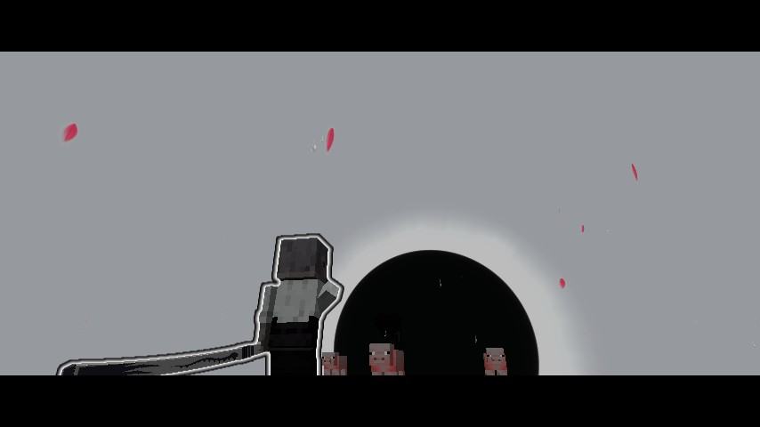{ loading=lazy }
  <figcaption>The black eclipse over the field.</figcaption>
</figure>

<figure markdown="span">
  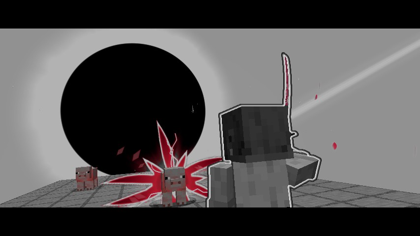{ loading=lazy }
  <figcaption>A Rain Cut and its red lightning flower.</figcaption>
</figure>

<figure markdown="span">
  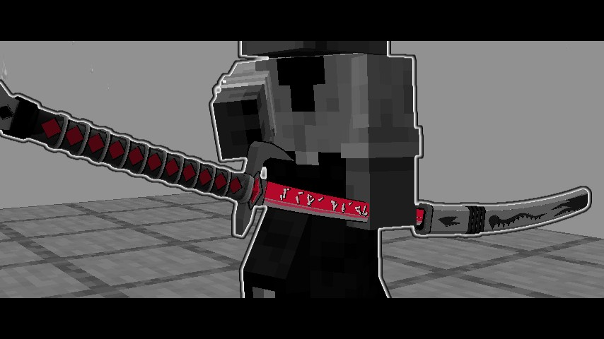{ loading=lazy }
  <figcaption>The blade home: everything lands on the click.</figcaption>
</figure>

<figure markdown="span">
  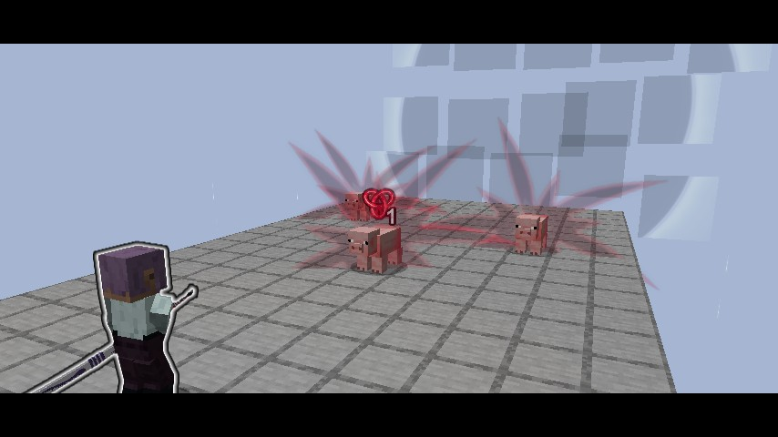{ loading=lazy }
  <figcaption>After: the colour floods back.</figcaption>
</figure>

**It's filmed for you.** The first Red Rain you ever cast plays the full scene, 10 seconds: the rain on the field, your
hand over the hilt as the drops stop, the eclipse rising, the draw, the three cuts across the whole screen, the Great Cut,
the cut eclipse in the sky and the blade going home. Every later one is a short cut, about 4 seconds. **Sneak** skips to
the click. Other players keep their own camera and see your body go through the motions; with `cutscenes` off, so do
you.

<figure markdown="span">
  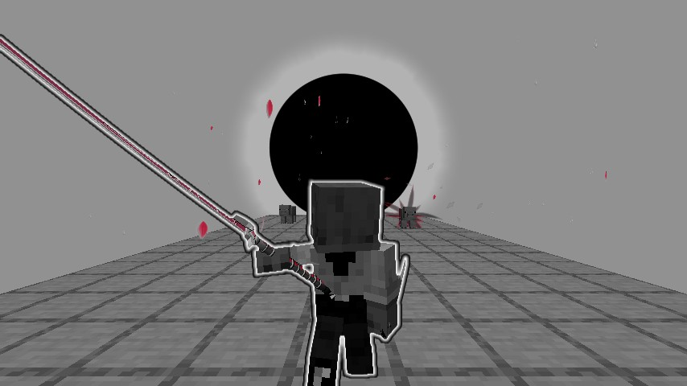{ loading=lazy }
  <figcaption>What a player standing nearby sees.</figcaption>
</figure>

The client setting `crimsonElegyGrey` keeps your own world in colour (for Red Rain and Ashen Cut's second). Under a
shader pack the black and white is a grey veil.

## Mastery and the panel

Mastery comes from the moves and cuts that hit, the fourth cut most, and from the kills with the sword. The panel right
of your hotbar shows a ring of nine petal slots, the modes with their prices and cooldowns, and the knots on the foe in
your crosshair. The gear has its own icons on the mode wheel.

## Settings and commands

- The server's `[crimson_elegy]` section holds every number on this page: see [Configuration](../reference/configuration.md#crimson_elegy).
- `/dxdtensura crimson_elegy release <player>`, `holder`, `mastery <percent>`, `petals` and `cutscene full|short`: see
  [Commands](../reference/commands.md#crimson-elegy).
