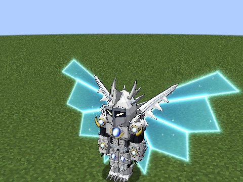
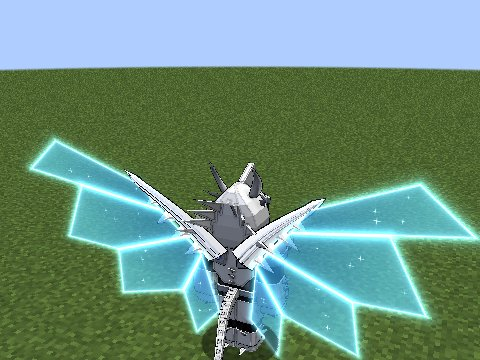
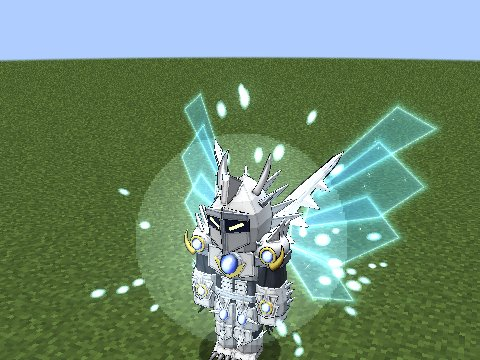
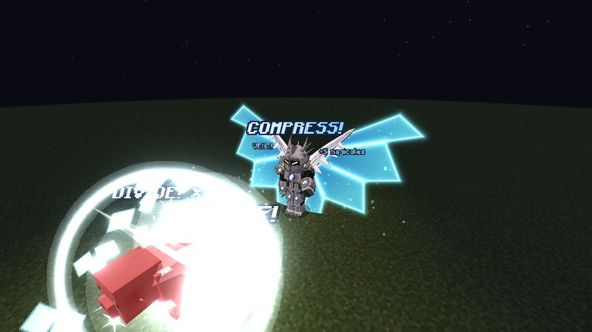
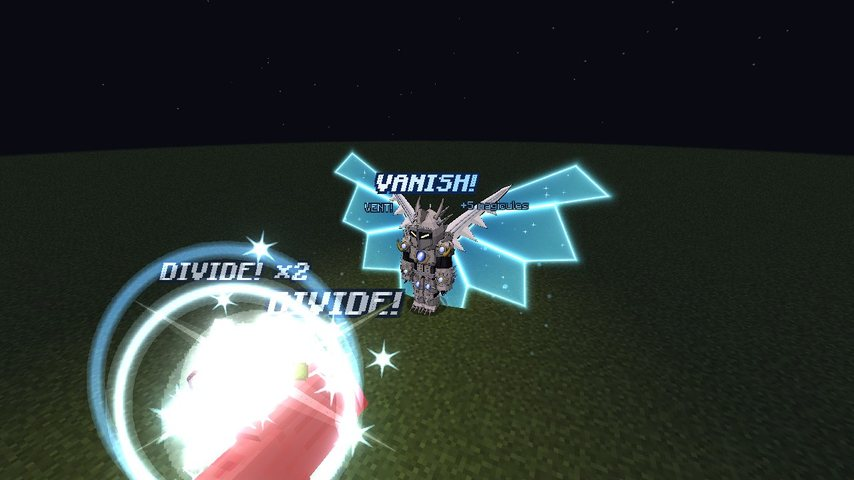
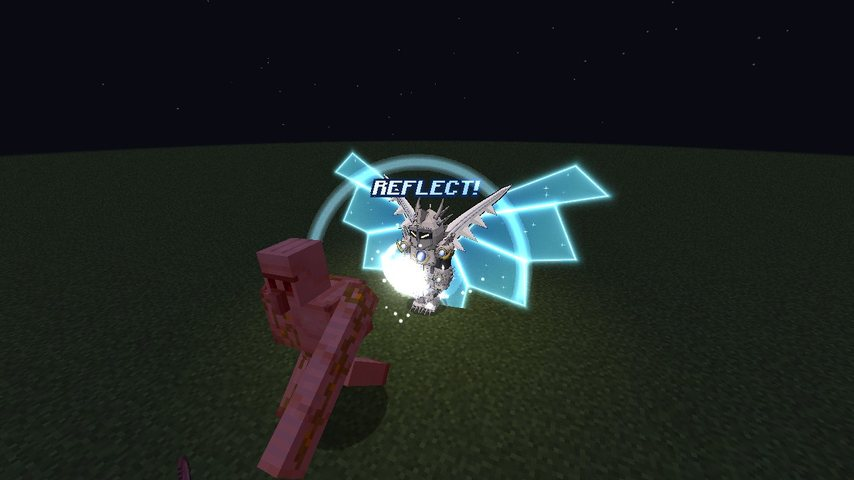

# Balance Breaker (the white Scale Mail)

The White Dragon Emperor's armour: white plates with blue jewels, and the wings of light on its back. In it, Divide
becomes a weapon of war: faster, deeper, and able to take on anything, if you can hold the power you steal.

<figure markdown="span">
  { loading=lazy }
  <figcaption>Front</figcaption>
</figure>

<figure markdown="span">
  { loading=lazy }
  <figcaption>Back</figcaption>
</figure>

<figure markdown="span">
  { loading=lazy }
  <figcaption>Forming</figcaption>
</figure>

## Awakening

From **40% mastery**, in a crisis like the red Scale Mail's: an enemy leaves you alive under **30% health**, it is strong
enough, and Albion rolls a chance that grows with each miss. The difference: **the enemy must be the one you're
dividing.** Albion tells you when it isn't time yet. On a success the armour forms at once and heals you.

Until it awakens, the armour's modes (Balance Breaker, Half Dimension, Compression Divider and Reflect) are skipped by
the mode key.

## Putting it on

Press **Balance Breaker** (mode 2) with the wings out. A countdown starts, like the red one's: 10 seconds, trained down
to 1 second. The countdown beats like the red one's.

**The cutscene plays in full every time** (unless the `cutscenes` client setting is off), on Albion's "Vanishing Dragon
Balance Breaker!", each word shown as he says it: the wings flare, the chest blazes, light pours down, the pieces fly on,
a split-second impact frame on "BREAKER!", and "SCALE MAIL".

Press the mode again in the armour to end it.

## In the armour

| | |
|---|---|
| Armour | +20 armour, +8 toughness |
| Knockback resistance | +0.5 |
| Speed | a little faster |
| Flight | costs nothing more; sprint-flight always twice as fast |
| Upkeep | 0.6% of your max magicules a second |
| Time limit | 3 minutes |

It ends like the red one (by choice, time up, running dry, death) with the same cooldowns, except that after a long
wear it waits **150 seconds**, half the red one's 300. See [the red Scale Mail's endings](../boosted-gear/balance-breaker.md#ending-it).

**Divide in the armour:**

- Divide lands **every 5 seconds**, and moving to a new target has **no cooldown**.
- Bosses take your full Divides, and **no target is too strong**. What limits you is what you can hold: the strain
  gauge.
- Your strength from Divides goes up to **×16** (×8 outside it). An enemy with at least **75%** of your max EP (max
  magicules plus max aura) counts one Divide more for the doubling, so three Divides on it make you ×16.

**Wings away.** In the armour, the **Wings** mode folds the wings away and takes their flight with them (you fall), but
the armour and its powers stay. Press it again and they come back, flight and all.

## The strain gauge

Power you can't hold no longer just vents: it fills a **gauge twice your max EP**.

- The wings vent **4% of it a second**, the light pouring off them with **VENT!** every other second.
- **Past 75%** Albion warns you, and the armour flickers white-hot.
- **Full, it overloads** and the armour breaks, like running dry.

A boss's power, or a big crowd caught in Half Dimension, can overload you. Watch the gauge.

## Half Dimension

*Mode 3, in the armour. 60 second cooldown.*

One Divide on **every living thing within 12 blocks**, seen or not. It spares you, your allies and pets, armour
stands, players in creative or spectator, and other players with PvP off. Rings of light spread out, and anyone caught
in it sees their view squeeze and ripple.

## Compression Divider

*Mode 4, in the armour, once the gear is mastered.*

**Three presses**, your hands taking turns, on the target you're dividing (or on what you're looking at, starting a
chain). Presses need **half a second** between them, so every slash plays out; a faster press doesn't count.

1. The first press lands a Divide at once: **DIVIDE!**
2. The second lands the next: **DIVIDE!**
3. The third lands the last Divide with both hands at once, and is **the compress**: **COMPRESS!**

Then a **60 second cooldown**. Bosses take all three in the armour. A target your Divides already brought to the end is
compressed with a single press.

**The compress** works once per Balance Breaker, and comes back the next time the armour forms. It crushes the target's
magicules and aura to **5%** of their max (destroyed, not taken), and holds them there while it stays Divided: the
**Compressed** effect. With the compress spent, the third press is only the last Divide.

**Noroi's execute.** A mob (not a player, not a boss) that is already at **5%** or less of its magicules and aura when
you compress it is crushed out of existence: **VANISH!** It counts as your kill, with its loot and EP. Bosses and players
are only compressed.

<figure markdown="span">
  { loading=lazy }
  <figcaption>The third press: "COMPRESS!"</figcaption>
</figure>

<figure markdown="span">
  { loading=lazy }
  <figcaption>Noroi's execute: "VANISH!"</figcaption>
</figure>

## Reflect

*Mode 6, in the armour. 20 second cooldown from the press.*

For **1.5 seconds** after you press it, what hits you goes back where it came from: **REFLECT!**

- **Arrows, spells, breaths and Dragon Shots** fly back at whoever shot them, as yours.
- **Other blows with an attacker** (melee, skills, a mob's explosion) are cancelled and dealt back to the attacker in
  full, through their armour (after your Divides have cut them).
- **It doesn't stop** `/kill`, hits with no attacker, or damage over time like a fall, fire or poison.
- **Penetrate breaks through it**, and you read "That one pierced your Reflect!"

<figure markdown="span">
  { loading=lazy }
  <figcaption>"REFLECT!": a zombie's blow turned back.</figcaption>
</figure>

## The power you took

- The panel's ×n is your attack with the Divides' bonus, over your own.
- "+1,200 magicules" and "+800 aura" float off you with each Divide, so you see what you gained.
- "VENT!" shows what the wings throw away.

## The panel

In the armour the panel reads **SCALE MAIL**:

- the ring is the **strain gauge**, with its percent in the jewel (white-hot past 75%);
- a row shows Half Dimension's, Compression Divider's and Reflect's cooldowns, with a dot on Compression while the
  compress is unused;
- the bar and the clock show the armour's time left.
