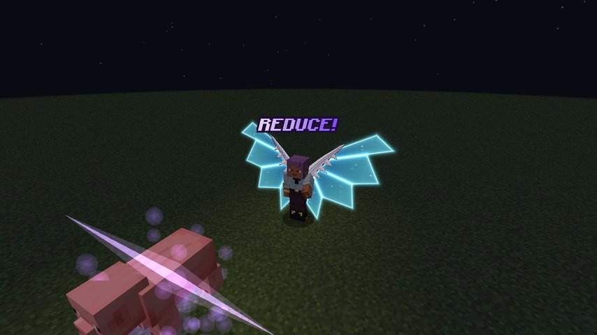

# Divine Dividing

The White Dragon Emperor's Sacred Gear, with **Albion** sealed inside. Its wings of light are the whole gear: they fly,
and they **Divide**, halving an enemy's power and taking it for you. It is a Tensura **Unique Skill**
(`dxdtensura:divine_dividing`), the Boosted Gear's rival.

<div class="grid" markdown>

<figure markdown="span">
  { loading=lazy }
  <figcaption>The wings of light</figcaption>
</figure>

<figure markdown="span">
  { loading=lazy }
  <figcaption>Flaring with a Divide</figcaption>
</figure>

</div>

## Getting it

- **Reincarnation** can roll it, at the same odds as the Boosted Gear.
- **Albion's jewel**, dropped by the [White Dragon Emperor](../world/white-dragon-emperor.md), gives it to a player with
  no gear.
- **One Heavenly Dragon per player.** A Boosted Gear holder can't learn Divine Dividing, and the other way round.
- **One Divine Dividing per world.** While someone holds it, the reincarnation roll skips it and nothing else gives it.
  Players who already held it keep it.

## Modes

| # | Mode | Unlocks | What it does |
|---|---|---|---|
| 0 | **[Divide](#divide)** | from the start | Slash at a target and keep halving its power |
| 1 | **Wings** | from the start | Summon or put away the wings |
| 2 | **[Balance Breaker](balance-breaker.md)** | awakening, from 40% mastery | Put on the white Scale Mail |
| 3 | **[Half Dimension](balance-breaker.md#half-dimension)** | awakening; in the armour only | Divide everything around you |
| 4 | **[Compression Divider](balance-breaker.md#compression-divider)** | awakening and a mastered gear; in the armour only | Two Divides, then the compress |
| 5 | **[Reduce](#reduce)** | a mastered gear | Poison what you look at with your own strength |
| 6 | **[Reflect](balance-breaker.md#reflect)** | awakening; in the armour only | Turn blows and shots back on their attacker |

While the wings are away, any press only summons them ("Divine Dividing!"). The Wings mode puts them away.

## Flight

With the wings out you can fly, creative-style (double-tap jump).

- Flying costs **0.5% of your max magicules a second** in the air. Standing is free.
- When your magicules can't pay, you fall, and the flight comes back once you have a second's worth again. Albion warns
  you once a flight when you drop below 20%.
- Flying forward you lean into it; flying backwards you lean back, and you bank into turns. Sprint-flying you go flat
  out, arms and legs still.
- **Sprint-flying gets faster with mastery**, up to twice as fast once mastered.

## Divide

Press it and you **slash your hand** at what you're looking at, up to **8 blocks** away. Blocks stop it; players in
creative or spectator and armour stands don't count.

A thin white line cuts across your view through the target, light bursts on it, **DIVIDE!** floats beside it and
blue-white stars scatter. Then, **every 10 seconds**, it is divided again by itself, as long as it stays within
32 blocks and your wings are out. Each Divide:

- **takes half its magicules and aura** and pours them into you, up to your own maximum. What you can't hold, your wings
  vent away as light. Tensura's energy-drain immunity and Energy Protection stop this part.
- **halves everything it deals**: melee, skills, magic and its projectiles, every hit (not its speed). It shows as the
  **Divided** effect, I to III, lasting 30 seconds after the last Divide. Its summons and pets aren't Divided with it.
- **doubles your strength** as Absorbed Power: **×2, ×4, ×8** at 1, 2 and 3 Divides, even on a weak mob. A hard-hitting
  enemy can push it further with the attack it lost, but never past **×8** in all (×16 in the
  [white Scale Mail](balance-breaker.md#in-the-armour)).
- **takes a Boosted Gear holder's stack**: they drop one held Boost stack (×2ⁿ to ×2ⁿ⁻¹, exactly half).

**Too strong.** A target with more than **ten times your max EP** (max magicules plus max aura) is beyond you: "Its
power is beyond us.", and the press costs nothing.

### How deep you can Divide

| Your mastery | Divides on one target | Its hits deal |
|---|---|---|
| new host | 1 | ½ |
| 40% | 2 | ¼ |
| mastered | 3 | ⅛ |

Bosses never take more than 2. A target that refuses effects (like Tensura's bosses) still stops at the cap and still
gives you the attack it would have lost; it only loses energy. Each Divide earns mastery.

### One target at a time

A press on a new target moves Divide to it and goes on a **10 second cooldown**; the old target stays weakened until its
effect runs out. A press on a target already at the cap says "It can't be divided further."

## Reduce

*Mode 5. Albion offers it once you master the gear.*

Albion's oldest power. Slash what you're looking at, up to **8 blocks** away, in a violet line, and it's poisoned for
**10 seconds**: **REDUCE!**, and the **Reduced** effect.

- **Each second** it takes **your attack**, Divide strength and weapon included, through armour and Tensura's
  resistances and nullifications (not barriers), plus **2%** of its max spiritual health.
- **Nothing heals it** while it lasts.
- Golems, Tensura's Elemental Colossus and lifeless things are immune: "It has no body to reduce." It won't touch Rias,
  or a player you can't harm here (PvP off, your own team).
- Its cooldown is **60 seconds**. With nothing in reach, the press costs nothing.

<figure markdown="span">
  { loading=lazy }
  <figcaption>"REDUCE!"</figcaption>
</figure>

## Rival fights

When a Divine Dividing holder and a [Boosted Gear](../boosted-gear/index.md) holder fight each other, the two Heavenly
Dragons forget their limits. A hit either way or a Divide between them starts it, and Albion and Ddraig each have a word.
It lasts until **30 seconds** after the last blow or Divide between them.

- **The white one's Divides keep landing** on the rival past three, up to **24**.
- **The red one's Boost keeps stacking** past its cap, up to **24**, a stack for every Divide. A stack past the cap
  costs what the last one did, and adds no body strain.
- **A Divide takes no magicules or aura from the rival.** It cancels one held Boost stack, or halves their hits if they
  hold none.
- The white one's strength stays capped (×8, ×16 in the armour). The red one's extra stacks count only on blows against
  the rival: Dragon Shot, Transfer, the Longinus Smasher and blows on anyone else stay at the normal cap.
- Compression Divider and Half Dimension keep the normal caps. When it ends, stacks and Divides fall back to their caps.

Server owners can turn it off with [`rivalsUncapped`](../reference/configuration.md#divine_dividing).

## Albion

Albion speaks to you in his own white and blue box, like Ddraig: teaching once each, the low-magicule warning, and the
rivals' meeting. When a Boosted Gear holder comes within 64 blocks: "The Red One is near." (and Ddraig to them: "I smell
the White One, partner."). The client setting `ddraigLines` covers him too.

## The panel

While the wings are out, the panel right of the hotbar is white and blue:

- the ring counts down to the next Divide around a blue jewel (dimmed while the Divide mode cools down);
- DIVINE DIVIDING;
- one pip per Divide your mastery allows, with the target's lit, and what's left of it (÷2, ÷4, ÷8);
- the target's name (or "No target"), with your mastery over the bar;
- the key for Divide.

A target divided to the cap stays on the panel for 30 seconds. Outside the armour the panel also shows your strength
(×3.5) and what's left of the target ("Pig ÷4").

## The wings

The wings unfold when summoned, sway at rest, beat while you fly, flare with each Divide and fold away when dismissed.
Your cape and elytra hide under them.

!!! note "Operators and testing"
    ```
    /tensura edit ability grant @s dxdtensura:divine_dividing
    /dxdtensura divinedividing holder             # who holds it in this world
    /dxdtensura divinedividing release <player>   # take it from them and free it
    ```
