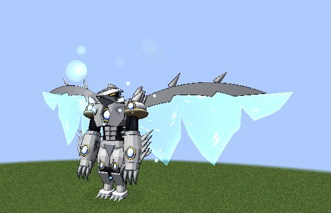

# Juggernaut Drive (the white dragon)

Vali's Juggernaut Drive, added in **0.1.72**. In the [white Scale Mail](balance-breaker.md) you speak the words and
become **the white dragon**, four times your size on wide wings of starry blue light, each edged with a white blade.

Unlike the [red one](../boosted-gear/juggernaut-drive.md), it runs on your **magicules, not your life**, and you can step
out of it when you like. Unless you stay too long.

<figure markdown="span">
  { loading=lazy }
  <figcaption>The white dragon on its wings of light.</figcaption>
</figure>

## Learning the words

Master Divine Dividing with the white Scale Mail awakened, and **Albion offers you Vali's words**, once: the five lines
in chat (click one to put it in your chat box) and his book, **The Words of the White Dragon**. Lost the book?
`/dxdtensura incantation` gives you a new one, as it does for the red words.

## The chant

In the white Scale Mail, **type the five lines in chat**, each within 30 seconds of the last, as with the red
incantation. Case, punctuation and spacing don't matter.

- Each line shows in white to players within 64 blocks, and Albion's past hosts answer.
- The last line **primes** it for 60 seconds. Press your **Balance Breaker** key to release it.

## The cutscene

The first time, the camera films the white dragon rising out of a column of light, its jewels and eyes lighting up, then
"JUGGERNAUT DRIVE!" and its roar, about 7 seconds. After that a short one of 3 seconds. Sneak to skip it.

## The dragon

- **Four times your size**, with the red dragon's stats. It doesn't heal you as it forms.
- **It flies**: sprint-flying is three times as fast as normal flight.
- **Your hand is the dragon's claw**, as in the red one.
- **Divide grows teeth:** the chain lands **every 2.5 seconds**, each target takes **two more Divides** than your cap
  (five for a master, ÷32), and your strength from Divides goes up to **×32**.
- **Half Dimension** reaches **24 blocks**.
- **The strain gauge stops venting.** Albion warns you at 75%. Full, it overloads and the dragon shatters.
- Your other powers keep working, and the armour's [halving](balance-breaker.md#the-armour-halves) of magic and
  projectiles carries on.

## The white Longinus Smasher

The **Wings** key in the dragon. From **half a full gauge**: a 5 second charge, the core blazing, then a white beam
**64 blocks** long and 10 around that fires what you divided but couldn't hold.

| Gauge | Damage |
|---|---|
| half | 320 |
| three quarters | 1,280 |
| full | 5,120 |

It does half the red Smasher's damage, since it charges faster and costs only the gauge. It **empties the gauge**, so
firing it also saves you from an overload.

## The fuel

It burns **3% of your max magicules a second**, never your last one. Press the **Balance Breaker** key with magicules to
spare and it ends in control.

## The berserk

Run dry in the dragon and **Albion's past hosts take over**: the jewels and eyes turn violet.

- The Balance Breaker key no longer works.
- The claws strike on their own every 1.5 seconds at the nearest thing within 8 blocks.
- It takes **10% of your max health for good**, the [red Drive's price](../boosted-gear/juggernaut-drive.md#the-price)
  and the same debt, then **3% of your max spiritual health a second**, down to 10%, where it ends.
- You keep every power, the Smasher too.

If half your max health is already paid away, Albion won't let them in: the Drive simply ends when the magicules run
out.

## After it

The dragon shrinks back and you drop to your knees, with the red Drive's
[aftermath](../boosted-gear/juggernaut-drive.md#after-it): Weakness II, Slowness II, Mining Fatigue, Fragility and Spent
Dragon for 2 minutes, and Paralysis for 3 seconds. The gear goes **silent for 10 minutes**.

- Ending in the air gives you **Slow Falling** until you land, for at most 10 seconds.
- A death in the dragon puts the aftermath off until you respawn.
- In **creative** it costs nothing and stops after 4 minutes, for testing.

!!! note "Operators"
    The silence is the Wings mode's Tensura cooldown, so Tensura's ability cooldown command can set it to 0.

## The panel

In the dragon the panel reads **JUGGERNAUT DRIVE**:

- the ring is the strain gauge, with a mark at half (where the Smasher can fire);
- the bar and the clock are the fuel, blue, then violet while your life burns;
- your Wings key shows as **Longinus Smasher**.

While the gear is silent it stays, dimmed, counting the minutes down.

## Transfer overload

The Boosted Gear's answer, Noroi's idea. A [Transfer](../boosted-gear/modes.md#transfer) aimed at a **rival you're
fighting** who wears the white Scale Mail, or is the white dragon, pours your Boost into their **strain gauge** instead
of helping them: **OVERLOAD!**

- It adds (2ⁿ − 1)% of your max EP for n stacks, every held stack counted.
- If the gauge overflows, the armour breaks or the Drive ends, and Ddraig and Albion each have a word for it.
- Without a live [rival fight](index.md#rival-fights), a Transfer still helps as usual.

!!! info "For server owners"
    Every number here is in the [`[white_juggernaut]`](../reference/configuration.md#white_juggernaut) config section.
    The white dragon shares the red one's size, stats, berserk, aftermath and silence numbers in
    [`[juggernaut]`](../reference/configuration.md#juggernaut).
