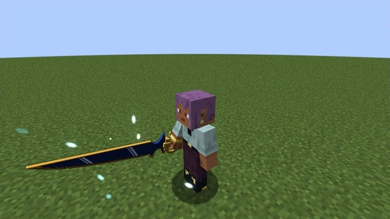
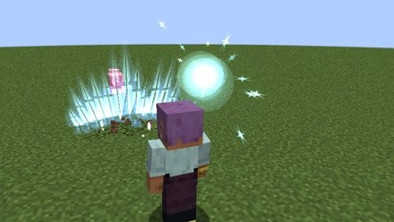
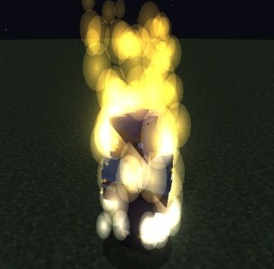
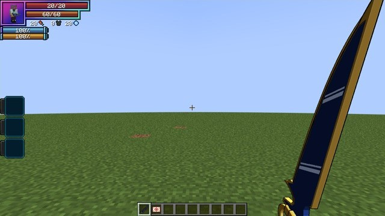
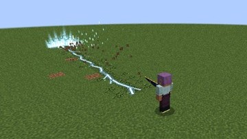
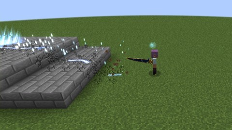
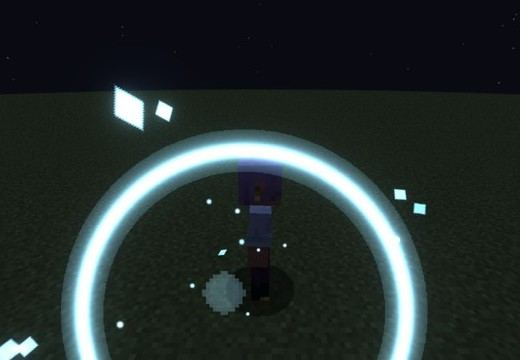
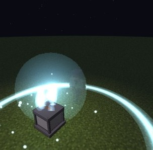

# Durandal and the Holy Factor

Xenovia's holy sword, added in **0.1.92**. Durandal answers only a **holy wielder**: someone with the **Holy Factor**, the
trait the Church's swordsmen are born with or given. Its wave tears along the ground, and once tamed it cuts through
almost anything. [Excalibur's seven fragments](../excalibur/index.md) answer the same holy wielders.

<div class="grid" markdown>

<figure markdown="span">
  { loading=lazy }
  <figcaption>Durandal, with its sharp gold edge leading.</figcaption>
</figure>

<figure markdown="span">
  { loading=lazy }
  <figcaption>The Holy Wave, a fan of aura running along the ground.</figcaption>
</figure>

</div>

## Who can wield it

A **holy wielder** is anyone with one of two passive skills, **Holy Factor** (born) or **Artificial Holy Factor**, and
without either:

- [Angels](../races/angels.md), Low-class to Seraph (not Fallen Angels);
- Tensura's Saint races and the Divine race each one evolves into;
- True Heroes.

A holder of a Heavenly Dragon's gear ([Boosted Gear](../boosted-gear/index.md), [Divine Dividing](../divine-dividing/index.md))
is **never** one, whatever their race, title or skills. The factor skills stay through every race change.

## The Holy Factor

### Being born with it

The first time you pick **Human** or **Enlightened Human** in Tensura's race menu, you have a **5%** chance of the Holy
Factor. If you were already Human, you roll once at your next login. It's rolled once per player.

A **Skill Reset Scroll** or **Character Reset Scroll** takes the factor away with your other skills, so each one gives
you one fresh roll.

It never goes with a Heavenly Dragon:

- a dragon holder's roll is spent without rolling;
- Tensura's reincarnation roll leaves the two dragons out for a factor holder;
- [Albion's jewel](../world/white-dragon-emperor.md#albions-jewel) refuses one.

Other Sacred Gears are fine. Kiba has both, and so can a [Sword Birth](../sword-birth/index.md) holder.

### The Holy Factor Crystal

One church chest in ten holds a **Holy Factor Crystal**. Drink it, like a potion, to get the **Artificial Holy Factor**.

- A holy wielder can't drink it, and neither can a dragon holder. They keep the crystal.
- Someone holy things hurt, a Devil for example, drinks it, loses it, gets no factor and burns for a quarter of their max
  health (never below one heart).

<figure markdown="span">
  { loading=lazy }
  <figcaption>The crystal, on someone holy things hurt.</figcaption>
</figure>

## The sword

A Tensura great sword, unbreakable, with **23 attack** at first and **70** [fully tamed](#taming-it).

- **It refuses anyone else.** Taken in hand by someone who isn't a holy wielder, it jolts them (**2 damage**, never below a
  heart) and leaves their hand, at most once a second. Carrying it in your inventory is fine.
- Creative and spectator players are never refused. A mob that picks it up drops it at once.
- **A wielder holy things hurt**, such as a Devil with the factor, burns for **1% of max health a second** while holding it,
  never below half.

<figure markdown="span">
  { loading=lazy }
  <figcaption>In first person.</figcaption>
</figure>

## The Holy Wave

**Hold use** to raise the sword (half a second at least, a second and a half for a full charge) and **let go**.

- **On the ground** it's a shockwave. It runs **20 blocks** along the ground, **3 blocks wide**, through every foe in its
  path, tossing them up a little. It climbs steps of up to 2 blocks, follows drops and stops at a taller wall. Behind it
  stays a fissure of cracks and blue light that fades in about 3 seconds.
- **In the air, or aimed steeply up,** it's a crescent flying straight ahead, stopped by blocks.
- **Damage:** 0.6 to 1.0 of your attack with Durandal, by the charge. It spares your pets and allies.
- **Cost:** 2.4 to 4% of your max magicules, by the charge. It cools down for **3 seconds**, on Durandal and its replica alike.
- It breaks no blocks unless the server turns on `waveBreaksBlocks`, and then it digs the line it runs along.
- A Tensura barrier dome holds it and takes its damage, until the sword is [tamed](#tamed-it-cuts-through-anything).

<div class="grid" markdown>

<figure markdown="span">
  { loading=lazy }
  <figcaption>Running on, the fissure behind it.</figcaption>
</figure>

<figure markdown="span">
  { loading=lazy }
  <figcaption>Climbing a step.</figcaption>
</figure>

</div>

## The holy strike

Every hit with Durandal, the wave's too, adds **50% of the hit as holy damage** on what holy things hurt: Devils by race,
Stray Devils, and Tensura's Majin races and monsters.

A **Durandal Replica** halves the wave and the strike, and so does an **Artificial Holy Factor**. Both together halve them
twice.

## Its pocket of space

The first time a wielder holds it, they learn the skill **Durandal**. Its **Call / Store** mode sends the held sword into a
pocket of space and calls it back to your hand. What you held goes to your inventory, or to your feet if that's full.

- **On death** a carried Durandal goes into an empty pocket. With `keepInventory` on, it simply stays with you.
- A copy of the skill never carries the sword: Tensura's clones can't take it with them.
- Forgetting the skill drops the sword at your feet.

## Taming it

A new wielder's Durandal is **wild**:

- its waves cost up to twice as much;
- each wave splashes you for up to 6% of your max health, never below half;
- it throws sparks.

Landed waves (**+4**) and hits with it (**+1**, once a second) raise the Durandal skill's mastery to **1,000**. The aura calms as
it rises, and the sword's tooltip says how it stands: wild, calming, or "answers you".

**Its attack grows with it,** a little every 50 mastery, from **23 to 70**, and a replica's to **37**. The wave and the holy strike go by
your attack, so they grow too. The growth counts only two-handed, with nothing in your off hand.

## Tamed, it cuts through anything

At **1,000 mastery**, its hits, its wave and its holy strike:

- go through Tensura's Resistances, Nullifications and barriers up to Guardian;
- shatter the Barrier spells, Multilayer Barrier, barrier domes and an Angel's Holy Barrier.

Each break-through costs **0.5% of your max magicules**, once a tick at most. Short of that, the defence holds. A replica or
a crystal's factor cuts too. A blue-white flash marks the cut.

<figure markdown="span">
  { loading=lazy }
  <figcaption>The tamed cut's flash.</figcaption>
</figure>

## The reliquary

One ruined church in three has a **crypt** under its nave, down a spiral stair, where Durandal stands point-down in a sealed
altar, chained. See [The crypt church](../world/structures.md#the-crypt-church).

```
/locate structure dxdtensura:ascalon_church_crypt
```

- Only a holy wielder can break the seal. Anyone else gets "The seal holds."
- The **first reliquary opened in a world gives the true Durandal**. Every later one gives a **Durandal Replica**.
- The empty altar stays as a trophy.
- A church with a crypt holds only Durandal: its dragon's skull is empty, and its lectern's book tells of the blade under the
  nave.

<figure markdown="span">
  { loading=lazy }
  <figcaption>The seal breaking.</figcaption>
</figure>

## In Lore mode

In a world with [Lore mode](../lore-mode.md) on:

- it never burns a Devil wielder;
- the Artificial Holy Factor is as strong as the natural one;
- a Durandal Replica has **one fifth** of the wave and the strike, in anyone's hand, and its attack grows only to about 32.

## Settings and commands

The numbers are in [`[durandal]`](../reference/configuration.md#durandal), and operators have
[`/dxdtensura holyfactor`](../reference/commands.md#durandal-and-the-holy-factor).
