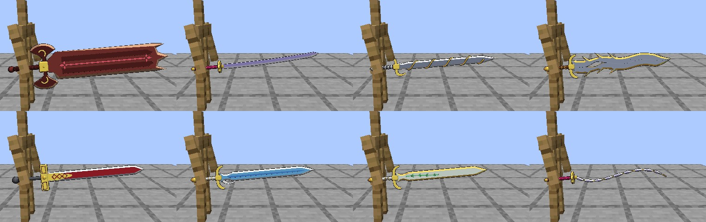
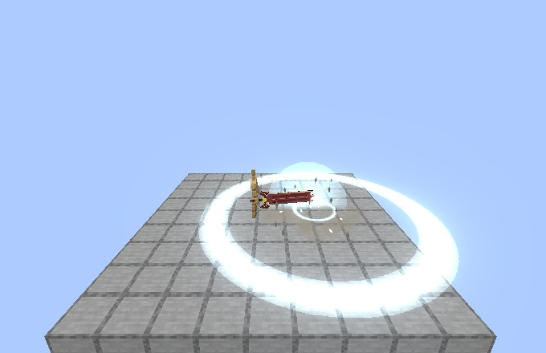
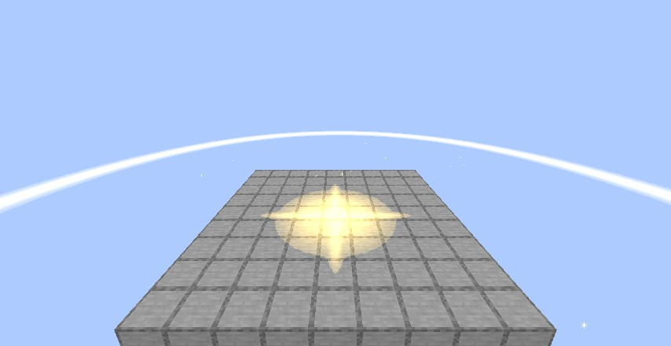
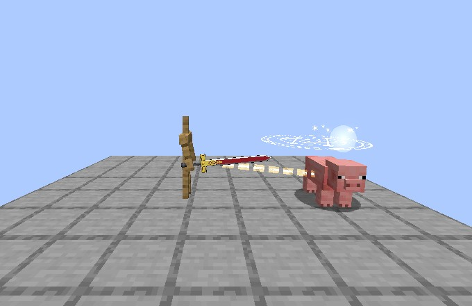
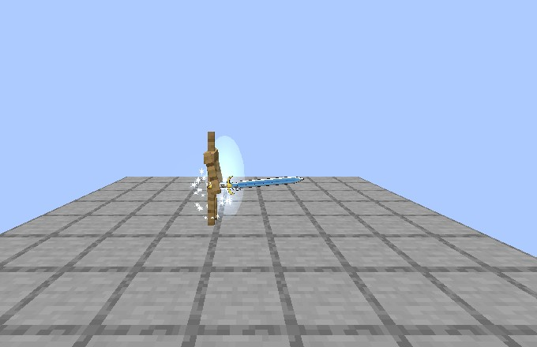
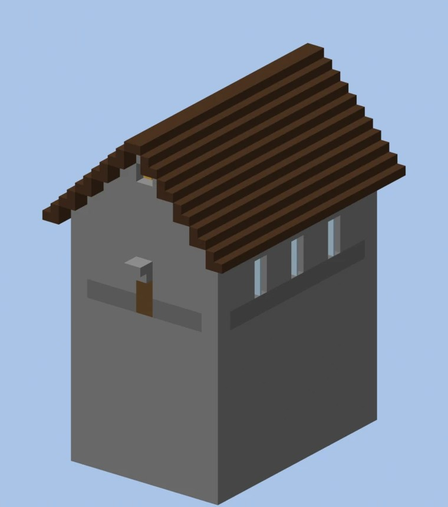
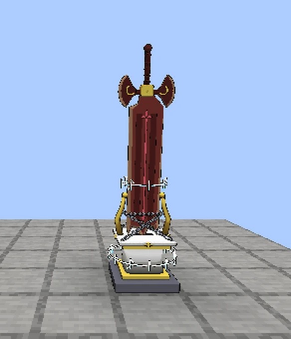
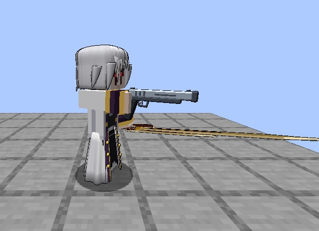
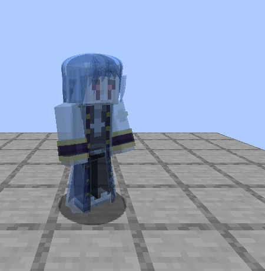
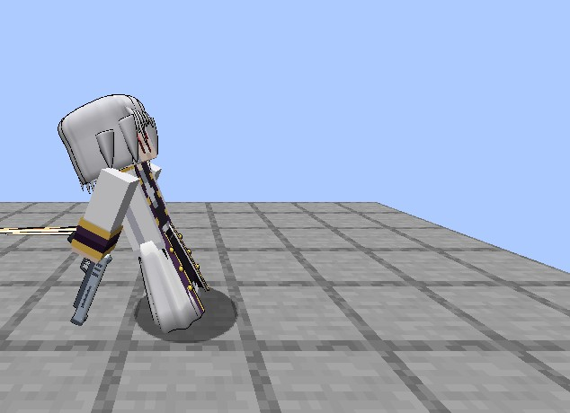

# Excalibur's fragments

Added in **0.2.78**. Excalibur broke into seven holy swords, each with one power of its own. They follow
[Durandal's](../durandal/index.md) rules: only a **holy wielder** can hold one (anyone else gets the jolt and "This sword refuses you."), a mob
that picks one up drops it and Sword Birth never copies them. Like Durandal, they don't burn a Devil wielder unless the server sets
`devilBurnPercent`. Creative and spectator players are never refused.

<figure markdown="span">
  { loading=lazy }
  <figcaption>Destruction, Mimic, Nightmare and Rapidly; Ruler, Transparency, Blessing, and Mimic as a whip.</figcaption>
</figure>

The first of each claimed in a world is the **true** fragment, and every later one is a **replica**, which halves its power's damage or time. In
[Lore mode](../lore-mode.md) a replica works at a fifth, and no sword of the family burns a Devil.

## The swords

Each hits for **22** two-handed, and every hit on what holy things hurt adds **25%** of the hit as holy damage. Use (right click) with the fragment in your
main hand for its power, which costs a share of your max magicules and cools down on that fragment. It does nothing if you're short of magicules, or
while your skills are barred.

| Fragment | Power | Cost | Cooldown |
|---|---|---|---|
| **Rapidly** | +30% speed while held. Use dashes 8 blocks in a quarter of a second, cutting everything on the way for 0.8 × your attack. It stops at a wall or a drop over 3 blocks | 2% | 4 s |
| **Destruction** | Hold use, then let go: a slam 2 blocks ahead hits everything within 4 blocks for 0.6 to 1.0 × your attack and throws it up. It leaves a small crater, no drops, by the server's griefing rules | 2.4 to 4% | 5 s |
| **Mimic** | Use changes its shape: sword (22), great sword (28, slower, wider), spear (22, +2 reach), whip (15, 6 blocks of reach, pulls the foe in) | free | 1 s |
| **Nightmare** | 3 copies of you for 8 s, and mobs within 16 blocks that were after you go for them | 3% | 20 s |
| **Transparency** | You vanish for 10 s, armour and held items too, from everyone else. Mobs lose you beyond 3 blocks. Your first melee hit does +50% and ends it | 3% | 30 s |
| **Blessing** | An 8-block circle of holy ground for 20 s: your side's hits inside add 25% holy damage on unholy foes, who are slowed and burn while they stand in it | 4% | 40 s |
| **Ruler** | A mob you look at within 16 blocks, with less EP than you, obeys you for 30 s. It fights what you fight and what fights you, and never you. Never a player, a boss, someone's pet or servant, or one of our NPCs ("It won't bow to you.", nothing spent) | 5% | 60 s |

Ruler's command also makes [Fenrir](../world/fenrir.md#taming-him) yield in his last phase.

<div class="grid" markdown>

<figure markdown="span">
  { loading=lazy }
  <figcaption>Destruction's slam.</figcaption>
</figure>

<figure markdown="span">
  { loading=lazy }
  <figcaption>Blessing's holy ground.</figcaption>
</figure>

<figure markdown="span">
  { loading=lazy }
  <figcaption>Ruler commanding a mob.</figcaption>
</figure>

<figure markdown="span">
  { loading=lazy }
  <figcaption>Transparency's vanishing.</figcaption>
</figure>

</div>

## Finding them

### The Church vault

**Destruction, Mimic or Blessing.** A small intact stone chapel, rarer than the [ruined church](../world/structures.md#ruined-church), in the same plains and
forests. Behind its altar a stair leads down to a vault with a sealed reliquary holding one of the three, picked when the chapel generates. Only a holy wielder
can break the seal, and the empty reliquary stays as a trophy.

```
/locate structure dxdtensura:church_vault
```

<div class="grid" markdown>

<figure markdown="span">
  { loading=lazy }
  <figcaption>The Church vault (a render).</figcaption>
</figure>

<figure markdown="span">
  { loading=lazy }
  <figcaption>A sealed reliquary.</figcaption>
</figure>

</div>

### Freed Sellzen

**Rapidly, Nightmare and Transparency.** The rogue exorcist sometimes waits at night in a ruined church's nave: for each player within 96 blocks of one, that church
has a 25% chance once a night. There is at most one Freed in a world, and a church he visited waits 3 days. He never comes on Peaceful or with `doMobSpawning` off,
and he skips [Michael's](../races/michael.md) church.

He has **400 health**, 30 attack and 150,000 EP. He fights with his fused sword and a light gun, dashes, vanishes below two thirds of his health, and sends copies below
half. At sunrise he leaves with nothing dropped. Killed, his sword breaks into the three fragments (true or replica, as above), with a Holy Factor Crystal, and a second
one time in four.

Beating him also awakens [Sword of Betrayer](../sword-birth/sword-of-betrayer.md) for a Sword Birth holder who qualifies.

<div class="grid" markdown>

<figure markdown="span">
  { loading=lazy }
  <figcaption>Freed Sellzen.</figcaption>
</figure>

<figure markdown="span">
  { loading=lazy }
  <figcaption>His light gun.</figcaption>
</figure>

<figure markdown="span">
  { loading=lazy }
  <figcaption>One of his copies.</figcaption>
</figure>

<figure markdown="span">
  { loading=lazy }
  <figcaption>His dash.</figcaption>
</figure>

</div>

### The White Dragon Emperor

**Ruler.** [Killing him](../world/white-dragon-emperor.md) (not his fading or fleeing) drops Excalibur Ruler where he dies: the true one if it hasn't been claimed, else a
replica one time in four.

## One Excalibur

Since **0.2.84** the fragments can be joined back into one sword.

- **Fusing.** Hold a fragment, or a fused Excalibur, in each hand, sneak and use. The off hand's sword joins the main hand's, which
  becomes **Excalibur**. It holds one of each fragment, seven at most ("Excalibur already holds Mimic." otherwise), and fusing never
  changes a fragment's true or replica kind.
- **The fused sword** has 22 attack and 5 more for each fragment past the first, so **52 with all seven**. With Mimic in it, it takes
  Mimic's shapes. Its holy strike is 50% of the hit times the average power of its fragments, and each power works at its own
  fragment's power. It keeps the better enchantments and the first name you gave either sword.
- **The Excalibur skill.** Your first fuse teaches it. Its modes are the powers the sword in your hand holds, then **Call / Store** (a
  pocket of space for the fused sword, as [Durandal's](../durandal/index.md#its-pocket-of-space), which also catches the fused sword you
  carry when you die) and **Unfuse** (the last fragment comes back out; with one left, the sword becomes that fragment). Its slot key
  fires the picked power, and with the fused sword in hand use fires it too. Each power cools down on its own, and splitting never
  resets a cooldown.
- **Ruler in the sword.** With Ruler fused in, every other power costs half, and Rapidly's speed works whatever mode is picked.

## Ex-Durandal

Once you know Durandal's [Aura Transfer](../durandal/index.md#aura-transfer) (500 Durandal mastery), hold Durandal in your main hand and a
fragment or a fused Excalibur in your off hand, then sneak and use. The pieces fold round the blade as a sheath, and Durandal becomes
**Ex-Durandal** (a replica becomes Ex-Durandal Replica).

- It is still Durandal for everything: the wave, the holy strike, the pocket and the taming.
- It hits **10 harder**, and its wild aura behaves as if half tamed.
- The sheath's powers fire from the Excalibur skill's key. More fragments join the sheath the same way, and Unfuse takes the whole
  sheath off.

### The giant slash

A gold bar under Ex-Durandal fills to 100: **+2** for a melee hit (once a second), **+8** for a wave that hits, **+4** for a sheath power
that hits, and **+20** from Aura Transfer with nothing in the off hand. It stays through death, the pocket and taking the sheath off.

When it's full ("The sheath is full."), hold use for 3 s and let go: a slash **40 blocks long and 7 wide** for **3 times your attack**
plus the holy strike, through every barrier. It takes the whole bar and no magicules, and it breaks no blocks unless the server turns on
`releaseBreaksBlocks`.

### In Lore mode

No sword of the family burns a Devil, a replica works at a fifth (a fused sword at its fragments' average), and an artificial wielder's
Ex-Durandal is at full power.

## Commands and settings

See [Commands](../reference/commands.md#excaliburs-fragments), and every number in [`[excalibur]`](../reference/configuration.md#excalibur).
