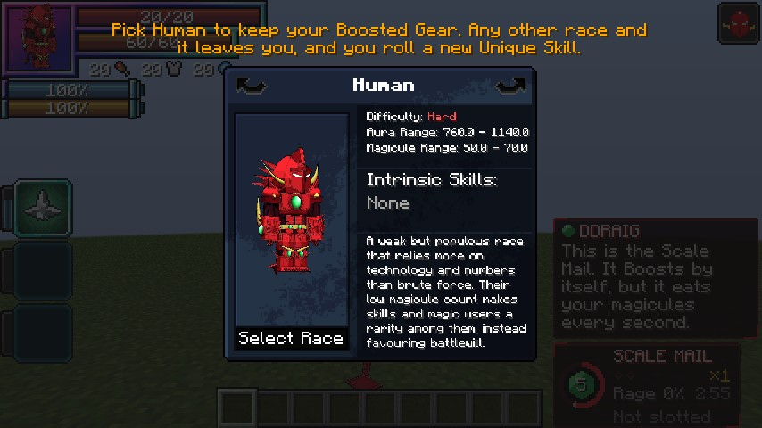

# Your first Sacred Gear

Devil x Slime's Sacred Gears are Tensura **Unique Skills**. There are five: the rival Heavenly Dragons, Asia's healing
rings, Kiba's swords and Gasper's eyes.

| Sacred Gear | Inside | What it is |
|---|---|---|
| [Boosted Gear](../boosted-gear/index.md) | Ddraig, the Red Dragon Emperor | A crimson gauntlet that doubles your power again and again |
| [Divine Dividing](../divine-dividing/index.md) | Albion, the White Dragon Emperor | Wings of light that halve your enemy's power and take it for you |
| [Twilight Healing](../twilight-healing/index.md) | no dragon | Two silver rings that heal with a touch, arrows of light and a field |
| [Sword Birth](../sword-birth/index.md) | no dragon | Fading copies of swords, in your hand or bursting out of the ground |
| [Forbidden Balor View](../balor-view/index.md) | no dragon | A time stop in your eyes: what you look at hangs in the air until its time is up |

## Getting one

**Reincarnate as a human.** When Tensura rolls a human's Unique Skill, the five gears are in the roll, with the same
odds as every other skill in it.

- **One Sacred Gear per player.** You can never hold two. If you have one, no other can be given to you in any way:
  "Albion and Ddraig can't share a host.", or "You already carry a Sacred Gear."
- **One Divine Dividing per world.** While a player holds Divine Dividing, the roll skips it. Its other way in is the
  [White Dragon Emperor](../world/white-dragon-emperor.md)'s jewel.
- **The Holy Factor shuts out the dragons.** A player with the [Holy Factor](../durandal/index.md#the-holy-factor) never
  rolls the Boosted Gear or Divine Dividing. The other gears are fine.
- Tensura's plundering skills can't steal any of them.

### Only in humans

Since **0.1.84**, as in DxD, a Sacred Gear is born only in a human: Tensura's **Human** line (Human, Enlightened Human,
Human Saint, Divine Human).

- **The roll.** Only a human's reincarnation roll has the gears in it. Pick any other race and you roll a normal Unique
  Skill; you never lose a roll to them.
- **Albion's jewel** gives Divine Dividing only to a human.
- **Keeping it.** Your gear stays through everything DxD and Tensura's evolution do to you: an Evil Piece making you a
  Devil, a Brave Saint card making you an Angel, an Angel's fall, Tensura's own evolutions.
- **Losing it.** Pick another race in **Tensura's race menu** (a Race Reset Scroll, the Reincarnation spell) and the gear
  leaves you: Ddraig or Albion says goodbye, and you roll a new Unique Skill in its place. The race menu warns you first:
  "Pick Human to keep your Boosted Gear." Divine Dividing goes back into the roll for someone else. A Juggernaut Drive's
  life debt stays with you.
- **Another road.** Since **0.2.33**, a gear that reaches a non-human any other way leaves within a second, or at their next login: another mod's pick, or another mod's rebirth into a
  race from Tensura's race menu. "A Sacred Gear only lives in a human, so yours left you." You get a new Unique Skill in its place. Evil Pieces, Brave Saint cards, evolution, falling
  and an operator's `/tensura edit` commands keep the gear as before.
- **Gears from older worlds.** A Devil, Angel, Fallen Angel, someone of the Vampire line or a Wight keeps a gear held from before 0.1.84 until their next race-menu pick. Anyone else, on a
  race no lawful road leads to, loses it at their next login, for a new Unique Skill.

So the road to a Devil with a Sacred Gear is Issei's: start human, roll a gear, then take an
[Evil Piece](../races/peerage.md).

<figure markdown="span">
  { loading=lazy }
  <figcaption>The race menu warns a gear holder first.</figcaption>
</figure>

!!! info "For server owners"
    [`humanOnly`](../reference/configuration.md#sacred_gears) in `[sacred_gears]` turns the rule off. Which races count
    as human is a race tag, `dxdtensura:sacred_gear_hosts`, that a datapack can add to.

!!! note "Operators and testing"
    With cheats on (or operator level 2), you can grant a gear straight away:

    ```
    /tensura edit ability grant @s dxdtensura:boosted_gear
    /tensura edit ability grant @s dxdtensura:divine_dividing
    /tensura edit ability grant @s dxdtensura:twilight_healing
    /tensura edit ability grant @s dxdtensura:sword_birth
    /tensura edit ability grant @s dxdtensura:forbidden_balor_view
    ```

    Commands give a gear to any race, for testing.

## Putting it on a key

1. Open Tensura's **Status Menu** (default **B**) and put the skill on one of your ability slots.
2. Press that slot's key. Tensura's defaults are **Z**, **X** and **C** for slots 1 to 3.
3. The first press **summons** the gear ("Boosted Gear!" or "Divine Dividing!"). It costs nothing. Once it is out, each
   press uses the slot's mode.

**Switching modes.** Hold **Left Alt** (Tensura's "Next Ability Mode" key) and press the slot key to step to the next
mode. "Previous Ability Mode" has no key by default; you can set one under Controls → Key Binds, in the
**Tensura:Reincarnated** category. You can also put a different mode of the same gear on each slot, so Boost is on Z
and Dragon Shot on X, for example.

You can also set a slot with a command: `/ability set <skill> <mode> <slot>`. For example,
`/ability set dxdtensura:boosted_gear 0 1` puts Boost on slot 1.

**Modes you haven't unlocked yet** are skipped when you switch. A slot still set to one just tells you when it unlocks.

## Mastery

Using your gear earns Tensura **mastery** for it, the bar in Tensura's skill screen. Mastery is how the gears grow:

- The Boosted Gear's gauntlet **evolves** at 40% and at 100%, unlocking new modes. See
  [Forms and mastery](../boosted-gear/forms-and-mastery.md).
- Divine Dividing can **Divide deeper** and **fly faster** as its mastery grows, and its Balance Breaker can awaken
  from 40%. See [Divine Dividing](../divine-dividing/index.md).
- Twilight Healing opens **Healing Arrows** at 40% and the **Healing Field** at 70%, and heals more for less once
  mastered. See [Twilight Healing](../twilight-healing/index.md).
- Sword Birth opens **Blade Line** at 40%, its **elements** at 50% and **Blade Ring** at 70%, and lasts longer for less
  once mastered. See [Sword Birth](../sword-birth/index.md).
- Forbidden Balor View opens **Forbidden View** at 40% and **Stop the World** at 70%, and stops longer on shorter cooldowns
  once mastered. See [Forbidden Balor View](../balor-view/index.md).

## The Sacred Gear panel

While your gear is out, a panel to the right of your hotbar shows its state: a ring around the gear's jewel with a
countdown, the gear's name, your power, your form and mastery, and the key of your first slot with its mode. Only you
see it, and **F1** hides it. Each gear's page explains what its panel shows.

## Your partner

The dragon sealed in a Heavenly Dragon gear talks to you (Twilight Healing, Sword Birth and Forbidden Balor View have no voice). Ddraig (Boosted Gear) and Albion (Divine Dividing) teach you each power the
first time you use it, warn you when you're running low, and react to what you do, in a small speech box above the
panel. The client setting `ddraigLines` sets how much of them you see. See [Ddraig and his Bargain](../boosted-gear/ddraig.md).

## Server owners: the reincarnation roll

Tensura picks the reincarnation Unique Skill from a list in its own config file,
`config/tensura/reincarnation_config.toml`, under `[Skills] startingSkills`. To join that roll, **Devil x Slime writes
its gears into that list** every time a world or server starts:

- `"dxdtensura:boosted_gear"`, switched by `addToReincarnationPool` in `config/dxdtensura-server.toml`;
- `"dxdtensura:divine_dividing"`, switched by `addDivineDividingToReincarnationPool`;
- `"dxdtensura:twilight_healing"`, switched by `addTwilightHealingToReincarnationPool` (in `[twilight]`);
- `"dxdtensura:sword_birth"`, switched by `addSwordBirthToReincarnationPool` (in `[sword_birth]`);
- `"dxdtensura:forbidden_balor_view"`, switched by `addBalorViewToReincarnationPool` (in `[balor_view]`).

It adds each entry once and leaves the rest of the file alone. Set a switch to `false` and the next start **removes**
that entry, even one you added by hand. If you uninstall Devil x Slime, a leftover entry is harmless: Tensura skips
skill ids it doesn't know.
