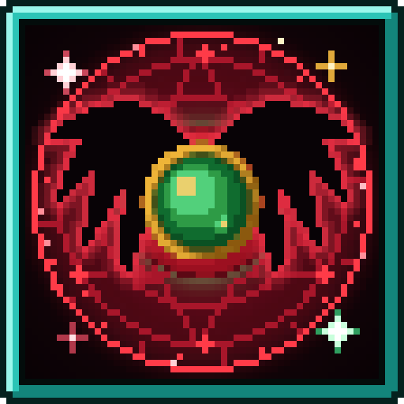
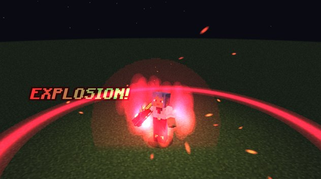
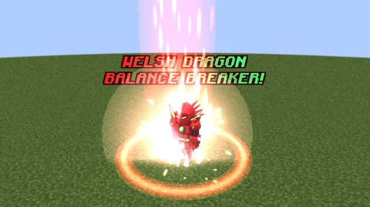
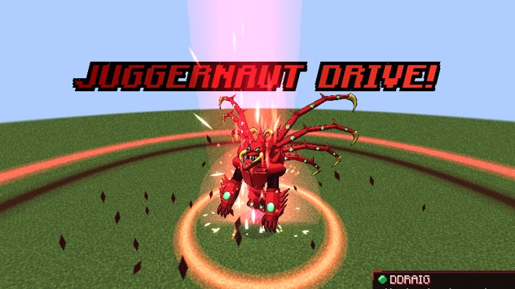

---
hide:
  - navigation
  - toc
---

# Devil x Slime

**High School DxD comes to Tensura: Reincarnated.** Devil x Slime is an addon for the Tensura: Reincarnated mod
(Minecraft 1.21.1, NeoForge). It started with the most iconic powers in DxD, the two Heavenly Dragons' Sacred Gears,
and now has Asia's Twilight Healing, Kiba's Sword Birth and Sword of Betrayer, Gasper's Forbidden Balor View, Saji's Absorption Line, Salvation Rose (a Sacred Gear of our own), Xenovia's Durandal and the
fragments of Excalibur with Ex-Durandal, dragon-style flight on its wings, the three
races of the Three Factions (Devils with their Houses and Evil Pieces, Angels with their Brave Saints, and Fallen
Angels), Koneko's cat Youkai, Kunou's foxes, Rossweisse's Valkyries, the Stray Devils to hunt, Fenrir to fight or tame and the Gremory family's town
in Hell. It is growing into the whole DxD world.

[Download on CurseForge](https://www.curseforge.com/minecraft/mc-mods/devil-x-slime){ .md-button .md-button--primary }
[Join the Discord](https://discord.gg/kvE52ppS9Z){ .md-button }
[Install it](getting-started/installation.md){ .md-button }

## What's in the mod

-   :material-hand-back-right:{ .lg .middle } **[Boosted Gear](boosted-gear/index.md)**

    ---

    Ddraig's crimson gauntlet. Boost your power ×2 every 10 seconds, then release it in an Explosion, give it to an
    ally or fire it as a Dragon Shot. Three forms that grow with you.

-   :material-shield-half-full:{ .lg .middle } **[Balance Breaker](boosted-gear/balance-breaker.md)**

    ---

    The Red Dragon Emperor's Scale Mail: armour, flight, a Boost that never stops and a rage meter that pushes you
    past your limit.

-   :material-chess-rook:{ .lg .middle } **[Promotion's armour forms](boosted-gear/promotion-forms.md)**

    ---

    A Pawn in the Scale Mail changes its shape: a fast Knight, a heavy Rook, a Bishop with cannons, and the crimson True
    Queen.

-   :fontawesome-solid-dragon:{ .lg .middle } **[Juggernaut Drive](boosted-gear/juggernaut-drive.md)**

    ---

    The forbidden dragon form and its Longinus Smasher. It costs a piece of your life every time.

-   :material-feather:{ .lg .middle } **[Divine Dividing](divine-dividing/index.md)**

    ---

    Albion's wings of light. Fly, Divide your enemy's power and take it for yourself, then break the limit into the
    white Scale Mail, and become the white dragon in its Juggernaut Drive.

-   :material-ring:{ .lg .middle } **[Twilight Healing](twilight-healing/index.md)**

    ---

    Asia's silver rings. Heal with a touch, with arrows of light for your allies, and with a field of light around
    you.

-   :material-sword-cross:{ .lg .middle } **[Sword Birth](sword-birth/index.md)**

    ---

    Kiba's gear. Make fading copies of any sword you're strong enough for, hold two, and tear a line or a ring of huge
    blades out of the ground.

-   :material-sword-cross:{ .lg .middle } **[Sword of Betrayer](sword-birth/sword-of-betrayer.md)**

    ---

    Sword Birth's Balance Breaker: holy-demonic swords, the sword itself in your hand, a wall of blades, and holy power turned on your enemies.

-   :material-eye:{ .lg .middle } **[Forbidden Balor View](balor-view/index.md)**

    ---

    Gasper's Evil Eye. What you look at stops dead, hanging in the air, until its time is up. Then everything in sight,
    then everything around you.

-   :material-vector-line:{ .lg .middle } **[Absorption Line](absorption-line/index.md)**

    ---

    Saji's lines, with Vritra asleep inside. Tie enemies down and drink them dry, then Shadow Prison, black flames and Delete Field.

-   :material-flower:{ .lg .middle } **[Salvation Rose](salvation-rose/index.md)**

    ---

    A Sacred Gear of our own: a ring with a pink gem and a bow of rose and light. Seeking arrows, a rain of arrows, a
    winged goddess form, and a witch for a gem gone dark.

-   :material-bird:{ .lg .middle } **[Dragon flight](getting-started/flight.md)**

    ---

    Soar on the mod's wings with momentum: dive for speed, glide, boost, brake and barrel roll, with wings that beat and
    pose as you fly.

-   :material-bat:{ .lg .middle } **[Devils](races/devil.md)**

    ---

    Play as a Devil, from Low-class to Satan-class: bat wings, Demonic Power, a magic circle home, and a weakness to holy
    things.

-   :material-fire:{ .lg .middle } **[House powers](races/houses.md)**

    ---

    A pure-blooded Devil is born of House Bael, Gremory, Phenex, Sitri or Leviathan: the Power of Destruction, wings of
    fire and rebirth, water in living shapes, or the raw sea.

-   :material-chess-queen:{ .lg .middle } **[The Peerage](races/peerage.md)**

    ---

    High-class Devils are Kings with 15 Evil Pieces. Make a friend, a beaten monster or an otherworlder your servant,
    promote your Pawns in enemy territory, and spend a rare Mutation Piece on someone worth far more.

-   :material-account-tie:{ .lg .middle } **[Rias Gremory](races/rias.md)**

    ---

    The NPC King in the old school building. Join her peerage in single player, carry her flyer for a second
    chance at death, and hunt Stray Devils for her.

-   :material-hand-heart:{ .lg .middle } **[Asia Argento](races/asia.md)**

    ---

    Rias's Bishop: a lost nun you lead home, who heals you and goes out with Rias's servants.

-   :material-spear:{ .lg .middle } **[Angels and Fallen Angels](races/angels.md)**

    ---

    Feathered wings that multiply with rank, spears of light, Blessing and the Great Spear. Sin makes an Angel fall,
    and a Fallen Angel with an Evil Piece becomes a hybrid.

-   :material-bow-arrow:{ .lg .middle } **[Light weapons](races/light-weapons.md)**

    ---

    Shape your light into a sword with a guard or a bow that needs no arrows, or keep the Light Spear in your hand.

-   :material-cards-playing:{ .lg .middle } **[Brave Saints](races/brave-saints.md)**

    ---

    A Seraph's twelve cards and the wild Joker. Make a human an Angel, then play Poker or Blackjack together for a hand's
    power, up to a Royal Flush and Heaven's Judgement.

-   :material-feather:{ .lg .middle } **[Michael](races/michael.md)**

    ---

    The NPC Seraph: he deals you his Hearts in single player, and trades your card up as you grow.

-   :material-cat:{ .lg .middle } **[Nekomata and Nekoshou](races/nekomata.md)**

    ---

    Koneko's and Kuroka's race: ears and tails that move with you, Senjutsu's ki, wheels of flame and a poison mist. Beware the
    Malice it takes in.

-   :material-paw:{ .lg .middle } **[Kitsune and the Nine-Tailed Fox](races/kitsune.md)**

    ---

    Kunou's and Yasaka's race: blue Fox Fire, a fox body that slips through gaps, illusions and a barrier of sunshower rain,
    and for the rare Nine-Tailed Fox, Yasaka's ten-block Great Fox.

-   :material-shield-sword:{ .lg .middle } **[Valkyries](races/valkyrie.md)**

    ---

    Rossweisse's race: wingless flight, the Battle Dress, Runes, a Full Burst of magic circles, barriers and seals, and
    the souls of the fallen called back as Einherjar.

-   :material-skull:{ .lg .middle } **[Stray Devils](world/stray-devils.md)**

    ---

    Devils twisted by the Evil Piece they stole. They rise on dark nights and rule ruined mansions, Viser first.

-   :material-castle:{ .lg .middle } **[The Castle Town of Gremory](world/castle-town.md)**

    ---

    A walled town in Hell under a purple sky: people in its streets, a market, an inn, a bounty board, and Rias's parents in the castle, with titles and a treasury to earn.

-   :material-crown:{ .lg .middle } **[The White Dragon Emperor](world/white-dragon-emperor.md)**

    ---

    A boss in a ruined white colosseum, with warned moves for every phase. Beat him for Albion's jewel.

-   :material-dog-side:{ .lg .middle } **[Fenrir](world/fenrir.md)**

    ---

    The god-slaying wolf in a frozen ruin. Pin him with Gleipnir, then kill him for his fang or tame him with the white Juggernaut Drive.

-   :material-sword:{ .lg .middle } **[Ascalon](boosted-gear/ascalon.md)**

    ---

    Saint George's dragon-slaying sword, waiting in a ruined church. It can live inside the Boosted Gear.

-   :material-sword:{ .lg .middle } **[Durandal](durandal/index.md)**

    ---

    Xenovia's holy sword, sealed in a crypt, for those with the Holy Factor. Its wave tears along the ground, and once
    tamed it cuts through anything.

-   :material-sword:{ .lg .middle } **[Excalibur's fragments](excalibur/index.md)**

    ---

    Seven holy swords, each with a power of its own, and Freed Sellzen in the ruined churches at night. Fuse them into one
    Excalibur, or sheathe Durandal in them as Ex-Durandal.

-   :material-book-open-page-variant:{ .lg .middle } **[Lore mode](lore-mode.md)**

    ---

    A game rule for one world: the Longinus gears as strong as in the story, with Boost and Divide by press and no
    time limit on the Scale Mails.

<figure markdown="span">
  { loading=lazy }
  <figcaption>"Explosion!"</figcaption>
</figure>

<figure markdown="span">
  { loading=lazy }
  <figcaption>Welsh Dragon Balance Breaker</figcaption>
</figure>

<figure markdown="span">
  { loading=lazy }
  <figcaption>Juggernaut Drive</figcaption>
</figure>

## Quick start

1. **Install** the mod and its requirements on the client and the server: see [Installation](getting-started/installation.md).
2. **Reincarnate as a human** and roll the Boosted Gear, Divine Dividing, Twilight Healing, Sword Birth, Forbidden Balor View,
   Absorption Line or Salvation Rose as your Unique Skill (only one Sacred Gear each, and [only humans](getting-started/first-gear.md#only-in-humans) roll them).
3. **Put the skill on an ability slot** in Tensura's Status Menu (default **B**) and press the slot key (**Z**, **X** or
   **C**) to summon your gear.
4. **Use it.** Every use earns mastery, and mastery unlocks the rest. [Your first Sacred Gear](getting-started/first-gear.md)
   walks you through it.

!!! tip "New here?"
    Start with [Your first Sacred Gear](getting-started/first-gear.md), then read the page for the gear you rolled. The
    [FAQ](faq.md) answers the questions players ask most. Want to play a Devil? See [Devils](races/devil.md). An Angel or a
    Fallen Angel? See [Angels and Fallen Angels](races/angels.md). A cat? See [Nekomata and Nekoshou](races/nekomata.md).

## Good to know

- Everything in this wiki describes the **latest version** of the mod. Server owners can change almost every number
  in the [configuration](reference/configuration.md); the numbers here are the defaults.
- [Lore mode](lore-mode.md) is off unless you turn it on. These pages describe the normal game.
- The mod is built for **Tensura: Reincarnated 2.0.1.3 or newer** on Minecraft **1.21.1** with **NeoForge**.
- Playing with friends? See [Multiplayer and servers](reference/multiplayer.md): a server and its players need the same
  version of the mod.
- There are hidden **easter eggs** for multiplayer. No spoilers here.
