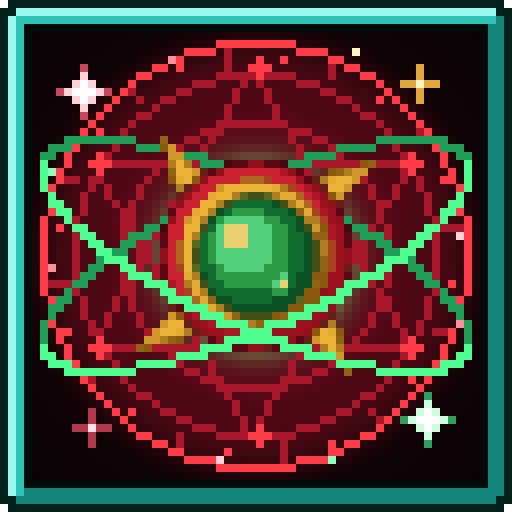
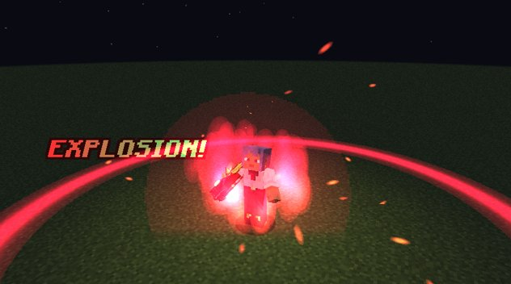
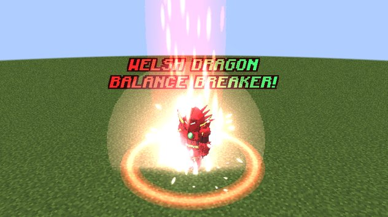
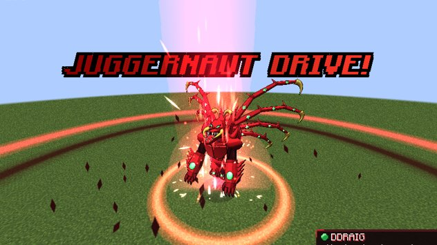

---
hide:
  - navigation
  - toc
---

# Devil x Slime

**High School DxD comes to Tensura: Reincarnated.** Devil x Slime is an addon for the Tensura: Reincarnated mod
(Minecraft 1.21.1, NeoForge). It started with the most iconic powers in DxD, the two Heavenly Dragons' Sacred Gears, and
now has its first race, the Devils, with their Evil Pieces. It is growing into the whole DxD world: Angels, Fallen Angels, Evil Pieces and more
Sacred Gears.

[Download on CurseForge](https://www.curseforge.com/minecraft/mc-mods/devil-x-slime){ .md-button .md-button--primary }
[Install it](getting-started/installation.md){ .md-button }

## What's in the mod

-   :material-hand-back-right:{ .lg .middle } **[Boosted Gear](boosted-gear/index.md)**

    ---

    Ddraig's crimson gauntlet. Boost your power ×2 every 10 seconds, then release it in an Explosion, give it to an
    ally or fire it as a Dragon Shot. Three forms that grow with you.

-   :material-shield-half-full:{ .lg .middle } **[Balance Breaker](boosted-gear/balance-breaker.md)**

    ---

    The Red Dragon Emperor's Scale Mail: armour, flight, a Boost that never stops and a rage meter that pushes you
    past your limit.

-   :fontawesome-solid-dragon:{ .lg .middle } **[Juggernaut Drive](boosted-gear/juggernaut-drive.md)**

    ---

    The forbidden dragon form and its Longinus Smasher. It costs a piece of your life every time.

-   :material-feather:{ .lg .middle } **[Divine Dividing](divine-dividing/index.md)**

    ---

    Albion's wings of light. Fly, Divide your enemy's power and take it for yourself, then break the limit into the
    white Scale Mail.

-   :material-bat:{ .lg .middle } **[Devils](races/devil.md)**

    ---

    Play as a Devil, from Low-class to Satan-class: bat wings, Demonic Power, a magic circle home, and a weakness to holy
    things.

-   :material-chess-queen:{ .lg .middle } **[The Peerage](races/peerage.md)**

    ---

    High-class Devils are Kings with 15 Evil Pieces. Make a friend, a beaten monster or an otherworlder your servant,
    and promote your Pawns in enemy territory.

-   :material-account-tie:{ .lg .middle } **[Rias Gremory](races/rias.md)**

    ---

    The NPC King in the old school building. Join her peerage in single player, and carry her flyer for a second
    chance at death.

-   :material-crown:{ .lg .middle } **[The White Dragon Emperor](world/white-dragon-emperor.md)**

    ---

    A boss in a ruined white colosseum. Beat him for Albion's jewel.

-   :material-sword:{ .lg .middle } **[Ascalon](boosted-gear/ascalon.md)**

    ---

    Saint George's dragon-slaying sword, waiting in a ruined church. It can live inside the Boosted Gear.

<figure markdown="span">
  { loading=lazy }
  <figcaption>"Explosion!"</figcaption>
</figure>

<figure markdown="span">
  { loading=lazy }
  <figcaption>Welsh Dragon Balance Breaker</figcaption>
</figure>

<figure markdown="span">
  { loading=lazy }
  <figcaption>Juggernaut Drive</figcaption>
</figure>

## Quick start

1. **Install** the mod and its requirements on the client and the server: see [Installation](getting-started/installation.md).
2. **Reincarnate** and roll the Boosted Gear or Divine Dividing as your Unique Skill (you can never have both).
3. **Put the skill on an ability slot** in Tensura's Status Menu (default **B**) and press the slot key (**Z**, **X** or
   **C**) to summon your gear.
4. **Use it.** Every use earns mastery, and mastery unlocks the rest. [Your first Sacred Gear](getting-started/first-gear.md)
   walks you through it.

!!! tip "New here?"
    Start with [Your first Sacred Gear](getting-started/first-gear.md), then read the page for the gear you rolled. The
    [FAQ](faq.md) answers the questions players ask most. Want to play a Devil? See [Devils](races/devil.md).

## Good to know

- Everything in this wiki describes the **latest version** of the mod. Server owners can change almost every number
  in the [configuration](reference/configuration.md); the numbers here are the defaults.
- The mod is built for **Tensura: Reincarnated 2.0.1.3 or newer** on Minecraft **1.21.1** with **NeoForge**.
- There are hidden **easter eggs** for multiplayer. No spoilers here.
