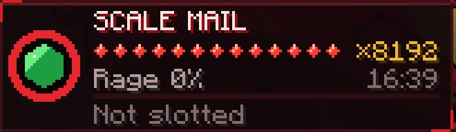
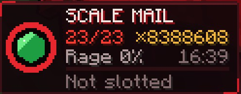
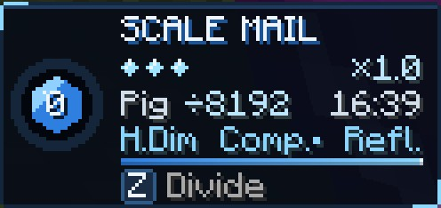

# Lore mode

A game rule, added in **0.2.0**, that makes the Longinus gears as strong as they are in the story, and corrects the other
places balancing moved the mod away from it. It's for one world, and it's off by default. With it off, the game plays exactly
as the rest of this wiki says.

<div class="grid" markdown>

<figure markdown="span">
  { loading=lazy }
  <figcaption>13 stacks, ×8,192, and the magicules' clock in place of a time limit.</figcaption>
</figure>

<figure markdown="span">
  { loading=lazy }
  <figcaption>Past the pips, the panel counts: 23 stacks.</figcaption>
</figure>

<figure markdown="span">
  { loading=lazy }
  <figcaption>White: a pig Divided past every normal cap.</figcaption>
</figure>

</div>

## Turning it on

- **For a new world:** it's **Lore Mode** in the game rules on the Create World screen, in the Player section.
- **In a world you're playing,** as an operator:

```
/gamerule dxdLoreMode true
```

It acts at once, and you can flip it at any time. Flipping it off takes back what only it allowed: stacks over your normal cap
drop, an armour worn past its normal limit ends, and copies with no timer fade. Divides already landed wear off as usual.

It's the only switch. The numbers are in [`[lore_mode]`](reference/configuration.md#lore_mode), and none of them does anything
with the rule off.

## What changes

| | Normal game | Lore mode |
|---|---|---|
| [Boost's limit](#the-boost) | By the gauntlet's form | By your max EP, up to 30 stacks |
| Boost in the Scale Mail | A stack every 10 s | Also a stack per press, no cooldown |
| What the Boost multiplies | Bare fists | Every hit you land |
| Boost after a release | A 30 s wait | Ready at once |
| Transfer | Half the extra power | All of it |
| [Scale Mail time limit](#the-scale-mails) | Yes, with an upkeep | None, with 0.1% upkeep a second |
| Cooldown after the armour | 60 s, or 5 minutes after a long wear | Always 60 s |
| The Bargain's armour | 30 s | 10 s |
| [Divide](#divide) in the white armour | On a timer, up to a cap | A press each, up to 30 on one target |
| [The compress](#the-compress-and-half-dimension) | Vanishes mobs only, once per armour | Also bosses and players, no once-only |
| [Penetrate](#penetrate) | Up to Guardian | Past every level, armour and the Scale Mails' cut too |
| [Durandal](#durandal) | Burns a Devil | No burn, and full strength for the crystal's factor |
| [Promotion](#promotion) | A 60 s wait, the Queen pays | No wait, the Queen pays nothing |
| [Sword Birth](#sword-birth) | 2 copies that fade | 16 copies that don't fade with time |

## The Boost

### Your limit

Your body is the limit, as Issei's is: **one stack each time your max EP doubles from 100**. It's never less than your form's
cap, and never more than 30. It follows your max EP live.

| Max EP | Limit | Multiplier |
|---|---|---|
| 1,000 | 3 | ×8 |
| 6,400 | 6 | ×64 |
| 20,000 (Middle-class) | 7 | ×128 |
| 100,000 (High-class) | 9 | ×512 |
| 400,000 (Ultimate-class) | 11 | ×2,048 |
| 1,000,000 | 13 | ×8,192 |
| 10,000,000 | 16 | ×65,536 |
| 100,000,000 | 19 | ×524,288 |

A rage burst's +1 and the dragon's +2 go on top, still never past 30. Rival fights keep their own lift if it's higher.

### Its price

A stack up to your form's cap costs what it always did. Past the cap, every stack costs the last price under it: 200 magicules
in the Initial form, 1,600 in Base, 3,200 in the Gift. The dragon's stacks stay free, and body strain outside the armour stays.

### Its pace

| Where | By itself | By press |
|---|---|---|
| Gauntlet | 1 stack every 10 s, up to your limit | As usual: start charging, release an Explosion |
| Scale Mail | 1 every 10 s, up to your form's cap | 1 per press, up to your limit |
| The Bargain's armour | 1 every 5 s, up to your form's cap | 1 per press, up to your limit |
| The red dragon | 1 every second, up to your form's cap + 2 | 1 per press, up to your limit + 2 |

- A press has **no cooldown**. Every press counts, with its gem flash and its BOOST!. The voice plays at most twice a second.
- At your limit the action bar says "Your body can't take any more." There's no stack and no price.
- During a rage burst a press does nothing, since the burst fills your stacks itself, to your limit + 1 for free.

### Every hit

In an Explosion or the armour, ×2ⁿ applies to **every hit you land**: your fist, a held weapon, Tensura's skills, magic,
projectiles and race powers.

- **Not added again:** Dragon Shot, both Longinus Smashers and the dragon's shockwave, which already carry the Boost, and
  Ascalon's holy strike, a share of a hit that already has it.
- **Not counted:** a hit on yourself, damage over time from an effect (burning, poison, a holy burn and the like) and your
  pets' or subordinates' hits.
- It doesn't touch your defence, and the Boost's speed keeps its +100% cap.

### After a release, and Transfer

Boost is **ready at once** after a release, though the Explosion still lasts 15 seconds. A **Transfer gives the whole ×2ⁿ**, to one
target, as in the story. Its reach and 30 seconds stay, and so does the
[overload](divine-dividing/balance-breaker.md) on a white rival.

## The Scale Mails

Both armours, red and white:

- **No time limit.** It lasts until you end it or your magicules run out, and the panel's clock shows what they can still pay.
- **Upkeep is 0.1% of your max magicules a second**, about 17 minutes from full.
- **The cooldown is always 60 seconds** when you let go. Running dry still means 5 minutes and exhaustion.
- **The Bargain's armour lasts 10 seconds**, as in the story. It still has no flight, and its 10-minute cooldown stays.

## Divide

### In the white armour and the white dragon

- **Each press lands one more Divide** on what you look at, on bosses too, up to **30** on one target. There's no cooldown, only half
  a second between presses so each slash plays out.
- The chain keeps its pace and stops at the normal cap. Past that it's your presses, so a strong enemy can't overflow your gauge
  without you asking.
- **The strain gauge stays.** Energy you can't hold fills it, your wings vent it, and overflowing it breaks the armour.

### Outside the armour

Still one every 10 seconds, but the chain doesn't stop at 3 Divides, or a boss's 2. It runs up to 30, for as long as the target stays in
range.

### The red Scale Mail, with Albion's power

Each press of [Divide](boosted-gear/divide.md) lands one more, half a second apart, also in the red dragon. **The life price
stays:** 2% a Divide, and at the 50% floor Ddraig refuses it. That's about 25 presses from full.

### Strength, the refusal and the wings

- **No cap on strength from Divides.** The bonus is still only what the target lost, so a weak mob still gives little.
- **The refusal reaches the armour too:** a Divide press or chain on something over 10 times your max EP is refused, as Vali couldn't
  Divide Loki. Half Dimension and Compression Divider aren't refused.
- **Flying on the wings is free.**

## The compress and Half Dimension

| Target | The compress |
|---|---|
| A mob at or under 70% of your max EP, or drained to 5% | Vanishes, as usual |
| A boss or a player at or under **50%** of your max EP | **Vanishes** |
| A boss or a player above that | Only compressed |
| Rias, or anything invulnerable | Only compressed |

- It still takes the white armour, full mastery and a target at its normal cap of Divides.
- It works **more than once** in an armour, and **Compression Divider and Half Dimension have no wait**.
- **A vanish is a real kill.** It counts as yours, with loot and EP. It goes past the
  [White Dragon Emperor](world/white-dragon-emperor.md)'s hit cap, as a win with his jewel. Totems and Tensura's death saves don't stop
  it.
- **On a player**, it follows the server's own PvP and team rules, and creative and spectator players can't be targeted. Rias's flyer can
  still catch someone who vanishes.

## Penetrate

With [Penetrate](boosted-gear/penetrate.md)'s toggle on, a gear hit also goes past Tensura's top barrier level, through vanilla
armour and through both Scale Mails' cut. Its 0.5% price stays. The Emperor's hit cap stays, since that's his fight and not a defence.
Only the gear's own hits penetrate, not a held weapon's.

## Durandal

[Durandal](durandal/index.md) never burns a Devil wielder. The Artificial Holy Factor is as strong as the natural one, and a Durandal
Replica has one fifth of the wave and the strike, in anyone's hand.

## Promotion

[Promotion](races/peerage.md) has no wait between Promotions, and a promoted Queen pays nothing. Enemy territory and the King's word
still decide when it works.

## Sword Birth

[Sword Birth](sword-birth/index.md) holds up to **16 copies**, and they don't fade with time. A dropped copy still fades, and so does one
replaced in the same hand or held at death.

## What stays the same

- The Scale Mails' awakening and its countdown, stats, flight, the flat cut, Ddraig's fire and the white halving.
- The Juggernaut Drives' fuel, life debt and aftermath, though they take the same presses.
- Reflect and Reduce, the Brave Saints' hands and Twilight Healing's price. The story gives them no numbers.
- The Evil Pieces' strengths. Stronger pieces in Lore mode are on the [roadmap](roadmap.md).
