# Angels and Fallen Angels

DxD's Angels and Fallen Angels as Tensura races, added in **0.1.66**. Each line has five ranks, and each rank is a race
of its own on Tensura's evolution screen.

- **Angels** serve Heaven. They're **Holy**, spread white wings under a gold halo, throw golden spears of light, bless
  their friends, and are strongest under the open sky. Sin makes an Angel fall.
- **Fallen Angels** are Grigori's kin, cast out of Heaven. They're **Chaos**, spread black wings, throw violet spears
  of light and charge a Great Spear. Hell's air is home to them.

Both are hurt by nothing holy: Holy Water, Ascalon and Tensura's holy damage leave them alone.

<figure markdown="span">
  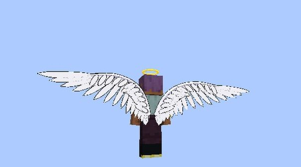{ loading=lazy }
  <figcaption>A Low-class Angel: two white wings and the halo.</figcaption>
</figure>

<figure markdown="span">
  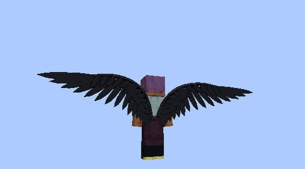{ loading=lazy }
  <figcaption>A Low-class Fallen Angel.</figcaption>
</figure>

## Becoming one

Pick **Low-class Angel** or **Low-class Fallen Angel** in Tensura's race menu:

- when you start a new character;
- after Tensura's **Reincarnation** spell;
- on an existing character, with Tensura's **Race Reset Scroll**.

An Angel can also become a Fallen Angel by [falling](#sin-and-the-fall). Server owners can take either race out of the
menu with [`angelInRaceMenu` and `fallenAngelInRaceMenu`](../reference/configuration.md#angel).

## The ranks

You climb the ranks with Tensura's evolution, like its own race lines.

| Rank | Angel | Fallen Angel | How you get there | Base aura | Base magicules | Wings |
|---|---|---|---|---|---|---|
| 1 | **Low-class** | **Low-class** | Pick it in the race menu | 1,500–2,500 | 2,500–3,500 | 2 |
| 2 | **Middle-class** | **Middle-class** | 20,000 EP | 8,000 | 12,000 | 4 |
| 3 | **High-class** | **High-class** | 100,000 EP | 40,000 | 60,000 | 6 |
| 4 | **Ultimate-class** | **Cadre** | 400,000 EP and 4 bosses (like Tensura's Saints) | 150,000 | 250,000 | 10 |
| 5 | **Seraph** | **Governor-General** | An awakening (below) | 1,000,000 | 1,000,000 | 12 |

- Both lines have the same stats at the same rank, and the same as a [Devil](devil.md) of the same class: more aura,
  magicules, health and attack each rank.
- **Rank 5 is an awakening.** Awakening as a **True Hero** makes an Ultimate-class Angel a Seraph. Awakening as a True
  Hero **or** a True Demon Lord makes a Cadre the Governor-General.
- Angels are **Holy**, so only the Hero path is open to them. Fallen Angels are **Chaos** and can take either path.
- Tensura's **Harvest Festival** (its Demon Lord awakening) moves a Fallen Angel one rank up. It gives an Angel nothing.

<figure markdown="span">
  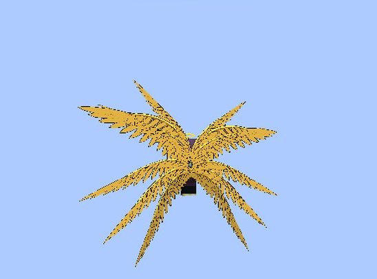{ loading=lazy }
  <figcaption>A Seraph's twelve gold wings.</figcaption>
</figure>

<figure markdown="span">
  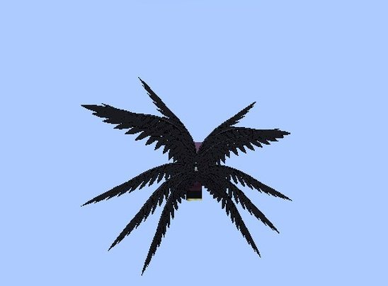{ loading=lazy }
  <figcaption>A Governor-General's twelve black wings.</figcaption>
</figure>

!!! info "For server owners"
    The races' own numbers (stats, EP ranges and requirements) are in `config/dxdtensura/race/angel_config.toml` and
    `fallen_angel_config.toml`. Those files are read when the game starts, so a change needs a restart. The powers'
    numbers are in the [`[angel]` section](../reference/configuration.md#angel) of the server config, which applies
    live.

## Wings and flight

Tensura's **Race/Mount Ability** key spreads your wings and gives you **free flight**, as it does for Devils.

- **In the air** you fly at once. **On the ground**, double-jump to take off.
- Press the key again and they fold back and go.
- **They multiply with rank:** 2, 4, 6, 10 and 12 wings, drawn larger each rank.
- **Angels' wings are white**, with a **gold halo** over your head while they're out. A Seraph's twelve are **gold**.
- **Fallen Angels' wings are black** and crow-like. Fallen Angels have no halo.
- **Standing on the ground**, the wings settle into a slight fold, and spread again as you take off.
- Flight speed, times creative flight, by rank: **0.8×, 1×, 1.2×, 1.5×, 2×**.

<figure markdown="span">
  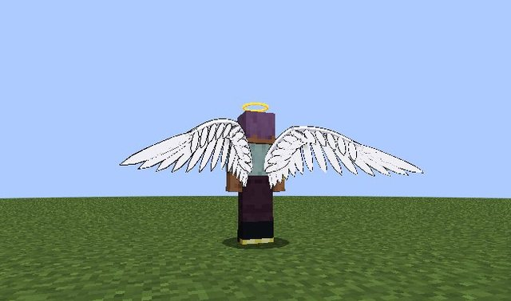{ loading=lazy }
  <figcaption>On the ground the wings fold slightly.</figcaption>
</figure>

**With a Sacred Gear.** Under either Scale Mail, as Juggernaut Drive's dragon, or with Divine Dividing's wings out, the
gear's wings show instead of yours, and the halo hides.

## The race skills

Each race comes with its skill, and loses it if you change race. Put it on an ability slot in Tensura's Status Menu and
switch its modes the way you switch the gears' modes.

| Skill | Race | Modes |
|---|---|---|
| **Heaven's Light** | Angels | Light Spear, Blessing, Fall |
| **Fallen Light** | Fallen Angels | Light Spear, Great Spear |
| **Fallen Blood** | [Hybrids](#hybrids) | Light Spear |

### Light Spear

Press it and a spear of light forms in your **raised hand**. A quarter of a second later your arm swings forward and it
flies where you're looking.

- It flies about **50 blocks** and shatters into shards where it hits.
- **Gold** from an Angel, **pink-violet** from a Fallen Angel or a hybrid.
- It deals **light damage**. Armour reduces it, and Tensura **triples it against undead**: a Low-class spear does 18 to
  a zombie.
- You can throw one **every second**. Short of magicules, nothing is thrown and nothing is spent.
- **The Boost never multiplies it.** A [Transfer](../boosted-gear/modes.md#transfer) does, at half.
- Under the open daytime sky an Angel's spear hits **25% harder** (see [Heaven's Grace](#day-and-hell)).

<figure markdown="span">
  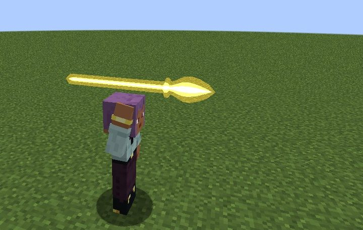{ loading=lazy }
  <figcaption>The spear in your raised hand, just before the throw.</figcaption>
</figure>

<figure markdown="span">
  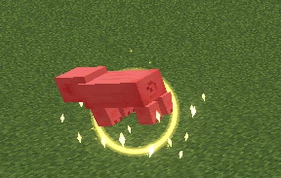{ loading=lazy }
  <figcaption>Where it hits.</figcaption>
</figure>

### The holy burn

All the races' light (Light Spear, Great Spear, Holy Lightning and the touch of Holy Barrier) leaves Tensura's **Holy
Damage** effect for **2 seconds** on whatever holy things hurt: **Devils, hybrids and Tensura's monsters**. That's
**16** more damage over the 2 seconds, **32** from a rank 4 and **48** from a rank 5. Players and animals that holy
things don't hurt take no burn.

### Blessing (Angels)

A golden pulse and drifting feathers that **heal you and everyone on your side within 8 blocks**: your pets, your
Tensura subordinates, your team, and other players who haven't hurt you in the last 30 seconds. Never hostile mobs.

- It also turns every plain **water bottle** you carry into **[Holy Water](devil.md#holy-water)**, one for one.
- Its cooldown is **20 seconds**.

<figure markdown="span">
  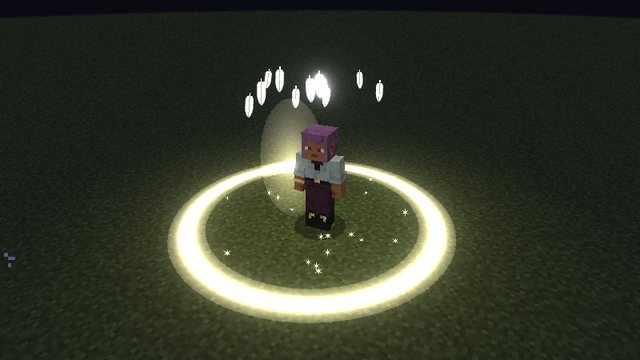{ loading=lazy }
  <figcaption>Blessing.</figcaption>
</figure>

### Great Spear (Fallen Angels)

**Hold the key**: your arm rises and a spear of light forms above your hand, growing as you hold.

- **Let go** after at least **half a second** to throw it. A shorter hold throws nothing, costs nothing and starts no
  cooldown.
- At half a second it's a Light Spear. Held to **3 seconds** it's full: three times the size, with **four times** a
  Light Spear's damage. In between, its damage, cost and size grow with the hold.
- It **bursts** where it lands, hitting everything within **4 blocks** except you, your pets and your allies.
- Its cooldown is **10 seconds**. Short of magicules when you let go, it throws at the charge you can pay for.

<figure markdown="span">
  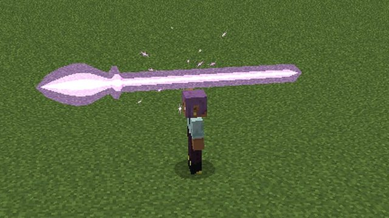{ loading=lazy }
  <figcaption>A Great Spear at full charge.</figcaption>
</figure>

### Damage and cost by rank

| Rank | Light Spear | Blessing heals | Great Spear, full |
|---|---|---|---|
| 1 | 6 damage, 100 magicules | 4, for 300 magicules | 24 damage, 500 magicules |
| 2 | 12 damage, 400 magicules | 8, for 1,200 | 48 damage, 2,000 |
| 3 | 24 damage, 1,800 magicules | 16, for 5,400 | 96 damage, 9,000 |
| 4 | 48 damage, 7,500 magicules | 32, for 22,500 | 192 damage, 37,500 |
| 5 | 96 damage, 30,000 magicules | 64, for 90,000 | 384 damage, 150,000 |

## Birth skills

Some are born with a rare gift. Each one is rolled **once per player**, ever:

- the first time you become an **Angel**, a **10%** chance of **Holy Barrier**;
- the first time you become a **Fallen Angel** (from the menu or by falling), a **10%** chance of **Holy Lightning**.

If you win, "You were born with" it, as a Tensura Extra Skill. You keep it through a fall, a race reset or an Evil
Piece.

### Holy Barrier

A dome of light with a **4 block** radius that moves with you for **10 seconds**: thin ribs of light over a golden
magic circle.

- It **pushes out** monsters and anyone who hurt you in the last 30 seconds. Those that holy things hurt burn while they
  touch it.
- It **stops projectiles from outside** at its edge. Yours and your allies' fly out.
- It costs **10% of your max magicules**. Press again to drop it. It can be raised again **60 seconds** after it ends.

### Holy Lightning

A golden-white, jagged bolt on what you look at within **32 blocks**, hitting everything within **2 blocks** of the
strike except you, your pets and your allies.

- **Holy damage** by rank: **12, 24, 48, 96, 192**, plus the holy burn. Armour reduces it. No fire.
- It costs **200 to 60,000 magicules** by rank, and you can call it **every 5 seconds**.

<figure markdown="span">
  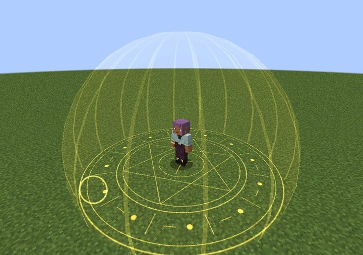{ loading=lazy }
  <figcaption>Holy Barrier.</figcaption>
</figure>

<figure markdown="span">
  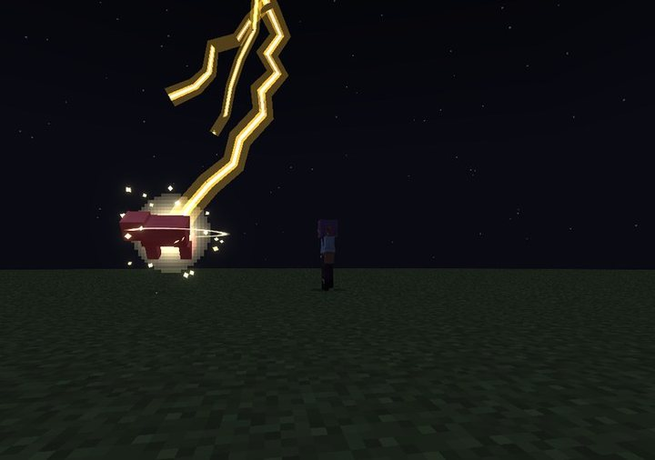{ loading=lazy }
  <figcaption>Holy Lightning.</figcaption>
</figure>

## Sin and the fall

Every Angel carries a hidden **sin**, from 0 to 100. It grows (in survival) when you:

| Deed | Sin |
|---|---|
| Kill a villager or a wandering trader | +20 |
| Kill an iron golem or a snow golem | +10 |
| Kill a tamed pet or a Tensura subordinate, your own included | +20 |
| Kill a player who hadn't hurt you in the last 30 seconds | +40 |
| Learn a Deadly Sin skill (Envy, Gluttony, Greed, Lust, Pride, Sloth, Wrath) | +60 |

- Sin **fades by 10 every in-game day**.
- **At 50**, "Your wings waver. Heaven has noticed." From then on your white feathers **flicker black** now and then,
  for everyone to see, more often as sin grows.
- **At 100, you fall.**

You can also **fall on purpose**: Heaven's Light's third mode, **Fall**, asks "Fall from Heaven?" first.

**The fall** makes you the **Fallen Angel of the same rank** at once (a Seraph becomes a Governor-General). You keep your
EP, your gears and your other skills, and Heaven's Light becomes Fallen Light. Your wings blacken from the tips, the
halo shatters, and "You fell from Heaven." There's no way back but a change of race.

<figure markdown="span">
  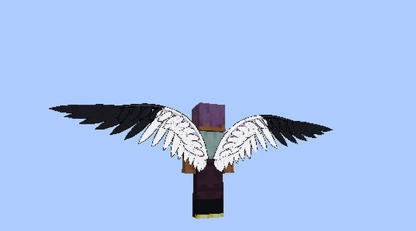{ loading=lazy }
  <figcaption>The fall: the wings blacken from the tips.</figcaption>
</figure>

## Day and Hell

An effect icon shows when either one is on.

| | Who | When | What it does |
|---|---|---|---|
| **Heaven's Grace** | Angels | Under the open daytime sky: daytime, no roof, no rain, not in water | Light Spear hits **25% harder**, and magicules regenerate **25% faster** |
| **Hell's Weight** | Angels | In Tensura's **Hell** | You're **10% slower** |

Hell's Magicule Poison hurts Angels as it does anyone, but **spares Fallen Angels**: Hell is Grigori's home too. Fallen
Angels feel neither the day nor the night.

## Holy things

| | Holy Water | Ascalon's holy strike | Tensura's holy damage | The races' light burn |
|---|---|---|---|---|
| **Angels and Fallen Angels** | no harm | no harm | no harm | none |
| **[Hybrids](#hybrids)** | burns | burns | hurts | burns, but never from their own light |
| **[Devils](devil.md)** | burns | burns | hurts | burns |

## Evil Pieces and hybrids

**Angels refuse Evil Pieces**, from a King or from [Rias](rias.md): "Heaven's system won't let a piece into an Angel."

A **Fallen Angel** can take one. The consent screen warns that holy things will hurt them and the Hero path closes. They
are reborn as a **Devil with Fallen Angel blood**: a hybrid, like Akeno.

### Hybrids

- They become the **Devil class** their EP reaches, with the [Devil](devil.md)'s powers, weaknesses and Night Sight.
- **Akeno's wings:** each pair is a **bat wing on the right** and a **black feathered wing on the left**. On the ground
  only the feathered one folds.
- They keep the Light Spear as **Fallen Blood**: violet, with a Devil class's damage (6 to 96). Devil's Night and the
  Bishop's bonuses never touch it, and their own light never burns them.
- They lose Fallen Light, and keep Holy Lightning if they were born with it.
- Released from the peerage, they stay a hybrid. A race reset clears the blood.

<figure markdown="span">
  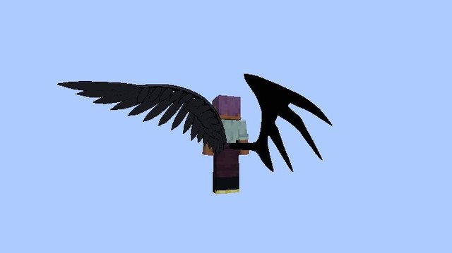{ loading=lazy }
  <figcaption>A hybrid's mixed wings: the bat wing on the right.</figcaption>
</figure>

## Rias and Angels

[Rias Gremory](rias.md) can't take an Angel: "An Angel? I'm sorry. Heaven would never let me have you." Her bat doesn't
bring an Angel her flyer, and she doesn't come when an Angel dies. Fall, and that changes.

## The Sacred Gears

Both races keep the [Boosted Gear](../boosted-gear/index.md) and [Divine Dividing](../divine-dividing/index.md) and use
them as anyone does.

## Leaving the race

Heaven's Light and Fallen Light go with the race. Holy Barrier and Holy Lightning stay through a race reset, and the
birth rolls never come again.

!!! note "Operators"
    `/dxdtensura sin <player>` shows an Angel's sin, and `/dxdtensura sin <player> set <0-100>` sets it. See
    [Commands](../reference/commands.md).
