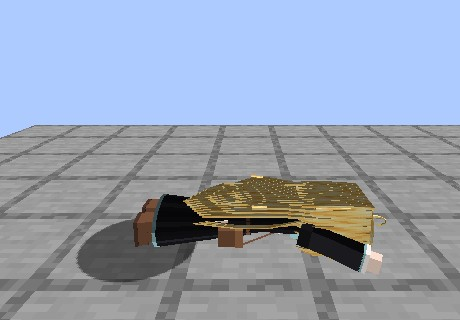
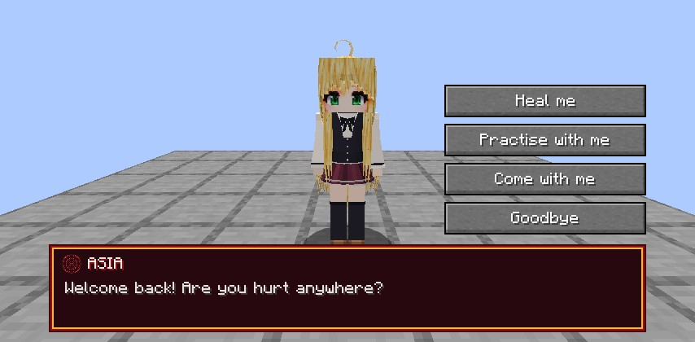
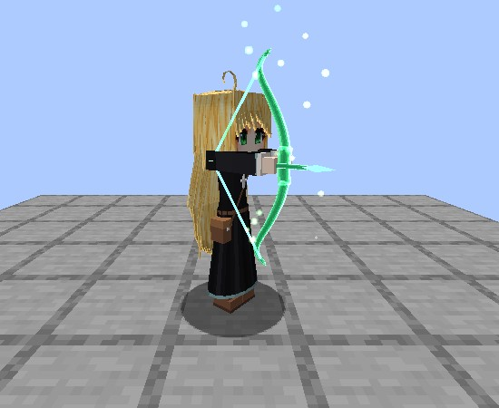

# Asia Argento

Asia Argento, the gentle nun with [Twilight Healing](../twilight-healing/index.md), becomes [Rias's](rias.md) Bishop. An NPC, added in **0.2.78**. There's one Asia per world.
Her two outfits, the nun dress and the Kuoh uniform, are Noroi's models.

<figure markdown="span">
  { loading=lazy }
  <figcaption>The nun dress.</figcaption>
</figure>

<figure markdown="span">
  { loading=lazy }
  <figcaption>The Kuoh uniform.</figcaption>
</figure>

## Meeting her

Once per world, by day, a lost nun walks up to a player in a village (in survival or adventure), trips flat on her face ("Hauu!") and asks the way to the church.
Right-click her:

- **Come with me** and she follows you. She catches up if you run ahead, and your action bar points to the old school building.
- **Not now** and she waits there for anyone.

On the way she heals you, a hurt villager or animal she passes, and herself last. While lost she stays in the Overworld.

<figure markdown="span">
  { loading=lazy }
  <figcaption>"Hauu!"</figcaption>
</figure>

## Bringing her to Rias

Lead her into the clubroom while Rias is there, or use **Go to my King** with her within 8 blocks. Rias asks her to be her Bishop, a Bishop piece sinks into her and she changes
into the Kuoh uniform. She holds her piece outside Rias's 15, so every piece stays open to players.

Nobody has to bring her: after 3 in-game days she finds her own way, and Rias mentions it once to each player.

## At home

In the clubroom she sits on a sofa, walks about, prays by the window, and can't be hurt. A hit on her counts as a hit on Rias. Talk to her:

- **Heal me** heals you to full. It's not for someone who hit her or Rias in the last 5 minutes.
- **Practise with me** gives a Twilight Healing holder 25 mastery points once an in-game day.

<figure markdown="span">
  { loading=lazy }
  <figcaption>Talking to her at home.</figcaption>
</figure>

## Out with you

Rias's servants can take her along (**Come with me**, one at a time). She follows, keeps out of melee and heals her side with Twilight Healing's full numbers: Touch, a healing arrow
from range, and the Healing Field for two or more. Some monsters turn on her when she heals.

Out, she can be hurt, and the blow that would kill her knocks her out instead: she's taken home to rest until the next day. Low on magicules she stops healing until she's back at half.

**Go home** sends her back. Logging out, leaving Rias or going where our circles can't open ends it too, and if you die she comes back when you respawn.
She also goes home by herself after 60 minutes out (`asiaOutMinutes`), so one player can't keep her from the others.

<figure markdown="span">
  { loading=lazy }
  <figcaption>Her Touch.</figcaption>
</figure>

<figure markdown="span">
  { loading=lazy }
  <figcaption>Her bow of light.</figcaption>
</figure>

## What she can't be

Named, taken by Evil Pieces or Brave Saints' cards, mind-controlled, possessed, plundered or commanded by Excalibur Ruler.

## Commands and settings

See [Commands](../reference/commands.md#asia-argento) and [`[asia]`](../reference/configuration.md#asia). Turning `lostNun` off puts her in the clubroom from the start.
