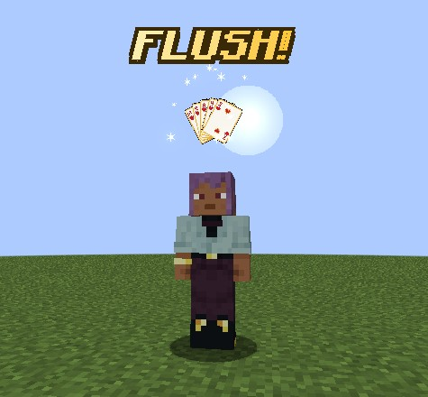
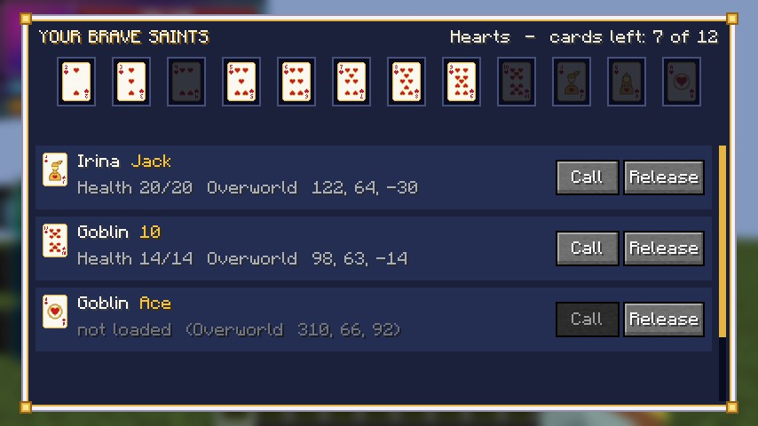
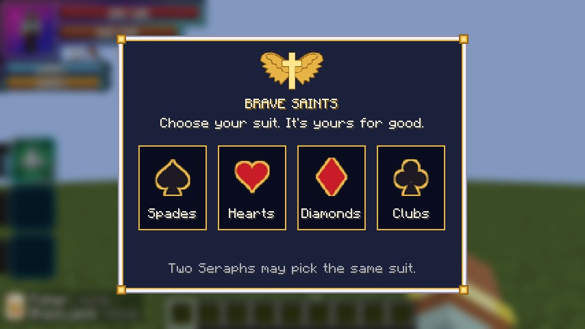
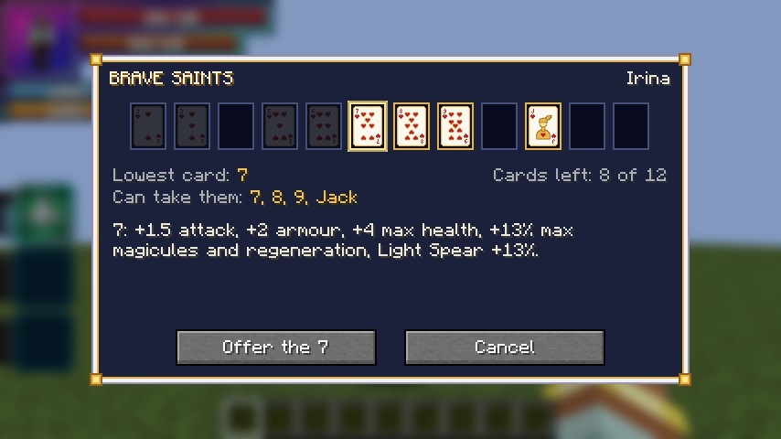
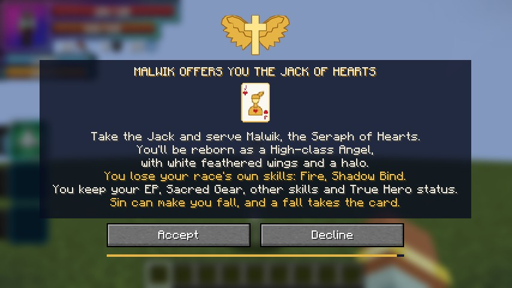
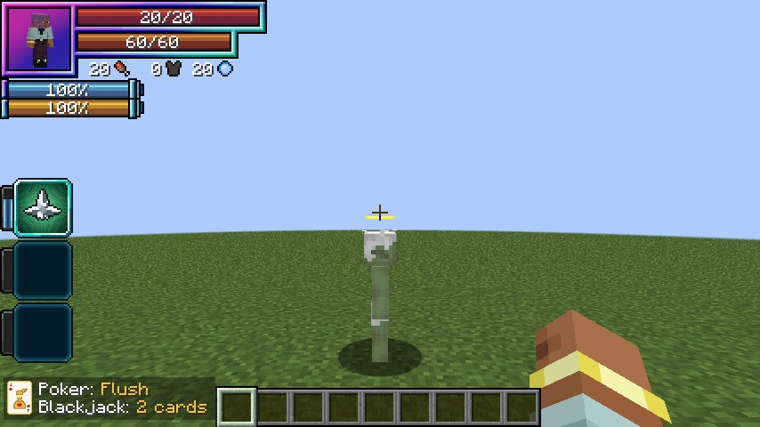
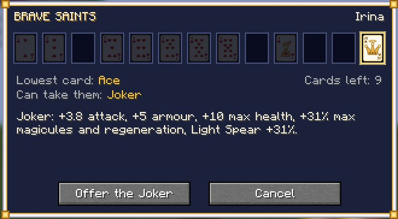
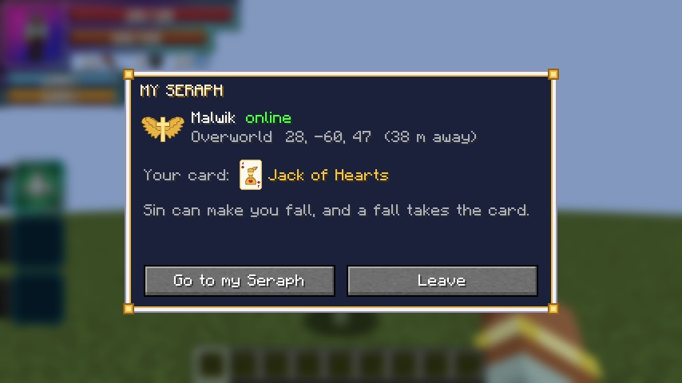

# Brave Saints

Heaven's answer to the Evil Pieces, added in **0.1.84**. A **Seraph** deals the twelve cards of one suit and the Joker, and a card
makes a human an Angel (or binds a pure Angel, or a beaten monster) with the card's strength. Card holders standing
together play **Poker** or **Blackjack**, and every card in the hand gets that hand's power for a short time.

<figure markdown="span">
  { loading=lazy }
  <figcaption>"FLUSH!": the hand's cards fan out in gold.</figcaption>
</figure>

<figure markdown="span">
  { loading=lazy }
  <figcaption>A Seraph's deck.</figcaption>
</figure>

## Becoming a Seraph

**Ultimate-class Angels and Seraphs** have the race skill **Brave Saints**. An Angel who was one already gets it at
their next login. Fallen Angels never deal.

- **The first press** opens the **suit picker**: Spades, Hearts, Diamonds or Clubs. The suit is yours for good, and two
  Seraphs may share one.
- After that, its **Take Out / Put Away** mode puts the white and gold **case** in your hand (or your inventory) and away
  again.
- **The case can't be lost**, like the crimson Evil Pieces case: tossed, burnt or dropped on death it vanishes, and the
  skill brings it back. An older case left in a chest crumbles.

<figure markdown="span">
  { loading=lazy }
  <figcaption>"Choose your suit. It's yours for good."</figcaption>
</figure>

## Offering a card

**Right-click a player or a monster** with the case. It opens on them:

- the **lowest card** that can take them, by their max EP against your base max EP: a twelfth of yours takes the 2, half
  the 7, nearly your equal the Ace. Any higher card works too;
- your cards left, with the ones that can take them lit;
- what the chosen card gives.

Click another lit card to choose it, then **Offer**.

- A **Longinus** holder ([Boosted Gear](../boosted-gear/index.md), [Divine Dividing](../divine-dividing/index.md))
  needs the **Queen or the Ace**, whatever their EP.
- Anyone as strong as you refuses.
- **A card costs no magicules**: the card is the price. One card per holder; cards never stack.

<figure markdown="span">
  { loading=lazy }
  <figcaption>The case open on someone: the 7 is the lowest card that takes them.</figcaption>
</figure>

### Players

A player gets a **consent screen**: your name, suit and card, and what it means for them.

- **A human** (Human, Enlightened Human, Human Saint) is **reborn an Angel**: Low-, Middle- or High-class by their EP,
  through Tensura's evolution. Holy, with the wings, the halo and Heaven's Light. They keep their EP,
  [Sacred Gear](../getting-started/first-gear.md#only-in-humans), other skills and True Hero status, and lose only their
  human race's own skills.
- **A pure Angel** keeps their race and takes only the card.
- They have **60 seconds** to answer. Walking 16 blocks away, logging out or dying answers no, and a no blocks your next
  offer to them for 30 seconds.
- Devils, hybrids, Fallen Angels, god-tier races (Seraphs and Divine Humans included), other races, a King's servants
  and anyone weighing an Evil Piece refuse, each with their own line.

<figure markdown="span">
  { loading=lazy }
  <figcaption>The Jack of Hearts, offered to a human.</figcaption>
</figure>

### Monsters

A monster takes a card **at once** once it has submitted, by Tensura's Naming rule, as for an
[Evil Piece](peerage.md): the same kinds, otherworlders too, never bosses, summons or someone else's.

- It keeps its race, wears a small **gold halo** and becomes your subordinate.
- Release one and it goes wild again, unless it was yours before.
- Its death brings its card back.

## What a card gives

While it's held, the **Ace** gives:

| | |
|---|---|
| Attack | +3 |
| Armour | +4 |
| Max health | +8 |
| Max magicules | +25% |
| Magicule regeneration | +25% |
| Light Spear damage | +25% |

Every lower card gives its share by place: the 7 half, the 2 a twelfth. Attack is flat, so the Boost stays the only
multiplier.

## Playing a hand

Both skills, a holder's **Brave Saint** and the Seraph's **Brave Saints**, have **Poker** and **Blackjack** modes.

A press plays **the best hand of that game** among the card holders and Seraphs within **16 blocks** who are ready, with
the presser in it.

- **Decks mix freely**, but never with a player who hurt the presser, or was hurt by them, in the last 30 seconds.
- **Poker** counts 2 to 10, Jack, Queen, the **King** (a Seraph, of his own suit) and the Ace (high, or low in
  A-2-3-4-5).
- **Blackjack** is exactly 21 with an Ace, two to five cards, the Jack and the Queen worth 10. A Seraph deals and isn't a
  card, but must own a card in the 21.
- The hand's name ("FLUSH!") rises over everyone in it, the cards fan out in gold above them, and they get its power for
  **30 seconds**.
- Only the cards that make the hand are spent, and they wait **2 minutes** from the press before joining another hand,
  in either game.
- **One deck holds each number once**, so a Pair or a Full House needs two Seraphs' cards.

### The hands' powers

For 30 seconds. A hand **all in one suit** gives 1.5 times the numbers of a Pair, Two Pair, Three of a Kind, Full House,
Four of a Kind, and a Blackjack's attack.

| Hand | Power |
|---|---|
| Pair | +2 attack |
| Two Pair | +2 attack, +4 armour |
| Three of a Kind | heals 2% of max health a second |
| Straight | +30% speed, walking and flying |
| Flush | Heaven's Light at half price (Light Spear, Blessing, the gold Great Spear, Holy Barrier, Holy Lightning); magicule regeneration +100% |
| Full House | 20% less damage taken (after everything else); heals 2% of max health a second |
| Four of a Kind | +6 attack, +8 armour |
| Straight Flush | the Straight's and the Flush's powers, and +4 attack |
| Royal Flush | the Straight Flush's powers, and Heaven's Judgement |
| Blackjack | +2 attack per card in the 21; Light Spear +50% |

The power shows as the **Heaven's Hand** effect.

### Heaven's Judgement

A **Royal Flush**: a Seraph with his 10, Jack, Queen and Ace. Light falls on **every monster within 24 blocks**, and on
anyone who hurt one of the hand in the last 30 seconds, for **twice the Seraph's Light Spear** (the undead take triple),
with the holy burn.

It never hits allies, pets or players who did nothing, and breaks no blocks.

### The hand row

A small row at the bottom left of the screen shows what you'd play now ("Poker: Flush", "Blackjack: 3 cards"), or the
wait ("waiting 1:20"). On a narrow window it moves up over the hotbar. The client setting
[`handRow`](../reference/configuration.md#client-settings) turns it off.

<figure markdown="span">
  { loading=lazy }
  <figcaption>The hand row, bottom left.</figcaption>
</figure>

## The Joker

Since **0.2.67** every Seraph's deck holds a 13th card after the Ace, outside the four suits: **the Joker**, Dulio's
card. A deck from before gets it at its next load.

<figure markdown="span">
  { loading=lazy }
  <figcaption>The case offering the Joker.</figcaption>
</figure>

<figure markdown="span">
  { loading=lazy }
  <figcaption>The Joker in the hand row: a Royal Flush.</figcaption>
</figure>

- **It takes anyone the Ace takes,** a Longinus holder included. It's listed last, so the lowest card that fits is still
  offered first.
- **A quarter more than the Ace:** +3.75 attack, +5 armour, +10 max health, and +31.25% max magicules, magicule
  regeneration and Light Spear damage.
- **Wild in a hand.** In **Poker** it stands for any one missing card from 2 to Ace, of any suit, but never the King,
  who is a Seraph. In **Blackjack** it counts as any card from the Ace to the Queen, so it can be the hand's Ace.
- **One Joker a hand**, it never breaks a one-suit bonus, and a hand that doesn't need it leaves it unspent.
- The card is white and gold, a jester's crown under a halo.

Server owners have `joker` and `jokerAcePercent` in [`[brave_saints]`](../reference/configuration.md#brave_saints).
With it off, the Joker is out of every pick and hand, and holders keep it.

## The deck menu

**Right-click the air with the case**: your 12 cards and the Joker, and for each holder their card, health and where they are.

- **Call:** a gold circle takes them to your side after 3 seconds, across dimensions, for **5% of your max magicules**,
  once every 30 seconds for each.
- **Release:** the card comes back. A player stays an Angel.

## A holder's side

A holder's skill, **Brave Saint**, opens on **My Seraph**: the Seraph's name and where they are, and your card.

- **Go to my Seraph:** the same circle, for **10% of your max magicules**, once a minute.
- **Leave:** no mark and no wait. You can take another card later.
- A small gold **Seraph marker** at the top of the screen points to your Seraph, with the distance or their dimension
  (client setting [`seraphMarker`](../reference/configuration.md#client-settings)).
- Stepping out of a circle, or anyone being hit, breaks it at no cost.

<figure markdown="span">
  { loading=lazy }
  <figcaption>My Seraph.</figcaption>
</figure>

## The bond

Seraph and holders are **Tensura allies**: holders can't hurt their Seraph or each other, the Seraph can't hurt them,
and Blessing, Holy Barrier and the Great Spear treat them as friends.

## Endings

- **A card Angel who falls** (full sin, or the Fall mode) loses the card, and the Seraph hears "Your Jack of Hearts has
  fallen." As a Fallen Angel they can then take an Evil Piece.
- **A player holder who stops being an Angel** any other way loses the card too.
- **A Seraph who falls**, or stops being an Ultimate-class Angel or a Seraph, loses the deck and the skill, and everyone
  is released.
- A release while someone is offline applies at their next login, a monster's when it loads.
- **A card Angel who reaches Ultimate-class** gets a deck of their own and keeps their card.

!!! info "For server owners"
    Every number is in the [`[brave_saints]`](../reference/configuration.md#brave_saints) config section. Operators have
    [`/dxdtensura bravesaints`](../reference/commands.md#brave-saints): `info`, `suit`, `release` and `joker`.
