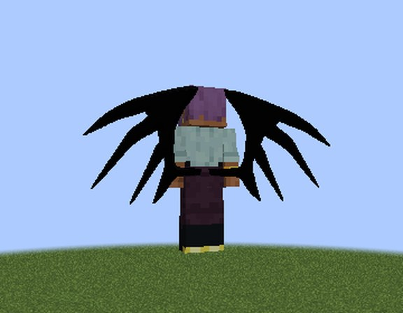
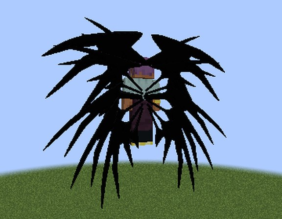
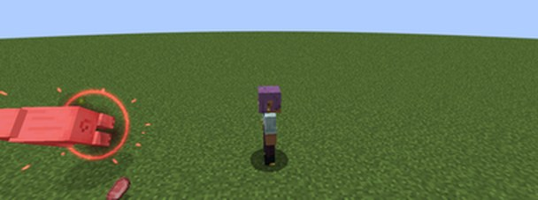
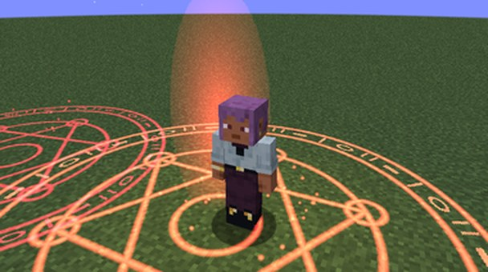

# Devils

DxD's Devils as Tensura races. There are five classes, from **Low-class** to **Satan-class**, and each one is a race of
its own on Tensura's evolution screen. All of them are **Majin**, so holy things hurt them.

A Devil spreads black bat wings and flies, fires **Demonic Power**, travels home by **magic circle**, and is stronger at
night and weaker under the sun.

<figure markdown="span">
  { loading=lazy }
  <figcaption>A Low-class Devil's wings.</figcaption>
</figure>

<figure markdown="span">
  { loading=lazy }
  <figcaption>Satan-class: six pairs.</figcaption>
</figure>

## Becoming a Devil

Pick **Low-class Devil** in Tensura's race menu:

- when you start a new character;
- after Tensura's **Reincarnation** spell;
- on an existing character, with Tensura's **Race Reset Scroll**, which opens the race menu again.

There's no ritual: it's a race like Tensura's own. Server owners can take it out of the menu with
[`devilInRaceMenu`](../reference/configuration.md#devil).

## The classes

You climb the classes with Tensura's evolution, like its own race lines. When you meet a class's requirements, Tensura's
evolution screen offers it.

| Class | How you get there | Base aura | Base magicules | Demonic Power | Flight speed |
|---|---|---|---|---|---|
| **Low-class** | Pick it in the race menu | 1,500–2,500 | 2,500–3,500 | 6 damage, 100 magicules | 0.8× |
| **Middle-class** | 20,000 EP | 8,000 | 12,000 | 12 damage, 400 magicules | 1× |
| **High-class** | 100,000 EP | 40,000 | 60,000 | 24 damage, 1,800 magicules | 1.2× |
| **Ultimate-class** | 400,000 EP and 4 bosses (like Tensura's Saints) | 150,000 | 250,000 | 48 damage, 7,500 magicules | 1.5× |
| **Satan-class** | Awakening as a Demon Lord | 1,000,000 | 1,000,000 | 96 damage, 30,000 magicules | 2× |

- Each class has more aura, magicules, health and attack than the one before.
- **Satan-class** is DxD's Satans as Tensura's Demon Lords. Tensura's **Harvest Festival** (its Demon Lord awakening)
  makes an Ultimate-class Devil Satan-class. At a lower class, it moves you one class up.
- Flight speed is times creative flight.

!!! info "For server owners"
    The races' own numbers (stats, EP ranges and requirements) are in `config/dxdtensura/race/devil_config.toml`. That
    file is read when the game starts, so a change needs a restart. The powers' numbers are in the
    [`[devil]` section](../reference/configuration.md#devil) of the server config, which applies live.

## Wings and flight

Tensura's **Race/Mount Ability** key spreads your black Devil wings with one flap and gives you **free flight**.

- **In the air** you fly at once. **On the ground**, double-jump to take off.
- The wings **stay open** until you press the key again. Then they fold back onto your back and go.
- They beat while you fly.
- **They grow with each class**, from 0.8× size at Low-class to 1.2× at Ultimate-class.
- **Satan-class has six pairs**: the main pair, plus five slimmer ones fanned out from above your head to below your
  feet.
- Flight gets faster with each class (see the table above).

**With a Sacred Gear.** Under either Scale Mail, as Juggernaut Drive's dragon, or with Divine Dividing's wings out, the
gear's wings show instead of yours.

## Demonic Power

Demonic Power is a race skill. It's on Tensura's skill bar, so put it on an ability slot and press the slot key.

- **A dark crimson orb** flies where you look and bursts on what it hits.
- It deals **darkness damage**: 6, 12, 24, 48 or 96 by class (see the table above). Darkness Attack Resistance works on
  it.
- It costs **100 to 30,000 magicules** by class, and you can fire it **once a second**.
- At night it hits **25% harder** (see [Night and day](#night-and-day)).
- **The Boost never multiplies it.**

<figure markdown="span">
  { loading=lazy }
  <figcaption>The orb bursting on what it hit.</figcaption>
</figure>

## The magic circle

Demonic Power's **second mode** opens at **Middle-class**. Switch to it the way you switch the gears' modes.

- **Press it:** a crimson magic circle opens under you for **3 seconds**.
- **Then** it takes you to your **respawn point**: your bed, your respawn anchor, or the world spawn. It works **across
  dimensions**.
- It costs **10% of your max magicules**, paid when you arrive, and works **once a minute**.
- **Moving or being hit** breaks it, and that costs nothing.
- It can't open in **Tensura's boss arena** or during a transformation cutscene.

<figure markdown="span">
  { loading=lazy }
  <figcaption>The magic circle.</figcaption>
</figure>

## Night Sight

A passive race skill: **you see in the dark**. It's on from the start. To switch it off, use the Status Menu.

Night vision comes on where the light is **7 or darker** and, once on, stays until the light reaches **11**, so it
doesn't blink at the edge of a torch's reach.

## Night and day

An effect icon shows when either one is on.

| | When | What it does |
|---|---|---|
| **Devil's Night** | At night, and anywhere in **Hell** | Demonic Power hits **25% harder**, and magicules regenerate **25% faster** |
| **Under the Sun** | In the daytime sun: open sky, no rain | You're **10% slower** and lose your class's **attack bonus** |

Indoors or underground by day, neither one applies. Tensura never counts creative players as under the sun.

## Holy things

As Majin, Devils are hurt by holiness:

- **Tensura's holy things** hurt them, for example the Holy Damage effect and Holy Field.
- **[Ascalon](../boosted-gear/ascalon.md)** burns a Devil who holds it, as it burns a dragon, and its holy strike hits
  Devils.
- **[Holy Water](#holy-water)** hurts them where it bursts.
- **[Angels' and Fallen Angels'](angels.md#the-holy-burn) light** (their spears and Holy Lightning) leaves a holy burn.

**Hell is different:** its Magicule Poison spares Devils.

### Holy Water

Devil x Slime's own Holy Water. Tensura 2.0.1.3 has none you can throw.

- **Throw it** like a splash potion. Where it bursts, Devils and Tensura's monsters take **holy damage**: 8 at the
  centre, half that 2.5 blocks out.
- It hurts only what Tensura counts as hurt by holy things (its monsters and Majin races), not humans or animals.
- It stacks to 16.
- **Get it** from the mod's creative tab, or **craft it** from a **water bottle and a gold nugget** (shapeless). An
  Angel's [Blessing](angels.md#blessing-angels) turns the water bottles they carry into Holy Water too.

## Devils and the Sacred Gears

A Devil keeps the [Boosted Gear](../boosted-gear/index.md) or [Divine Dividing](../divine-dividing/index.md) and uses it
as before. The life prices of [Juggernaut Drive](../boosted-gear/juggernaut-drive.md#the-price) and the Boosted Gear's
[Divide](../boosted-gear/divide.md) are the same for a Devil.

## Kings and the Peerage

At **High-class** and up, a Devil is a **King** with 15 Evil Pieces, and can make a player, a beaten monster or an
otherworlder their servant. See [The Peerage](peerage.md). To serve a King yourself, find
[Rias Gremory](rias.md).

## Leaving the race

Demonic Power, Night Sight and Evil Pieces are learned with the race, and you lose them if you change race. A King who
stops being a Devil releases their whole [peerage](peerage.md#endings).
