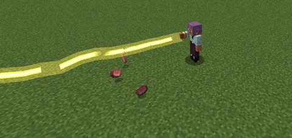
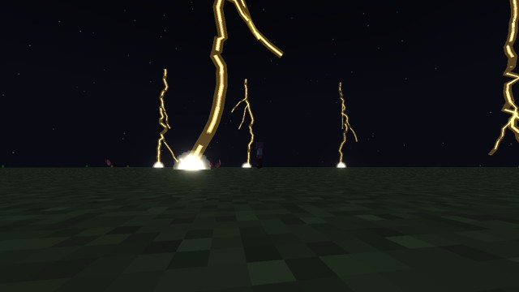
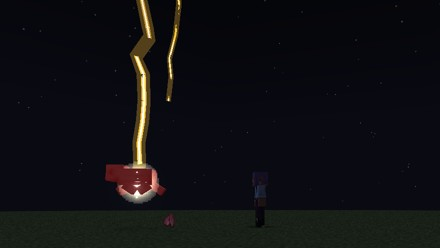
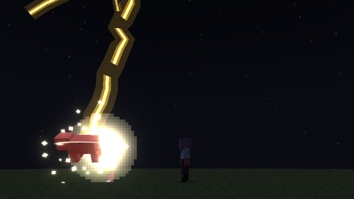

# Holy Lightning

Akeno's power: thunder mixed with holy light. It's a rare birth skill of [Fallen Angels](angels.md#birth-skills), and since
**0.1.92** it earns mastery and has five modes, modelled on Tensura's Black Lightning. The two big ones carry its name in the
novels, **Thunderlight**.

<figure markdown="span">
  { loading=lazy }
  <figcaption>The Thunderlight Blast, at full mastery.</figcaption>
</figure>

<figure markdown="span">
  { loading=lazy }
  <figcaption>A Thunderlight Storm.</figcaption>
</figure>

## Getting it

- The first time you become a **Fallen Angel**, from the menu or by falling, you have a **10%** chance of it.
- A Fallen Angel reborn as a [hybrid](angels.md#hybrids) by an Evil Piece has **one more 10% try**, once.

If you win, "You were born with" it, as a Tensura **Extra Skill**. You keep it through a fall, a race reset or an Evil Piece.

## Mastery

Mastery shows on Tensura's skill screen, out of **500**.

| What | Points |
|---|---|
| A use (a strike you paid for, or a storm started) | 1, times your Ability Mastery Gain |
| A hit | 2 |
| A kill | 2 |

Holding the Blast and trying to learn the storm earn none. **Full mastery opens the Thunderlight Blast**. Holders from before
0.1.92 keep the skill and start at 0.

## The modes

| # | Mode | Opens | What it does |
|---|---|---|---|
| 0 | **[Holy Lightning](#the-strikes)** | from the start | A bolt on what you look at |
| 1 | **[Decreased Power](#the-strikes)** | from the start | A thin, cheap bolt on a short cooldown |
| 2 | **[Increased Power](#the-strikes)** | from the start | A thick, costly bolt with a wider hit |
| 3 | **[Thunderlight Blast](#thunderlight-blast)** | full mastery | Hold it for a beam through everything on its line |
| 4 | **[Thunderlight Storm](#thunderlight-storm)** | High-class, then learned | Bolts for two and a half minutes |

The mode key skips what isn't open yet. The storm shows while you're still learning it.

Your **rank** sets the damage and the price: your Angel, Fallen Angel or, for a hybrid, Devil class.

| Mode | Low | Middle | High | Rank 4 | Rank 5 |
|---|---|---|---|---|---|
| Holy Lightning: damage / magicules | 12 / 200 | 24 / 800 | 48 / 3,600 | 96 / 15,000 | 192 / 60,000 |
| Decreased Power | 6 / 40 | 12 / 160 | 24 / 720 | 48 / 3,000 | 96 / 12,000 |
| Increased Power | 36 / 400 | 72 / 1,600 | 144 / 7,200 | 288 / 30,000 | 576 / 120,000 |
| Thunderlight Blast: a hit / magicules a second | 6 / 40 | 12 / 160 | 24 / 720 | 48 / 3,000 | 96 / 12,000 |
| Thunderlight Storm: a bolt / magicules once | 24 / 2,000 | 48 / 8,000 | 96 / 36,000 | 192 / 150,000 | 384 / 600,000 |

**Every mode:**

- is holy damage with the [holy burn](angels.md#the-holy-burn), and Holy Attack Resistance softens it;
- spares you, your pets and your allies;
- sets no fires and breaks no blocks.

A Brave Saints [Flush](brave-saints.md) halves every mode's price, and [Divide](../divine-dividing/index.md) cuts its hits as it
cuts any skill's.

### The strikes

A golden-white, jagged bolt on what you look at within **32 blocks**.

| Mode | Hits within | Cooldown |
|---|---|---|
| Holy Lightning | 2 blocks | 5 s |
| Decreased Power | 1.25 blocks | 3 s |
| Increased Power | 3 blocks | 7 s |

<figure markdown="span">
  { loading=lazy }
  <figcaption>Decreased Power.</figcaption>
</figure>

<figure markdown="span">
  { loading=lazy }
  <figcaption>Increased Power.</figcaption>
</figure>

### Thunderlight Blast

*Mode 3, at full mastery.*

**Hold the key:** a jagged beam of golden lightning runs from your raised hand to what you look at, up to **30 blocks**, and
follows your look. It stops at the first block, not at a mob.

- **Twice a second** it hits everything on its line.
- It pays its price at once and then every second. It stops when you let go or run out of magicules.
- It has no cooldown.

### Thunderlight Storm

*Mode 4, from High-class.*

**Learning it.** With the mode picked, each press is a try. It costs the Increased Power price and shows Tensura's learning
line, and it takes about 30 tries. Below High-class a press does nothing.

**Calling it.** You need the open sky: no block 50 above you. For the price in the table it runs **30 waves**, one every 5
seconds, so two and a half minutes. In each wave:

- a bolt falls on each **monster**, and on **anyone who hurt you in the last 30 seconds**, within 30 blocks. Every second wave
  each of those bolts falls only one time in three;
- up to **10 more** fall on random ground within 30 blocks.

Each bolt hits within 2 blocks, and it hurts only those same kinds, the ground bolts too, so villagers and farm animals are
safe. The weather stays as it is.

**It ends** when you press again, die, log out or change dimension, or at a wave with a block 50 above you.

## Settings

The numbers are in [`[angel]`](../reference/configuration.md#angel).
