# House powers

A pure-blooded Devil is born of one of the great Houses, a birthright in place of a Sacred Gear. Added in **0.2.13**, there are five:
**Bael**, **Gremory**, **Phenex**, **Sitri** and **Leviathan**. Each gives a race skill of its own beside
[Demonic Power](devil.md#demonic-power), with more powers opening as you master it.

| House | Its skill | What it is |
|---|---|---|
| [Bael](#house-bael-and-house-gremory) | Power of Destruction | Black spheres that erase what they touch, through armour and barriers |
| [Gremory](#house-bael-and-house-gremory) | Power of Destruction | The same, 15% harder, with a crimson circle and Gremory's crest |
| [Phenex](#house-phenex) | Flames of Phenex | Fire, wounds that close by themselves, rebirth from death and wings of fire |
| [Sitri](#house-sitri) | Waters of Sitri | Water in the shapes you give it, and ice from 75% mastery |
| [Leviathan](#house-leviathan) | Sea Serpent of the End | The raw sea: crushing weight, waves, its creatures and a Sea Dragon form |

<figure markdown="span">
  { loading=lazy }
  <figcaption>The Houses' sigils: Bael, Gremory, Phenex, Sitri and Leviathan.</figcaption>
</figure>

## Who has one

- **Anyone who picked a Devil race** in Tensura's race menu, or who is on the Devil line and was never reborn by a piece.
- **A Devil reborn by an [Evil Piece](peerage.md)** has none, and neither does a [hybrid](angels.md#hybrids). A Phenex King's servants
  get no flames.
- **A pure Devil who takes a King's piece** keeps theirs.

## The roll

One roll per character, when you're born. You can't choose.

| House | Chance |
|---|---|
| Phenex | 30% |
| Sitri | 30% |
| Bael | 20% |
| Gremory | 10% |
| Leviathan | 10% |

- The House's sigil burns over you and a line names it: "You were born of House Sitri. Water answers to your blood."
- **Devils already in a world** roll at their next login.
- **Death, evolution and a Race Reset Scroll** keep it. A **Character Reset Scroll** rolls again.
- Server owners set the odds with [`houseRollOdds`](../reference/configuration.md#houses). Operators have
  [`/dxdtensura house`](../reference/commands.md#house-powers).

## How the powers work

- **Your circles** take your House's colour and sigil, for the [circle home](devil.md#the-magic-circle) and the Peerage's calling circles.
- **The numbers go by your class.** A power is a multiple of your class's Demonic Power orb, so it grows with you, with the night's and
  the Bishop's bonuses. In the tables here, "2 orbs" is twice what one orb deals or costs in your class:

| Class | 1 orb of damage | 1 orb of cost |
|---|---|---|
| Low-class | 6 | 100 magicules |
| Middle-class | 12 | 400 |
| High-class | 24 | 1,800 |
| Ultimate-class | 48 | 7,500 |
| Satan-class | 96 | 30,000 |

- **Mastery** counts to 1,000 on Tensura's skill screen, 2 for each use that hurts something, and a line in chat says when a power
  opens. Full mastery means **half the cost and a quarter more damage**, except on the top powers: Extinguished Star, Ruin the Extinct,
  Firestorm, Celsius Cross Trigger and the Sea Dragon.

## House Bael and House Gremory

**The Power of Destruction** erases what it touches. Gremory's hits 15% harder and its circle is crimson with Gremory's crest; the rest
is the same.

| # | Mode | Opens | Damage | Cost | Cooldown |
|---|---|---|---|---|---|
| 0 | **Destruction Orb** | from the start | 1.5 orbs | 2 orbs | 2 s |
| 1 | **Destruction Bullets** | 25% | 0.4 orbs each | 0.25 orbs each | none |
| 2 | **Destruction Guard** | 50% | none | 0.1 orbs a second, 1 orb per thing erased or hit refused | 3 s |
| 3 | **Extinguished Star** | 75%, Ultimate-class | 8 orbs | 10 orbs | 60 s |
| 4 | **Ruin the Extinct** | 100%, Satan-class | 1 orb each | 20 orbs | 120 s |

- **The Destruction Orb** is a black ball that erases any projectile it meets and stops at a block.
- **The Bullets** are a hold: small fast bullets, five a second.
- **The Guard** is a hold: a shell 2 blocks round you erases what crosses in and refuses a foe's hits, but you can't strike out through
  it. It refuses hits that don't fly too, such as a howl, a spell's area or a blow: all of it from a foe at or under your EP, less above
  that.
- **Extinguished Star** is a hold of 3 seconds, then let go: a huge slow sphere that bursts 6 blocks round. It also takes a quarter of its
  damage from spirit health, and erases a mob at 70% of your EP or less outright, but never a player, a boss or a mob made invulnerable.
  It leaves a small crater, with no drops, where Tensura's `skillGriefing` rule allows and a claim mod doesn't object, and never in
  bedrock, wither-immune blocks or block entities.
- **Ruin the Extinct** sends twelve homing spheres, shared among the foes around you, through walls and domes. Each strips one good
  effect.

<figure markdown="span">
  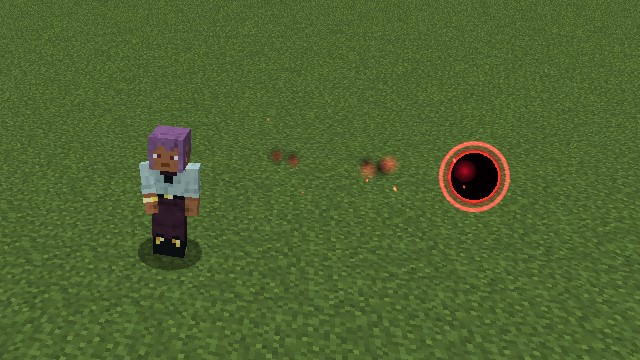{ loading=lazy }
  <figcaption>The Destruction Orb.</figcaption>
</figure>

<figure markdown="span">
  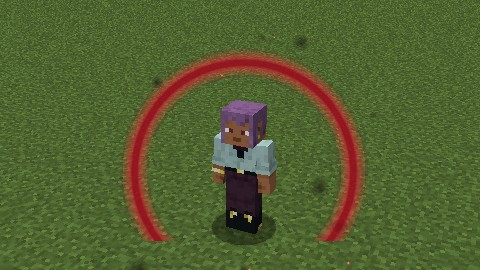{ loading=lazy }
  <figcaption>The Destruction Guard.</figcaption>
</figure>

<figure markdown="span">
  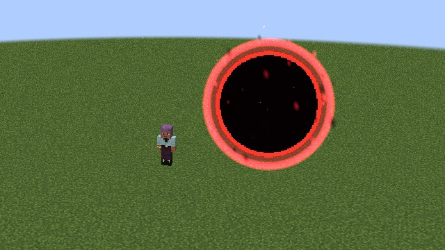{ loading=lazy }
  <figcaption>Extinguished Star.</figcaption>
</figure>

<figure markdown="span">
  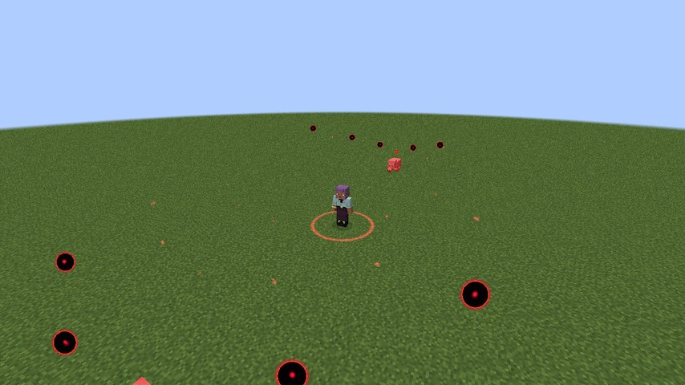{ loading=lazy }
  <figcaption>Ruin the Extinct.</figcaption>
</figure>

- **Through defences, not through strength.** Destruction goes through armour and shields, and through resistances and barriers as
  [Penetrate](../boosted-gear/penetrate.md) does. Against anyone with more EP than you it's weaker, by your EP over theirs, never under
  10%. It never passes invulnerability.
- **Erasing.** It erases a projectile only from an owner no stronger than you. It leaves your own and your allies' alone, one lying
  still, and a trident.
- **Rias's** own [Power of Destruction](../world/stray-devils.md#riass-hunts) stays hers.

## House Phenex

**The Flames of Phenex**: you can't burn, your wounds close by themselves, and death takes a price instead of you.

<figure markdown="span">
  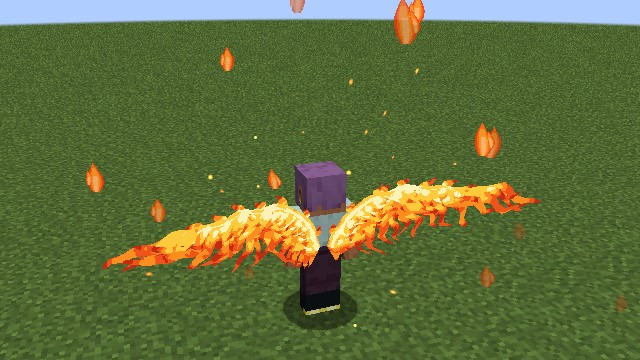{ loading=lazy }
  <figcaption>Wings of fire, bright even at midnight.</figcaption>
</figure>

<figure markdown="span">
  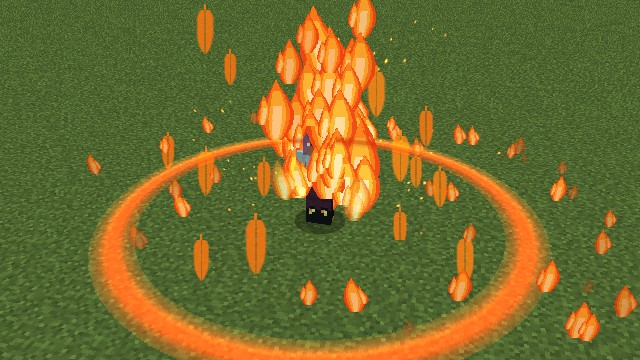{ loading=lazy }
  <figcaption>Rebirth.</figcaption>
</figure>

- **Fire can't hurt you.** Tensura's Fire Attack Nullification comes with the skill and goes with it. If you earned your own, it stays.
- **Regeneration.** Under full health you heal 5, 5, 8, 10 or 15% of max health a second by class, with small flames licking off you. A
  whole bar costs 30% of your max magicules, in proportion, and only what you heal is paid for. Toggle the skill off to save your
  magicules. Every 100 health healed counts as a use for mastery.
- **Rebirth.** Death is called off for **30%** of your max magicules, then **45, 60 and 80%** for each rebirth within 5 minutes of the
  last. You come back at half health and at least half spirit, the fire out, with a burst of flame (2 orbs within 4 blocks) and a second
  in which nothing lands but `/kill` and the void. Tensura's EP toll never happens, and your killer gets no EP.
- **It's a real death** when you can't pay, for `/kill` and the void, when the blow's attacker has 10 times your max EP, and while your
  flames are stilled. [Rias's flyer](rias.md#her-second-chance) still has its chance then.
- **Flames Stilled.** A holy hit (Tensura's holy damage, [Holy Water](devil.md#holy-water), a Light Spear) stops regeneration and rebirth
  for 10 seconds, shown by an effect icon. A new hit starts the time again.
- **Wings of fire** in place of the bat wings, the same fan of pairs, always fully bright. They grow with the magicules you hold, from
  85% to 125% of your class's size. A holy hit, Tensura's Frost, or a cold or water hit of at least 10% of your max health puts them out
  for 5 seconds: they close, you fall, and the race key is refused. Wings that were open come back by themselves. Under water they work
  as anyone's.

| # | Mode | Opens | Damage | Cost | Cooldown |
|---|---|---|---|---|---|
| 0 | **Flame Shot** | from the start | 1.2 orbs | 1.5 orbs | 1 s |
| 1 | **Flame Burst** | 25% | 2 orbs | 3 orbs | 8 s |
| 2 | **Phoenix Tear** | 50% | none | 30% of max magicules | 10 min |
| 3 | **Firestorm** | 75%, Ultimate-class | 3 orbs a second | 15 orbs | 60 s |

- **Flame Shot** is a fast bolt, 50 blocks, that touches what passes within 0.75 blocks of its path and sets it alight for 5 seconds.
- **Flame Burst** is a ring of fire 6 blocks round you, knocking back, alight for 3 seconds.
- **Phoenix Tear** makes one Phoenix Tear, with a water bottle in your inventory.
- **Firestorm** is fire and wind for 6 seconds where you look, up to 32 blocks, pulling foes in within 8 blocks.

<figure markdown="span">
  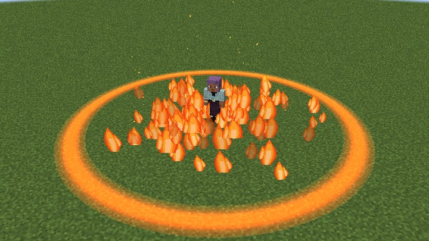{ loading=lazy }
  <figcaption>Flame Burst.</figcaption>
</figure>

<figure markdown="span">
  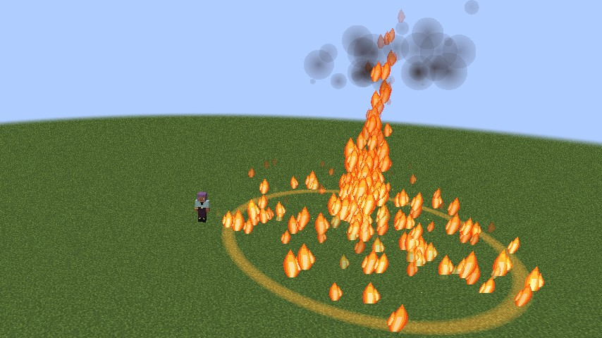{ loading=lazy }
  <figcaption>Firestorm.</figcaption>
</figure>

- **Phenex fire** is Tensura's fire element, so Fire Attack Resistance and Nullification read it. The Scale Mails' and the gauntlet's fire
  cuts don't: in the story it burns dragons. It spares your allies and sets no block alight. A Firestorm ends early if you die, log out or
  leave the dimension.
- **The Phoenix Tear.** It stacks to 16 and is in the creative tab, with no recipe and no loot. A Phenex makes one, and the
  [Castle Town's Apothecary](../world/castle-town.md#the-towns-own-goods) sells one a day to a Friend of House Gremory. Anyone can drink it, in a second: health to full and fire out, never magicules or aura. Divine Dividing's
  [Reduce](../divine-dividing/index.md#reduce) still blocks the heal.

## House Sitri

**The Waters of Sitri**: water takes the shapes you give it, and from 75% mastery it stands as ice.

**Near water** every power hits 25% harder and costs 25% less: with 8 water blocks within 4 blocks of you, standing in water, or in the
rain. It's checked once a second.

| # | Mode | Opens | Damage | Cost | Cooldown |
|---|---|---|---|---|---|
| 0 | **Water Hawk** | from the start | 1.2 orbs | 1.5 orbs | 1 s |
| 1 | **Water Serpent** | 25% | 0.5 orbs a second | 3 orbs | 10 s |
| 2 | **Water Wall** | 25% | none | 2 orbs | 12 s |
| 3 | **Water Lions** | 50% | 2 orbs each | 5 orbs | 15 s |
| 4 | **Water Dragon** | 75% | 5 orbs | 8 orbs | 45 s |
| 5 | **Ice Lance** | 75% | 1.5 orbs | 3 orbs | 20 s |
| 6 | **Celsius Cross Trigger** | 75%, Ultimate-class | 4 orbs | 25 orbs | 120 s |

- **The Water Hawk** flies at 2 blocks a tick for 30 ticks and curves to what you looked at within 48 blocks, touching what passes within
  0.75 blocks.
- **The Water Serpent** flies to who you look at within 32 blocks, wraps them and holds them still for 3 seconds, a boss for 1. With no one
  to wrap, nothing is paid.
- **The Water Wall** stands 5 wide and 3 high, 3 blocks ahead, for 8 seconds. Walkers wade at half speed and shots die in it, but yours
  and your allies' pass, and an arrow or trident someone could pick up just drops. From 75% it stands as ice and stops walkers too.
- **The Water Lions** are three, side by side, 1.5 blocks apart, charging 24 blocks along the ground. Each hits a target once and throws it
  aside, and a block taller than a step stops one.
- **The Water Dragon** flies 32 blocks where you look, hitting everyone within 2.5 blocks of its path, then bursts 5 blocks round where it
  ends. No one is hit twice.
- **The Ice Lance** is a barbed spear of ice six blocks long. It freezes its target solid with Tensura's Frost, standing them in ice
  crystals until it ends: mobs 3 seconds, players 1.5, bosses Slowness III with no crystals.
- **Celsius Cross Trigger** freezes 24 blocks round you for 8 seconds. Foes take the hit and 6 seconds of Frost (players 3, bosses
  Slowness III), and anyone who walks in later is frozen too, once. Open water turns to frosted ice and melts, only with `skillGriefing`
  on, and no other block changes.

<figure markdown="span">
  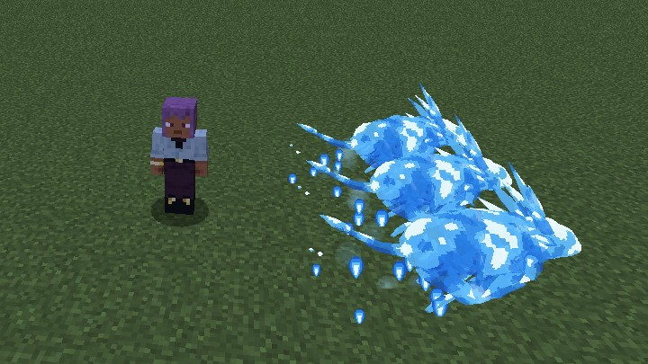{ loading=lazy }
  <figcaption>Water Lions.</figcaption>
</figure>

<figure markdown="span">
  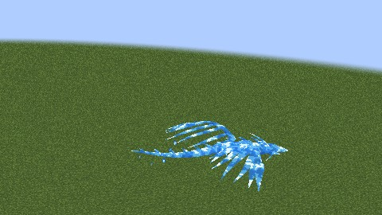{ loading=lazy }
  <figcaption>The Water Dragon.</figcaption>
</figure>

<figure markdown="span">
  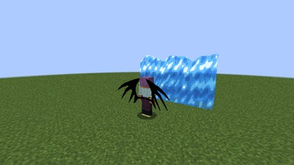{ loading=lazy }
  <figcaption>The Water Wall.</figcaption>
</figure>

<figure markdown="span">
  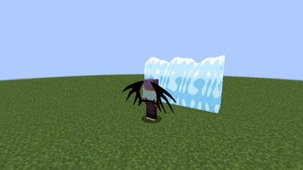{ loading=lazy }
  <figcaption>From 75% mastery it stands as ice.</figcaption>
</figure>

<figure markdown="span">
  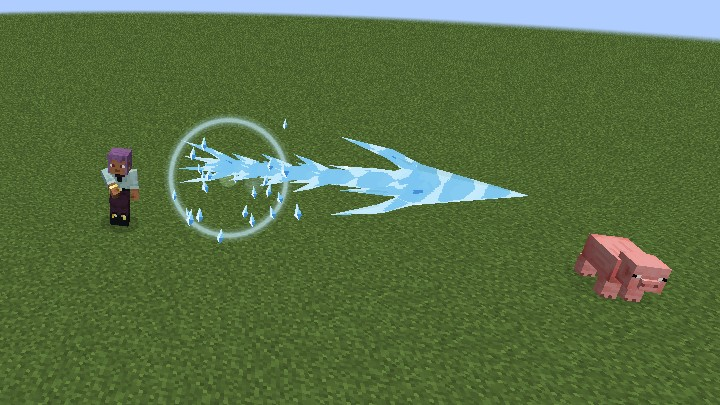{ loading=lazy }
  <figcaption>The Ice Lance.</figcaption>
</figure>

<figure markdown="span">
  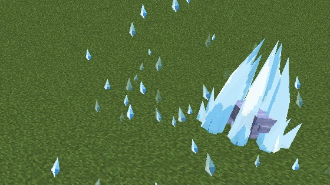{ loading=lazy }
  <figcaption>Who it freezes stands in ice crystals.</figcaption>
</figure>

<figure markdown="span">
  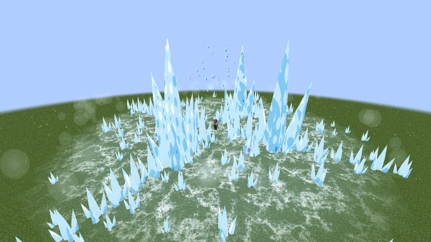{ loading=lazy }
  <figcaption>Celsius Cross Trigger.</figcaption>
</figure>

- **Celsius Cross Trigger's ice** races out from you over about a second: a cross of great spikes along the four directions, four spires
  14 blocks tall and thick frost, all drawn and none of it blocks, shattering at the end. Who it freezes stands in the same crystals as
  the Ice Lance's.
- **Water and ice** are Tensura's water element, and ice also counts as cold. A big enough hit puts a Phenex's wings out, and Frost stops
  them healing.
- They spare your allies. A freeze with no hit behind it still asks PvP, and a Serpent's hold can't be drunk away with milk.

## House Leviathan

**The Sea Serpent of the End.** Where Sitri shapes water, Leviathan is the raw sea: no shapes and no ice, dark water with white foam, and
far stronger at sea.

- **Immense power.** 25% more max magicules, which don't count toward evolution.
- **Many wings.** 2, 3, 4, 5 and 6 pairs by class.
- **The sea.** In an ocean biome every power hits 50% harder, and in Tensura's Hell 30% weaker. Rivers don't count.
- **Its creatures.** Drowned, guardians (not the elder), dolphins, squid, axolotls, fish and Tensura's sea creatures don't choose a
  Leviathan as a target unless hit first.

| # | Mode | Opens | Damage | Cost | Cooldown |
|---|---|---|---|---|---|
| 0 | **Crushing Depths** | from the start | 1.3 orbs | 1.5 orbs | 2 s |
| 1 | **Surge** | 25% | 2 orbs | 3 orbs | 6 s |
| 2 | **Call of the Sea** | 50% | none | 4 orbs | 60 s |
| 3 | **The Flood** | 75% | 3 orbs at the first touch, then 1 orb a second | 15 orbs | 60 s |
| 4 | **Sea Dragon** | 75%, Ultimate-class | 3 orbs a bite | 2% of max magicules a second, 1% at sea | 1 minute when you end it, 5 when you run dry |
| 5 | **Breath** | 75%, Ultimate-class | 6 orbs a second | The form's price | none |

- **Crushing Depths:** the weight of the deep falls on who you look at within 24 blocks, with no projectile, and presses them for 1 second:
  30% slower and barely able to jump. With no one there, nothing is paid.
- **Surge** is a wave 8 blocks ahead of you in a 100° wedge, throwing foes back. A wall in the way stops it, and a boss takes the hit without
  moving.
- **[Call of the Sea](#call-of-the-sea):** for 30 seconds the creatures within 32 blocks attack what you look at, or what you hit in the
  last 10 seconds, and it brings more.
- **The Flood** is a wave 16 blocks wide that runs 32 blocks in 3 seconds at your height, through walls, changing no block. It carries what
  it meets and puts out fire and a Phenex's wings. A boss is hit but never carried.
- **[The Sea Dragon](#the-sea-dragon):** press to become a dragon about 30 blocks long, and press again to end it.
- **Breath**, held in the form, is a beam of 32 blocks through everything but blocks, breaking none.

<figure markdown="span">
  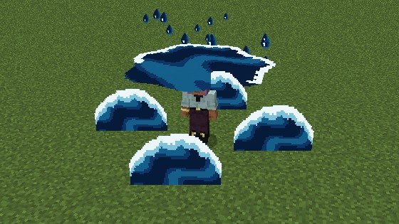{ loading=lazy }
  <figcaption>Crushing Depths.</figcaption>
</figure>

<figure markdown="span">
  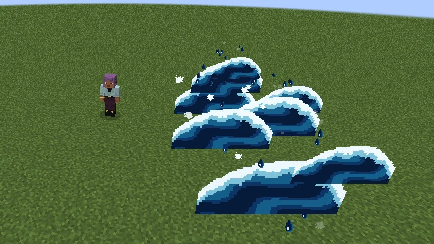{ loading=lazy }
  <figcaption>Surge.</figcaption>
</figure>

<figure markdown="span">
  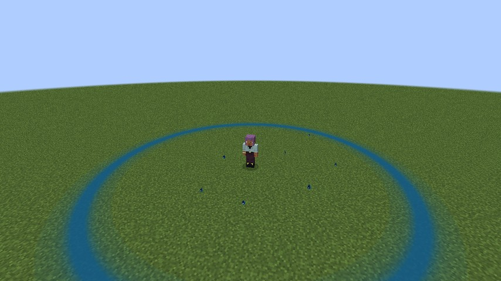{ loading=lazy }
  <figcaption>Call of the Sea.</figcaption>
</figure>

<figure markdown="span">
  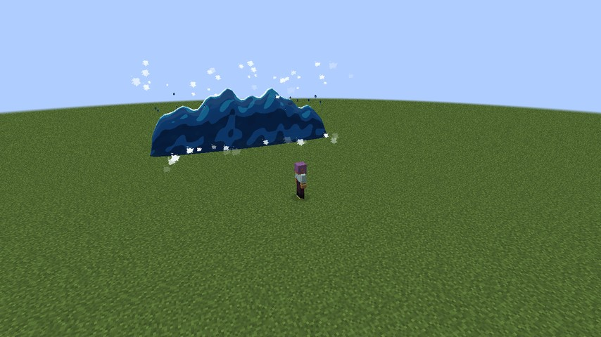{ loading=lazy }
  <figcaption>The Flood.</figcaption>
</figure>

- **The water** is Tensura's water element, and it spares your allies. A player you can't harm is neither pressed nor carried.

### Call of the Sea

Bosses and anyone's pets don't come. With fewer than 4 creatures near (6 at sea), the rest come up in a splash 4 to 8 blocks from the
target: drowned on land, drowned and guardians in water. Those are on your side, drop nothing and go when the Call ends. The others let
go when the target dies, or when you die or leave. With nothing to attack or nowhere for them to come up, nothing is paid.

### The Sea Dragon

<figure markdown="span">
  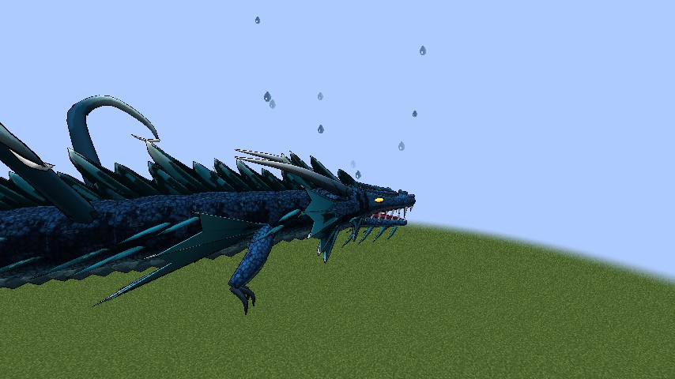{ loading=lazy }
  <figcaption>The Sea Dragon.</figcaption>
</figure>

<figure markdown="span">
  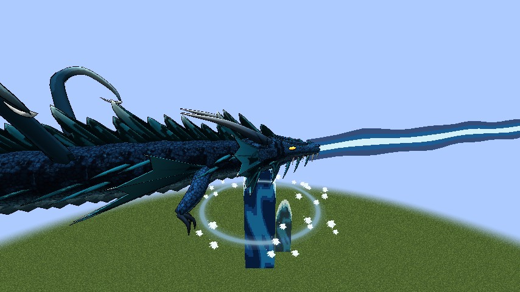{ loading=lazy }
  <figcaption>Its Breath.</figcaption>
</figure>

- **You fly at your class's wing speed** from the moment it forms: double-tap jump or the race key takes off, and the race key lands.
- **In water** you fly a quarter faster and can't drown.
- You take no fall damage and have the Scale Mail's armour.
- Your hand stays empty, and a melee blow is a bite.
- It's refused in a Scale Mail or a Drive. Death, a new dimension or logging out ends it.

## Settings

The numbers are in [`[houses]`](../reference/configuration.md#houses).
