# Kitsune and the Nine-Tailed Fox

Kunou's and Yasaka's race, added in **0.2.67**: fox Youkai of Kyoto, with fox ears and tails, blue **Fox Fire**, a **fox body** and the
fox's own **Youjutsu**. Each line has five ranks, and each rank is a race of its own on Tensura's evolution screen.

- **Kitsune** pick a coat of their own and have the whole set of powers, with one to five tails.
- **Nine-Tailed Foxes**, the rare ones, have nine golden tails from the start, a quarter more of everything, hotter Fox Fire, and from
  High-class Yasaka's **Great Fox** and the **ley point**.

<figure markdown="span">
  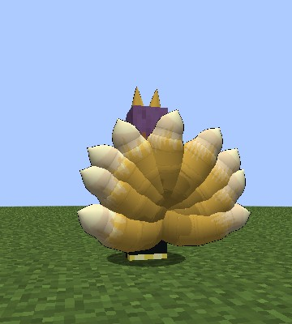{ loading=lazy }
  <figcaption>A Nine-Tailed Fox's nine.</figcaption>
</figure>

<figure markdown="span">
  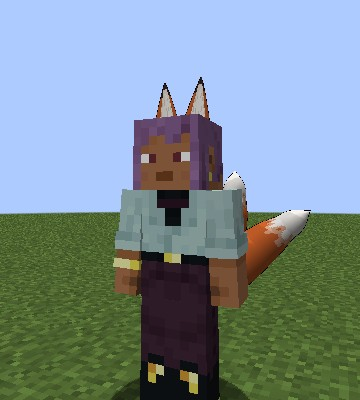{ loading=lazy }
  <figcaption>Ears from the front.</figcaption>
</figure>

<figure markdown="span">
  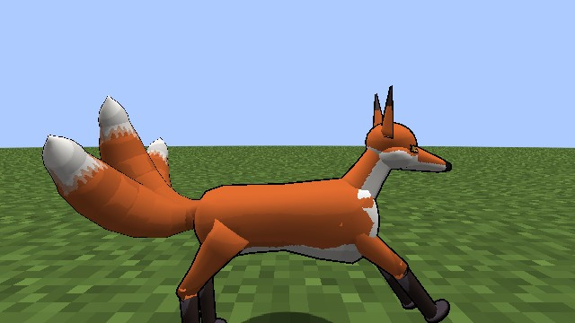{ loading=lazy }
  <figcaption>The fox body.</figcaption>
</figure>

## Becoming one

Pick **Low-class Kitsune** in Tensura's race menu:

- when you start a new character;
- after Tensura's **Reincarnation** spell;
- on an existing character, with Tensura's **Race Reset Scroll**, which opens the race menu again.

**One player in ten is born a Nine-Tailed Fox instead.** It's one roll per player, kept through death and a Race Reset Scroll. A Character
Reset Scroll starts it over.

<figure markdown="span">
  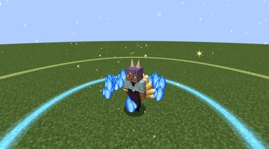{ loading=lazy }
  <figcaption>Born a Nine-Tailed Fox.</figcaption>
</figure>

They are **Majin**: holy things hurt them, and the Hero path is closed. A fox never rolls a [Sacred
Gear](../getting-started/first-gear.md#only-in-humans), the [Holy Factor](../durandal/index.md#the-holy-factor) or a
[Brave Saint](brave-saints.md) card.

## The ranks

| Rank | Kitsune | Nine-Tailed Fox | Reached by | Tails |
|---|---|---|---|---|
| 0 | Low-class Kitsune | Low-class Nine-Tailed Fox | the start | 1 (nine short) |
| 1 | Middle-class Kitsune | Middle-class Nine-Tailed Fox | 20,000 EP | 2 |
| 2 | High-class Kitsune | High-class Nine-Tailed Fox | 100,000 EP | 3 |
| 3 | Elder Kitsune | Elder Nine-Tailed Fox | 400,000 EP and 4 bosses | 4 |
| 4 | Kitsune Daiyoukai | Nine-Tailed Fox Daiyoukai | awakened as a True Demon Lord | 5 (nine full length) |

A Nine-Tailed Fox always has nine tails; they grow from short at Low-class to full length at Daiyoukai. Harvest Festival moves a lower rank
one up, and an Elder to a Daiyoukai.

<figure markdown="span">
  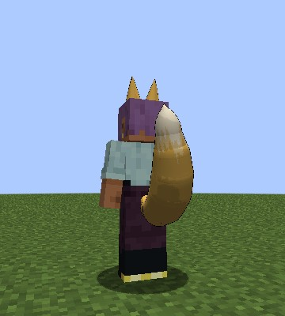{ loading=lazy }
  <figcaption>A Low-class Kitsune's one tail.</figcaption>
</figure>

<figure markdown="span">
  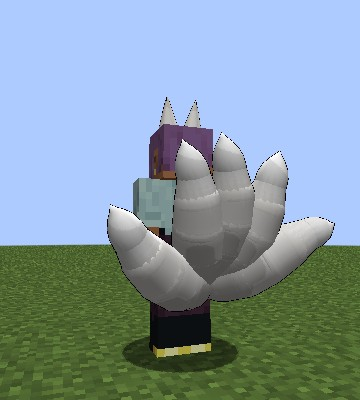{ loading=lazy }
  <figcaption>A Daiyoukai's five.</figcaption>
</figure>

<figure markdown="span">
  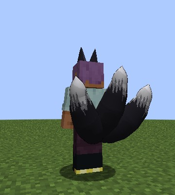{ loading=lazy }
  <figcaption>A black coat.</figcaption>
</figure>

## The coat

The first time, a screen offers **six coats**: golden, light brown, red, silver, white and black. Closing it wears golden for now, and it
asks again at your next login. A Nine-Tailed Fox always wears its own gold.

<figure markdown="span">
  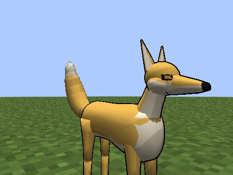{ loading=lazy }
  <figcaption>Golden.</figcaption>
</figure>

<figure markdown="span">
  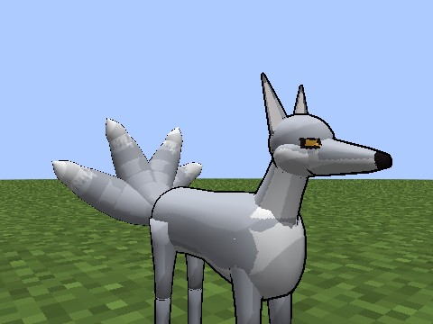{ loading=lazy }
  <figcaption>Silver.</figcaption>
</figure>

<figure markdown="span">
  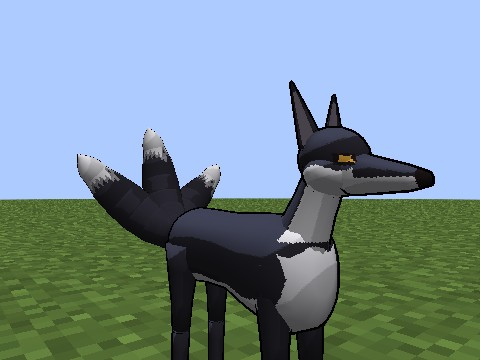{ loading=lazy }
  <figcaption>Black.</figcaption>
</figure>

## Ears and tails

The **race key** shows and hides them. On a [hybrid](#evil-pieces-and-hybrids) it's **Sneak + race key**.

They move with you: they swish slowly when you stand, swing away from a step or a turn, stream back at a run and droop as you fall, a
Nine-Tailed Fox's nine fanned low and wide. They hide under invisibility, a Scale Mail and the dragon.

**Out,** you get:

| Rank | 0 | 1 | 2 | 3 | 4 |
|---|---|---|---|---|---|
| Speed | +10% | +12% | +15% | +20% | +25% |
| Jump (blocks) | 2 | 2 | 2.5 | 3 | 4 |
| Fox senses (blocks) | 8 | 12 | 16 | 20 | 24 |

- You take **no fall damage**.
- **The pounce:** sprint and jump for a long, low leap of 5 to 12 blocks by rank, at most once a second.
- **Fox senses:** while you **sneak**, Tensura's presence sense outlines living things through walls, a quarter further for a Nine-Tailed
  Fox. Standing up ends it, and it costs nothing.
- **Fox touches:** Minecraft's foxes trust you, and chickens run from you.

**Hidden,** you look human, and all of that goes. Using Fox Fire while hidden brings them out first, for free.

<figure markdown="span">
  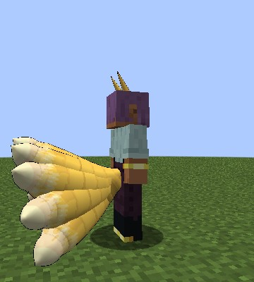{ loading=lazy }
  <figcaption>Tails streaming back at a run.</figcaption>
</figure>

## The fox body

**Fox Transformation** (Sneak + race key, or the skill's first mode): a puff of blue fire and you're a small fox in your coat, with your
tails. Press again to stand.

- **40% faster** than with the ears out, through **one-block gaps**, and it jumps twice as high: 4 to 8 blocks by rank. A pounce stays low.
- **Sneaky:** mobs notice it only within **4 blocks** until it strikes, then from half as far for 5 seconds. Its fox senses stay on without
  sneaking.
- **Every hit is a bite,** whatever you hold: your race's attack plus 4 to 64 by rank. A pounce bites the first enemy it meets for half
  again.
- **No items,** but doors, buttons and levers still work.
- **Fox Fire** is a quarter stronger and a quarter cheaper in it, and **Youjutsu** works in it.
- It ends on a second press, death, a race change, a Scale Mail or the dragon. It stays on through logging out.

<figure markdown="span">
  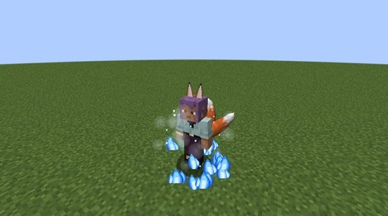{ loading=lazy }
  <figcaption>A puff of blue fire.</figcaption>
</figure>

<figure markdown="span">
  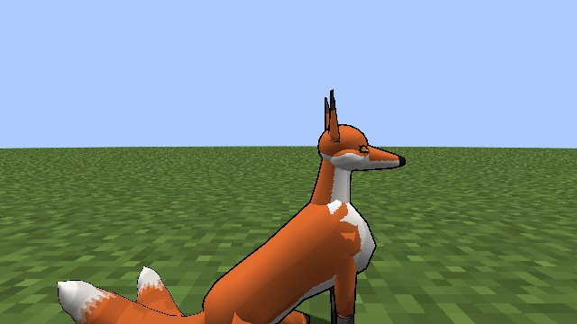{ loading=lazy }
  <figcaption>Sitting.</figcaption>
</figure>

<figure markdown="span">
  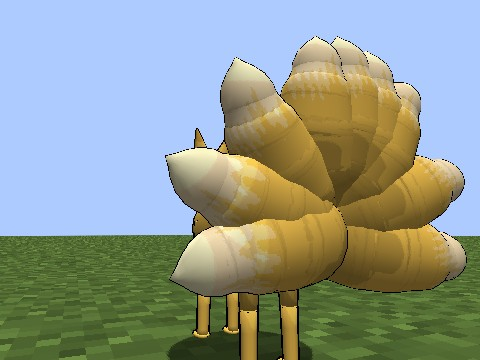{ loading=lazy }
  <figcaption>A Nine-Tailed Fox's.</figcaption>
</figure>

## The Great Fox

*Fox Transformation's second mode: a Nine-Tailed Fox from High-class, by line or by blood.*

A column of blue fire and a roar, and you're **Yasaka's glowing fox**, about **ten blocks tall**, its nine tails swaying.

| | High-class | Elder | Daiyoukai |
|---|---|---|---|
| Lasts | 30 s | 45 s | 60 s |

It costs **30% of your max magicules** and then cools down for **10 minutes**.

- **In it:** the Scale Mail's armour, no fall damage, 2.5-block steps, 40% faster, a long reach. **Every hit is a bite** of four times the
  fox body's. **Fox Breath** reaches 20 blocks.
- **Sneak + attack** sweeps the tails round you: everything within 6 blocks is thrown back for the bite's damage, at most every 2 seconds.
  Pets and allies are passed by.
- **Not in it:** flight, items, the pounce.
- **It needs room** to stand at full size. In a cave or under a low roof: "There's no room here for the Great Fox.", and it costs nothing.
  It never chokes in a wall while it lasts.
- **It ends** on time, a second press, death, a new dimension, logging out or a race change. From the small fox body, a press goes straight
  into it.

<figure markdown="span">
  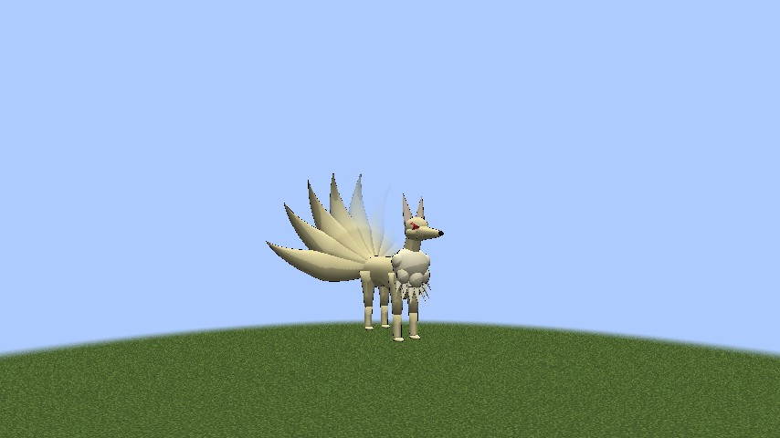{ loading=lazy }
  <figcaption>The Great Fox.</figcaption>
</figure>

<figure markdown="span">
  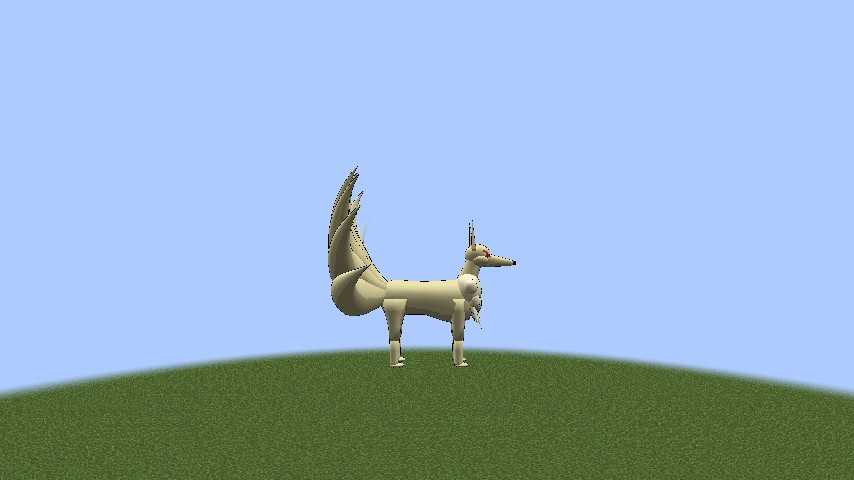{ loading=lazy }
  <figcaption>From the side.</figcaption>
</figure>

<figure markdown="span">
  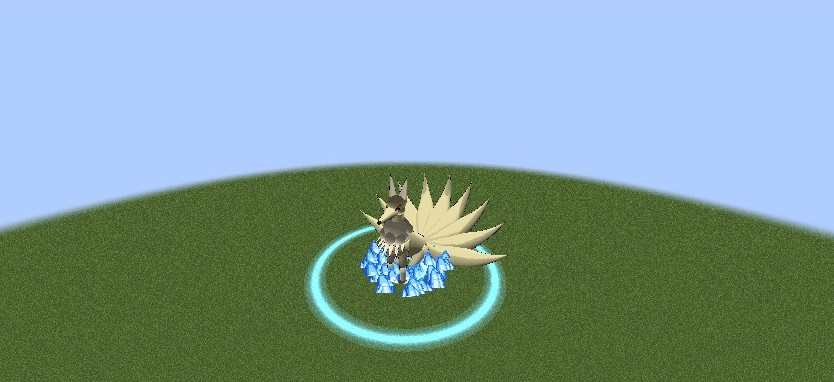{ loading=lazy }
  <figcaption>The tail sweep.</figcaption>
</figure>

<figure markdown="span">
  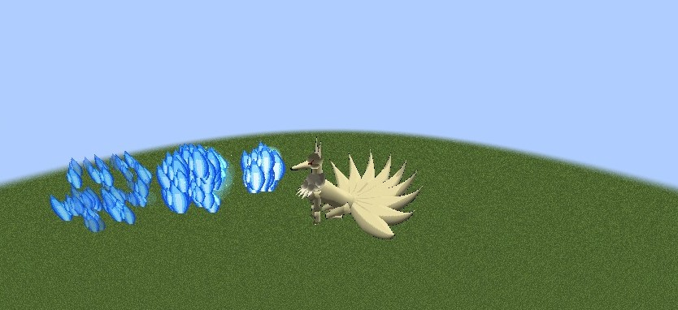{ loading=lazy }
  <figcaption>Fox Breath, 20 blocks long.</figcaption>
</figure>

## Ley Lines

*A Nine-Tailed Fox's skill, by line or by blood.*

Press to bind your **ley point** where you stand, once a game day (with the daylight cycle off, once every 20 minutes of play). Within
**64 blocks** of it, in its dimension:

- magicules and aura refill **three times as fast**;
- Fox Fire hits **a quarter harder**;
- the Great Fox comes back **twice as soon**.

Only you see its faint golden lines in the ground. Away from it, nothing changes.

<figure markdown="span">
  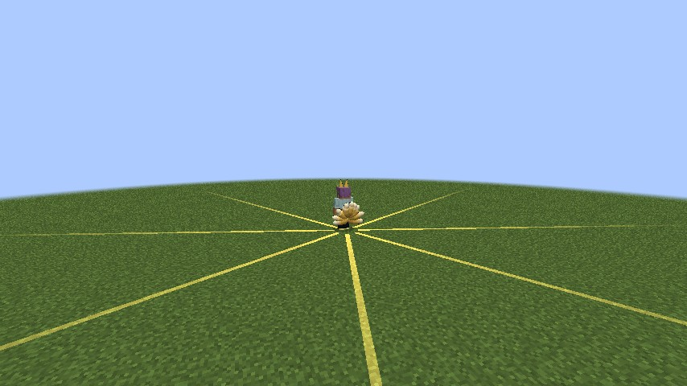{ loading=lazy }
  <figcaption>The ley point's lines, seen only by its holder.</figcaption>
</figure>

## Fox Fire

Blue flames, paid in **magicules**, with mastery to **1,000**. Mastered, it costs half, hits a quarter harder and its burn lasts 6 seconds.
A Nine-Tailed Fox's is a quarter stronger and bigger.

| # | Mode | Unlocks | What it does |
|---|---|---|---|
| 0 | **Foxfire** | from the start | A blue fireball that bursts on what it hits |
| 1 | **Kitsunebi** | from the start | A wisp per tail circles you, and darts at whoever you hit or hits you |
| 2 | **Fox Breath** | from the start | Hold for a cone of blue fire |
| 3 | **Foxfire Pillar** | 40% mastery | A ring of fire where you look, then a column bursting up |

**The blue burn.** Its fire burns fire-immune mobs too, for 4 seconds; water puts it out, and it **never lights blocks**.

By rank:

| Rank | 0 | 1 | 2 | 3 | 4 |
|---|---|---|---|---|---|
| Foxfire: damage | 6 | 12 | 24 | 48 | 96 |
| Foxfire: magicules | 100 | 400 | 1,800 | 7,500 | 30,000 |
| Blue burn: damage a second | 1 | 2 | 4 | 8 | 16 |
| Kitsunebi: a wisp's damage | 4 | 8 | 16 | 32 | 64 |
| Kitsunebi: magicules | 300 | 1,200 | 5,400 | 22,500 | 90,000 |
| Fox Breath: damage a second | 8 | 16 | 32 | 64 | 128 |
| Fox Breath: magicules a second | 150 | 600 | 2,700 | 11,250 | 45,000 |
| Foxfire Pillar: damage | 15 | 30 | 60 | 120 | 240 |
| Foxfire Pillar: magicules | 500 | 2,000 | 9,000 | 37,500 | 150,000 |

- **Foxfire** flies up to 48 blocks, once a second.
- **Kitsunebi:** the wisps circle you for 30 seconds; each time you hit or are hit, one darts at the other, at most one a second.
- **Fox Breath:** a 6-block cone, up to 5 seconds held.
- **Foxfire Pillar:** up to 32 blocks away, throwing things up, every 10 seconds.

<figure markdown="span">
  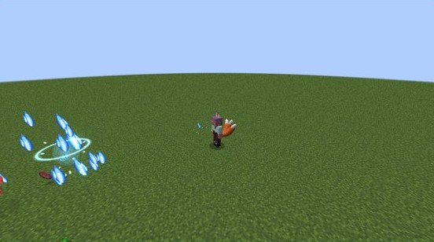{ loading=lazy }
  <figcaption>Foxfire bursting.</figcaption>
</figure>

<figure markdown="span">
  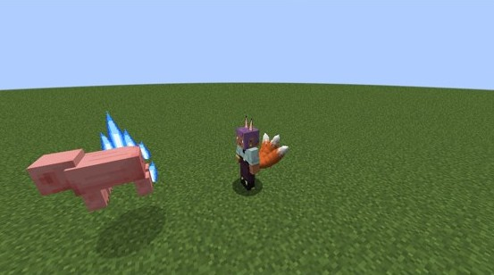{ loading=lazy }
  <figcaption>The blue burn.</figcaption>
</figure>

<figure markdown="span">
  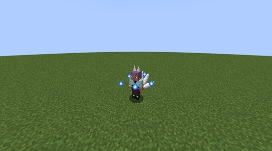{ loading=lazy }
  <figcaption>Kitsunebi's wisps.</figcaption>
</figure>

<figure markdown="span">
  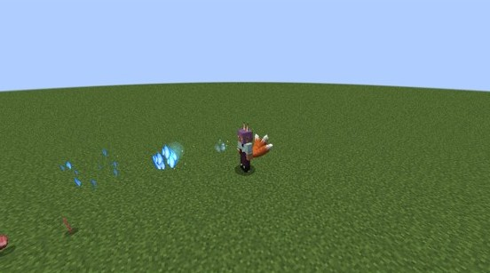{ loading=lazy }
  <figcaption>Fox Breath.</figcaption>
</figure>

<figure markdown="span">
  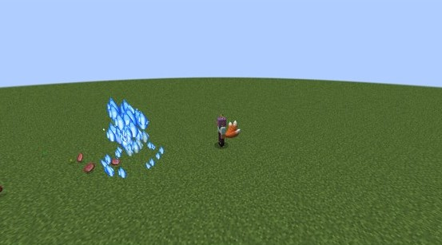{ loading=lazy }
  <figcaption>The Foxfire Pillar.</figcaption>
</figure>

## Youjutsu

The fox's own arts, apart from the [cats'](nekomata.md#youjutsu), paid in **magicules**, with mastery to **1,000**. Mastered, they cost half
and last a quarter longer. They work hidden and in the fox body.

| # | Mode | Unlocks | What it does |
|---|---|---|---|
| 0 | **Fox Illusion** | from the start | Copies of you that draw enemies off |
| 1 | **Bewitch** | from the start | A mob fights for you for a while |
| 2 | **Fox Step** | from the start | A puff of fire, and you appear where you look |
| 3 | **Sunshower Barrier** | 50% mastery | A dome of rain in sunlight where nothing breaks and no enemy leaves |

By rank:

| Rank | 0 | 1 | 2 | 3 | 4 |
|---|---|---|---|---|---|
| Fox Illusion: magicules | 400 | 1,600 | 7,200 | 30,000 | 120,000 |
| Bewitch: seconds | 15 | 20 | 25 | 30 | 40 |
| Bewitch: magicules | 500 | 2,000 | 9,000 | 37,500 | 150,000 |
| Fox Step: blocks | 8 | 10 | 12 | 14 | 16 |
| Fox Step: magicules | 150 | 600 | 2,700 | 11,250 | 45,000 |
| Sunshower Barrier: radius (blocks) | 12 | 16 | 20 | 24 | 32 |

- **Fox Illusion:** 2 to 4 copies of you (one more for a Nine-Tailed Fox) for 10 seconds, with your ears and tails; in the fox body they're
  small foxes like you. Mobs turn to them, and a struck copy bursts in blue fire. Every 25 seconds.
- **Bewitch:** the mob you point at within 16 blocks, if its EP is below 75% of yours, fights for you for the table's time, 1 to 3 at once by
  rank. Bosses and players refuse. When it ends, or you let it go (Sneak and press on it), it's its old self again.
- **Fox Step:** up to the table's blocks where you look, short of walls, every 3 seconds.
- **Sunshower Barrier:** a dome for 30 seconds, with rain falling through sunlight. Nothing inside breaks or is placed, and an enemy inside
  can't walk out. It costs 5% of your max magicules on top of its price, and cools down for 2 minutes.

<figure markdown="span">
  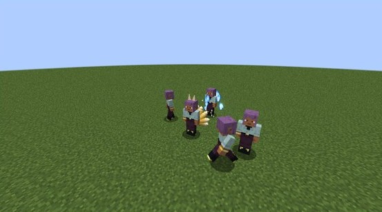{ loading=lazy }
  <figcaption>Fox Illusion's copies.</figcaption>
</figure>

<figure markdown="span">
  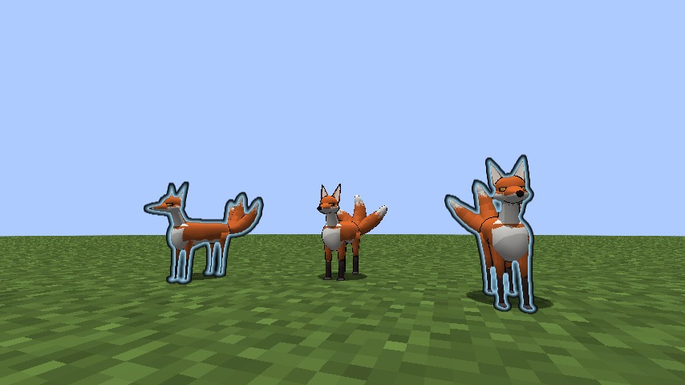{ loading=lazy }
  <figcaption>Cast in the fox body, the copies are foxes too.</figcaption>
</figure>

## Mastery

Fox Fire and Youjutsu each count to **1,000**, by the race skills' rule: points for each use that hits something, and for any Fox Step or
Sunshower Barrier. A line marks the Pillar at 40%, the Barrier at 50% and full mastery. Fox Transformation has no mastery.

## Evil Pieces and hybrids

A fox takes an [Evil Piece](peerage.md) as anyone does, reborn a Devil of their class with their blood:

- **Kept:** Fox Fire with its mastery, Fox Transformation, the coat, the ears and the tails, at their Devil class's numbers. A Nine-Tailed
  Fox's blood keeps the gold coat, the hotter flames, the Great Fox and Ley Lines.
- **Lost:** Youjutsu.
- The race key spreads **bat wings**, and **Sneak + race key** shows the ears and tails. The fox body is the skill alone.
- A Race Reset Scroll ends the blood.

## Hell and holy things

- Hell's poison reaches a pure fox, not a hybrid.
- [Ascalon's](../boosted-gear/ascalon.md) burn and strike spare a pure fox and hit a hybrid.

## Settings and commands

The numbers are in [`[kitsune]`](../reference/configuration.md#kitsune), and the races' stats in
`config/dxdtensura/race/kitsune_config.toml` and `kyuubi_config.toml`. Operators have the
[Kitsune commands](../reference/commands.md#kitsune-and-the-nine-tailed-fox).
