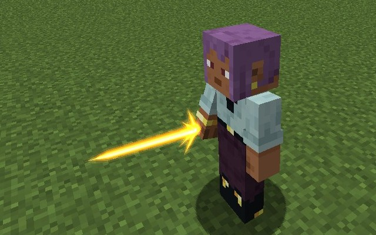
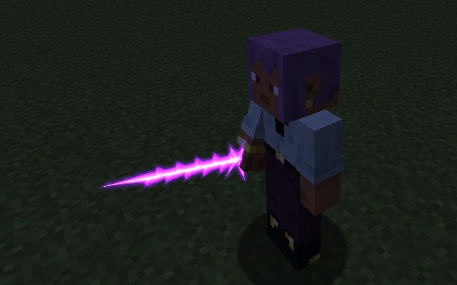
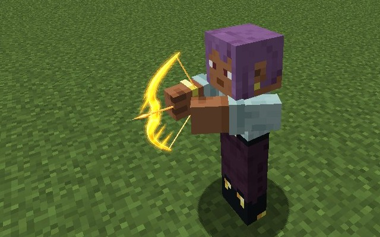
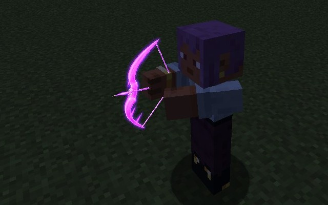
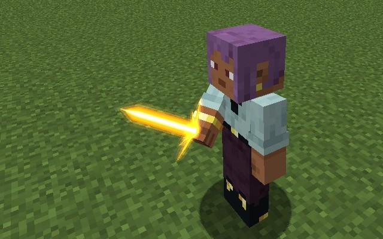
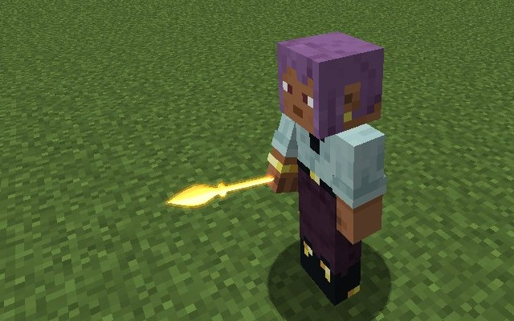
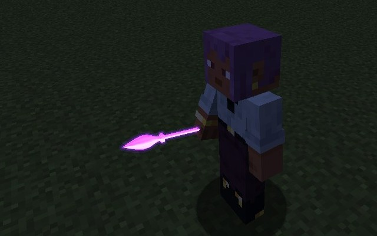

# Light weapons

[Angels and Fallen Angels](angels.md) don't only throw their light: since **0.2.35** they shape it into a **Light Sword** and a **Light Bow**, and can keep
the **Light Spear** in the hand. Gold from an Angel, violet from a Fallen Angel, and each line's weapons have their own look.

<figure markdown="span">
  { loading=lazy }
  <figcaption>An Angel's Light Sword.</figcaption>
</figure>

<figure markdown="span">
  { loading=lazy }
  <figcaption>A Fallen Angel's, barbed.</figcaption>
</figure>

<figure markdown="span">
  { loading=lazy }
  <figcaption>An Angel's Light Bow.</figcaption>
</figure>

<figure markdown="span">
  { loading=lazy }
  <figcaption>A Fallen Angel's.</figcaption>
</figure>

## Who has them

| Skill | Race | Weapons |
|---|---|---|
| **Heaven's Light** | Angels | Light Sword, Light Bow from 40% [mastery](angels.md#mastery), the held Light Spear |
| **Fallen Light** | Fallen Angels | Light Sword, Light Bow from 40% mastery, the held Light Spear |
| **Fallen Blood** | [Hybrids](angels.md#hybrids) | The held Light Spear only |

The Light Sword and the Light Bow are two more modes on the skill. Switch to them the way you switch the gears' modes. A line in chat tells you when the bow
answers you. The Juggernaut Drive's dragon can't form them.

## How a weapon works

- **Press the mode.** The weapon forms in your selected hotbar slot if that's empty, or in your first empty hotbar slot, and your hand jumps there. With no empty
  slot, "Your hands are full: your light needs an empty slot."
- **It costs nothing to form or to hold,** and it has no timer. Each hit, blocked blow or shot costs magicules, and a miss is free.
- **Press again to end it,** and your hand goes back to where it was.
- **It fades** when you switch away, drop it, run out of magicules or die.
- **One weapon at a time.** It can't be stored.

### Its hits

- A hit counts as **light**, not physical. Tensura's light resistances read it, but physical ones and Physical Barrier don't.
- **The undead take it tripled**, and it can strike a spiritual form.
- It leaves the [holy burn](angels.md#the-holy-burn) on what holy things hurt.
- [Heaven's Grace](angels.md#day-and-hell), [Brave Saint](brave-saints.md) cards and full mastery all count, as they do for the Light Spear.
- Hits earn mastery, at most once a second.
- [Sword Birth](../sword-birth/index.md) can't copy them.

## Light Sword

Your own light as a blade. It adds **4, 8, 16, 32 or 64 attack** by rank to your own, at Tensura's long sword speed and reach, with a sweep.

- **Each swing that does damage** costs magicules. If you can't pay, the hit still lands and the blade goes out.
- **Hold use to guard.** It blocks what a shield blocks, from the front. Each blocked blow costs what a hit costs, and an axe stops the guard for 5 seconds.

A Low-class Angel's sword does about 18 to a zombie.

<figure markdown="span">
  { loading=lazy }
  <figcaption>On guard.</figcaption>
</figure>

## Light Bow

From 40% mastery, a bow that needs no arrows.

- **A full draw** takes 1 second and shoots a straight bolt of light, up to **96 blocks**. It zooms as you draw, as a vanilla bow does.
- **A shorter draw** does and costs its share. Under a quarter of a second it shoots nothing.
- **Short of magicules,** the shot still flies, weaker.

A Low-class Angel's full bolt does about 13.5 to a zombie.

## The Light Spear in your hand

The [Light Spear](angels.md#light-spear) has two ways to use it now:

- **Tap the key** and it flies, as it always did.
- **Keep the key down** until the throw is due and it stays in your hand instead.

In the hand it hits for **3, 6, 12, 24 or 48 attack** by rank, less hard than the sword, with more reach and no sweep or guard. **Right-click or tap the key to throw
it** as a Light Spear, free, since the press already paid. A hybrid's Fallen Blood spear does all of this too.

The Great Spear keeps its charge and throw.

<figure markdown="span">
  { loading=lazy }
  <figcaption>In an Angel's hand.</figcaption>
</figure>

<figure markdown="span">
  { loading=lazy }
  <figcaption>In a Fallen Angel's.</figcaption>
</figure>

## Numbers by rank

Attack is added to your own. Costs are in magicules.

| Rank | Sword attack | A hit or block | Bow, full draw | A shot | Held spear attack | A hit |
|---|---|---|---|---|---|---|
| 1 | 4 | 25 | 4.5 | 50 | 3 | 20 |
| 2 | 8 | 100 | 9 | 200 | 6 | 80 |
| 3 | 16 | 450 | 18 | 900 | 12 | 360 |
| 4 | 32 | 1,875 | 36 | 3,750 | 24 | 1,500 |
| 5 | 64 | 7,500 | 72 | 15,000 | 48 | 6,000 |

Server owners can change them in the [`[light_weapons]`](../reference/configuration.md#light_weapons) config section.
