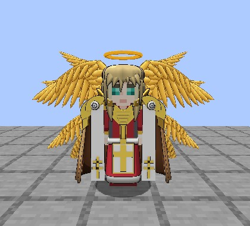
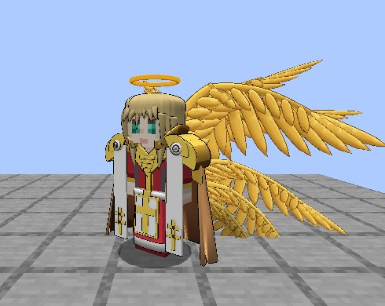
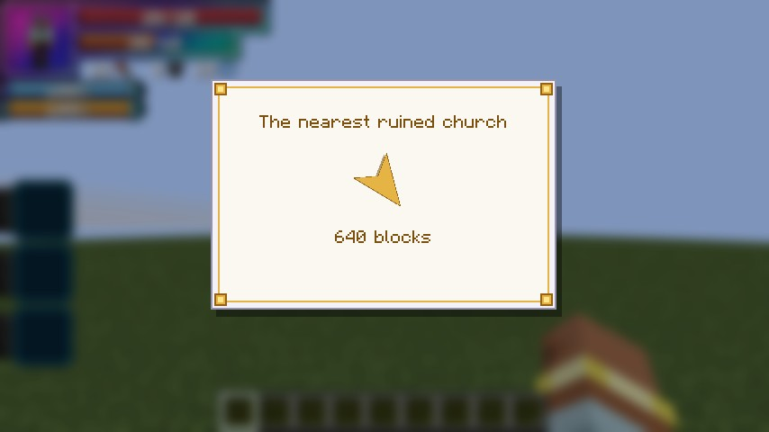
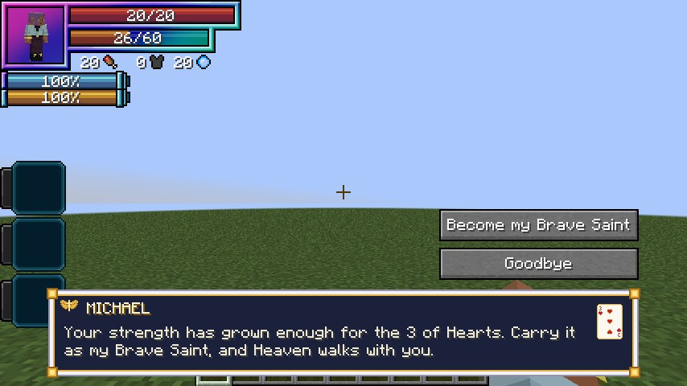
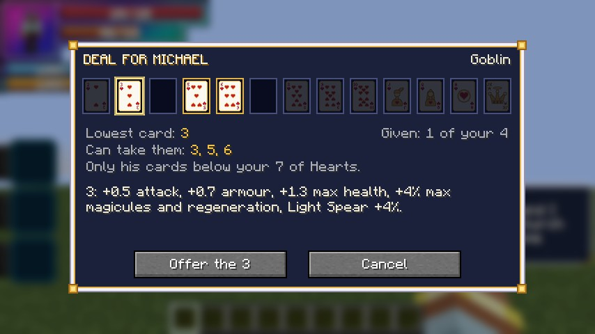

# Michael

**Michael**, the leader of Heaven, is an NPC Seraph added in **0.2.78**. He deals his own deck of [Brave Saints'](brave-saints.md) cards, in Hearts, so a player on their own can become a
Brave Saint, as [Rias](rias.md) lets them become a Devil. There's one Michael per world, with twelve gold wings and a halo.

<figure markdown="span">
  { loading=lazy }
  <figcaption>Michael.</figcaption>
</figure>

<figure markdown="span">
  { loading=lazy }
  <figcaption>Twelve gold wings.</figcaption>
</figure>

## Hearing of him

At your first sunrise in the Overworld, under open sky, a white feather drifts down to your feet, once for good (for a human or a pure Angel who holds no card). Right-click **Michael's
Feather**: an arrow and a distance point to the nearest ruined church, or to his church once he has one. Ruined churches' chests can hold feathers too.

<figure markdown="span">
  { loading=lazy }
  <figcaption>The feather points the way.</figcaption>
</figure>

## Meeting him

Pray at a ruined church's quartz altar (right-click it). The first church anyone prays at becomes his for good: a pillar of light falls before the altar and he steps out of it. After that he
stands at his altar and walks the aisle. Its blocks are never changed, and Freed's raids skip it.

He can't be hurt. A hit gets a warning, and a second within 5 minutes sends you out of his church in a gold circle.

## His card

Right-click him and ask to become his Brave Saint. He deals the card your EP earns, the lowest free one that covers you. Accept on the consent screen and you're reborn an Angel, and a human keeps
a Sacred Gear through his card.

Come back stronger and he **trades your card up** for a higher free one. Past the Ace, the top step is the [Joker](brave-saints.md#the-joker).

**Who can join:** a human (Human, Enlightened Human, Human Saint) or a pure Angel, holding no card and serving no King. Devils, hybrids, Fallen Angels and a newcomer already as strong as his cards
(his 300,000 EP by default) are turned down, each with their own line. A holder who grows that strong trades up to his Joker instead.

**One deck per world:** every player shares his twelve Hearts and his Joker, and a card someone holds isn't free.

<figure markdown="span">
  { loading=lazy }
  <figcaption>"Carry it as my Brave Saint."</figcaption>
</figure>

## Hands when you play alone

His holders' Brave Saint skill gets a fourth mode, **Deal for Michael**: give his spare cards to monsters you've beaten, up to 4, always lower than your own card and covering the monster. They become your
Tensura subordinates with the card's bonus and small gold halos, and play hands with you. **My Seraph** lists them, with Release. If one dies or you release it, the card goes back to his deck.

With the 10, Jack, Queen and Ace of Hearts in a hand, he joins from afar as the King for a **Royal Flush**, and his Heaven's Judgement falls at a Seraph's rank.

<figure markdown="span">
  { loading=lazy }
  <figcaption>Deal for Michael.</figcaption>
</figure>

## Commands and settings

See [Commands](../reference/commands.md#michael) and [`[michael]`](../reference/configuration.md#michael).
