# Nekomata and Nekoshou

Koneko's and Kuroka's race, added in **0.2.0**: cat Youkai with ears and tails, Senjutsu's ki and Youjutsu's poison and tricks. Each line has
five ranks, and each rank is a race of its own on Tensura's evolution screen.

- **Nekomata** pick a coat of their own, and have the whole set of powers.
- **Nekoshou**, the rare ones, are pure white or pure black, with a little more of everything, a Kasha that purifies and a Ki
  Healing that gives back life.

<figure markdown="span">
  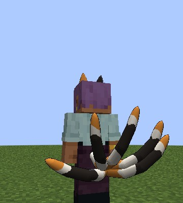{ loading=lazy }
  <figcaption>A calico coat and five tails.</figcaption>
</figure>

<figure markdown="span">
  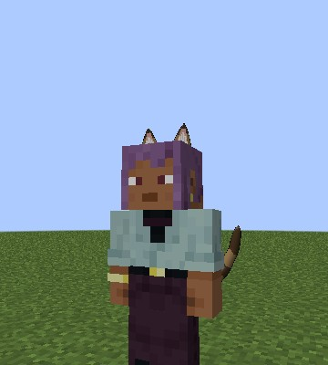{ loading=lazy }
  <figcaption>Ears from the front. One flicks now and then.</figcaption>
</figure>

<figure markdown="span">
  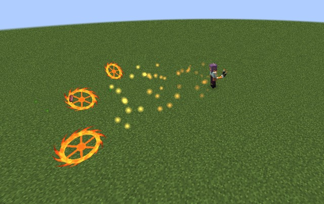{ loading=lazy }
  <figcaption>Kasha: a wheel of flame for each tail.</figcaption>
</figure>

## Becoming one

Pick **Low-class Nekomata** in Tensura's race menu:

- when you start a new character;
- after Tensura's **Reincarnation** spell;
- on an existing character, with Tensura's **Race Reset Scroll**, which opens the race menu again.

**One player in ten is born a Nekoshou instead**: "You were born a Nekoshou." It's one roll per player, kept through death and a Race
Reset Scroll. A Character Reset Scroll starts it over.

<figure markdown="span">
  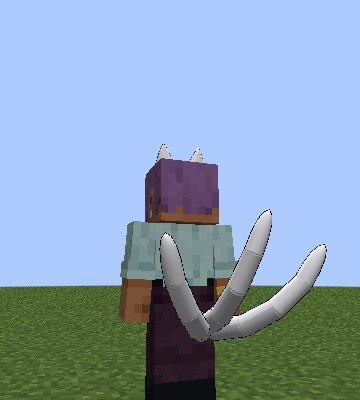{ loading=lazy }
  <figcaption>A white Nekoshou.</figcaption>
</figure>

<figure markdown="span">
  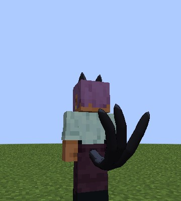{ loading=lazy }
  <figcaption>A black Nekoshou.</figcaption>
</figure>

They are **Majin**: holy things hurt them, and the Hero path is closed. A cat never rolls a [Sacred
Gear](../getting-started/first-gear.md#only-in-humans), the [Holy Factor](../durandal/index.md#the-holy-factor) or a
[Brave Saint](brave-saints.md) card.

## The ranks

| Rank | Nekomata | Nekoshou | Reached by | Tails |
|---|---|---|---|---|
| 0 | Low-class Nekomata | Low-class Nekoshou | the start | 1 |
| 1 | Middle-class Nekomata | Middle-class Nekoshou | 20,000 EP | 2 |
| 2 | High-class Nekomata | High-class Nekoshou | 100,000 EP | 3 |
| 3 | Elder Nekomata | Elder Nekoshou | 400,000 EP and 4 bosses | 5 |
| 4 | Nekomata Daiyoukai | Nekoshou Daiyoukai | awakened as a True Demon Lord | 7 |

Harvest Festival moves a lower rank one up, and an Elder to a Daiyoukai.

<figure markdown="span">
  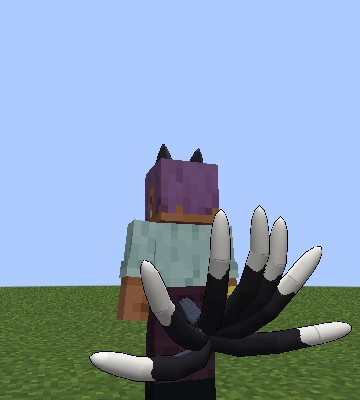{ loading=lazy }
  <figcaption>A Daiyoukai's seven tails.</figcaption>
</figure>

## The coat

The first time, a screen offers **six coats**: ginger, grey, brown tabby, calico, tuxedo or cream. A Nekoshou gets **two**, white or
black.

- Closing the screen wears the first coat for now, and it asks again at your next login.
- A Race Reset Scroll and picking the race again changes your coat.

<figure markdown="span">
  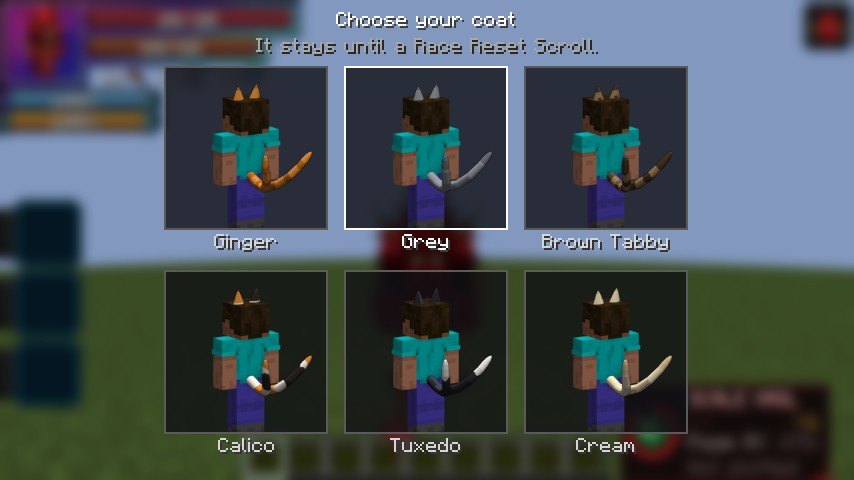{ loading=lazy }
  <figcaption>A Nekomata's six coats.</figcaption>
</figure>

<figure markdown="span">
  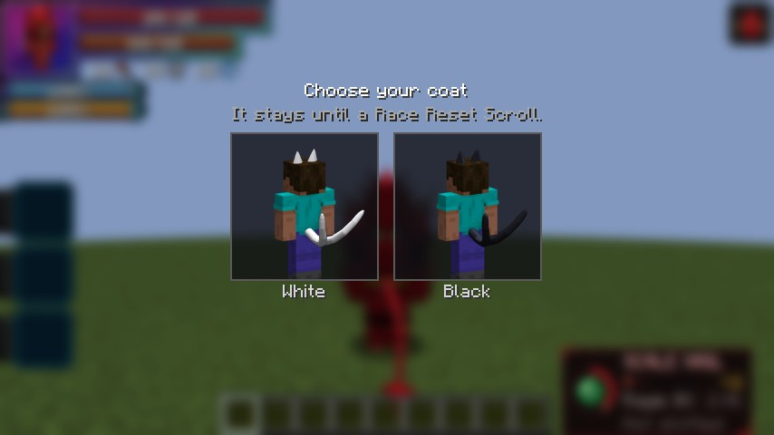{ loading=lazy }
  <figcaption>A Nekoshou's two.</figcaption>
</figure>

## Ears and tails

The **race key** shows and hides them. On a [hybrid](#evil-pieces-and-hybrids) it's **Sneak + race key**.

They move with you. The tails swish when you stand, stream out at a run, swing away from a step or a turn, and droop or lift as you
rise and fall. They grow in and shrink away when you show or hide them. They hide under invisibility, a Scale Mail and the dragon, and
the ears still show over a helmet.

**Out,** you get:

| Rank | 0 | 1 | 2 | 3 | 4 |
|---|---|---|---|---|---|
| Speed | +10% | +12% | +15% | +20% | +25% |
| Jump (blocks) | 2 | 2 | 2.5 | 3 | 4 |
| Air steps | 1 | 1 | 2 | 4 | 6 |

- Press jump in mid-air for an **air step**. They come back when you land.
- You take **no fall damage**.
- **Creepers and phantoms keep away.**

**Hidden,** you look human. All of that goes, and Touki, Aura Sense and Ki Healing end. Pressing Senjutsu while hidden brings them out
first, for free.

<figure markdown="span">
  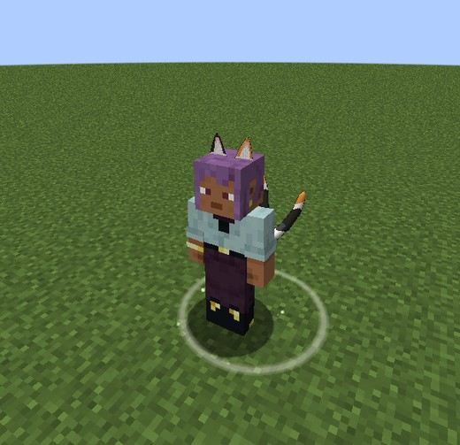{ loading=lazy }
  <figcaption>An air step.</figcaption>
</figure>

## Senjutsu

The skill of life force, paid in **aura**, with mastery to **1,000**. Mastered, it costs half, hits a quarter harder and gathers half the
[Malice](#malice).

| # | Mode | Unlocks | What it does |
|---|---|---|---|
| 0 | **[Touki](#touki)** | from the start | A white aura for harder bare-handed blows |
| 1 | **[Ki Bullet](#ki-bullet)** | from the start | A white bolt from the palm |
| 2 | **[Ki Healing](#ki-healing)** | from the start | Hold to heal someone, or yourself |
| 3 | **[Aura Sense](#aura-sense)** | from the start | Tensura's presence sense |
| 4 | **[Kasha](#kasha)** | 40% mastery | Wheels of flame along the ground |

By rank:

| Rank | 0 | 1 | 2 | 3 | 4 |
|---|---|---|---|---|---|
| Touki: extra bare-hand damage | 4 | 8 | 16 | 32 | 64 |
| Touki: spirit damage | 1 | 2 | 4 | 8 | 16 |
| Touki: damage taken | -10% | -12% | -15% | -20% | -25% |
| Ki Bullet: damage | 6 | 12 | 24 | 48 | 96 |
| Ki Bullet: aura | 100 | 400 | 1,800 | 7,500 | 30,000 |
| Aura Sense: blocks | 16 | 24 | 32 | 48 | 64 |
| Kasha: damage | 12 | 24 | 48 | 96 | 192 |
| Kasha: aura | 500 | 2,000 | 9,000 | 37,500 | 150,000 |

### Touki

A white aura. Your bare-handed hits do the table's extra damage and spirit damage, push back, and block the target's energy regeneration for
3 seconds. A sword gets only the defence and the +5% speed.

It costs **1% of your max aura a second**, won't start below 5%, and has a 5 second cooldown. A
[Divide](../divine-dividing/index.md#divide) on you cuts the extra and the spirit damage, as it does every hit.

### Ki Bullet

A white bolt, with a quarter of its damage going to the spirit, once a second.

### Ki Healing

**Hold it** to heal whoever is under your crosshair, or yourself.

- It restores health **and** spiritual health, a whole bar in 10 seconds.
- A bar costs **30% of your max aura**, **15%** mastered. You pay only for what it restored.
- The first pulse **draws out poison and curses**.

**A Nekoshou's payback.** Three seconds on a player with a life debt gives back **1 point** of the
[Juggernaut Drive's debt](../boosted-gear/juggernaut-drive.md#the-price) and **2** of the
[Divides'](../boosted-gear/divide.md#the-price). That Nekoshou then waits 20 minutes.

<figure markdown="span">
  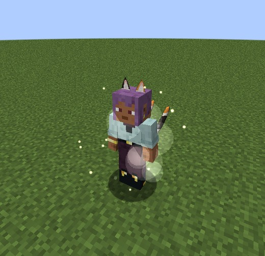{ loading=lazy }
  <figcaption>Touki.</figcaption>
</figure>

<figure markdown="span">
  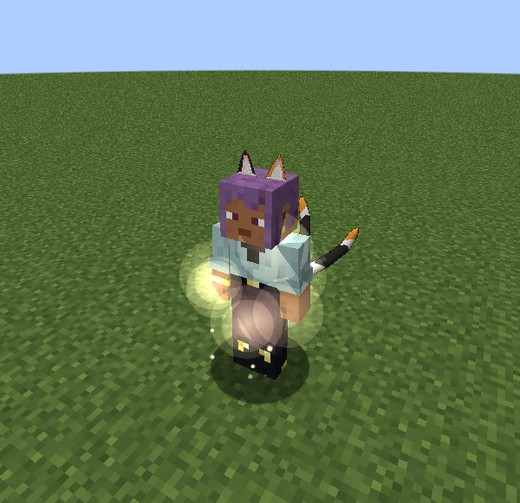{ loading=lazy }
  <figcaption>Ki Healing.</figcaption>
</figure>

<figure markdown="span">
  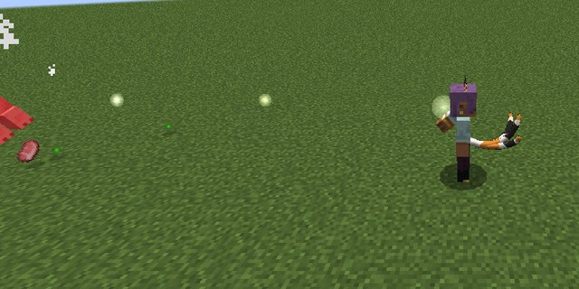{ loading=lazy }
  <figcaption>A Ki Bullet.</figcaption>
</figure>

### Aura Sense

Tensura's presence sense, for **0.2% of your max aura a second**. It shows you what's alive through walls.

### Kasha

*Mode 4, from 40% mastery.*

A flame wheel for each tail spins up at your sides for a second, then rolls out in a 60-degree fan along the ground for **24 blocks**,
climbing one-block steps.

- A cast hits a target **once**, so more wheels cover more ground, not more damage.
- With no ground within 4 blocks it refuses, for free.
- **Orange flames** burn for 5 seconds. A Nekoshou's **white or black** ones are holy.

<figure markdown="span">
  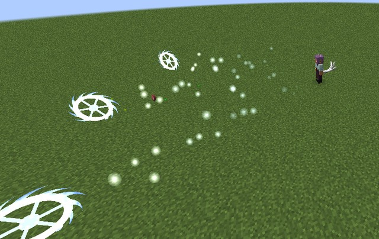{ loading=lazy }
  <figcaption>A white Nekoshou's Kasha.</figcaption>
</figure>

<figure markdown="span">
  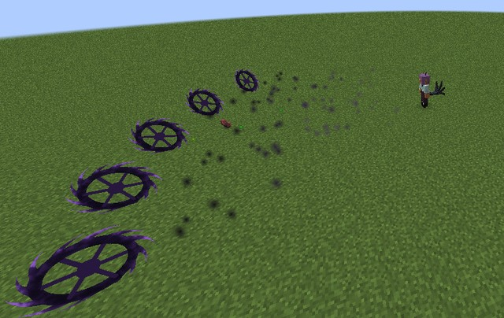{ loading=lazy }
  <figcaption>A black Nekoshou's Kasha.</figcaption>
</figure>

## Youjutsu

Youkai magic, paid in **magicules**, with mastery to **1,000**.

| # | Mode | Unlocks | What it does |
|---|---|---|---|
| 0 | **[Poison Mist](#poison-mist)** | from the start | A cloud of poison on the ground |
| 1 | **[Mud Bind](#mud-bind)** | 25% mastery | A patch of mud that holds what stands in it |
| 2 | **[Veil](#veil)** | 50% mastery | You turn invisible, and mobs lose you |
| 3 | **[Mirage](#mirage)** | 75% mastery | Copies of you that draw enemies off |

The mode key skips what isn't open yet, and a line in chat marks each one as it opens.

- **Mastery:** a use that poisons, holds or fools something earns **8**, so Mud Bind takes about 32 uses. An armour stand or Tensura's
  Training Dummy earns none.
- **A Nekoshou's full mastery** halves all four's costs and makes them last a quarter longer. A plain Nekomata still opens them all.

By rank:

| Rank | 0 | 1 | 2 | 3 | 4 |
|---|---|---|---|---|---|
| Poison Mist: damage a second | 2 | 4 | 8 | 16 | 32 |
| Poison Mist: magicules | 300 | 1,200 | 5,400 | 22,500 | 90,000 |
| Mud Bind: seconds held | 2 | 2 | 3 | 3 | 4 |
| Mud Bind: magicules | 200 | 800 | 3,600 | 15,000 | 60,000 |
| Veil: magicules | 300 | 1,200 | 5,400 | 22,500 | 90,000 |
| Mirage: copies | 1 | 2 | 2 | 3 | 3 |
| Mirage: magicules | 400 | 1,600 | 7,200 | 30,000 | 120,000 |

### Poison Mist

A dark violet cloud on the ground where you look within 24 blocks, through leaves, or with Sneak on yourself. Its radius is 5 blocks, it
lasts 8 seconds, and you can cast it every 30 seconds.

- It does **twice the table's damage** on Devils, Strays and cats.
- It does **nothing** on dragons or Heavenly Dragon holders.

<figure markdown="span">
  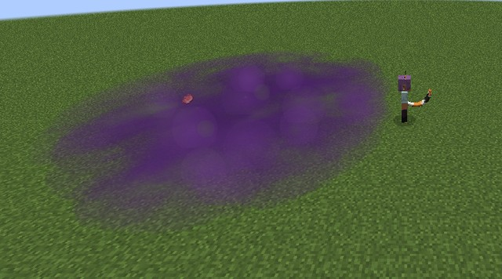{ loading=lazy }
  <figcaption>Poison Mist.</figcaption>
</figure>

### Mud Bind

*Mode 1, from 25% mastery.*

A patch of mud, radius **3.5 blocks**, where you look, or with Sneak at your feet. It lies for 4 seconds, and you can cast it every 20 seconds.

- What stands in it can **barely move or jump** for the table's time, but can still swing and cast.
- A patch holds nothing twice.
- It does no damage, and spares you, your allies and your pets.
- Anything that refuses effects only wades through.

<figure markdown="span">
  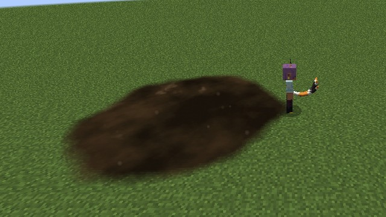{ loading=lazy }
  <figcaption>Mud Bind.</figcaption>
</figure>

### Veil

*Mode 2, from 50% mastery.*

You turn **invisible for 15 seconds**, though armour still shows.

- Mobs within 32 blocks drop you, and none can pick you up from further than **3 blocks**.
- **A hit you land, a second press or the berserk ends it.** Being hit doesn't, and nor do Thorns or your Poison Mist's ticks.
- The **45 second** cooldown starts when it ends.
- The wisps and the sound are yours alone, so they don't give away where you went.

<figure markdown="span">
  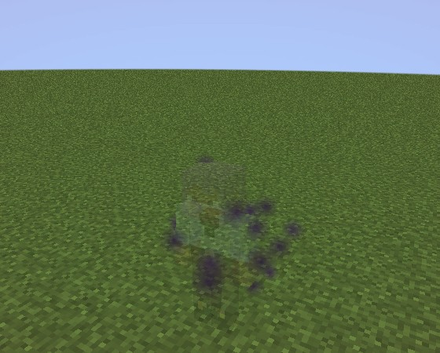{ loading=lazy }
  <figcaption>Fading into a Veil, as you see it.</figcaption>
</figure>

### Mirage

*Mode 3, from 75% mastery.*

Copies of you step out, in your skin, armour, held item, ears and tails, with your name. They last **10 seconds**, and you can cast it every
40 seconds.

- A mob within 24 blocks going for you goes for a copy, and those already after you turn to one.
- **Any hit pops a copy** in dark smoke, with no loot, XP, EP or souls.
- Casting again replaces them. Logging out, dying or changing dimension takes them away.

<figure markdown="span">
  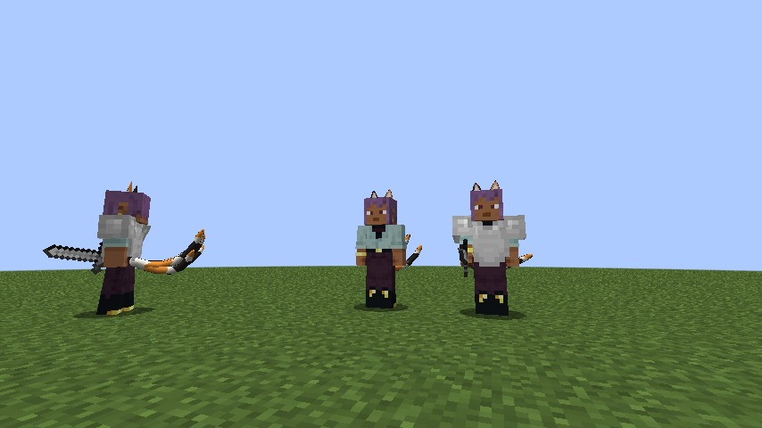{ loading=lazy }
  <figcaption>Copies wear what you wear.</figcaption>
</figure>

<figure markdown="span">
  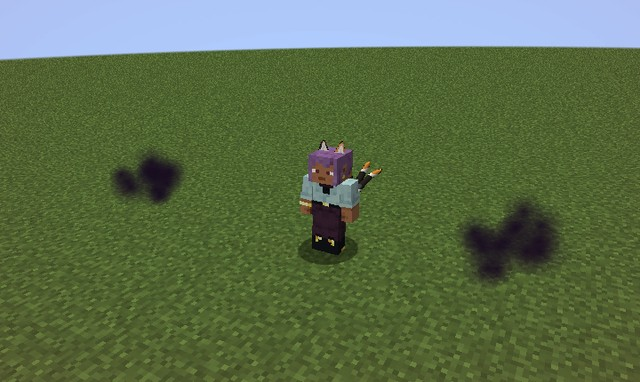{ loading=lazy }
  <figcaption>Popping in dark smoke.</figcaption>
</figure>

## Malice

Senjutsu takes in the world's ill will: a hidden number from 0 to 100.

| Deed | Malice |
|---|---|
| A Ki Bullet | +1 |
| A Kasha | +5 |
| 10 seconds of Touki | +1 |
| 2 seconds of healing | +1 |

- It gathers **three times as fast** in Hell and miasma, and half as fast once mastered.
- It fades 2 a minute by day and 1 by night, never in Hell.
- **From 50** your tails flicker dark for everyone to see, with "Something dark stirs in your ki."

**At 100, the berserk,** for 15 seconds:

- dark Touki, for free;
- no skills and no race key;
- you strike the nearest living thing on your own every half second, **friends and pets too**, though you can still walk away.

It ends at 30 Malice with no lasting harm, and Touki cools down for 30 seconds. Death and logging out end it too.

<figure markdown="span">
  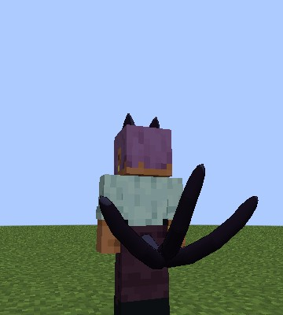{ loading=lazy }
  <figcaption>The tails flickering dark, from 50.</figcaption>
</figure>

<figure markdown="span">
  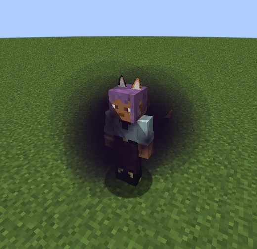{ loading=lazy }
  <figcaption>The berserk.</figcaption>
</figure>

## Evil Pieces and hybrids

A cat takes an [Evil Piece](peerage.md) as anyone does, reborn a Devil of their class with their blood:

- **Kept:** Senjutsu with its mastery, the coat, the ears, the tails and Malice.
- **Lost:** Youjutsu.
- The race key spreads **bat wings**, and **Sneak + race key** works the ears and tails.
- A Nekoshou's blood keeps the holy Kasha and the payback.
- A Race Reset Scroll ends the blood.

[Rias](rias.md) makes a cat of worth up to 5 her **Rook**, as Koneko is.

<figure markdown="span">
  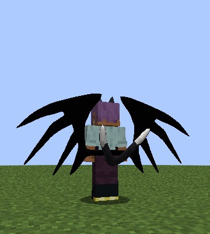{ loading=lazy }
  <figcaption>A hybrid: bat wings and tails.</figcaption>
</figure>

## Hell and holy things

- Hell's poison reaches a pure cat, not a hybrid.
- [Ascalon's](../boosted-gear/ascalon.md) burn and strike spare a pure cat and hit a hybrid.

## Settings and commands

The numbers are in [`[nekomata]`](../reference/configuration.md#nekomata), and the races' stats in
`config/dxdtensura/race/nekomata_config.toml` and `nekoshou_config.toml`. Operators have the
[Nekomata commands](../reference/commands.md#nekomata-and-nekoshou).
