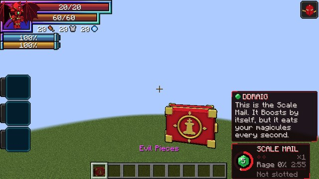
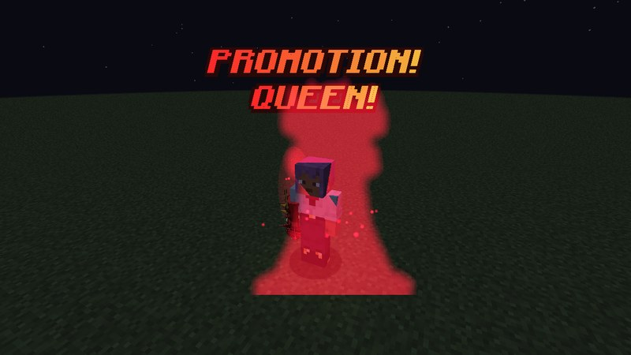
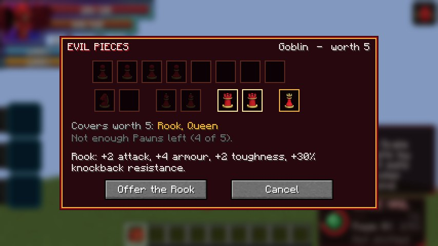
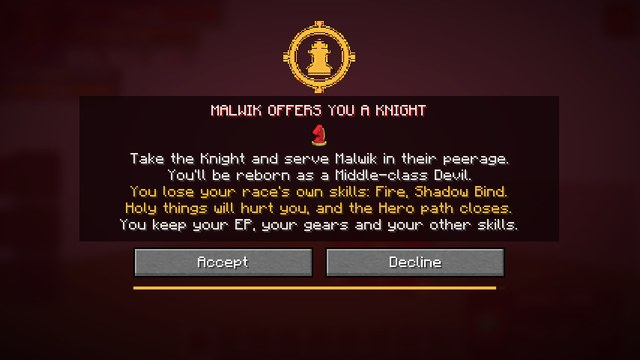
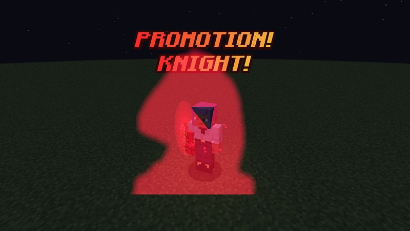
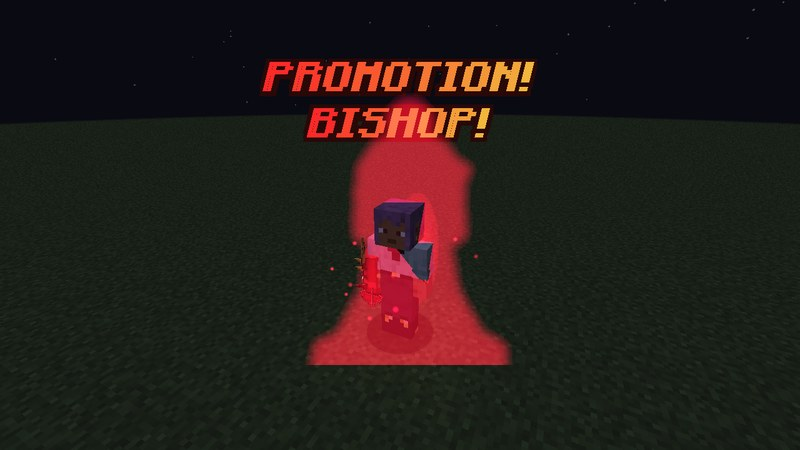
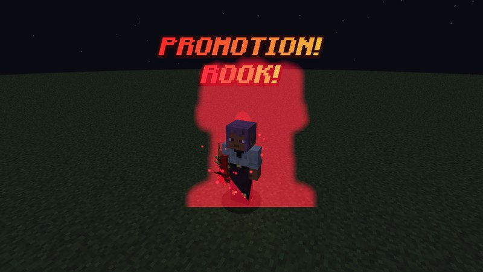
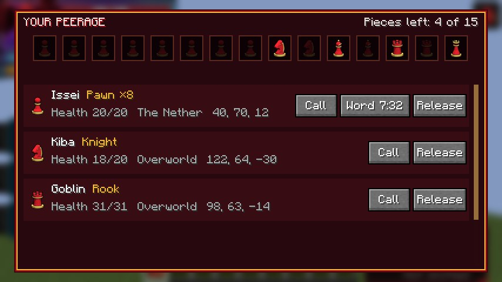
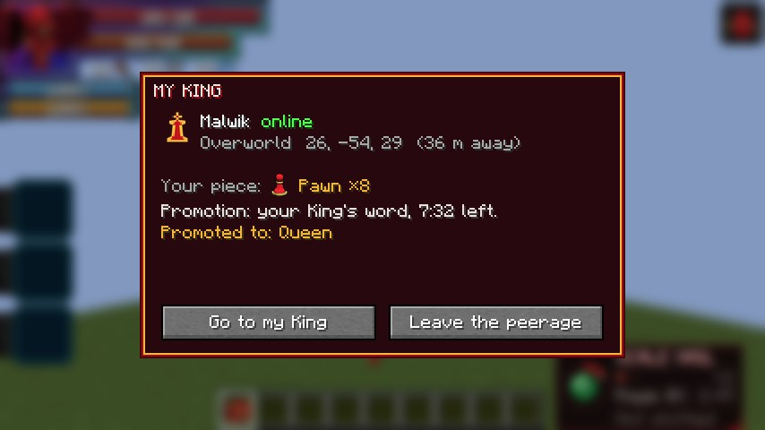
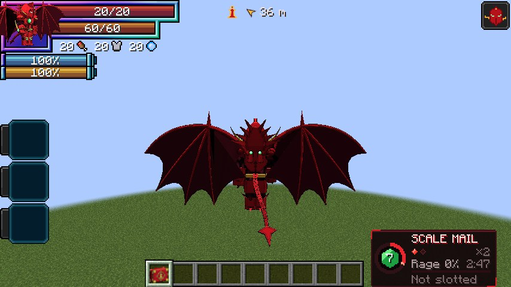

# The Peerage

DxD's peerages, added in **0.1.52**. A High-class [Devil](devil.md) is a **King** with 15 **Evil Pieces**: 8 Pawns,
2 Knights, 2 Bishops, 2 Rooks and a Queen. A piece turns a willing player, or a beaten monster, into the King's
**servant**. Each piece gives its own strengths, Pawns can **promote**, and King and servants find each other by magic
circle.

<figure markdown="span">
  { loading=lazy }
  <figcaption>The case of Evil Pieces.</figcaption>
</figure>

<figure markdown="span">
  { loading=lazy }
  <figcaption>"PROMOTION! QUEEN!"</figcaption>
</figure>

## Becoming a King

**High-, Ultimate- and Satan-class** Devils have the race skill **Evil Pieces**.

- **Press it** to put the crimson case of pieces in your hand, or in your inventory if your hand is full. **Press it
  again** to put the case away.
- **The case can't be lost.** If you toss it, burn it or drop it on death, it vanishes, and the skill brings it back.
  Your pieces are counted with you, not kept in the case, so an old case left in a chest doesn't work.
- A servant who reaches High-class becomes a King too, with a case of their own, and still serves their King.

## Offering a piece

Right-click a player or a monster with the case. The case opens on them and shows:

- **their worth** compared to you, in chess values: someone with a tenth of your EP is worth 1, half your EP is 5, and
  nearly your equal is 9;
- **your pieces left**, and which of them cover that worth.

<figure markdown="span">
  { loading=lazy }
  <figcaption>The case open on a goblin worth 5: only the Rooks and the Queen cover it.</figcaption>
</figure>

| Piece | Covers a worth of |
|---|---|
| Knight or Bishop | up to 3 |
| Rook | up to 5 |
| Queen | up to 9 |
| Pawns | exactly as many Pawns as the worth |

- Kinds never mix: you can't pay with a Knight plus two Pawns.
- **Anyone as strong as you refuses.**
- **A Longinus holder** (the [Boosted Gear](../boosted-gear/index.md) or [Divine Dividing](../divine-dividing/index.md))
  is worth at least **8**, so they take all 8 Pawns or the Queen.

### Players

A player sees a **consent screen** first. It names you and the piece, says what they'll become and what they'll lose,
and gives them **60 seconds** to answer.

<figure markdown="span">
  { loading=lazy }
  <figcaption>The offer, as the player sees it.</figcaption>
</figure>

- **A player who isn't a Devil is reborn as one.** They become Low-, Middle- or High-class, depending on their EP,
  through Tensura's evolution.
    - They **keep** their EP, their gears and their learned skills.
    - They **lose** only their old race's own skills, as with Tensura's Race Reset Scroll.
    - They become **Majin**: holy things hurt them, and the Hero path closes.
- **A Devil** just takes the piece.
- These all count as a **no**:
    - walking more than 16 blocks away;
    - logging out;
    - dying.

    After a no, you have to wait **30 seconds** before offering to them again.

- These players can't take a piece:
    - a True Hero;
    - someone who already serves a King;
    - your own King;
    - someone bound to another master.
- A player with Ddraig's Bargain open can't be offered a piece until they answer it.

### Monsters

A monster takes a piece at once if it has **submitted**, by Tensura's own Naming rule. That means one of these:

- it's at **a quarter of its health** or less;
- it's under your **Fear**;
- it's **weak enough** next to you: under 1% of your EP.

These can take a piece:

- Tensura's nameable monsters, such as goblins, orcs, lizardmen and direwolves;
- vanilla's tameable animals.

These can't:

- bosses;
- summons;
- another player's pets or subordinates.

A servant monster is yours to command like a named monster, with Tensura's follow, stay and wander orders. **Its pieces
come back when it dies.**

!!! note "Creative mode"
    A King in creative mode skips the "beat it down first" rule and the strength limit, and can still hit their own
    servants. Try offers in survival to see the real rules.

## The pieces' strengths

A servant has these strengths for as long as they serve. Monster servants get them too.

| Piece | Strengths |
|---|---|
| **Pawn** | None of its own, until it promotes |
| **Knight** | +20% movement speed, +0.3 attack speed |
| **Bishop** | +25% max magicules, +25% magicule regeneration, +25% Demonic Power (added to the night's bonus) |
| **Rook** | +2 attack, +4 armour, +2 armour toughness, +30% knockback resistance |
| **Queen** | All three: the Knight's, the Bishop's and the Rook's |

The attack bonus is flat, so the [Boost](../boosted-gear/modes.md) stays the only multiplier.

## Promotion

A Pawn's servant skill, **Evil Piece**, has the modes **Promotion: Knight**, **Bishop**, **Rook** and **Queen**. A press
makes the Pawn that piece, with that piece's strengths, however many Pawns they took. A crimson silhouette of the piece
rises behind them, with a **PROMOTION!** callout and a sound.

<figure markdown="span">
  { loading=lazy }
  <figcaption>Knight</figcaption>
</figure>

<figure markdown="span">
  { loading=lazy }
  <figcaption>Bishop</figcaption>
</figure>

<figure markdown="span">
  { loading=lazy }
  <figcaption>Rook</figcaption>
</figure>

<figure markdown="span">
  { loading=lazy }
  <figcaption>Queen</figcaption>
</figure>

**Where it works:**

- **in enemy territory:**
    - the Nether;
    - the End;
    - Tensura's labyrinth and boss arena;
    - inside the [Ascalon church](../boosted-gear/ascalon.md) or the
      [White Dragon's colosseum](../world/white-dragon-emperor.md);
- **anywhere, for 10 minutes,** on the King's **word**, given from the peerage menu.

**When it ends:**

- 5 seconds after you leave enemy territory, or when the word runs out;
- when you press it again;
- when you die.

After that, there's a **60-second** cooldown.

## The bond

King and servants are Tensura **allies**:

- servants can't hurt their King or each other;
- the King can't hurt them.

Tensura's Harvest Festival reaches them too.

### The peerage menu

**Right-click the air with the case.** The menu shows your 15 pieces, with the used ones dimmed. Each servant gets a row
with their piece, their health and where they are.

<figure markdown="span">
  { loading=lazy }
  <figcaption>The King's peerage menu.</figcaption>
</figure>

- **Call:** a crimson circle opens under the servant and brings them to your side after 3 seconds, even from another
  dimension.
    - It costs **5% of your max magicules**.
    - You can call each servant once every 30 seconds.
- **Word** (Pawns only): lets that Pawn promote anywhere for 10 minutes.
- **Release:** the servant's pieces come back to you. They stay a Devil.

### A servant's side

A servant's skill, **Evil Piece**, opens on **My King**. It shows:

- the King's name and where they are;
- the servant's own piece;
- how long the King's word has left.

<figure markdown="span">
  { loading=lazy }
  <figcaption>My King.</figcaption>
</figure>

- **Go to my King:** the same circle takes you to your King.
    - It costs **10% of your max magicules**.
    - You can use it once a minute.
- **Leave the peerage:** you get a warning first. Leaving marks you a **Stray Devil**. The mark does nothing yet; it
  will mean something once Stray Devils are in the mod.

Either way, released or gone, you can join another King later.

**About the circles:**

- Stepping out of a circle, or being hit, breaks it at no cost.
- A monster stands still in its circle, and the King is told if a call breaks.
- No circle opens in Tensura's boss arena or during a cutscene.

### The King marker

A small crimson King marker at the top of a servant's screen points to their King. It shows the distance, or the King's
dimension if the King is in another world. You can turn it off with the client setting
[`kingMarker`](../reference/configuration.md#client-settings).

<figure markdown="span">
  { loading=lazy }
  <figcaption>The marker, at the top middle of the screen.</figcaption>
</figure>

## Endings

- **A King who stops being a Devil** releases the whole peerage. That happens with a Race Reset Scroll or a command.
- **A servant who stops being a Devil** is released.
- **A servant released while offline** finds out at their next login. A monster finds out when it loads again.
- **A monster servant that dies** gives its pieces back.

## Not in the mod yet

These are coming later:

- **Rias Gremory:** an NPC King who recruits single-player players into her peerage. She's next.
- **Stray Devils:** what the Stray Devil mark does.
- **Hybrids.**
- **Mutation Pieces.**
- **Rating Games.**
- **Trading pieces.**
