# The Peerage

DxD's peerages, added in **0.1.52**. A High-class [Devil](devil.md) is a **King** with 15 **Evil Pieces**: 8 Pawns,
2 Knights, 2 Bishops, 2 Rooks and a Queen. A piece turns a willing player, a beaten monster or one of Tensura's
otherworlders into the King's **servant**. Each piece gives its own strengths, Pawns can **promote**, and King and
servants find each other by magic circle.

No King among your friends? [Rias Gremory](rias.md), the NPC King, offers her pieces to everyone, single player too.

<figure markdown="span">
  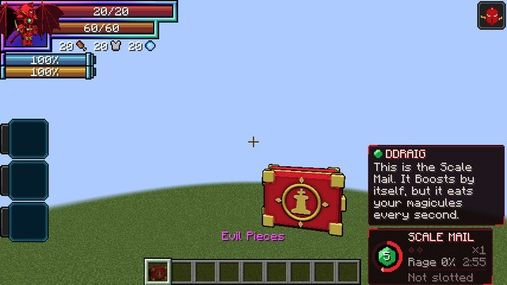{ loading=lazy }
  <figcaption>The case of Evil Pieces.</figcaption>
</figure>

<figure markdown="span">
  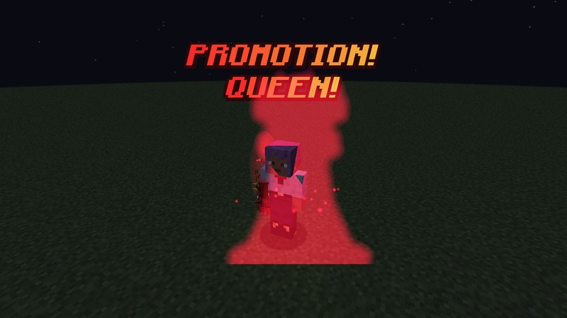{ loading=lazy }
  <figcaption>"PROMOTION! QUEEN!"</figcaption>
</figure>

## Becoming a King

**High-, Ultimate- and Satan-class** Devils have the race skill **Evil Pieces**.

- **Press it** to put the crimson case of pieces in your hand, or in your inventory if your hand is full. **Press it
  again** to put the case away.
- **The case can't be lost.** If you toss it, burn it or drop it on death, it vanishes, and the skill brings it back.
  Your pieces are counted with you, not kept in the case, so an old case left in a chest doesn't work.
- A servant who reaches High-class becomes a King too, with a case of their own, and still serves their King.

## Offering a piece

Right-click a player or a monster with the case. The case opens on them and shows:

- **their worth** compared to you, in chess values: someone with a tenth of your EP is worth 1, half your EP is 5, and
  nearly your equal is 9;
- **your pieces left**, and which of them cover that worth.

<figure markdown="span">
  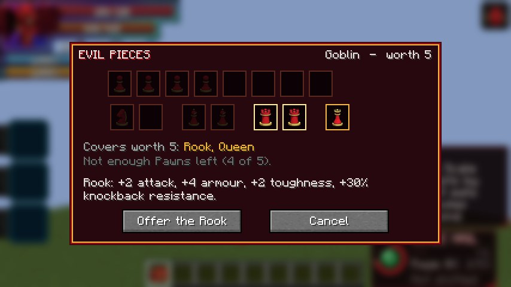{ loading=lazy }
  <figcaption>The case open on a goblin worth 5: only the Rooks and the Queen cover it.</figcaption>
</figure>

| Piece | Covers a worth of |
|---|---|
| Knight or Bishop | up to 3 |
| Rook | up to 5 |
| Queen | up to 9 |
| Pawns | exactly as many Pawns as the worth |

- Kinds never mix: you can't pay with a Knight plus two Pawns.
- **Anyone as strong as you refuses.**
- **A Longinus holder** (the [Boosted Gear](../boosted-gear/index.md) or [Divine Dividing](../divine-dividing/index.md))
  takes **all 8 Pawns**, whatever their EP, and never the Queen. A King with fewer than 8 Pawns left can't take them. They
  [grow into those Pawns](#growing-into-your-pawns) as their EP climbs.

### Players

A player sees a **consent screen** first. It names you and the piece, says what they'll become and what they'll lose,
and gives them **60 seconds** to answer.

<figure markdown="span">
  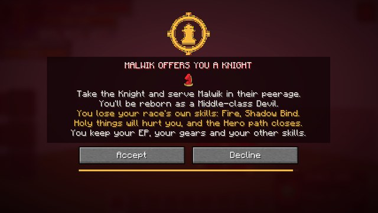{ loading=lazy }
  <figcaption>The offer, as the player sees it.</figcaption>
</figure>

- **A player who isn't a Devil is reborn as one.** They become Low-, Middle- or High-class, depending on their EP,
  through Tensura's evolution.
    - They **keep** their EP, their gears and their learned skills.
    - They **lose** only their old race's own skills, as with Tensura's Race Reset Scroll.
    - They become **Majin**: holy things hurt them, and the Hero path closes.
    - A **Fallen Angel** becomes a Devil with Fallen Angel blood, a [hybrid](angels.md#hybrids), and keeps the Light
      Spear.
    - A **Nekomata or Nekoshou** becomes a Devil with their blood, a [hybrid](nekomata.md#evil-pieces-and-hybrids), and keeps
      Senjutsu, the ears and the tails.
    - A **Valkyrie** becomes a Devil with Valkyrie blood, a [hybrid](valkyrie.md#evil-pieces-and-hybrids), and keeps her
      Norse magic and the Battle Dress.
    - A **Kitsune or Nine-Tailed Fox** becomes a Devil with their blood, a [hybrid](kitsune.md#evil-pieces-and-hybrids),
      and keeps Fox Fire, the fox body, the ears and the tails.
- **A Devil** just takes the piece. A pure-blooded Devil keeps their [House](houses.md). A Devil reborn by a piece has no House, whoever
  their King is.
- These all count as a **no**:
    - walking more than 16 blocks away;
    - logging out;
    - dying.

    After a no, you have to wait **30 seconds** before offering to them again.

- These players can't take a piece:
    - a True Hero;
    - an [Angel](angels.md#evil-pieces-and-hybrids): "Heaven's system won't let a piece into an Angel.";
    - someone who already serves a King;
    - your own King;
    - someone bound to another master.
- A player with Ddraig's Bargain open can't be offered a piece until they answer it.

### Monsters and otherworlders

A monster or an otherworlder takes a piece at once if it has **submitted**, by Tensura's own Naming rule. That means one
of these:

- it's at **a quarter of its health** or less;
- it's under your **Fear**;
- it's **weak enough** next to you: under 1% of your EP.

These can take a piece:

- Tensura's nameable monsters, such as goblins, orcs, lizardmen and direwolves;
- vanilla's tameable animals;
- Tensura's **otherworlders**: Shizu, Folgen, Kirara Mizutani, Kyoya Tachibana, Mai Furuki, Mark Lauren, Shin Ryusei,
  Shinji Tanimura and Shogo Taguchi.

These can't:

- bosses, Hinata Sakaguchi among them;
- summons;
- another player's pets or subordinates, including the otherworlders they summoned.

A servant monster is yours to command like a named monster, with Tensura's follow, stay and wander orders. **Its pieces
come back when it dies.**

- A serving otherworlder keeps its own name and forgets its old bed. A serving Shizu's Ifrit stays sealed.
- A servant drops no unique skills when it dies.
- **Release it** and it goes wild again, unless it was already your named subordinate or tamed pet before it took the
  piece. It forgets its target, so it doesn't attack you on the spot.

!!! note "Creative mode"
    A King in creative mode skips the "beat it down first" rule and the strength limit, and can still hit their own
    servants. Try offers in survival to see the real rules.

## The pieces' strengths

A servant has these strengths for as long as they serve. Monster servants get them too.

| Piece | Strengths |
|---|---|
| **Pawn** | None of its own, until it promotes |
| **Knight** | +20% movement speed, +0.3 attack speed |
| **Bishop** | +25% max magicules, +25% magicule regeneration, +25% Demonic Power (added to the night's bonus) |
| **Rook** | +2 attack, +4 armour, +2 armour toughness, +30% knockback resistance |
| **Queen** | All three: the Knight's, the Bishop's and the Rook's |

The attack bonus is flat, so the [Boost](../boosted-gear/modes.md) stays the only multiplier.

In a world with [Lore mode](../lore-mode.md#the-evil-pieces) on, every piece gives what it gives in the story, with a frail Knight, a slower Rook and a Queen with neither weakness.

## Promotion

A Pawn's servant skill, **Evil Piece**, has the modes **Promotion: Knight**, **Bishop**, **Rook** and **Queen**. A press
makes the Pawn that piece, with that piece's strengths, however many Pawns they took. A crimson silhouette of the piece
rises behind them, with a **PROMOTION!** callout and a sound.

<figure markdown="span">
  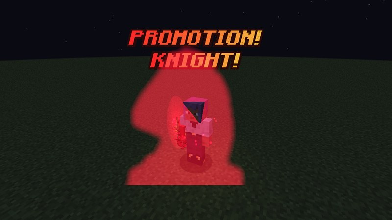{ loading=lazy }
  <figcaption>Knight</figcaption>
</figure>

<figure markdown="span">
  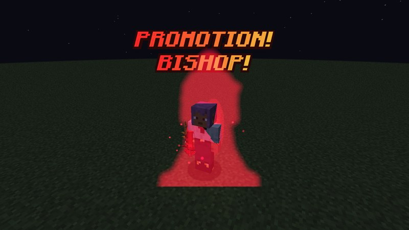{ loading=lazy }
  <figcaption>Bishop</figcaption>
</figure>

<figure markdown="span">
  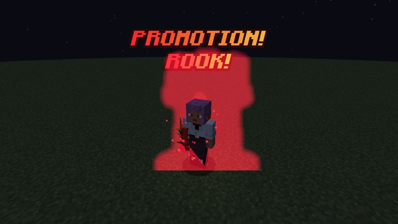{ loading=lazy }
  <figcaption>Rook</figcaption>
</figure>

<figure markdown="span">
  { loading=lazy }
  <figcaption>Queen</figcaption>
</figure>

The Knight, Bishop and Rook are free. **The Queen costs 2% of your max magicules** when you promote, and again every 5
seconds. If you can't pay the first 2%, you can't promote to Queen.

**Where it works:**

- **in enemy territory:**
    - the Nether;
    - the End;
    - Tensura's labyrinth and boss arena;
    - inside a [ruined church](../boosted-gear/ascalon.md), crypt churches too, the
      [White Dragon's colosseum](../world/white-dragon-emperor.md) or a
      [Stray mansion](../world/stray-devils.md#lairs);
- **anywhere, for 10 minutes,** on the King's **word**, given from the peerage menu ([Rias](rias.md#serving-her)
  gives hers when you ask).

**In the Boosted Gear's Scale Mail** a Pawn promotes anywhere, and the armour changes shape. See [Promotion's armour forms](../boosted-gear/promotion-forms.md).

In a world with [Lore mode](../lore-mode.md#promotion) on, Promotion has no wait and a promoted Queen pays nothing.

**When it ends:**

- 5 seconds after you leave enemy territory, or when the word runs out;
- as a Queen, when you can't pay her cost;
- when you press it again;
- when you die.

After that, there's a **60-second** cooldown.

**Your magicule bar keeps its share.** Since 0.2.67 a Bishop's or a Queen's bigger pool fills as it grows, and empties as
it goes: at 80% before, you're at 80% after.

## Growing into your Pawns

Since **0.2.35**, as with Issei, a Longinus holder on 8 Pawns starts with few of them awake, and wakes one more each time their base max EP doubles. Anyone else is an ordinary
Pawn.

| Base max EP | Pawns awake | Opens |
|---|---|---|
| Under 5,000 | 1 | Knight, Bishop |
| 5,000 | 2 | |
| 10,000 | 3 | Rook |
| 20,000 | 4 | |
| 40,000 | 5 | Queen |
| 80,000 | 6 | |
| 160,000 | 7 | |
| 320,000 | 8 | The [True Queen](../boosted-gear/promotion-forms.md#the-true-queen), on top of her 3 minutes in each form |

- **Stronger as you grow.** A Promotion grows from ×1 at one awake to **×2 at all eight**: its attack, armour, toughness, speed, attack speed, magicules, regeneration and Demonic
  Power.
- **Asleep.** Press a Promotion you haven't opened, and "Your body can't take the ... yet". Nothing starts and nothing is paid. The same goes for the Rook's form in the Scale Mail.
- **A Pawn waking** sinks into your chest with a chime, the action bar says so, and a King who's online hears of it. Ddraig or Albion speaks when the Rook, the Queen and the last Pawn
  open.
- **They stay awake** if your EP falls.
- **It shows** on the consent screen ("You start with N of 8 Pawns awake"), in the Evil Piece's first mode, in the King's menu, and on your **My King** screen, with eight small Pawns
  and the EP the next wakes at.
- **A holder already promoted** above their climb in an older world goes back to Pawn, with no wait.
- `/dxdtensura max` wakes them all. Server owners have `pawnGrowth` and its numbers in [`[peerage]`](../reference/configuration.md#peerage).

## Mutation Pieces

Since **0.2.67**, as in the story, about one Devil in ten has a **Mutation Piece**: a piece that takes someone who would
need several, as one.

<figure markdown="span">
  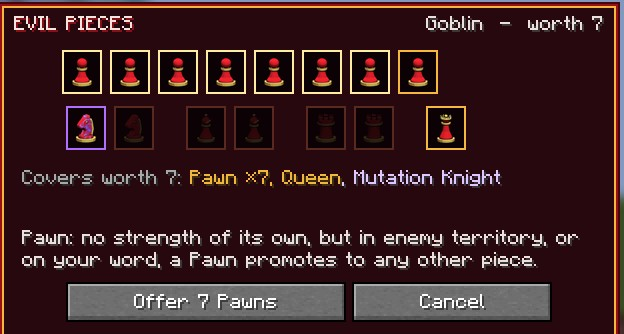{ loading=lazy }
  <figcaption>The case on a goblin worth 7: the Mutation Knight takes it alone.</figcaption>
</figure>

<figure markdown="span">
  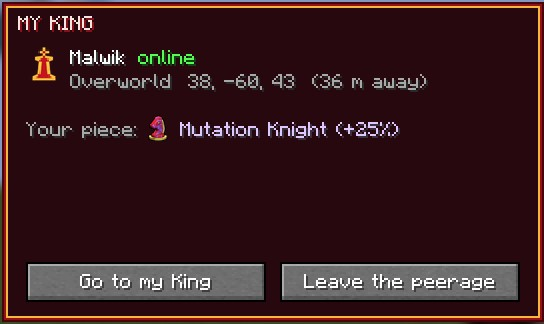{ loading=lazy }
  <figcaption>A Mutation Knight's My King screen.</figcaption>
</figure>

**Getting one.**

- When you become a King, there's a **1 in 10** chance one of your unused pieces is a Mutation Piece.
- **Each time your base max EP doubles,** an unused piece may turn too, at the same chance.
- **One at a time:** while you have an unused Mutation Piece, or one waiting for its kind, no other piece turns.
- When one turns, the chat says so: "One of your unused Evil Pieces has turned into a Mutation Piece!" **Use the case in
  the air**: the peerage menu opens with a row on top, and you **choose which kind** it becomes, from the kinds you still
  have unused. Until then it can't be spent.

**Using one.**

- **One Mutation Piece takes anyone worth up to 9**, whatever its kind, as a single piece. Anyone as strong as you still
  refuses.
- The case lists it beside the ordinary picks ("Mutation Knight"), so you choose whether to spend it.
- **Its servant is a quarter stronger:** every strength of their piece is 25% higher. A Mutation Knight is +25% speed
  and +0.375 attack speed; a Mutation Pawn's quarter shows in their Promotions.
- **A Longinus holder** still takes only Pawns, so for them only a **Mutation Pawn** works, and it counts as all 8 Pawns.
- The consent screen names it: "A Mutation Knight: a quarter stronger than a Knight."
- Released, leaving or dying, the servant gives back a Mutation Piece of the same kind.

The pieces are crimson with **violet veins** glowing through, in the case, the menus and in the air.

**Issei's Pawns turn.** A [Boosted Gear](../boosted-gear/index.md) holder on Pawns (not on a Mutation Pawn already) has one
Pawn turn Mutation the first time they use each of [Illegal Move Triaina's](../boosted-gear/promotion-forms.md) forms, the
Knight, the Rook and the Bishop, and their first [True Queen](../boosted-gear/promotion-forms.md#the-true-queen): four in
all. Each turned Pawn adds an eighth of the quarter, so all four make them 12.5% stronger. Ddraig has a word for each.
Releasing them turns them back.

**Rias** keeps one Mutation Bishop, as Gasper's: a player she'd make her Bishop who is worth more than a Bishop covers
gets it. See [Rias](rias.md#joining-her-peerage).

Server owners have `mutationPieces` and its numbers in [`[peerage]`](../reference/configuration.md#peerage). With it off,
a Mutation Piece serves as an ordinary one.

## The bond

King and servants are Tensura **allies**:

- servants can't hurt their King or each other;
- the King can't hurt them.

Tensura's Harvest Festival reaches them too.

### The peerage menu

**Right-click the air with the case.** The menu shows your 15 pieces, with the used ones dimmed. Each servant gets a row
with their piece, their health and where they are.

<figure markdown="span">
  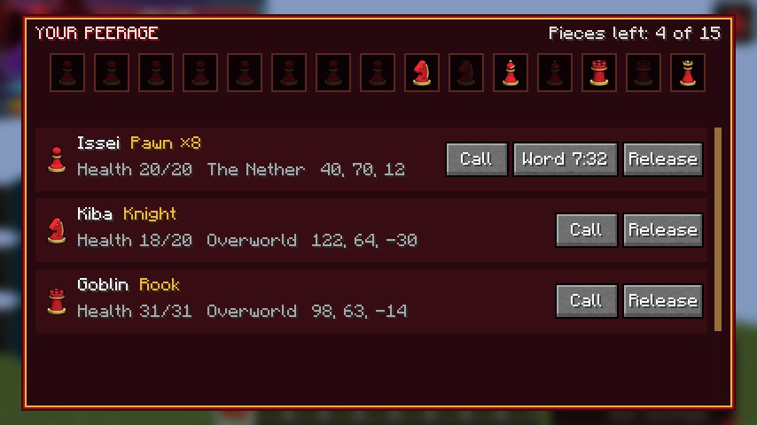{ loading=lazy }
  <figcaption>The King's peerage menu.</figcaption>
</figure>

- **Call:** a crimson circle opens under the servant and brings them to your side after 3 seconds, even from another
  dimension.
    - It costs **5% of your max magicules**.
    - You can call each servant once every 30 seconds.
- **Word** (Pawns only): lets that Pawn promote anywhere for 10 minutes.
- **Release:** the servant's pieces come back to you. A player stays a Devil; a monster goes wild again (see
  [Monsters and otherworlders](#monsters-and-otherworlders)).

### A servant's side

A servant's skill, **Evil Piece**, opens on **My King**. It shows:

- the King's name and where they are;
- the servant's own piece;
- how long the King's word has left.

<figure markdown="span">
  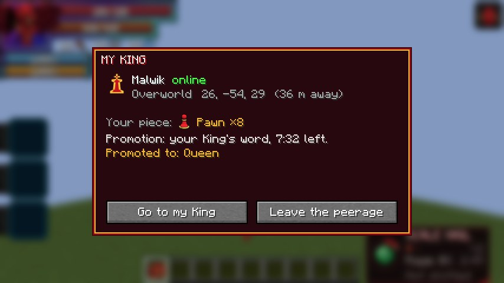{ loading=lazy }
  <figcaption>My King.</figcaption>
</figure>

- **Go to my King:** the same circle takes you to your King.
    - It costs **10% of your max magicules**.
    - You can use it once a minute.
- **Leave the peerage:** you get a warning first. Leaving marks you a **Stray Devil**, and
  [Strays](../world/stray-devils.md#the-stray-devil-mark) take you for one of their own.

Either way, released or gone, you can join another King later. Leave [Rias](rias.md#leaving-her) and she makes you
wait 10 in-game days.

**About the circles:**

- Stepping out of a circle, or being hit, breaks it at no cost.
- A monster stands still in its circle, and the King is told if a call breaks.
- No circle opens in Tensura's boss arena or during a cutscene.
- A Devil with a [House](houses.md) calls in their House's colour and sigil.

### The King marker

A small crimson King marker at the top of a servant's screen points to their King. It shows the distance, or the King's
dimension if the King is in another world. You can turn it off with the client setting
[`kingMarker`](../reference/configuration.md#client-settings). A King who'd rather not be found can hide from their own servants'
markers with `/dxdtensura hideking`.

An operator can release a player from a player King's peerage with `/dxdtensura peerage release <player>`, online or not.

<figure markdown="span">
  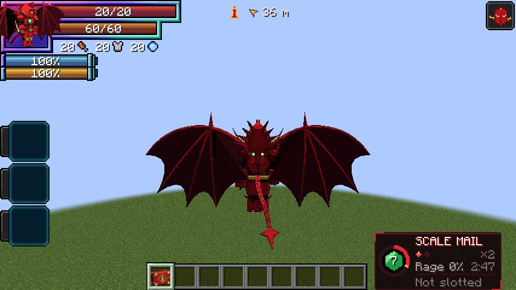{ loading=lazy }
  <figcaption>The marker, at the top middle of the screen.</figcaption>
</figure>

## Endings

- **A King who stops being a High-class Devil** releases the whole peerage, and loses the Evil Pieces skill and the case. That
  happens with a Race Reset Scroll, a command or an evolution out of the Devils.
- **A servant who stops being a Devil** is released.
- **A servant released while offline** finds out at their next login. A monster finds out when it loads again.
- **A monster servant that dies** gives its pieces back.

## Not in the mod yet

These are coming later:

- **Rating Games.**
- **Trading pieces.**
