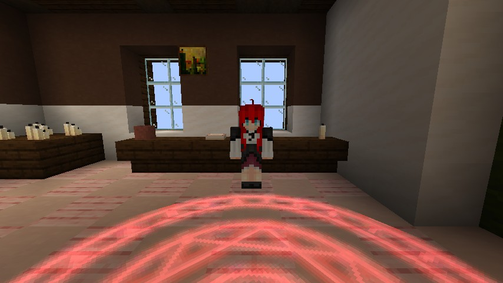
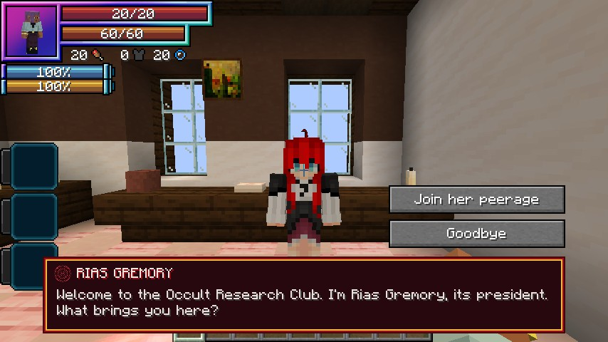
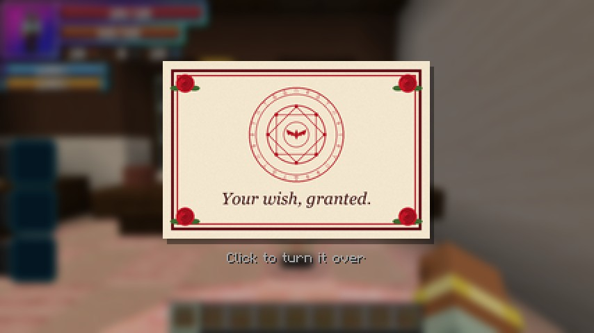
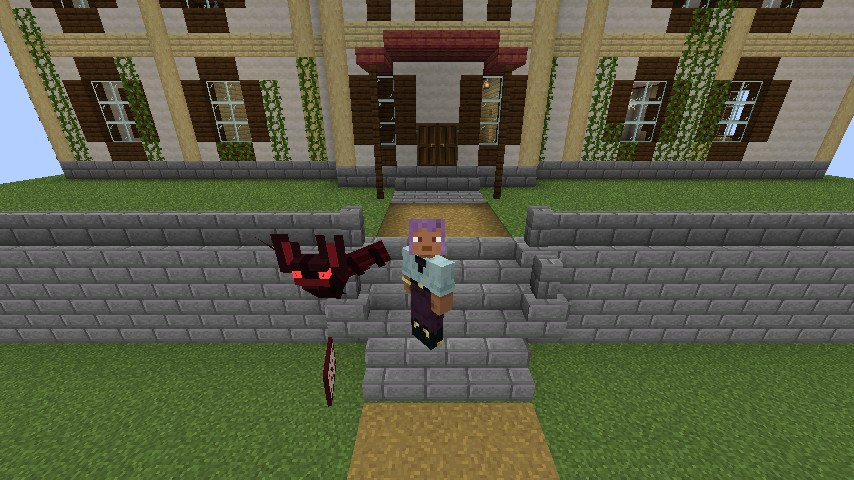
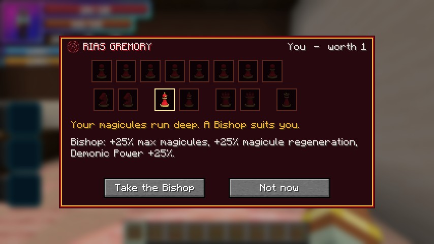
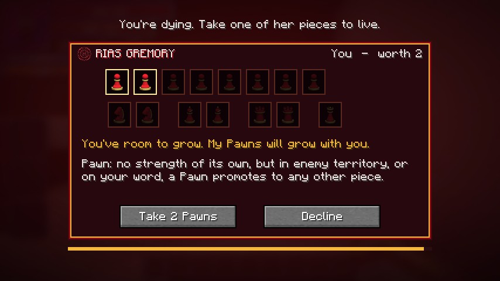

# Rias Gremory

Rias Gremory, president of the Occult Research Club, is an **NPC King**, added in **0.1.60**. She has her own set of 15
[Evil Pieces](peerage.md) and offers them to every player, so you can join a peerage in single player too. There's one
Rias per world, and her pieces go to whoever comes first.

Since **0.1.66** she wears a new look made by **Noroi**: an HD skin and long 3D hair, with her ahoge on top. Noroi's Rias
resource pack is no longer needed.

<div class="grid" markdown>

<figure markdown="span">
  { loading=lazy }
  <figcaption>Rias in the clubroom, behind the Gremory circle.</figcaption>
</figure>

<figure markdown="span">
  { loading=lazy }
  <figcaption>"Welcome to the Occult Research Club."</figcaption>
</figure>

</div>

## Finding her

She lives in the Occult Research Club's **old school building**. There's one per world, a few hundred blocks from the
middle of the world, and it prefers forest or taiga.

```
/locate structure dxdtensura:old_school_building
```

- Upstairs is her **clubroom**, with a crimson Gremory circle glowing in the floor. She appears at her desk when you come
  near. She wanders the room, sits at her desk or on a sofa, and looks out of the window.
- **In a world played before 0.1.60**, or if its spot is water, the building waits further out and appears when that
  land is first explored. `/locate` can't find a building that moved, but her flyer can.

<figure markdown="span">
  { loading=lazy }
  <figcaption>The old school building.</figcaption>
</figure>

### Her flyer

The **Gremory Flyer** points the way. Right-click it to read it, and click to turn it over. Its back has a crimson
arrow that turns as you turn, and says how many blocks away the building is. In another dimension, it says she's in the
Overworld.

<div class="grid" markdown>

<figure markdown="span">
  { loading=lazy }
  <figcaption>"Your wish, granted."</figcaption>
</figure>

<figure markdown="span">
  { loading=lazy }
  <figcaption>Turn it over for the way.</figcaption>
</figure>

</div>

You can get one in three ways:

- **From her bat.** On your first night in the Overworld, her red-eyed bat flies in, drops a flyer at your feet and flies
  off. If you lose your flyer before you've met her, the bat brings another, at most every 3 nights.
- **From her desk.** It holds a stack of them. Take one if you aren't carrying one already.
- **In villages.** About 1 in 20 village house chests holds one.

<figure markdown="span">
  { loading=lazy }
  <figcaption>Her bat, with your flyer.</figcaption>
</figure>

## Joining her peerage

Right-click her to talk, and choose **Join her peerage**. She picks your piece, lights it up and tells you why. Take it,
and the usual [consent screen](peerage.md#players) follows: if you aren't a Devil yet, you're reborn as one.

<figure markdown="span">
  { loading=lazy }
  <figcaption>"Your magicules run deep. A Bishop suits you."</figcaption>
</figure>

She chooses from your strengths, from the top of this table down:

| If you are | She gives you |
|---|---|
| A Longinus holder ([Boosted Gear](../boosted-gear/index.md) or [Divine Dividing](../divine-dividing/index.md)) | All 8 Pawns |
| Worth 9, or worth 6 or more with aura and magicules each at least 40% of your EP | Her Queen |
| Worth up to 5, with 3 attack and 30 max health bare-handed and with no potions | A Rook |
| Worth up to 3, with at least 60% of your EP in magicules | A Bishop |
| Worth up to 3, with at least 60% of your EP in aura | A Knight |
| Anyone else | As many Pawns as your worth |

- **Your worth** is measured against her **300,000 EP**. Every 33,333 EP is one point: 100,000 EP is worth 3, and
  200,000 is worth 6. At **300,000 EP or more**, you're too strong for her pieces.
- **You can't pick another piece.** If the piece she'd give you is taken, she offers Pawns. If there aren't enough Pawns
  left, her peerage is full for you.
- If you say no, give it a moment before you ask again.

## Her second chance

**Die with a flyer anywhere in your inventory**, and she comes to offer you a piece.

- She comes only after everything else has had its chance: totems, Tensura's Unyielding and any other revive.
- You're held at 1 health. Rias steps out of a magic circle beside you, wings spread, and her piece picker opens. You
  can't close it, and you have 60 seconds.
- **Take her piece**, and you live on as her servant, at full health. One flyer is used up, you keep the EP Tensura's
  death would cost you, and your killer gets no EP for you.
- **Decline**, let the time run out or log out, and you die as you would have, paying the death's price once.

<figure markdown="span">
  { loading=lazy }
  <figcaption>"You're dying. Take one of her pieces to live."</figcaption>
</figure>

She doesn't come:

- for `/kill` or the void;
- in Tensura's boss arena, or during a Balance Breaker or Juggernaut Drive cutscene;
- to anyone she couldn't take: someone with 300,000 EP or more, a True Hero, an Angel, another King's servant, someone
  bound to another master, or when none of her pieces fit.

!!! note "Angels"
    Rias can't take an [Angel](angels.md#rias-and-angels): "An Angel? I'm sorry. Heaven would never let me have you."
    Her bat brings an Angel no flyer until they fall. A Fallen Angel who joins her becomes a
    [hybrid](angels.md#hybrids).

## Serving her

As your King, she's calm:

- her name and where she is show on your **My King** screen, the King marker points to her, and **Go to my King** takes
  you to the circle in her clubroom;
- she never calls you away, and she never releases you.

Her Pawns can **ask for her word** on her talk screen: Promotion anywhere for 10 minutes, once an in-game day.

## Leaving her

Leave the peerage from your **Evil Piece** skill, as with any King. You're marked a **Stray Devil** (the mark does
nothing yet), and she won't take you back for **10 in-game days**. Sleeping counts, and setting the clock back never
makes the wait longer.

Joining her again clears her Stray Devil mark, but not one from a player King's peerage.

## Don't hit her

She can't be hurt, and monsters ignore her. Hit her once and she warns you. Hit her again within 5 minutes, at her home,
and a magic circle drops you outside the front door.

## With friends

- There's one Rias and one set of 15 pieces per world, shared by everyone. Several players can serve her at once.
- Each player gets their own first-night bat, first greeting, word and wait to rejoin.

## For server owners

- Her rules are in the [`[rias]`](../reference/configuration.md#rias) config section: turn her off, turn off the revive
  or the bat, or change her EP, the waits and the chest chance.
- Operators have the [`/dxdtensura rias`](../reference/commands.md#rias-gremory) commands, for example to end someone's
  wait to rejoin her.
- Her lines show in her own crimson speech box, with a chime. They count as important, so they still show with
  [`ddraigLines`](../reference/configuration.md#client-settings) set to `IMPORTANT`.
