# Valkyries

Rossweisse's race, added in **0.2.67**: Norse battle mages who fly with no wings, fight with Runes, sing Galdr to shield and strengthen, and
gather the souls of the fallen. They change into a **Battle Dress** of white and gold, and one in ten is born a **genius of Norse magic**
whose Full Burst fills the sky.

<figure markdown="span">
  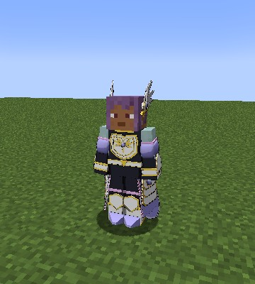{ loading=lazy }
  <figcaption>The Battle Dress.</figcaption>
</figure>

<figure markdown="span">
  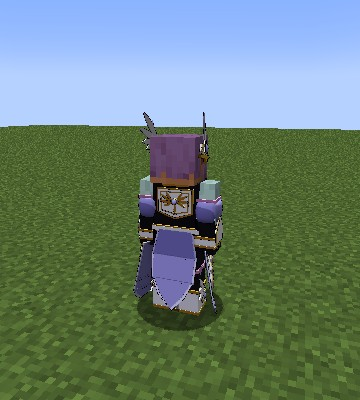{ loading=lazy }
  <figcaption>From the back.</figcaption>
</figure>

<figure markdown="span">
  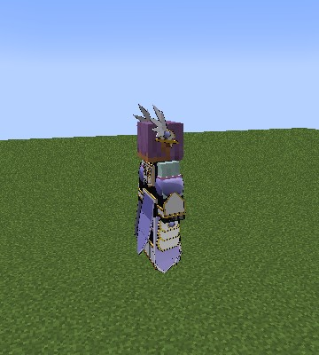{ loading=lazy }
  <figcaption>Flying, the cloth pressed along the legs.</figcaption>
</figure>

## Becoming one

Pick **Valkyrie Trainee** in Tensura's race menu:

- when you start a new character;
- after Tensura's **Reincarnation** spell;
- on an existing character, with Tensura's **Race Reset Scroll**, which opens the race menu again.

**One player in ten is born a genius of Norse magic**: "You were born a genius of Norse magic." It's one roll per player, kept through
death, a Race Reset Scroll and rebirth as a Devil. A Character Reset Scroll starts it over.

They are **Holy**: holy things don't hurt them, and the Hero path is theirs. A Valkyrie never rolls a
[Sacred Gear](../getting-started/first-gear.md#only-in-humans).

## The ranks

| Rank | Race | Reached by |
|---|---|---|
| 0 | Valkyrie Trainee | the start |
| 1 | Valkyrie | 20,000 EP |
| 2 | Valhalla Guard | 100,000 EP |
| 3 | Chief Valkyrie | 400,000 EP and 4 bosses |
| 4 | Brynhildr | awakened as a True Hero |

A True Hero's awakening moves a Valkyrie one rank up, and a Chief Valkyrie to Brynhildr.

**Aspectual magic.** Each rank teaches Tensura's own spells as it's reached, as Tensura's Daemons learn theirs: fire, ice, thunder and wind,
barriers, healing and travel. The lists are under `[learnableMagics]` in `config/dxdtensura/race/valkyrie_config.toml`.

## The genius

| A genius gets | How much |
|---|---|
| More magic power | a quarter more max magicules at every rank |
| A stronger [Norse Formula](#norse-formula) | 10 points more on both cost and chant |
| A stronger [Rune Barrier](#rune-barrier) | half as strong again |
| Faster learning | twice the mastery from every use |
| [Full Burst](#full-burst) | a sheet of the sky, up to 80 circles, with its own song |

**What it costs:** a genius has no [Seiðr](#seidr), as Rossweisse has none: no Chosen Souls and no Einherjar.

## Flight

The **race key** flies on magic, with no wings and nothing drawn. In the air you fly at once; on the ground a double jump takes off. Press
again to land.

| Rank | 0 | 1 | 2 | 3 | 4 |
|---|---|---|---|---|---|
| Flight speed | 0.8 | 1.0 | 1.2 | 1.5 | 2.0 |

## The Battle Dress

**Sneak + race key** changes you into the Battle Dress in a burst of runes, and back with a quiet fade. It works in the air too, waits
3 seconds between changes, and stays on through death and logging out.

| Rank | 0 | 1 | 2 | 3 | 4 |
|---|---|---|---|---|---|
| Armour | +4 | +8 | +12 | +16 | +20 |
| Toughness | 0 | +2 | +4 | +6 | +8 |
| Tensura magic resistance | 5% | 10% | 15% | 20% | 25% |

- **Worn armour still protects.** Only its look is hidden, and it can't be lost.
- **The cloth moves** with you: it swings as you walk and turn, lies along the legs in flight, presses down as you rise and lifts as you sink.
- It isn't drawn under a Scale Mail or in the dragon.

## Norse Formula

A passive skill with no key. **All your magic costs less and chants faster**, Tensura's spells included, and more with each rank.

| Rank | 0 | 1 | 2 | 3 | 4 |
|---|---|---|---|---|---|
| Magic cheaper | 10% | 15% | 20% | 25% | 30% |
| Chants faster | 10% | 20% | 30% | 40% | 50% |
| A genius: cheaper | 20% | 25% | 30% | 35% | 40% |
| A genius: faster | 20% | 30% | 40% | 50% | 60% |

It adds to a [Bishop's](peerage.md#the-pieces-strengths) cheaper magic.

## Rune Magic

The Norse art of attack, paid in **magicules** through Norse Formula, with mastery to **1,000**. Mastered, the Runes cost half and strike a
quarter harder.

| # | Mode | Unlocks | What it does |
|---|---|---|---|
| 0 | **Fire Rune** | from the start | A bolt that sets its target alight for 4 s |
| 1 | **Ice Rune** | from the start | A bolt that slows for 3 s |
| 2 | **Thunder Rune** | from the start | A bolt that jumps once to the nearest enemy within 6 blocks, for half the damage |
| 3 | **Wind Rune** | from the start | A bolt that pushes back |
| 4 | **[Full Burst](#full-burst)** | 40% mastery | Hold to open circles, and they rain blasts on the crosshair |

Each Rune is an instant bolt from a small circle at your raised hand, in its element's colour. The four share one **1 second** cooldown, and
they're real elemental hits, so Tensura's resistances count. A Rune never breaks or lights a block.

| Rank | 0 | 1 | 2 | 3 | 4 |
|---|---|---|---|---|---|
| A Rune's damage | 6 | 12 | 24 | 48 | 96 |
| Magicules | 100 | 400 | 1,800 | 7,500 | 30,000 |

### Full Burst

*Mode 4, from 40% mastery.*

**Hold the key.** Circles open round you, each paying for itself as it opens. Once they're all open, they **fire while you keep holding**:
beams in each Rune's colour fly to the crosshair (up to 96 blocks away) and burst where they land, spread round it. Let go to stop.

- **A normal burst** is two rings in the Runes' colours. Fire burns and Ice slows; Thunder doesn't jump and Wind doesn't push, so a burst
  doesn't scatter its own targets. It fires for up to **8 seconds**, each blast paying a tenth of a Rune, and cools down for **30 seconds**.
- **The blasts break blocks** round where they land, as TNT does, up to stone and metal, never obsidian, bedrock or anything holding items,
  with no drops. They need the `mobGriefing` and `skillGriefing` rules on, and claims are respected. The server setting
  `fullBurstBreaksBlocks` turns it off.

| Rank | 0 | 1 | 2 | 3 | 4 |
|---|---|---|---|---|---|
| Circles at most | 6 | 8 | 12 | 16 | 20 |
| A genius's circles | 12 | 20 | 35 | 55 | 80 |

<figure markdown="span">
  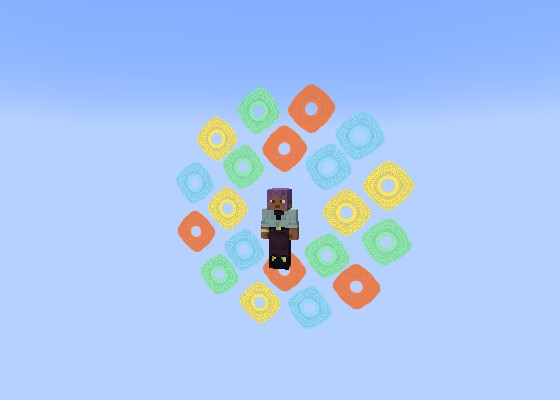{ loading=lazy }
  <figcaption>A normal Full Burst: two rings in the Runes' colours.</figcaption>
</figure>

<figure markdown="span">
  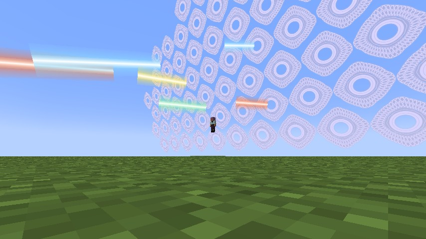{ loading=lazy }
  <figcaption>Firing.</figcaption>
</figure>

**A genius's Full Burst is an ultimate.** A sheet of pale violet-white circles behind and above you, up to 80 at Brynhildr (about 54 blocks
across), forms over **4 seconds** to its own song, then fires for up to **11 seconds**, its blasts landing up to 16 blocks round the aim.
Forming costs 10% of your max magicules and a full fire 40%, half of everything in all, with no discount. Letting go early pays less. Its
volley hits two and a half times as hard as a normal one's. **On the ground** the sheet stands as a wall instead of going under it.

The song plays for anyone near, on the Jukebox volume slider, in place of the game's music. The client setting `fullBurstMusic` turns it off
for you.

<figure markdown="span">
  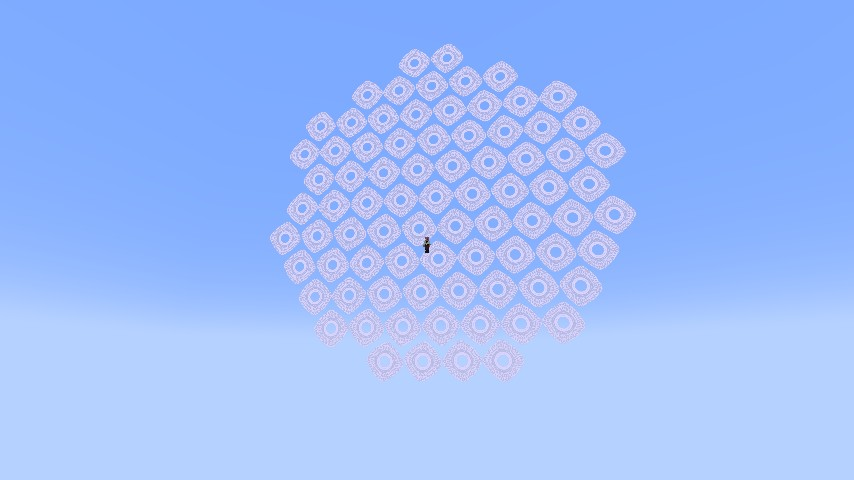{ loading=lazy }
  <figcaption>A genius's sheet: 80 circles.</figcaption>
</figure>

<figure markdown="span">
  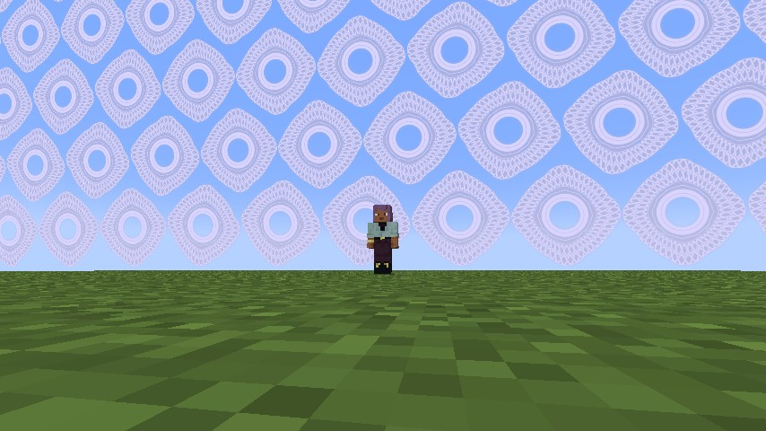{ loading=lazy }
  <figcaption>On the ground it stands as a wall.</figcaption>
</figure>

### Sake

A bottle of **Sake**: crafted from a water bottle, two wheat and a sugar, or bought for a gold coin at the
[Castle Town's inn](../world/castle-town.md#the-inn). Drinking it leaves you **Tipsy** for 2 minutes, with a hiccup now and then.

A tipsy **genius's** Full Burst is a drunken one: it opens **half as many circles again** (120 at Brynhildr), drains **all** their
magicules instead of half, and leaves them **paralysed for 10 seconds** when it ends. On anyone else Sake is only hiccups.

## Galdr

The Norse art of song and support, paid in **magicules** through Norse Formula, with mastery to **1,000**. Mastered, its songs cost half and
hold stronger.

| # | Mode | What it does |
|---|---|---|
| 0 | **[Rune Barrier](#rune-barrier)** | A disc of runes before you that soaks hits from the front |
| 1 | **[Enhancement](#enhancement)** | More attack and speed, on friends too from rank 2 |
| 2 | **[Rune Seal](#rune-seal)** | Holds one target still and blocks its skills |
| 3 | **[Rune Sword](#rune-sword-and-rune-spear)** | A sword of runes in your hand |
| 4 | **[Rune Spear](#rune-sword-and-rune-spear)** | A spear of runes, for the hand or for throwing |

All five are open from the start.

### Rune Barrier

A disc of runes, 3 blocks wide, before you along your look. It **soaks hits from the front** (within 75 degrees of where you look): blows,
arrows and spells alike, until it breaks. What's left when it breaks goes through. Hits with nowhere they came from, like a fall, fire or
poison, pass, and so does [Penetrate](../boosted-gear/penetrate.md).

| Rank | 0 | 1 | 2 | 3 | 4 |
|---|---|---|---|---|---|
| Soaks | 40 | 80 | 160 | 320 | 640 |
| Magicules | 200 | 800 | 3,600 | 15,000 | 60,000 |

- **Stronger:** half again for a genius, half again for a [Rook](#evil-pieces-and-hybrids), a quarter more mastered, all multiplied: a genius
  Rook's soaks two and a quarter times the table.
- A press raises it and a press while it stands drops it. It lasts **15 seconds**, then cools down for 10 (20 if it broke).
- Its open middle keeps your own view clear. It flashes on a hit and shatters when it breaks.

<figure markdown="span">
  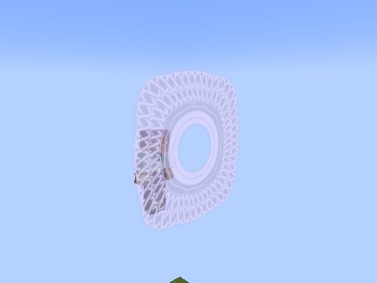{ loading=lazy }
  <figcaption>Rune Barrier.</figcaption>
</figure>

### Enhancement

**More attack and speed** for **60 seconds**, with a 60 second cooldown from the cast. Mastered, half the price and 75 seconds. **From
rank 2** it also falls on your friends within 12 blocks.

| Rank | 0 | 1 | 2 | 3 | 4 |
|---|---|---|---|---|---|
| Attack and speed | +10% | +15% | +20% | +25% | +30% |
| Magicules | 150 | 600 | 2,700 | 11,250 | 45,000 |

### Rune Seal

Rings of runes close round **one target** under your crosshair, up to 24 blocks away. While **Rune Sealed** it can barely move or jump, a
flying player's flight is off, and **its skills and spells are refused**. It can still swing at what's in reach. Damage doesn't break it.

| Rank | 0 | 1 | 2 | 3 | 4 |
|---|---|---|---|---|---|
| Seconds, on an equal | 3 | 3 | 4 | 4 | 5 |
| Magicules | 150 | 600 | 2,700 | 11,250 | 45,000 |

- **Shorter on the strong:** the time shrinks with their EP over yours, down to a quarter. A boss takes half of that, and it's never
  under 1 second.
- 20 second cooldown. With nothing under the crosshair: "Nothing to seal.", for free.

### Rune Sword and Rune Spear

Weapons formed from runes, on the [light weapons'](light-weapons.md) rules, in pale violet-white.

- **A press** forms one in your selected slot if it's empty, or the first empty hotbar slot, and the hand jumps to it. Forming is free; a
  hit that lands costs magicules. A press again, switching away, dropping it, running dry, death or a race change fades it. One rune weapon
  at a time.
- **The Rune Sword** is two-handed, as Tensura's long sword: +1 reach and a sweep.
- **The Rune Spear** has +2 reach and no sweep. **Right-click throws it**, paying then, and the hand goes back to the slot it jumped from.
- Their hits are light, not holy: no holy burn. They're refused in Juggernaut Drive's dragon, and [Sword Birth](../sword-birth/index.md)
  can't copy them.

| Rank | 0 | 1 | 2 | 3 | 4 |
|---|---|---|---|---|---|
| Rune Sword: attack | 4 | 8 | 16 | 32 | 64 |
| Rune Sword: magicules a hit | 25 | 100 | 450 | 1,875 | 7,500 |
| Rune Spear: attack | 3 | 6 | 12 | 24 | 48 |
| Rune Spear: magicules a hit | 20 | 80 | 360 | 1,500 | 6,000 |
| Thrown spear: damage | 6 | 12 | 24 | 48 | 96 |
| Thrown spear: magicules | 100 | 400 | 1,800 | 7,500 | 30,000 |

<figure markdown="span">
  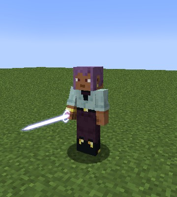{ loading=lazy }
  <figcaption>The Rune Sword.</figcaption>
</figure>

<figure markdown="span">
  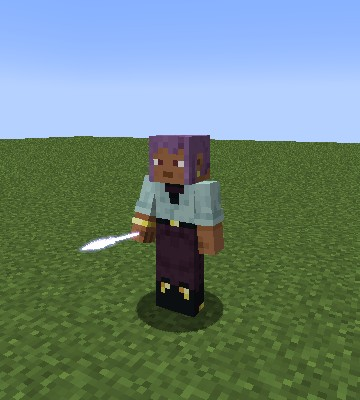{ loading=lazy }
  <figcaption>The Rune Spear.</figcaption>
</figure>

## Seiðr { #seidr }

The Norse art of fate and the dead, for **every Valkyrie but a genius**, paid in **magicules** through Norse Formula, with mastery to
**1,000**. Mastered, its calls cost half and you hold one soul more.

| # | Mode | What it does |
|---|---|---|
| 0 | **Choose the Slain** | Takes a Chosen Soul near you |
| 1 | **Call Einherjar** | Spends a soul on a ghostly warrior who fights beside you |

### Chosen Souls

When a **boss** or a **strong foe** (at least half your EP) dies near you, its soul hangs where it died as a gold light for **30 seconds**.

- A strong foe must die within 16 blocks of someone with Seiðr. A boss reaches **64 blocks**, and whoever kills it gets a soul wherever they
  stand.
- No soul comes from a pet, a summon, an Einherjar, a friend or a player you spared.
- **Choose the Slain** takes the nearest soul within 6 blocks, for nothing but the press. The mode's name shows how many you hold.

| Rank | 0 | 1 | 2 | 3 | 4 |
|---|---|---|---|---|---|
| Souls held | 1 | 2 | 3 | 5 | 7 |

Souls stay with you through death and a change of race.

### Call Einherjar

A press spends your oldest soul and a fee on a **ghostly gold warrior** with a helm, a round shield and a sword, who lands on level ground
beside you and fights for **60 seconds**.

- **It fights for you:** whatever you've just hit or been hit by, as a wolf does, and on its own the hostile mobs near you (not creepers).
  It never touches your friends and pets, Rias or the Castle Town's people. It follows you and catches up if you get far ahead.
- **It draws them off you** (0.2.67): a mob it strikes turns on it, Tensura's mobs included, and its sword arm swings with every blow. Its
  kills and their EP stay yours.
- **A stronger soul makes a stronger warrior,** up to one as strong as you: a soul much weaker than you gives as little as a quarter of the
  table.
- It fades when you die or log out. 5 second cooldown.

| Rank | 0 | 1 | 2 | 3 | 4 |
|---|---|---|---|---|---|
| Attack | 6 | 10.5 | 19 | 36 | 70 |
| Health | 40 | 120 | 300 | 1,500 | 4,000 |
| Out at once | 1 | 1 | 2 | 2 | 3 |
| Magicules | 150 | 600 | 2,700 | 11,250 | 45,000 |

<figure markdown="span">
  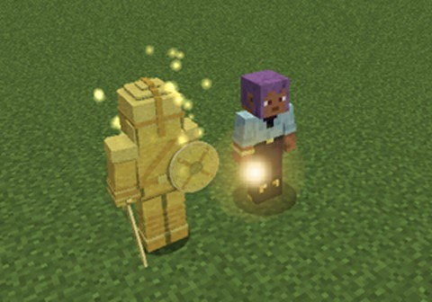{ loading=lazy }
  <figcaption>An Einherjar, and a gold Chosen Soul.</figcaption>
</figure>

## Mastery

Rune Magic, Galdr and Seiðr each count to **1,000**, by the race skills' rule: points for each use that hits, heals or holds. A Full Burst
earns once a release, not once a shot. **A genius earns twice as much.** Full Burst opens at 40%, and full mastery halves the price.

## Evil Pieces and hybrids

A Valkyrie takes an [Evil Piece](peerage.md) as anyone does, reborn a Devil of their class with **Valkyrie blood**:

- **Kept:** Norse Formula, Rune Magic, Galdr, Seiðr (for a non-genius), the genius result and the Battle Dress, with mastery. They go on
  learning their aspectual spells by their Devil class.
- **Devil wings** replace the magic flight, as Rossweisse's did. The race key is the wings; **Sneak + race key** is the Battle Dress.
- **A Rook's** Rune Barrier is half as strong again, as she used the Rook's defence in her barriers.
- Holy things hurt them now, and the Hero path closes, as for any Devil. A Race Reset Scroll ends the blood.

[Rias](rias.md) makes a Valkyrie of worth up to 5 her **Rook**, as Rossweisse is: "A Valkyrie? Then you're my Rook. Your barriers will thank
me."

## In the world

- **Hell's** thick magicules poison a pure Valkyrie, as anyone not of Hell.
- **The Castle Town:** the market's stalls take **10% off** for a Valkyrie, pure or hybrid.
- **A Divide** cuts Norse magic as it does every skill.

## Settings and commands

The numbers are in [`[valkyrie]`](../reference/configuration.md#valkyrie), and the races' stats in
`config/dxdtensura/race/valkyrie_config.toml`. Operators have the [Valkyrie commands](../reference/commands.md#valkyries).
