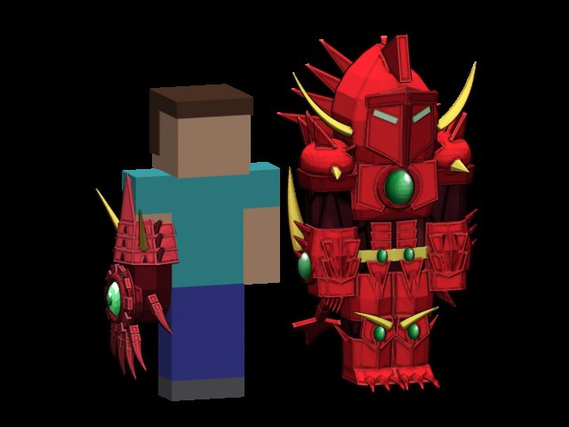
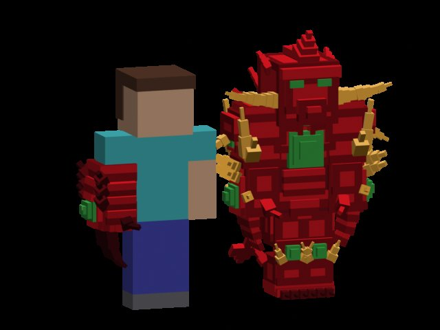
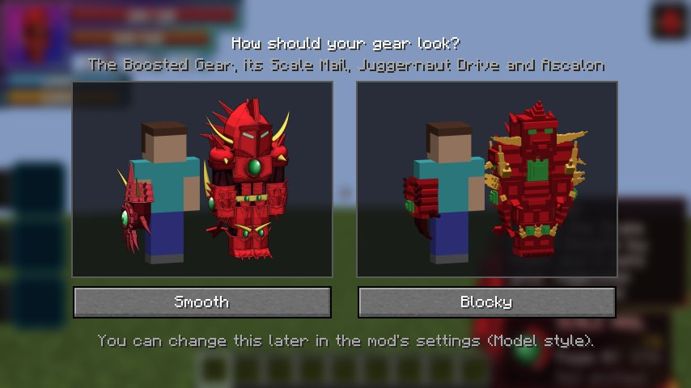

# Looks, cutscenes and effects

Everything that makes the gears look and sound like the anime, and the client settings that tune it for you. The client
settings live in `config/dxdtensura-client.toml`, or in game under Mods → Devil x Slime → Config.

## Model style

Every remodelled piece comes in two looks:

| `modelStyle` | Look |
|---|---|
| `NEW` (default) | Smooth, outlined models with cel-shaded textures |
| `CLASSIC` | The blocky models from the first versions |

<figure markdown="span">
  { loading=lazy }
  <figcaption>NEW: smooth</figcaption>
</figure>

<figure markdown="span">
  { loading=lazy }
  <figcaption>CLASSIC: blocky</figcaption>
</figure>

It covers the gauntlet's three forms, the Scale Mail, Juggernaut Drive's dragon, and Ascalon's blade on the gauntlet and
the Scale Mail. The sword itself, its relic and the skull keep their one look. The change applies at once.

The first time you hold the Boosted Gear, a screen asks which look you want (**Smooth** or **Blocky**), with a picture
of each. Any way out of it keeps the current look. To be asked again, set `modelStyleAsked` back to `false`.

Divine Dividing's wings and the white Scale Mail have the new look only.

<figure markdown="span">
  { loading=lazy }
  <figcaption>The screen that asks the first time.</figcaption>
</figure>

## Cutscenes

**Balance Breaker** and **Juggernaut Drive** play a cutscene as they form.

| Transformation | First time | After that |
|---|---|---|
| Balance Breaker (red Scale Mail) | full, about 7 s | short, 3 s |
| Juggernaut Drive | full, about 7 s | short, 3 s |
| Divine Dividing's Balance Breaker (white Scale Mail) | full | full, every time |
| Taking Albion's power | a short cutscene | |

- You stand still and **can't be hurt** while it plays, and your head stays level; the mouse can't turn you.
- **Sneak** skips the rest of it. You still transform.
- Players around you see your poses and effects, but keep their own camera.
- `cutscenes = false` turns them off for you: you transform at once.

## Callouts

The gear calls out what it does in bold italic letters that float up and fade, coloured from crimson to green:

- **BOOST!**, **EXPLOSION!**, **RESET** and **DRAGON SHOT!** float beside the gauntlet, on the outside of your arm. A rage
  burst's quick boosts join into "BOOST! BOOST! BOOST!".
- **TRANSFER!** floats over whoever receives it.
- The big moments appear over your head in larger letters: **WELSH DRAGON BALANCE BREAKER!**, **DRAGON BOOSTER!**,
  **SECOND LIBERATION!**, **JUGGERNAUT DRIVE!**, **LONGINUS SMASHER!** and **PENETRATE!**.
- Divine Dividing's **DIVIDE!** floats beside the target, and **VENT!** beside you.

<figure markdown="span">
  { loading=lazy }
  <figcaption>A big moment</figcaption>
</figure>

<figure markdown="span">
  { loading=lazy }
  <figcaption>TRANSFER! over the receiver</figcaption>
</figure>

In first person they show just above your gauntlet, and the big ones over the middle of your view.

## Effects

Every big moment has its own effect, made with Photon and seen by everyone around you:

| Moment | What you see |
|---|---|
| Summon | Red sparks drawn into your raised arm; the gauntlet appears with a green flash from the jewel, a red ring and sparks |
| Dismiss | The gauntlet breaks into crimson motes and a few falling scales as the jewel's light goes out |
| Boost | The jewel flashes green and a ring of green sparks bursts out. While you hold stacks a red aura rises off you, stronger at 3 and at 5 stacks |
| Explosion! | A crimson burst with the jewel's green star at its heart, a shockwave along the ground, sparks, and flames around you until it ends. You brace and the camera shakes |
| Reset | The power sinks down your body, a ring closes in at your feet and dark red smoke puffs out |
| Transfer | A green-gold stream from your jewel into the target, which glows green and keeps green motes while the boost lasts |
| Dragon Shot | A crimson flare as you thrust your palm, a glowing orb with a trail, and a flash, shockwave, sparks, fire and smoke where it lands |
| Evolution | A column of red and green light around you that bursts as the new form appears; taller and with gold for the Gift |
| Balance Breaker | A red aura drawn in through the countdown, a ring tightening each second with a heartbeat; the armour forms in a pillar of crimson light, and shatters into crimson shards when it ends |
| Rage burst | A dark red aura pulsing with each quick boost, and the edges of your screen throb red |
| Penetrate | A crimson crack where the hit breaks through |
| Divide | A thin white line across your view through the target, a burst of light and blue-white stars |
| Demonic Power | A dark crimson orb that bursts on what it hits |
| Magic circle | A crimson circle with a sigil opens under you while it hums, and you arrive at your respawn point |

### LambDynamicLights

With [LambDynamicLights](../getting-started/installation.md#optional) installed, the summoned gauntlet's gems, held
stacks, the Explosion, the Scale Mail, a rage burst and a Dragon Shot in flight light up the blocks around them, and the
big moments flash.

## The settings

| Setting | Default | What it does |
|---|---|---|
| `ddraigLines` | `ALL` | How much of Ddraig and Albion you see: `ALL`, `IMPORTANT` (teaching, warnings and story lines) or `OFF` |
| `screenShake` | `true` | Shake the camera for the Explosion, the Scale Mail forming and a Dragon Shot landing close by |
| `gearEffects` | `ALL` | `ALL`; `MOMENTS` (no lingering auras or motes); or `OFF` (no effects, no light from the gear, no rage tint). Poses and sounds always play |
| `cutscenes` | `true` | The transformation cutscenes. Off, you transform at once |
| `modelStyle` | `NEW` | `NEW` or `CLASSIC` models |
| `modelStyleAsked` | `false` | Whether the model style screen has been answered; set it to `false` to be asked again |
