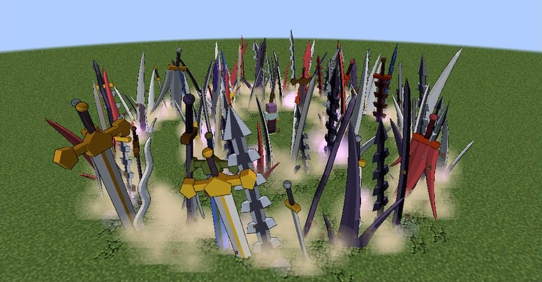
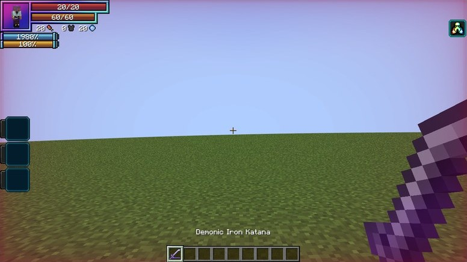
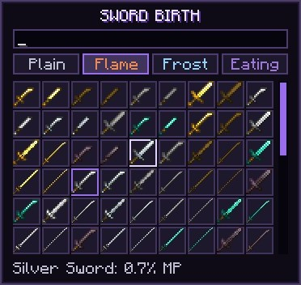
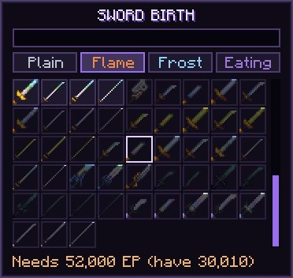
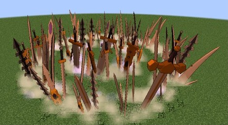
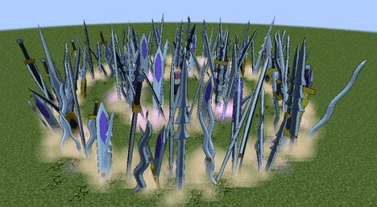
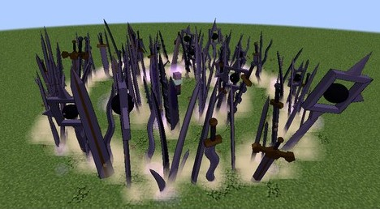
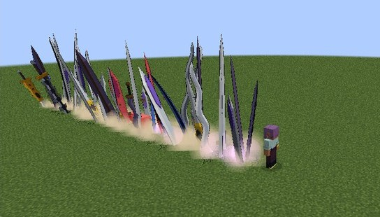
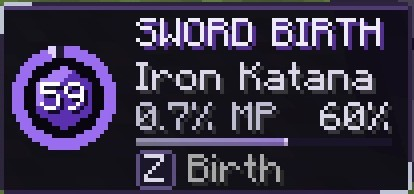

# Sword Birth

Yuuto Kiba's Sacred Gear, added in **0.2.0**: it makes demonic copies of swords, in your hand or bursting out of the ground,
and every copy fades. It is a Tensura **Unique Skill** (`dxdtensura:sword_birth`) with no dragon inside: no voice, no armour and
nothing to summon. The gear shows only as its swords. Its Balance Breaker, [Sword of Betrayer](sword-of-betrayer.md), can awaken from 40% mastery.

<figure markdown="span">
  { loading=lazy }
  <figcaption>Blade Ring: two rings of swords burst up around you.</figcaption>
</figure>

<figure markdown="span">
  { loading=lazy }
  <figcaption>A copy in hand, with its violet sheen.</figcaption>
</figure>

## Getting it

- **Only the reincarnation roll**, at the same odds as the other gears, and only for a
  [human](../getting-started/first-gear.md#only-in-humans).
- Learning it costs 30,000 magicules, as Tensura charges any unique skill. Any number of players can hold it.
- **One Sacred Gear per player.** A holder of another gear can't learn it: "You already carry a Sacred Gear."
- A holder reborn as another race in Tensura's race menu loses it. A Devil's Evil Piece keeps it.
- It goes with the [Holy Factor](../durandal/index.md#the-holy-factor), as Kiba's did.
- [Rias](../races/rias.md) offers a holder her **Knight**, as Kiba was, when a Knight covers their worth and one is free.

## Modes

| # | Mode | Unlocks | What it does |
|---|---|---|---|
| 0 | **[Birth](#birth)** | from the start | Put your chosen sword in your hand |
| 1 | **[Blade Line](#blade-line)** | 40% mastery | A line of huge swords tears along the ground where you look |
| 2 | **[Blade Ring](#blade-ring)** | 70% mastery | Two rings of swords burst up around you |
| 3 | **[Choose](#choose)** | from the start | Pick your sword and, later, its element |

The mode key skips what isn't open yet.

## Choose

A menu with a search field and a grid of swords, weakest first. It doesn't pause the game.

- **Open swords are bright.** Click one to choose it and close the menu.
- **Locked swords are dim**, and the line at the foot says why: "Needs 52,000 EP (have 12,345)", or "Hold a real Ruhk once".
- From 50% mastery, the buttons over the grid pick an [element](#elements).

<figure markdown="span">
  { loading=lazy }
  <figcaption>The menu, weakest first.</figcaption>
</figure>

<figure markdown="span">
  { loading=lazy }
  <figcaption>Locked swords are dim, and the foot says why.</figcaption>
</figure>

### Which swords

Every sword of Tensura's and vanilla's, in every material and shape. A sword opens when **your max EP** reaches its own EP in
Tensura's data:

| Swords | Your max EP |
|---|---|
| Wood to netherite, and silver | from the start |
| Low Magisteel | 6,000 |
| High Magisteel | 18,000 |
| Mithril | 45,000 |
| Orichalcum | 50,000 |
| Pure Magisteel | 52,000 |
| Adamantite | 225,000 |
| Hihi'Irokane | 750,000 |

- **Relics** also need you to have **held a real one** once, and a line says the gear remembers it: Ruhk, Meat Crusher, Ice
  Blade, the Tempest Scale Sword and Knife, Spatial Blade, and the Centipede and Spider Daggers.
- **Holy swords never open:** Ascalon, Durandal, their replicas, Moonlight and Dead End Rainbow.
- Other mods' swords stay out.

## Birth

A press puts your chosen sword in your hand and pays its price. With nothing chosen the menu opens, and that pick makes the sword
at once.

- **A plain press** uses your main hand if it's empty or holds a copy, then your off hand.
- **A press while sneaking** tries the off hand first, which is how to hold two.
- A copy already there fades and the new one takes its place, at full price.
- **Two copies at most.** A third makes the oldest fade.
- Hands full, or a chosen sword you can no longer open, costs nothing and says so.

**The price** is paid once, a share of your max magicules: **1%** for a sword with no EP, up to **10%** for one right at your own
EP, and half that at full mastery. Growing makes old swords cheap.

## A copy

A copy is the real item, so its model, reach, speed and its own right-click power all work (Ice Blade's lances, Spatial Blade's
blades). It has no engravings, gains no EP and can't evolve. It never breaks.

**It hits like the real sword, up to 30 attack.** Mithril and weaker swords don't change. Orichalcum and above stop there, so a
Hihi'Irokane copy adds 30, not 80, and never outdoes the real Durandal.

It's called "Demonic Iron Katana" ("of Flame", "of Frost", or "Light-Eating Iron Katana"), with a violet sheen and a bar running
down in its slot.

**It ends:**

- after **60 seconds**, up to **3 minutes** at full mastery (the clock runs while you're logged out too);
- at zero magicules;
- on your death, whatever `keepInventory` says;
- when dropped, which is how to dismiss one (**Q**), since it never lands;
- in any container, item frame or grid;
- when you no longer have the gear, or in anyone else's hands.

It breaks into black shards when it fades in a hand. Thrown with Tensura's Thrower, it hits and is gone.

## Elements

From **50% mastery**. They cost nothing extra, and count on the main hand's copy and on the blades.

| Element | What it does |
|---|---|
| **Flame** | Sets the target alight for 5 s, and adds 20% of the hit on anything not fire-immune |
| **Frost** | Chills it for 3 s (Tensura's Chill), and adds 10% on anything that can freeze |
| **Light-Eating** | Adds 50% on a holy foe: the Angel line, a Brave Saint or a holy wielder |

<figure markdown="span">
  { loading=lazy }
  <figcaption>Flame.</figcaption>
</figure>

<figure markdown="span">
  { loading=lazy }
  <figcaption>Frost.</figcaption>
</figure>

<figure markdown="span">
  { loading=lazy }
  <figcaption>Light-Eating.</figcaption>
</figure>

## The blades from the ground

Blade Line and Blade Ring need a chosen open sword, but not your hands.

- They hit as hard as your attack would with that sword, up to the same 30 attack from the sword, times the move's share, and
  carry your element.
- They hit each target once and toss it up a little.
- They spare you, your pets and your Tensura allies. Barriers stop them, and they break no blocks.
- With no ground within 6 blocks under you, a press does nothing and costs nothing.

The blades are ten of our own, up to three times a person's height, tinted toward your element, with dust at their feet, rocks of
the ground's own block thrown up, cracks and a violet haze. They rise, stand about a second and crumble. Only the rise can hit.

### Blade Line

*Mode 1, from 40% mastery.* The swords run where you look. A wall over 3 blocks high ends the line, and a gap is skipped.

### Blade Ring

*Mode 2, from 70% mastery.* The swords burst in two circles round you.

Each grows in a straight line with mastery:

| | Blade Line | Blade Ring |
|---|---|---|
| Size | 12 to 20 blocks long | radius 5 to 8 blocks |
| Hit, of your attack with the sword | 60% to 100% | 50% to 80% |
| Price | twice the sword's | three times the sword's |
| Cooldown | 6 s | 12 s |

<figure markdown="span">
  { loading=lazy }
  <figcaption>Blade Line.</figcaption>
</figure>

## Mastery

You earn a point for a sword born (at most every 10 seconds), a hit with a copy (at most every 2 seconds) and a blade move that
hurt anything. That's about half an hour of steady fighting. A line in chat marks 40%, 50%, 70% and full mastery.

## The panel

Right of the hotbar, while a copy is in either hand or a blade move cools down, in steel and violet:

- the ring round a violet jewel is the held copy's seconds left, otherwise the cooldown, dimmed;
- the title **SWORD BIRTH**;
- the chosen sword;
- its price and your mastery %;
- the mastery bar, gold once mastered;
- the key, with the slotted mode.

<figure markdown="span">
  { loading=lazy }
  <figcaption>The panel, with 59 seconds left on the copy in hand.</figcaption>
</figure>

## In Lore mode

In a world with [Lore mode](../lore-mode.md) on, a holder can have up to **16 copies**, and they don't fade with time. The bar in
the slot goes, and the panel's ring stays full with no number, unless a blade move is cooling down. The other endings stay.

## Settings

The numbers are in [`[sword_birth]`](../reference/configuration.md#sword_birth).
