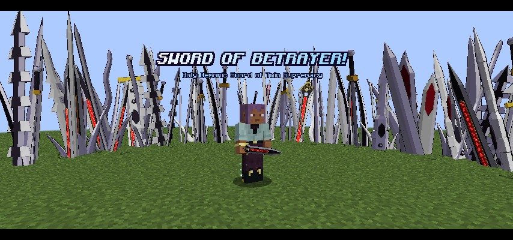
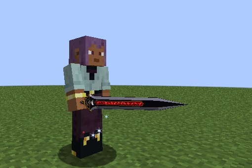
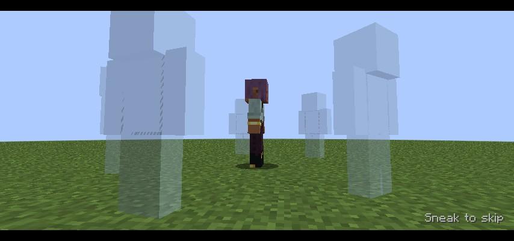
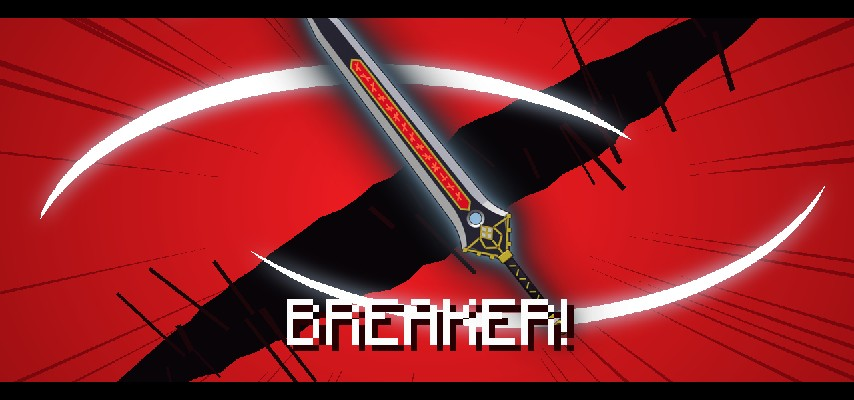
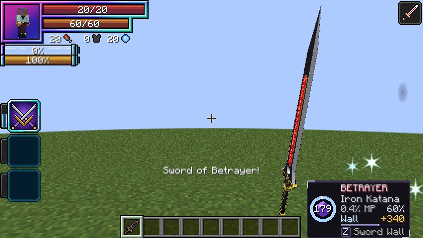
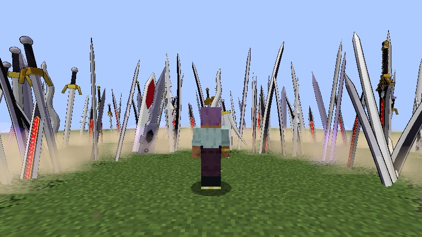
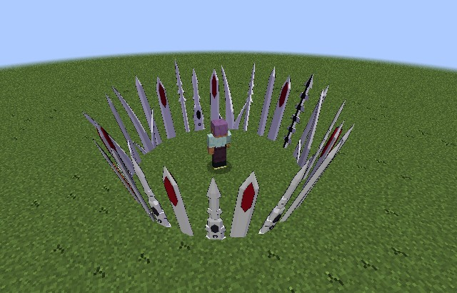

# Sword of Betrayer

[Sword Birth's](index.md) Balance Breaker, added in **0.2.78**: the "Holy Demonic Sword of Twin Supremacy". For a few minutes
every sword you make is holy-demonic, you hold the Sword of Betrayer itself, a wall of blades shelters you, and holy power feeds
your next blow.

<figure markdown="span">
  { loading=lazy }
  <figcaption>The end of the full cutscene.</figcaption>
</figure>

<figure markdown="span">
  { loading=lazy }
  <figcaption>The Sword of Betrayer in hand.</figcaption>
</figure>

## Awakening it

Every way needs **40% mastery** of Sword Birth. Once awakened, it stays awakened through death and relogs.

- **A crisis.** With one of your swords in either hand, a hit from a worthy enemy (a player, a boss, or something with at least
  half your max EP) leaves you alive under 30% health. It rolls at 10%, and each miss adds 10% for next time and says "Your swords
  tremble, holy and demonic, but hold." Each sword rolls once.
- **A Holy Factor Crystal.** Eat one and it awakens at once, even for a Devil. You don't get the Holy Factor from it, and you
  aren't burned. Below 40%, or once awakened, the crystal does what it always did.
- **Beating Freed.** Everyone with Sword Birth who hurt [Freed Sellzen](../excalibur/index.md#freed-sellzen) and was within 64
  blocks when he died awakens 2 seconds after he falls.

Your first awakening plays the full cutscene and starts the state with no countdown and no cost. It raises you to half health if
you're under it.

<figure markdown="span">
  { loading=lazy }
  <figcaption>The comrades' souls gather.</figcaption>
</figure>

<figure markdown="span">
  { loading=lazy }
  <figcaption>"BREAKER!"</figcaption>
</figure>

## Using it

Two modes open with the awakening: **Balance Breaker** (mode 4) and **Sword Wall** (mode 5).

- **Balance Breaker** starts a 10-second countdown while you fight on, shortening to 1 second over 10 minutes spent in the state.
  Press it again to cancel at no cost. At zero the short cutscene plays and the state starts.
- With [New ability controls](../getting-started/mode-wheel.md) on, the key that started it now casts Sword Wall, and goes back when
  it ends. No sword in hand is needed to start.
- It costs **0.6% of your max magicules a second**, and lasts up to **3 minutes**. In [Lore mode](../lore-mode.md) there's no limit and a
  lower upkeep, as for the Scale Mails.
- The state changes nothing about your body. It works alongside a race form, a fox body or a Promotion.

<figure markdown="span">
  { loading=lazy }
  <figcaption>The panel shows the time left, Sword Wall's cooldown and the absorption store.</figcaption>
</figure>

## The swords

Everything made in the state is **holy-demonic**: its shape and element stay, and "Holy-Demonic" goes on its name.

- **Attack:** 20 more, up to **50** at most, so an Iron Katana hits for 26. The sword's own right-click still works.
- **The holy half:** +50% of the hit on what holy things hurt: Devils, the undead, Stray Devils.
- **The demonic half:** +50% on a holy foe: Angels, Brave Saints and holy wielders. A target that is both takes the larger one
  once, and a Light-Eating sword's own share doesn't add to it.
- **Prices are halved**, for Birth, Blade Line, Blade Ring and Sword Wall.
- **Blade Line and Blade Ring reach half as far again**: a mastered Line runs 30 blocks and a mastered Ring reaches 12.
- A Devil isn't burned by their own holy-demonic swords.
- A holy-demonic sword fades when the state ends. Older copies keep their own time.

### The Sword of Betrayer in hand

The sword that forms in the cutscene is yours for the state: **50 attack**, both halves, no element, with a one-handed longsword's
speed and reach, so a copy fits in the off hand. It takes your main hand, and whatever was there moves to a free slot. With no free
slot it isn't made, and nothing is ever dropped ("No room for Sword of Betrayer.").

Lose it and the Choose menu lists it first while the state lasts: Birth makes it again for free, and only one exists at a time.
About one blade in eight in the Line, Ring and Wall is this sword too.

<figure markdown="span">
  { loading=lazy }
  <figcaption>A ring of holy-demonic blades.</figcaption>
</figure>

## Sword Wall

Only in the state. A ring of tall blades bursts up 3 blocks around where you stand, and stays where it was raised.

- **It lasts** 6 seconds, up to 10 mastered, or until the state ends or its strength runs out.
- **The rising blades** hit what they rise through for half your holy-demonic attack and throw it outward. They spare you, your pets
  and Tensura allies, and no block breaks.
- **It keeps them out:** enemies inside are pushed out through the blades, and projectiles from outside break on it. Yours fly out
  freely.
- **It takes the hits:** damage from outside to anyone it spares inside is cancelled and taken off its strength, **200% of your max
  health**, up to 400% mastered. A hit bigger than what's left shatters it, and the rest goes through.
- **It costs** 3 times the chosen sword's price (halved in the state), and cools for 20 seconds.

<figure markdown="span">
  { loading=lazy }
  <figcaption>Sword Wall.</figcaption>
</figure>

## Holy Absorption

In the state, **holy damage you take is halved**: Light Spears, holy lightning, the Holy Wave, Heaven's Judgement and the like. The part
it took off fills a store, up to your max health. Your next hit with a holy-demonic sword or one of the state's blades **adds the
whole store** to that hit, in one burst. The store empties when the state ends.

## Ending it

| How | What happens |
|---|---|
| By choice, within 90 s of the start | Cooldown 60 s |
| By choice later, or the time runs out | Cooldown 150 s |
| Out of magicules | The swords shatter: Weakness and Slowness for 60 s, cooldown 300 s |
| Death, a dispel, Magic Interference II or higher | Cooldown 60 s, no exhaustion |

## The look and the music

A full cutscene of about 18 seconds the first time, under a red sky: the blade rising alone out of the vortex's white, the pillar of light,
a slow catch, the turn filmed close on red streaks, and a run along the finished sword. 3 seconds after that. Sneak skips it, and the
[`cutscenes`](../reference/looks.md#the-settings) setting turns them off. With a shader pack the streaks and the name show properly.

A song plays from each start of the state, for everyone within 48 blocks: it starts with the full cutscene and crosses to its drop at the
reveal, and later entries open on the drop. The client setting `betrayerMusic` turns it off, and `gearSongs` picks whether you hear other
players'.

## Settings

Every number is in [`[sword_birth]`](../reference/configuration.md#sword_birth), and `/dxdtensura max` awakens it. The crisis
roll, the countdown and the upkeep share the Scale Mails' `breaker*` keys in [`[balance_breaker]`](../reference/configuration.md#balance_breaker).
