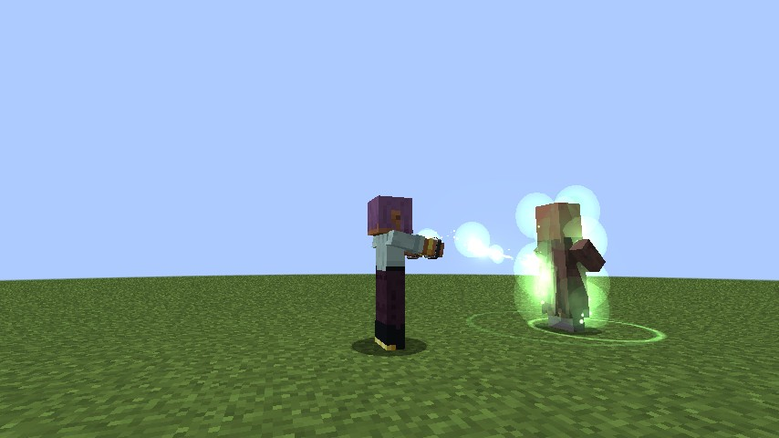
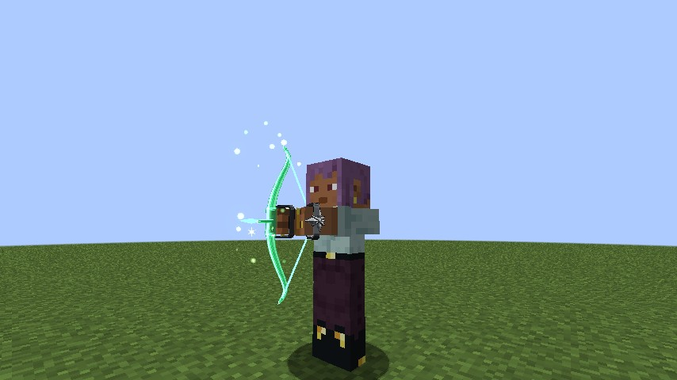
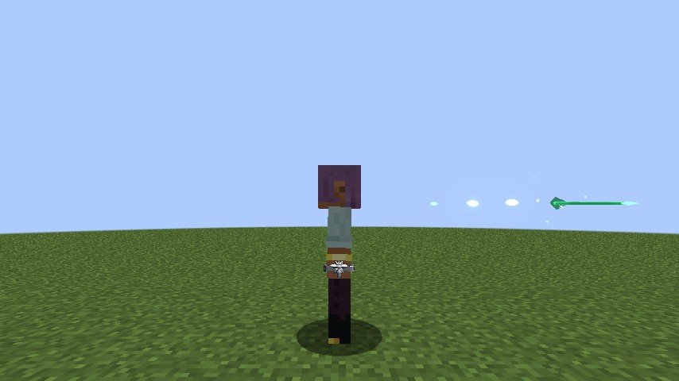
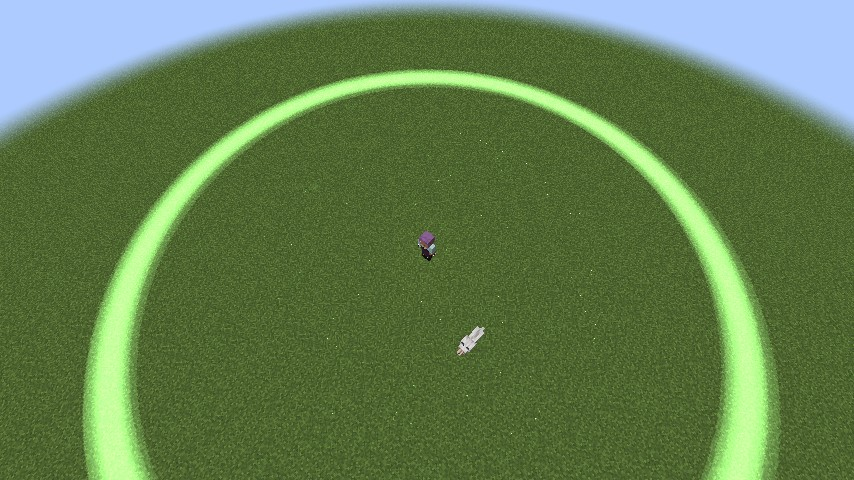
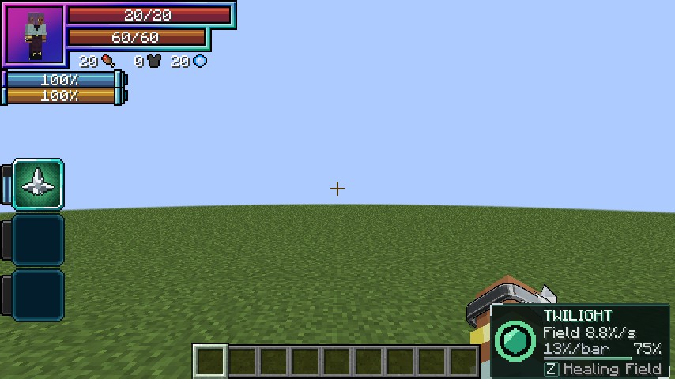

# Twilight Healing

Asia Argento's Sacred Gear, added in **0.1.77**: two silver rings that heal. It is a Tensura **Unique Skill**
(`dxdtensura:twilight_healing`), and the first Sacred Gear with no dragon inside. It has no voice, no Balance Breaker and
nothing to fight with, only light that mends.

<figure markdown="span">
  { loading=lazy }
  <figcaption>Touch: green light from the rings to the one you heal.</figcaption>
</figure>

<figure markdown="span">
  { loading=lazy }
  <figcaption>Healing Arrows: a bow of green light.</figcaption>
</figure>

## Getting it

- **Only the reincarnation roll**, at the same odds as the dragons, and only for a
  [human](../getting-started/first-gear.md#only-in-humans).
- Learning it costs 30,000 magicules, as Tensura charges any unique skill. Any number of players can hold it.
- **One Sacred Gear per player.** A Boosted Gear or Divine Dividing holder can't learn it, and a healer can't learn
  either dragon: "You already carry a Sacred Gear."

## Modes

| # | Mode | Unlocks | What it does |
|---|---|---|---|
| 0 | **[Touch](#touch)** | from the start | Hold it to heal what you look at |
| 1 | **[Healing Arrows](#healing-arrows)** | 40% mastery | A bow of light that shoots heals |
| 2 | **[Healing Field](#healing-field)** | 70% mastery | A ring of light that heals everyone in it |
| 3 | **Rings** | from the start | Put the rings on or take them off |

The mode key skips what isn't open yet. A power pressed with the rings off puts them on and starts at once. Taking them
off ends Touch, a drawn bow and an open Field. Death ends the powers too, but leaves the rings on.

## What a heal does

Every heal is a **share of the healed one's max health**, never past it, so it works the same on a villager and on a
3,000-health Tensura player.

- **Health only.** No effects are cured, no spiritual health or absorption is given, lost max health stays lost, and
  nobody is raised from the dead.
- Anything living can be healed, undead included, except armour stands and players in creative or spectator.
- **Healing is never an attack.** It starts no fight, and it's no sin for an [Angel](../races/angels.md#sin-and-the-fall).

## The price

Restoring a target's **whole health bar costs 20% of your max magicules**, **10%** once mastered. A part of a bar costs
that part: healing 5% of a bar costs 1% of your max. The same for a pig or a boss.

- You pay only for **health that actually comes back**. A target at full health costs nothing.
- A heal a [Transferred Boost](#with-the-boosted-gear) makes bigger costs more in proportion, and the Field pays for
  each one it heals.
- Short of magicules, a heal shrinks to what you can pay. Touch and the Field stop when you can't pay for 1% of a bar.

## Touch

**Hold the key.** Both hands come up, held out flat, and green light flows from the rings to whatever living thing is
under your crosshair within **4 blocks**, or to you with nothing in reach.

- It picks again each pulse, so you can sweep from one ally to the next.
- Four pulses a second heal **20% of max health a second**, **50%** once mastered.
- While it flows you can't attack or use items, and you walk instead of sprinting.
- It stops when you let go, at zero magicules, with the rings off, on death or a mode change. It has no cooldown.
- **It heals anyone you touch**, enemies too.

## Healing Arrows

*Mode 1, from 40% mastery.*

**Hold the key** to draw a bow of green light (full in 1 second, slowing you as a bow does), and **let go** to fire. A
draw under a quarter fires nothing. The arrow flies straight and fast, up to **48 blocks**.

- **On an ally** it heals **21%** of their max health at 40% mastery, **30%** mastered, times how far you drew, and bursts
  into motes.
- Allies are your pets, your Tensura allies and team, those serving the same King, and any player who hasn't hurt you in
  the last 30 seconds.
- **On anyone else** it fades, healing and costing nothing. You can't shoot yourself.

<figure markdown="span">
  { loading=lazy }
  <figcaption>A Healing Arrow on its way to an ally.</figcaption>
</figure>

## Healing Field

*Mode 2, from 70% mastery. 30 second cooldown.*

**Press the key**: a ring of green light opens round you and follows you for **10 seconds**, healing everyone inside
once a second, you included.

- **8.5% of max health a second** over **10.8 blocks** when it opens at 70%, **10%** over **12 blocks** mastered, and up
  to 4 blocks up or down.
- **Until full mastery it heals enemies too.** Fully mastered, only you and your allies.
- You can fight, and use Touch or the bow, while it's open.
- It ends after 10 seconds, at zero magicules, with the rings off, or on death, logging out or a new dimension.
- Pressed without the magicules for one health point, it doesn't open and doesn't cool down.

<figure markdown="span">
  { loading=lazy }
  <figcaption>The Healing Field's ring of light.</figcaption>
</figure>

## Mastery

Mastery comes from **health restored**: 10 points for a whole health bar restored to someone else (a quarter of that
healing yourself), so about **100 bars** master it. A line in chat marks each step:

- **40%**: "Your light reaches further: Healing Arrows."
- **70%**: the Healing Field.
- **100%**: everything heals more for less, and the Field spares your enemies.

## With the Boosted Gear

A healer carrying a [Transferred Boost](../boosted-gear/modes.md#transfer) heals more by the same factor as their hits:
**×1.5** at one stack, **×16.5** at five. The price per health stays the same, so a boosted healer burns magicules
faster.

## Rias wants you

[Rias](../races/rias.md) offers a Twilight Healing holder her **Bishop**, as Asia was, when a Bishop covers their worth
and one is free: "That light of yours mends what's broken. A Bishop suits you."

## The panel

While the rings are on, a silver and green panel sits right of the hotbar:

- the ring round a green jewel is the **Healing Field**: its seconds while it's open, its cooldown dimmed after, full
  when ready, empty and dim before 70%;
- **TWILIGHT HEALING** (TWILIGHT on a narrow screen);
- the slotted mode's rate ("Touch 20%/s");
- the magicules per bar ("20% MP/bar" of your max magicules), with your mastery;
- the mastery bar, gold once mastered, and the key.

<figure markdown="span">
  { loading=lazy }
  <figcaption>The panel with the Field ready.</figcaption>
</figure>

## The look

- A plain **silver ring with a crown** on the back of each hand, in first and third person.
- The bow and its arrows of green light.
- Touch's glowing hands, the thread of light to the one you heal, and the green light wrapping them.
- The Field's ring at its edge, with motes rising inside and a glow on each one it heals.
- Healed in your own first-person view, you see a few motes at the edges of the screen instead of the light round your
  body, so it never hides what's in front of you.

!!! info "For server owners"
    Every number here is in the [`[twilight]`](../reference/configuration.md#twilight) config section, including
    `addTwilightHealingToReincarnationPool`. `/dxdtensura max` masters it for testing.
