# The Castle Town of Gremory

The Gremory family's town stands in Tensura's **Hell**, added in **0.2.33**: a walled town on its own base of rock, with a castle, a
market, an inn and people in its streets, under a purple sky and a great artificial moon. There's one per world.

The town is still growing: the [bounty board and the castle's lords](#still-to-come) come in later versions.

<div class="grid" markdown>

<figure markdown="span">
  { loading=lazy }
  <figcaption>The town from above, in Hell's sand.</figcaption>
</figure>

<figure markdown="span">
  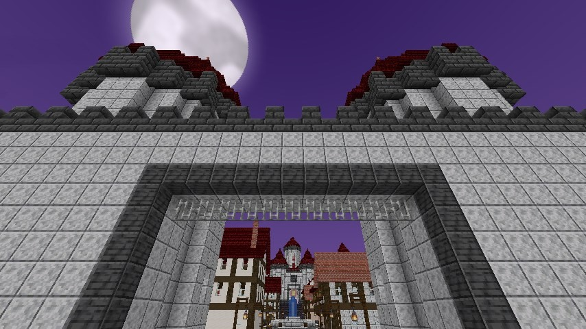{ loading=lazy }
  <figcaption>The south gate, the way in on foot.</figcaption>
</figure>

</div>

## Finding it

It's about a thousand blocks from the middle of Hell. Tensura's **Hell Gates** keep your X and Z, so any gate will do, and a map tells you
where to walk.

**Getting a map:**

- **Ask Rias.** Her talk screen has **The way to the Underworld**. She gives anyone a map once an in-game day, servant or not.
- **A wandering trader** sometimes offers one for 12 emeralds.
- **The Curio Seller** in the town's market sells them for 3 silver, to pass on to a friend.

**Using it:** it's a map of Hell with a red X, and its tooltip gives the coordinates. Hold it in either hand in Hell, and the action bar says
how far and which way, once a second: "Castle Town: 2,340 blocks north-east".

**The sky** tells you you're close: it starts to turn purple about 450 blocks out, and it's fully purple at 150.

<figure markdown="span">
  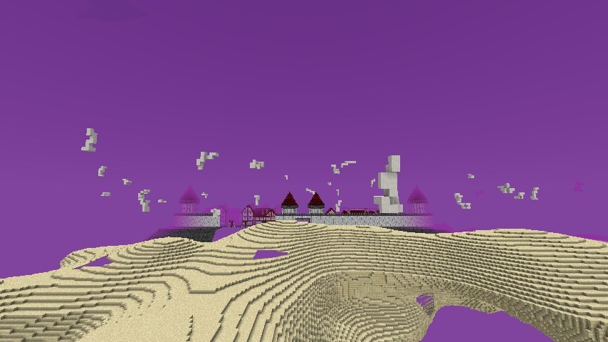{ loading=lazy }
  <figcaption>About 300 blocks out, with the sky already turning.</figcaption>
</figure>

Operators can find it with these:

```
/locate structure dxdtensura:castle_town
/dxdtensura town where
```

!!! note "A world that already explored Hell"
    If Hell's land is already generated where the town would stand, it picks unexplored land further along and comes up as you get close, chunk
    by chunk. `/locate` can't find a town that moved, but the map and `/dxdtensura town where` can.

## Coming and going

**On foot.** The town stands level on its own base, over the pits if it has to, with a paved terrace all the way round. Walk round to the **south
gate**. Flyers can land anywhere.

**By ticket.** A **Ticket to the Castle Town** costs 5 silver at the Curio Seller. Use it and stand still for 5 seconds: a circle opens under you and
you arrive on the Town Circle, from any dimension. A step or a hit breaks the circle and you keep the ticket. It doesn't work inside the town, in a
boss area or in the Labyrinth.

**By Devil's circle.** A [Devil](../races/devil.md#the-magic-circle) from Middle-class who has been inside the walls once gets a new Demonic Power mode,
**Circle to the Castle Town**. It costs and cools down as the circle home does, and arrives on the Town Circle.

**The way out: the Town Circle.** It's in the plaza inside the south gate. Right-click it, and 3 seconds later you're back where you last left the
overworld, for free, whoever you are. A step or a hit breaks it. With no spot saved, you land at the world spawn.

<figure markdown="span">
  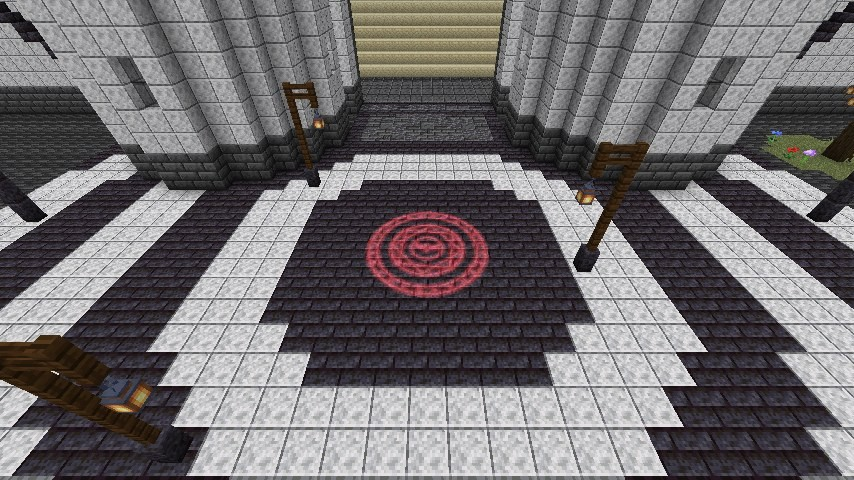{ loading=lazy }
  <figcaption>The Town Circle, in the plaza inside the south gate.</figcaption>
</figure>

**The first time** you step inside the walls, a title reads "Castle Town of Gremory" and a bell rings. If you serve Rias, she has a word for you too.

## The town

- **The Avenue** runs north from the south gate, through the square, to the castle steps.
- **Fountain Square** has its fountain and two marble statues facing each other across it: the Scale Mail and Rias.
- **Market Row** has the [five stalls](#the-market). The [inn](#the-inn) and the **Hunters' Office** are nearby.
- **About 60 houses,** noble gardens and lanes fill the rest, inside the town wall.
- **The stadium** is closed for now.
- **The castle** has the rooms the story names: the great hall with its thrones, a theatre, a dining room, a library, Rias's room, and a treasury
  with three vaults nobody has the key to yet.

<div class="grid" markdown>

<figure markdown="span">
  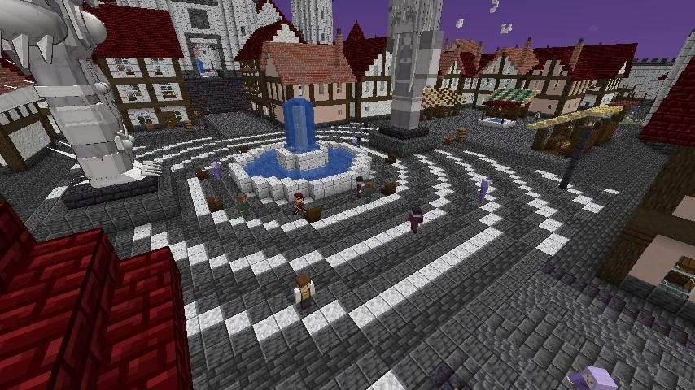{ loading=lazy }
  <figcaption>Fountain Square.</figcaption>
</figure>

<figure markdown="span">
  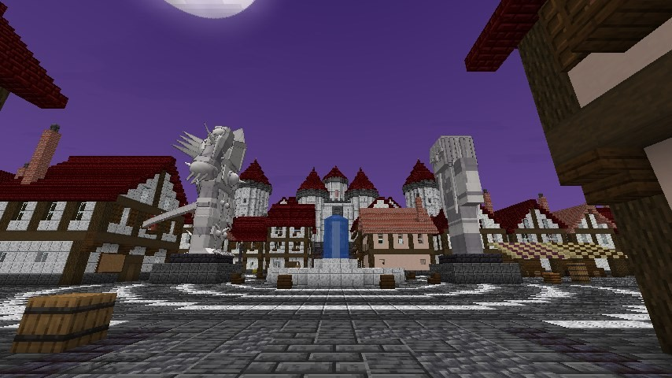{ loading=lazy }
  <figcaption>The Scale Mail and Rias, in marble.</figcaption>
</figure>

<figure markdown="span">
  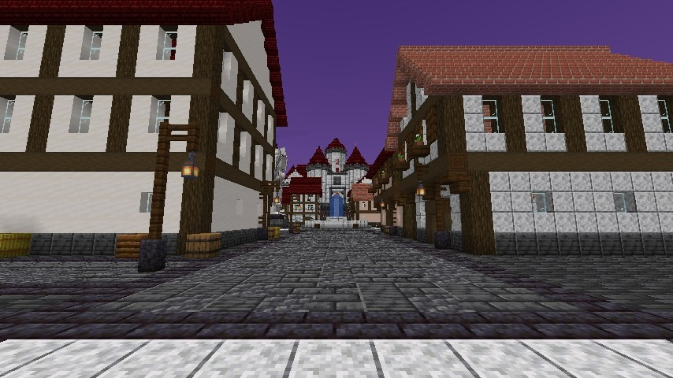{ loading=lazy }
  <figcaption>The Avenue, with the castle at its end.</figcaption>
</figure>

<figure markdown="span">
  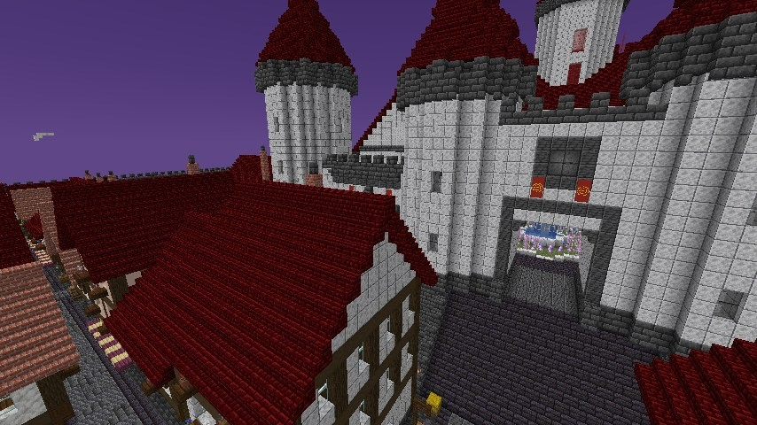{ loading=lazy }
  <figcaption>The castle.</figcaption>
</figure>

</div>

The purple sky and the moon are a client setting. Turn `townSky` off and Hell keeps its own sky there.

## The rules

In survival, inside the town's square and on its terrace:

- **No breaking or building.** Blocks don't break or place, buckets and flint do nothing, axes don't strip, and explosions and skills leave the town
  whole. Juggernaut Drive's dragon can't break it either. Creative players and operators can.
- **What you can click:** doors, gates and bells work. Chests and barrels stay shut. A bed says "Talk to the innkeeper".
- **No monsters.** Nothing spawns in the square. Outside, Hell is as it always is.
- **No poison inside the walls.** Hell's Magicule Poison stops at them, and starts again on the terrace.

## The people

While a player is near, the town has **24 citizens** and **10 guards**. They arrive before you're inside, and leave when you've gone.

- **Citizens** walk the streets, stop in pairs to talk, sit on the square's benches and run from danger.
- **Guards** carry swords. They stand at the gates, walk the south wall and patrol the Avenue.
- **The Hunters' Clerk** stands behind the counter of the Hunters' Office. Nobody can hurt the Clerk, the stallkeepers or the innkeeper, and trying makes you
  Wanted.
- **Right-click** a citizen or a guard for a line. It depends on who you are: a Devil, an Angel, a Fallen Angel, a stranger, Rias's servant, or Wanted.
- **The dead stay dead for a day.** Each citizen or guard killed leaves one fewer until the next in-game day.
- They can't take an Evil Piece, a Brave Saint card or a name. [Forbidden Balor View](../balor-view/index.md) stops a citizen, but not the Clerk.

<div class="grid" markdown>

<figure markdown="span">
  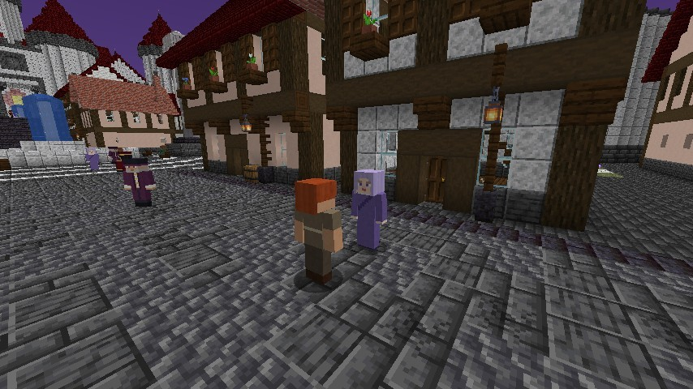{ loading=lazy }
  <figcaption>Citizens in the street.</figcaption>
</figure>

<figure markdown="span">
  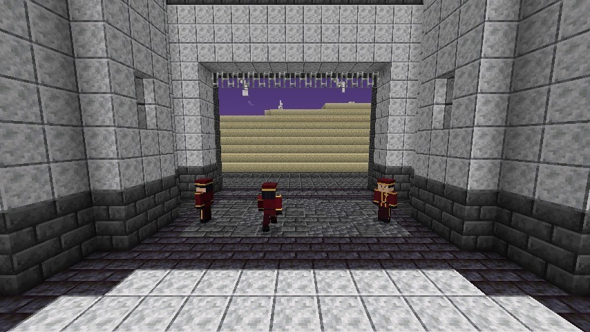{ loading=lazy }
  <figcaption>Guards at the gate.</figcaption>
</figure>

</div>

### Wanted

Hurt anyone inside the square, or send a pet or an arrow to do it, and "The town has marked you Wanted. Its guards will attack on sight." Creative players
are let off.

- **Guards** open their wings and fly at you, hit you close up and throw Demonic Power orbs from further off. They give up about 30 blocks past the walls.
- **The alarm.** While a guard can see you, 2 more come through a circle about every 20 seconds, up to 12 in a day. It stops after you've been out of
  sight for 30 seconds.
- **Citizens** run with a cry.
- **Stalls and the inn** refuse you.

**It ends** either way:

- after a **full in-game day outside the square**, and coming back early starts the count again;
- for **1 gold coin** paid to the Clerk.

**A [Stray Devil mark](stray-devils.md#the-stray-devil-mark)** makes you Wanted whenever you're in the square, and there's no fine to pay for it. Outside the
square nobody minds.

<div class="grid" markdown>

<figure markdown="span">
  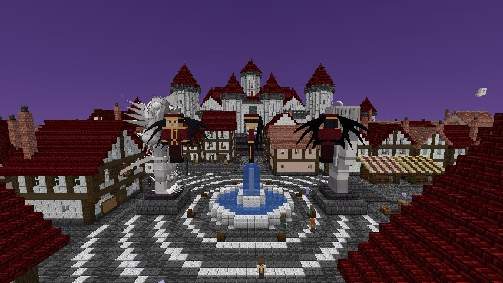{ loading=lazy }
  <figcaption>Guards with their wings open, in a chase.</figcaption>
</figure>

<figure markdown="span">
  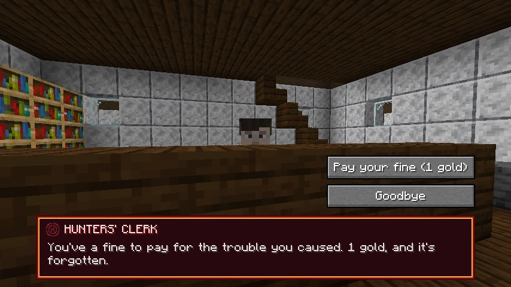{ loading=lazy }
  <figcaption>The Clerk takes the fine.</figcaption>
</figure>

</div>

## The market

Five stalls on Market Row, each with a keeper. Right-click a keeper, then **Trade** for the normal trade screen, paid in Tensura's coins.

| Stall | Sells from Tensura's lists for |
|---|---|
| **Apothecary** | Clerics |
| **Smith** | Weaponsmiths, armourers and toolsmiths |
| **Tome Seller** | Magic trainers and librarians |
| **Grocer** | Butchers and farmers |
| **Curio Seller** | Merchants, and the coin exchange, always, both ways |

- **The stock changes every in-game day,** and it's the same for everyone.
- **Use limits are per player,** and come back the next day.
- **A Devil pays 10% less.** What a stall pays you and the coin exchange never change.
- **No stall buys what a stall sells,** so there's no money from nothing.
- The screen closes by itself if you walk more than 8 blocks away or become Wanted, and any coins in its slots come back to you.

<div class="grid" markdown>

<figure markdown="span">
  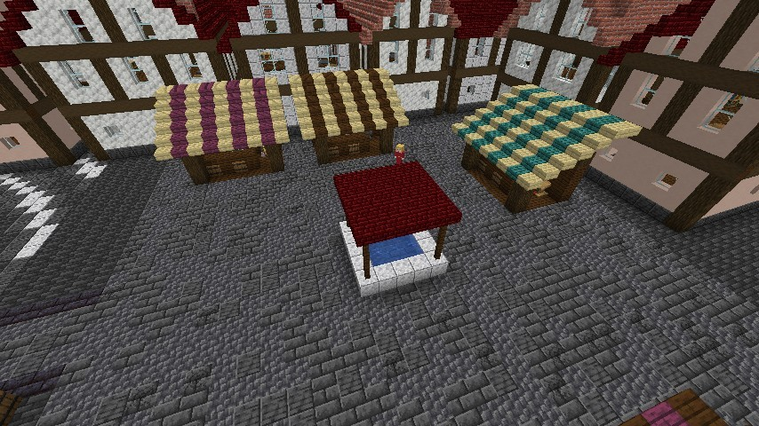{ loading=lazy }
  <figcaption>Market Row.</figcaption>
</figure>

<figure markdown="span">
  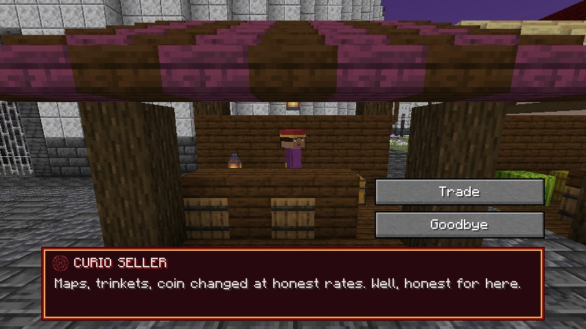{ loading=lazy }
  <figcaption>A keeper's panel.</figcaption>
</figure>

<figure markdown="span">
  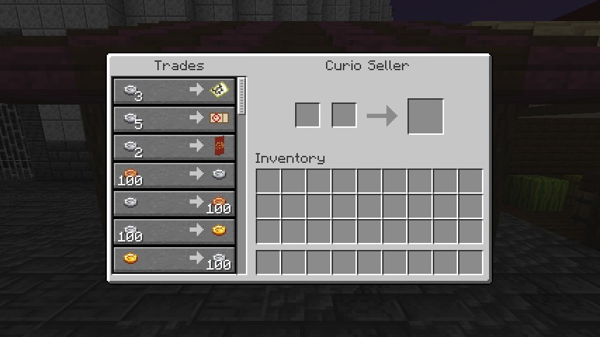{ loading=lazy }
  <figcaption>The Curio Seller's trades.</figcaption>
</figure>

</div>

### The town's own goods

These are always on the stall, on top of the day's stock.

| Goods | Stall | Price | A day |
|---|---|---|---|
| **Bael Apple** | Grocer | 3 silver | 8 |
| **Dragon Apple** | Grocer | 8 silver | 8 |
| **Map to the Castle Town** | Curio Seller | 3 silver | 2 |
| **Ticket to the Castle Town** | Curio Seller | 5 silver | 4 |
| **Gremory Banner**, a crimson banner with the crest | Curio Seller | 2 silver | 4 |
| **[Phoenix Tear](../races/houses.md#house-phenex)**, for a Friend of House Gremory and up | Apothecary | 16 gold | 1 |

### The apples

- **Bael Apple:** eaten fast, always edible. Food 4, 4 health and **5% of your max magicules** back.
- **Dragon Apple:** for a dragon, meaning a dragon race or a Boosted Gear or Divine Dividing holder, it's food 8 and **a quarter of your max magicules and
  aura** back. For anyone else, it's food 4 and 30 seconds of Fire Resistance.

## The inn

The innkeeper stands behind the inn's counter.

- **Rent a room** once, for 1 gold. It's free for a Devil, and it's yours for good.
- **Set your respawn here** and you wake at the inn when you die. **Give up your room** puts your respawn back. Setting it again costs nothing.
- **Wanted,** the inn won't have you: you wake at the world spawn instead, and the room is still yours afterwards.

<figure markdown="span">
  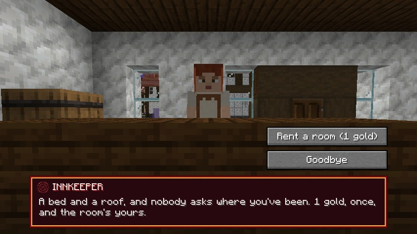{ loading=lazy }
  <figcaption>The innkeeper.</figcaption>
</figure>

## Titles and renown

House Gremory has five titles for you. A title opens more of each stall's lists and takes a cut off prices. The cut adds to a Devil's 10%, and never comes
to more than 25%.

| Title | Stall lists it opens | Cut |
|---|---|---|
| Visitor | Levels 1 and 2 | none |
| Guest of House Gremory | Up to level 3 | none |
| Friend of House Gremory | Up to level 4, and the Phoenix Tear | 5% |
| Honoured by House Gremory | All 5 | 10% |
| Champion of House Gremory | All 5 | 15% |

**For now everyone is a Visitor.** The titles come with the castle's lords. Until then an operator can set one with `/dxdtensura town title set`.

**Renown** counts what the town thinks of you, and `/dxdtensura town renown` shows yours. It falls by 10 when you become Wanted and by 50 when you kill.

## Still to come

- **The bounty board** outside the Hunters' Office, which says "Nothing's been posted yet."
- **The castle's lords,** titles earned by renown, and the keys to the treasury.
- **The stadium.**

See the [Roadmap](../roadmap.md).

## For server owners

- The numbers are in the [`[town]`](../reference/configuration.md#town) config section. `enabled = false` takes away the town's rules, people, circle, tickets and
  Rias's map, and no new town generates. `protect = false` lets anyone break blocks. `phoenixTearsInMarket = false` leaves Phoenix Tears to Phenex players.
- Operators have the [`/dxdtensura town`](../reference/commands.md#the-castle-town) commands.
- **People and stalls need no new world:** a town already generated gets them. The buildings themselves don't change once generated.
