# Fenrir

The god-slaying wolf of Norse myth, added in **0.2.78**, bound by the ribbon Gleipnir in a frozen ruin. Beat him for
Tensura's reward for his magicules, plenty of XP and a fang that wounds as his do, or break his will and he runs with
you.

<div class="grid" markdown>

<figure markdown="span">
  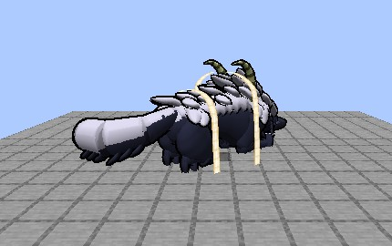{ loading=lazy }
  <figcaption>Asleep on the binding stone, Gleipnir round him.</figcaption>
</figure>

<figure markdown="span">
  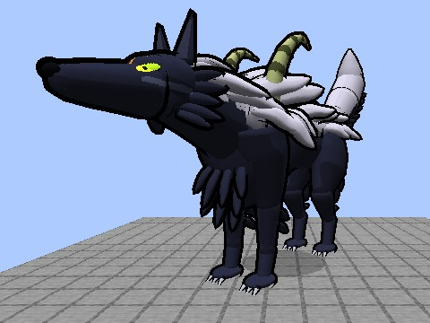{ loading=lazy }
  <figcaption>Unbound, at his full size.</figcaption>
</figure>

</div>

## Finding him

The **Frozen Ruin** stands on snowy slopes, frozen and jagged peaks, groves and ice spikes, about as rare as the
[White Dragon Colosseum](white-dragon-emperor.md#finding-him): a ring of broken Norse stones round an icy floor, four tall
rune stones on the diagonals, and the binding stone in the middle with Fenrir asleep on it.

```
/locate structure dxdtensura:fenrir_ruin
```

<figure markdown="span">
  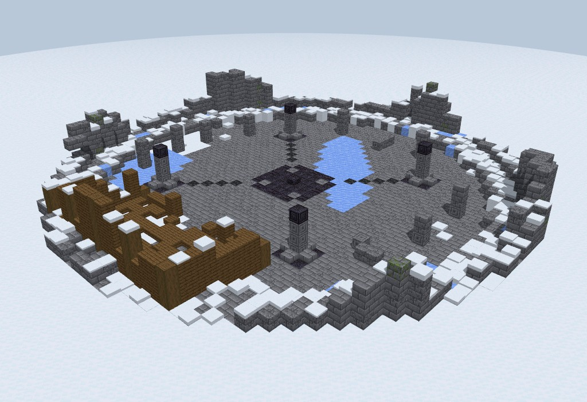{ loading=lazy }
  <figcaption>The Frozen Ruin (a render of its blocks).</figcaption>
</figure>

**The ruin can't be changed.** Nothing breaks or blows up its blocks, whether players, skills, explosions or mobs, and only a
creative player can place or break anything inside it.

## Calling him

Use a **Nether Star** on the binding stone.

- The stone stays silent until the **Ender Dragon has been killed** in your world (you keep the star).
- It refuses on **Peaceful**.
- Only one Fenrir hunts in a world at a time.

Gleipnir snaps and he rises.

<figure markdown="span">
  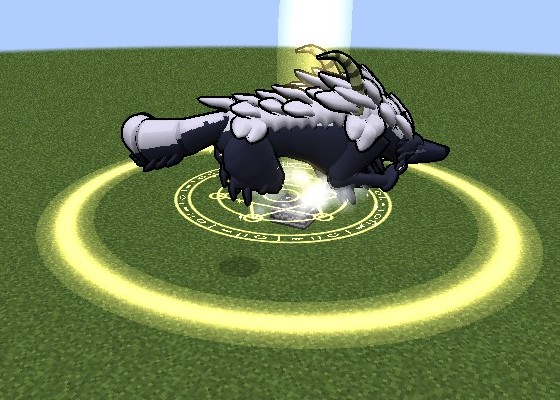{ loading=lazy }
  <figcaption>A Nether Star on the stone, and Gleipnir snaps.</figcaption>
</figure>

## The fight

He has **4,000 health**, and **no single hit takes more than 200 of it** (5%), whatever you use. Soul damage is held to the same
cap, and only `/kill`, the void and [Lore mode's](../lore-mode.md) vanish go past it. His own hits grow with your max health. He
stays within 24 blocks of his stone and hunts the mightiest player in the ruin first.

### God Slayer

His jaws glow and he growls for a second, then he bites. The bite goes through **armour and barriers** and leaves a wound: for
**10 seconds nothing heals you**. It hits twice as hard on the mightiest: awakened Demon Lords and True Heroes, Satan-class
Devils, Seraphs, and a Heavenly Dragon holder in a Scale Mail or a Juggernaut Drive.

<figure markdown="span">
  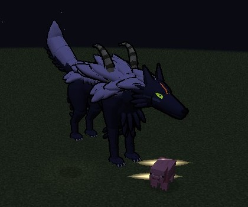{ loading=lazy }
  <figcaption>God Slayer lands.</figcaption>
</figure>

### The hunt

He circles you, lunges and pounces. He runs and leaps but **never flies**. He leaps up at anyone hovering close and carries them
down in his jaws, and after 3 seconds of hovering, or of being out of his reach, he howls a cone of force that throws you down.
Either one keeps you out of the air for 3 seconds (the **Grounded** effect), whatever you fly with, and the fall doesn't hurt.

<figure markdown="span">
  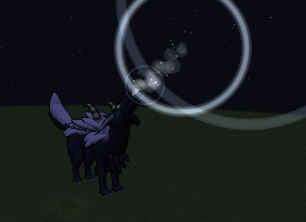{ loading=lazy }
  <figcaption>The howl goes up after anyone out of his reach.</figcaption>
</figure>

### His phases

- **At two thirds** he leaps onto the stone and howls, and his sons **Sköll and Hati** join in, 400 health each. Their nips have
  no God Slayer in them.
- **At one third** he roars, every lit anchor goes dark and he grows to his full size: faster and tougher, biting more often, and
  able to **Devour**, a lunge after a long glow that catches you in his jaws for two bites and a throw.

<div class="grid" markdown>

<figure markdown="span">
  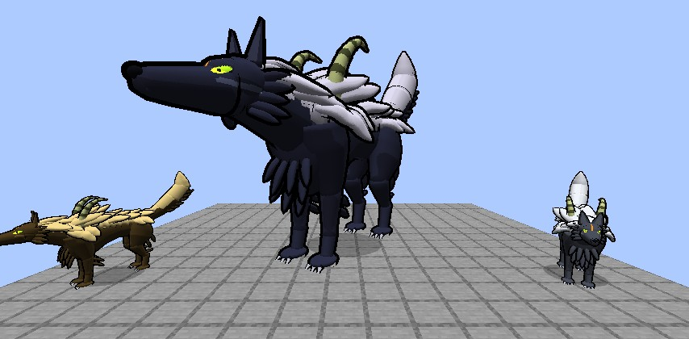{ loading=lazy }
  <figcaption>Sköll and Hati.</figcaption>
</figure>

<figure markdown="span">
  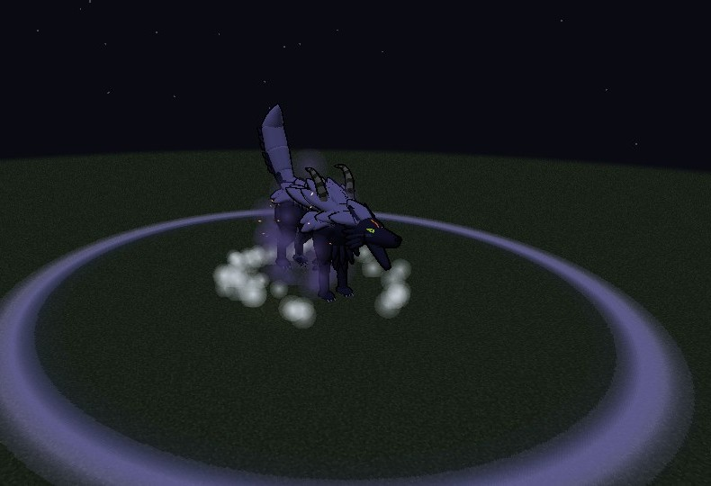{ loading=lazy }
  <figcaption>The roar at one third.</figcaption>
</figure>

</div>

### Gleipnir

Hold use on a rune stone's anchor for **2 seconds** to light it (a hit from him or his sons stops you). It stays lit for 15
seconds. While two anchors are lit and he comes within 2 blocks of the line between them, the ribbon snaps tight and **pins him**:
he can't move or attack for 6 seconds, then 4, then 3, and always 3 at the last stage. Anything he held is dropped. Then those
two anchors rest for 20 seconds.

<div class="grid" markdown>

<figure markdown="span">
  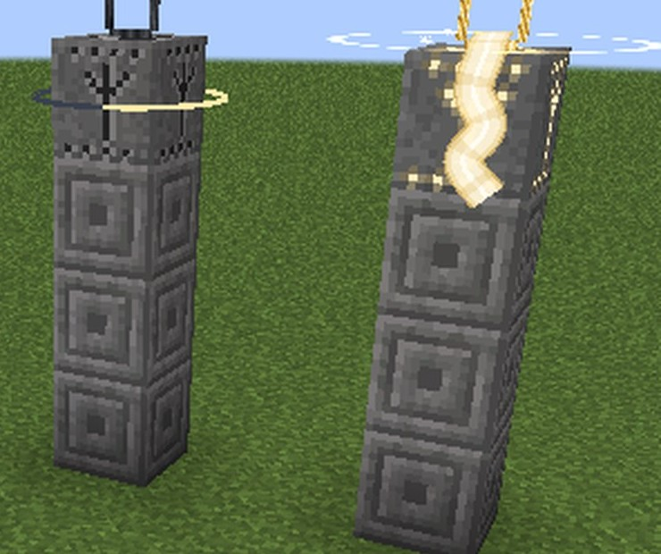{ loading=lazy }
  <figcaption>A lit anchor on a rune stone.</figcaption>
</figure>

<figure markdown="span">
  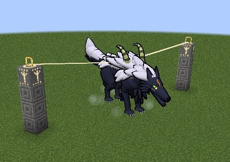{ loading=lazy }
  <figcaption>Pinned between two anchors.</figcaption>
</figure>

</div>

### Leaving him alone

With no one to fight near his stone for 30 seconds he walks back to it, heals and lies down. The star is spent.

## His kill

Tensura's reward for his magicules, **1,500 XP** and **Fenrir's Fang**, one per kill: a dagger with 9 attack and netherite's
durability, which can be enchanted, and whose hits leave a 3-second God Slayer wound.

## Taming him

Only in his **last phase**. A [Divine Dividing](../divine-dividing/index.md) holder in the
[white Juggernaut Drive](../divine-dividing/juggernaut-drive.md) lands **5 Divides** on him, each making him smaller, and at the
fifth he lies down for 10 seconds, untouchable. Use him within 4 blocks, still in the Drive, and he's yours. Left alone he gets
up at full size.

[Excalibur Ruler's](../excalibur/index.md#the-swords) command makes him yield too, with no Drive needed.

There is **one tamed Fenrir in a world**. While he lives, every binding stone shows Gleipnir lying empty.

<figure markdown="span">
  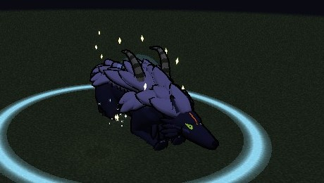{ loading=lazy }
  <figcaption>He yields.</figcaption>
</figure>

### The tamed Fenrir

A wolf-sized companion with **300 health** who sits and follows as a wolf does (use him to sit him down) and fights what you
fight. Every 4 seconds one of his hits is a bite that leaves a God Slayer wound. He can't die: at 1 health he slinks off for 5
minutes, and comes back healed when you call him.

<figure markdown="span">
  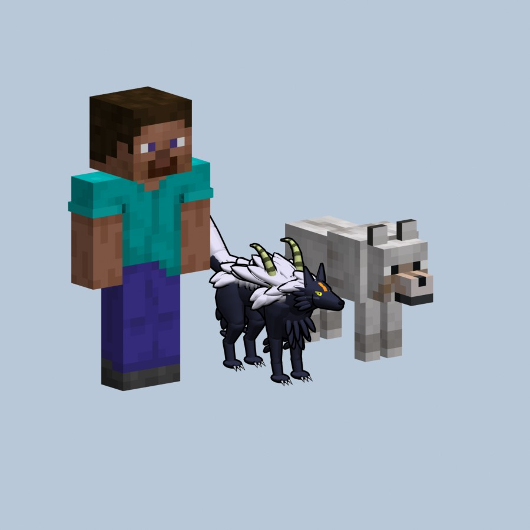{ loading=lazy }
  <figcaption>The tamed Fenrir beside a player (a render of his model).</figcaption>
</figure>

### God-Devouring Wolf

The Extra Skill you learn by taming him. It can't be rolled or plundered.

| Mode | What it does |
|---|---|
| **Call** | Within 32 blocks he runs to you; farther off he appears beside you |
| **Unleash** | His fight size for 30 s, with three times the health and 60 attack. A 5-minute cooldown |
| **Release** | Press it twice within 5 s to set him free. Forgetting the skill frees him too |

## Commands and settings

Operators can use `/dxdtensura fenrir owner` and `/dxdtensura fenrir release <player>`: see
[Commands](../reference/commands.md#fenrir). His numbers are in [`[fenrir]`](../reference/configuration.md#fenrir).
