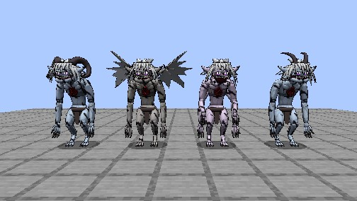
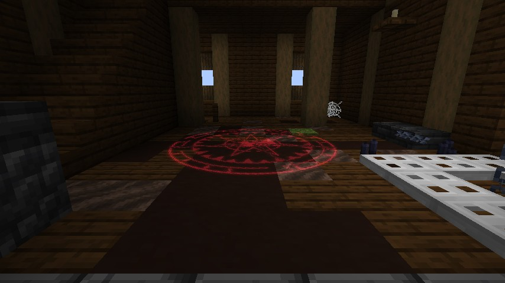
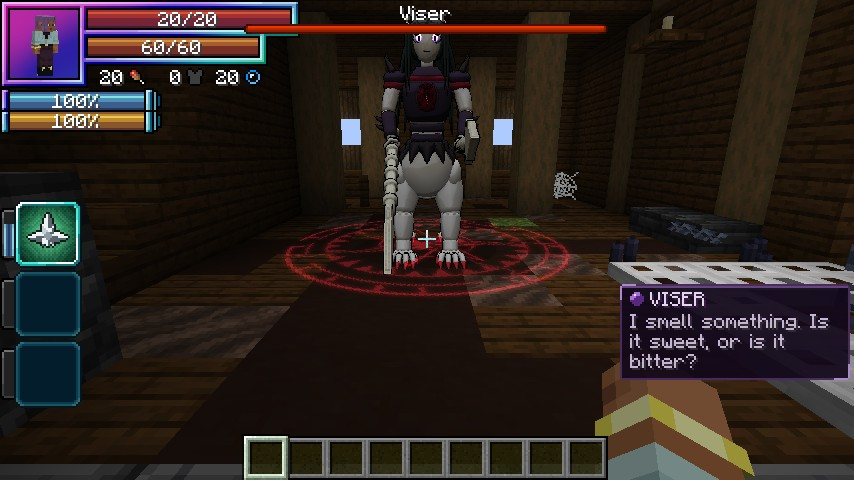
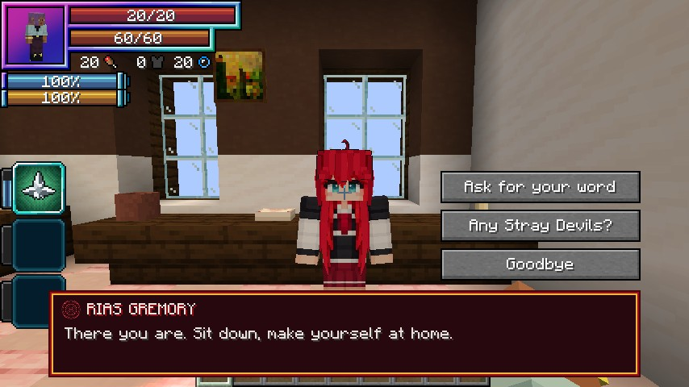
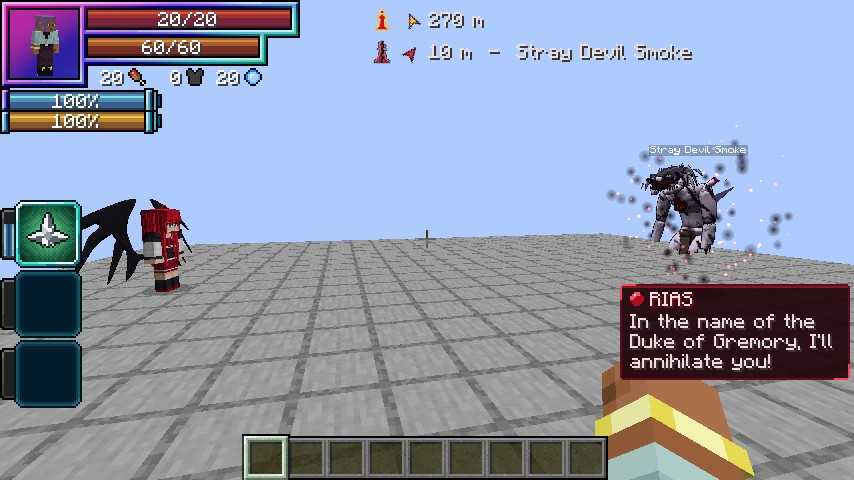
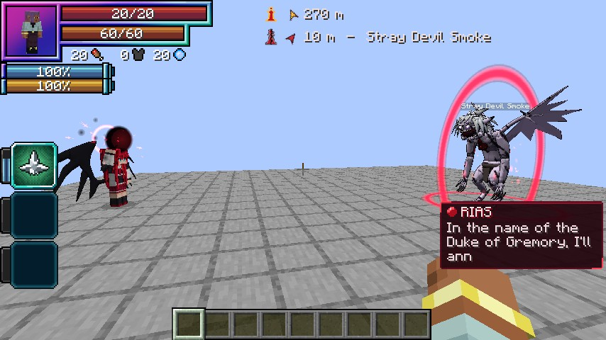

# Stray Devils

**Stray Devils**, added in **0.1.72**, are reincarnated Devils who ran from their Kings with an Evil
Piece. Its power ran wild and twisted their bodies. The cracked piece still glows a dull crimson, half sunk in each
one's chest, and its shape tells you how it fights.

<figure markdown="span">
  { loading=lazy }
  <figcaption>No two Strays look alike.</figcaption>
</figure>

## What they look like

Every Stray is a **hunched, clawed Devil** with pale silver hair, in pale blue-grey, pale violet or ash grey, with **one
to four mutations** rolled once:

- horns: ram curls, swept-back spikes or a broken crown;
- a second pair of arms;
- a barbed tail;
- torn bat wings;
- a split jaw;
- extra glowing eyes.

| Class | EP | Size |
|---|---|---|
| **Low-class** | 5,000–20,000 | normal |
| **Middle-class** | 20,000–100,000 | 1.3 times |
| **High-class** | 100,000–400,000 | 1.6 times |

The stronger a Stray, the more mutations it has.

## How each piece fights

| Piece | How it fights |
|---|---|
| **Pawn** | Walks up and claws. |
| **Knight** | Fast and frail. From 6 to 10 blocks it crouches and **lunges** (1.5 times its attack), then backs off and circles. |
| **Bishop** | Keeps 8 to 14 blocks away and throws a crimson **Demonic Power orb** every 2.5 seconds. Get close and it hops 8 blocks back through a dark circle. |
| **Rook** | Slow and tough. It roars, **charges** in a straight line (1.5 times its attack, with a strong knockback; a wall stuns it) and **slams** the ground around it. |

Every Stray claws in reach, and every move has a wind-up you can see and a sound.

## At night

Now and then (about **one for each player every 2.5 nights**), a Low-class or sometimes Middle-class Stray rises
through a **dark circle** somewhere dark, 24 to 48 blocks from a player in the overworld, and comes for them.

- Never with another Stray within 96 blocks.
- Not in Peaceful, with mob spawning off, in the Nether, the End or Tensura's Hell, or in oceans, rivers or mushroom
  fields.
- **They don't burn in the sun.** From sunrise to dusk, a night Stray with no target that hasn't been hurt for 10 seconds
  sinks away.

**Who they fight:** players in survival or adventure, villagers, wandering traders, and anything that hurts them. Never
each other (their orbs pass through Strays) and never Rias. Iron golems fight them.

## Lairs

Ruined **Stray mansions** stand in plains, forests, birch and dark forests, taiga and meadows.

```
/locate structure dxdtensura:stray_mansion
```

Come within **32 blocks** of the dark circle in the hall's floor and **the lair wakes**:

- its **boss** rises out of the circle, and 2 to 4 Low-class guards come up on the house's floors;
- they chase you out into the garden and a little past the fence, and 32 blocks from the circle they give up and walk
  back;
- until the boss dies, nothing breaks the circle, no liquid included.

<div class="grid" markdown>

<figure markdown="span">
  { loading=lazy }
  <figcaption>The lair's circle in the hall.</figcaption>
</figure>

<figure markdown="span">
  { loading=lazy }
  <figcaption>Viser rises.</figcaption>
</figure>

</div>

### The lair boss

The first lair boss in each world is **Viser**, a four-legged beast with a Devil's upper body and a snake for a tail.
Later ones take names from a list (Morvane, Krovath, ...).

- A crimson boss bar with its name, and lines in the speech box in a violet voice of its own.
- It fights with its **bone lances** (a 6-block lunge), **Demonic Power** volleys, a **trampling charge** and its
  **snake tail**, and grows fiercer at half health.
- **Kill it** and the lair is cleared for good: its circle dims and can be broken.
- A **cellar chest** holds gold, emeralds, Magic Ore, silver, iron, books and sometimes a Gremory flyer.

## Kills

- Tensura's usual EP for the kill, and EP-based XP.
- A few gold nuggets and sometimes an emerald, more from stronger Strays.
- A lair boss always drops gold ingots and emeralds.

## Devil things

- Strays are **Majin**: Light Spears, Holy Water, Tensura's Holy Damage and Ascalon's holy strike burn them.
- They refuse an Evil Piece: "It still holds its old King's piece."
- A Stray mansion is **enemy territory** for [Promotion](../races/peerage.md).

## The Stray Devil mark

Leave a peerage, or be released, and you carry the **Stray Devil mark**: Strays take you for one of their own.

- None of them comes for you on its own, lair bosses and guards included. A lair boss that sees you says "You smell like
  one of us. Leave, or stay and rot."
- Hurt one and that Stray alone fights you, until it dies or you're more than 48 blocks away. The others stay calm.
- In the [Castle Town](castle-town.md#wanted) the mark makes you **Wanted** whenever you're in its square, with no fine to pay for it.

## Rias's hunts

Serve [Rias](../races/rias.md) and she sends you hunting.

- **Every 3 in-game days** she calls you at dusk in the overworld, in her speech box, and sends you after a Stray. Or ask
  her **"Any Stray Devils?"** on her talk screen once the days are up. Too soon: "Not yet. Rest while you can.", and the
  row counts the days.
- **The target** is a named Middle-class Stray 200 to 400 blocks away, rising through a dark circle as you come within
  64 blocks. From **100,000 EP** it's a High-class one, or, with a living lair within 600 blocks, that lair's boss.
- **A hunt marker** under the King marker points the way: the distance and "Stray Devil Krovath" or "Stray Devil lair".
  The client setting [`huntMarker`](../reference/configuration.md#client-settings) turns it off.
- **While a job is open, your Pawn can promote anywhere.**

<div class="grid" markdown>

<figure markdown="span">
  { loading=lazy }
  <figcaption>"Any Stray Devils?"</figcaption>
</figure>

<figure markdown="span">
  { loading=lazy }
  <figcaption>The hunt marker, under the King marker.</figcaption>
</figure>

</div>

### Rias arrives

Bring the target **under a fifth of its health** with you within 32 blocks, and her circle opens beside you. She holds
the Stray still with her power, says "In the name of the Duke of Gremory, I'll annihilate you!", and her **Power of
Destruction** erases it.

- **The kill and its EP are yours.**
- Then her reward, "Well done. That's one less Stray in my territory.": gold, emeralds, Magic Ore and silver, sometimes
  an enchanted book, a diamond or a Gremory flyer, into your inventory (the rest at your feet), and **10% of the
  Stray's EP** on top of the kill's own. Then she leaves.
- **Finish it yourself** and she comes for the reward a moment later: "You finished it yourself? Impressive."
- In Tensura's boss arena, during a cutscene, or with `riasArrives` off, the reward comes through a small circle at your
  feet.
- Logging out, dying or leaving the dimension mid-scene sends her away. The Stray fights on and the job stays.

<figure markdown="span">
  { loading=lazy }
  <figcaption>The Power of Destruction.</figcaption>
</figure>

### How a job ends

| What happens | The job |
|---|---|
| The target dies with you within 64 blocks | Done, whoever landed the blow |
| The target dies with you further off | "Someone else dealt with it." No reward |
| 2 days go by | "It got away. We'll find it again." A field Stray sinks away; a lair boss stays |
| The world goes Peaceful | Ends the same way |
| You leave her peerage | Ends quietly |
| You die | Nothing: the job stays |

Each of her servants has their own job and target, and a lair is never sent to two at once.

!!! info "For server owners"
    Every number is in the [`[stray]`](../reference/configuration.md#stray) config section, and operators have the
    [`/dxdtensura stray`](../reference/commands.md#stray-devils) commands.
