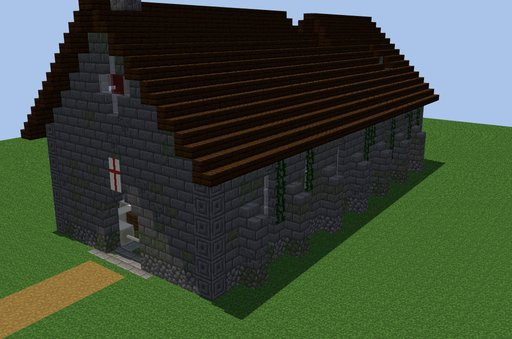
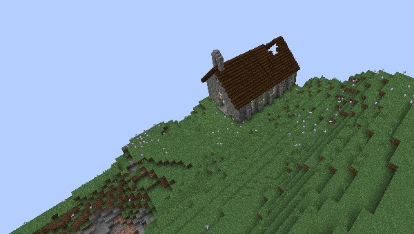
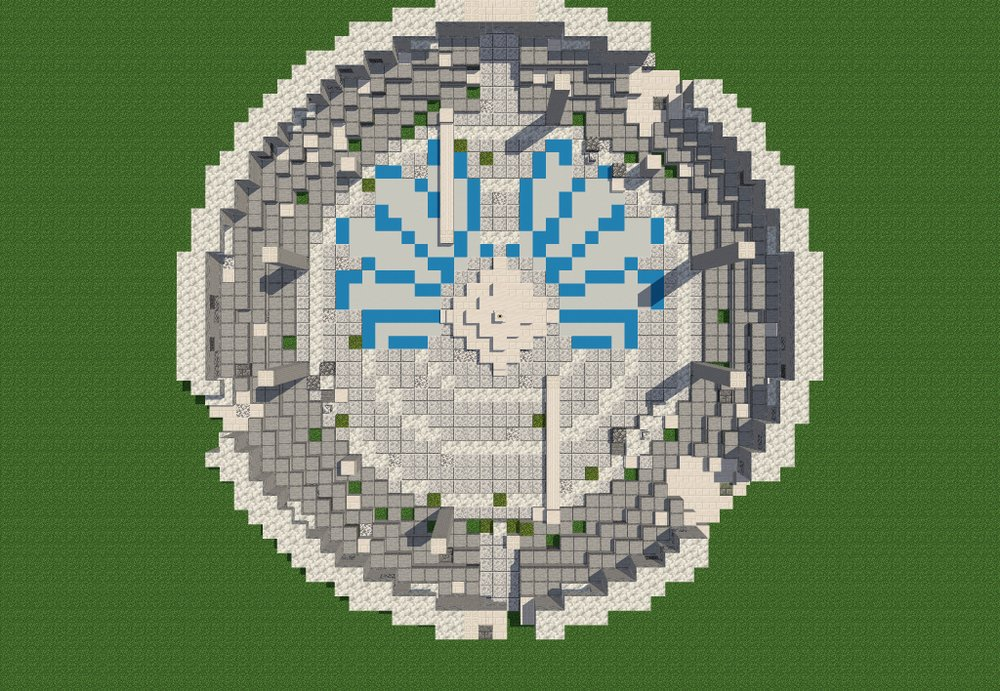
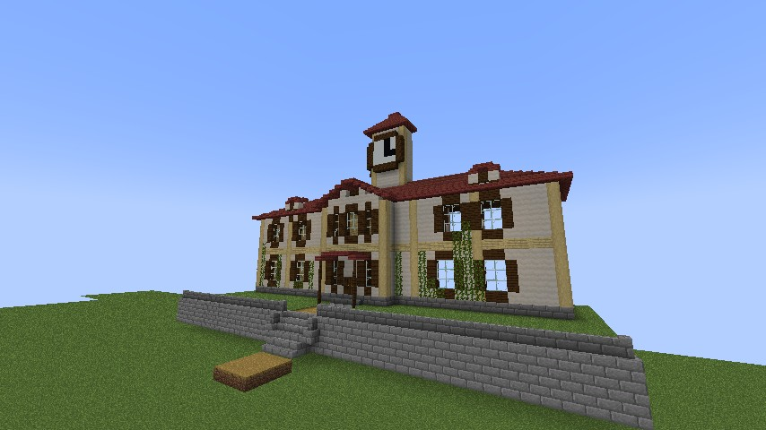
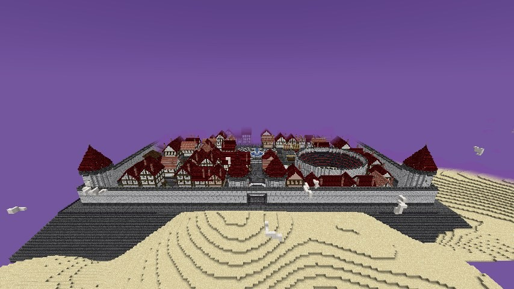

# Structures

Devil x Slime adds four structures to the overworld, and a [town in Hell](#the-castle-town-of-gremory). The church is rarer than a pillager outpost, the colosseum about
twice as common as the church, and the Stray mansion a little rarer than the colosseum; the old school building
stands once per world. Since **0.1.92** each one checks its ground first: see [Where they stand](#where-they-stand).

## Ruined church

A ruined chapel in **plains, meadows and forests**. Inside, a dragon's skeleton lies across the nave, and **Ascalon** is
driven down through its skull at the chancel steps, glowing under a hole in the roof. The first church drawn from in a
world holds the true Ascalon; every other one holds a replica.

```
/locate structure dxdtensura:ascalon_church
```

<figure markdown="span">
  { loading=lazy }
  <figcaption>A ruined church.</figcaption>
</figure>

See [Ascalon](../boosted-gear/ascalon.md).

### The crypt church

One ruined church in three has a **crypt** under its nave, down a spiral stair, where
[Durandal](../durandal/index.md#the-reliquary) stands sealed and chained in an altar. A church with a crypt holds only
Durandal: its dragon's skull is empty, and its lectern's book tells of the blade under the nave. One church chest in ten
holds a [Holy Factor Crystal](../durandal/index.md#the-holy-factor-crystal).

```
/locate structure dxdtensura:ascalon_church_crypt
```

<figure markdown="span">
  { loading=lazy }
  <figcaption>A crypt church, on the land it checked first.</figcaption>
</figure>

## White Dragon Colosseum

A broken ring of white stone on **high ground** (meadows, cherry groves, windswept hills and forests, savanna plateaus),
with Albion's wings inlaid in blue around an altar in the middle. A Nether Star on the altar calls the **White Dragon
Emperor**, once the Ender Dragon is dead.

```
/locate structure dxdtensura:white_dragon_colosseum
```

<figure markdown="span">
  { loading=lazy }
  <figcaption>The colosseum from above: Albion's wings around the altar.</figcaption>
</figure>

See [The White Dragon Emperor](white-dragon-emperor.md).

## Old school building

The Occult Research Club's old school building, with a clock tower and a walled yard, home of
[Rias Gremory](../races/rias.md). Upstairs is her clubroom, with the Gremory circle in the floor.

- There's **one per world**, about 300 to 600 blocks from the middle of the world (0, 0). It moves up to 112 blocks to
  stand in forest or taiga if there's some nearby.
- **In a world played before 0.1.60**, or if its spot is water, it waits further out, in land nobody has explored yet,
  and appears when that land is first generated. `/locate` can't find it then; her flyer's arrow and
  `/dxdtensura rias where` can.

```
/locate structure dxdtensura:old_school_building
```

<figure markdown="span">
  { loading=lazy }
  <figcaption>The old school building.</figcaption>
</figure>

## Stray mansion

A ruined manor in **plains, forests, taiga and meadows**, and the lair of a named beast with its guards. The cellar chest has
the loot. See [Lairs](stray-devils.md#lairs).

```
/locate structure dxdtensura:stray_mansion
```

## The Castle Town of Gremory

A walled town in **Tensura's Hell**, about a thousand blocks from its middle, with one per world. It stands on its own base and doesn't follow the rules below. See
[The Castle Town of Gremory](castle-town.md).

```
/locate structure dxdtensura:castle_town
```

<figure markdown="span">
  { loading=lazy }
  <figcaption>The Castle Town.</figcaption>
</figure>

## Where they stand

Since **0.1.92**, the churches, the old school building, the Stray mansions and the White Dragon's colosseum look at their
whole footprint before they generate:

- **no water** and **no overhang**;
- **ground near level:** within 5 blocks of the floor under a church or mansion, 8 under the school or colosseum;
- **at least a dozen blocks clear** of other structures, other mods' included.

A spot that fails looks around within a few chunks for a better one, so `/locate` can be up to about 90 blocks off.

- **Buildings already in a world stay where they are.** Only new land follows these rules.
- `/place structure dxdtensura:<name>` follows them too, and can fail on bad land.
- `/place template dxdtensura:<name>` drops the building anywhere.
