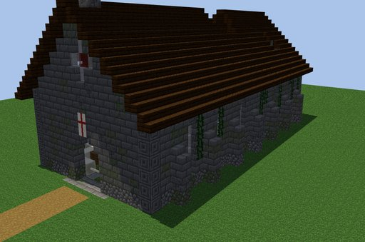
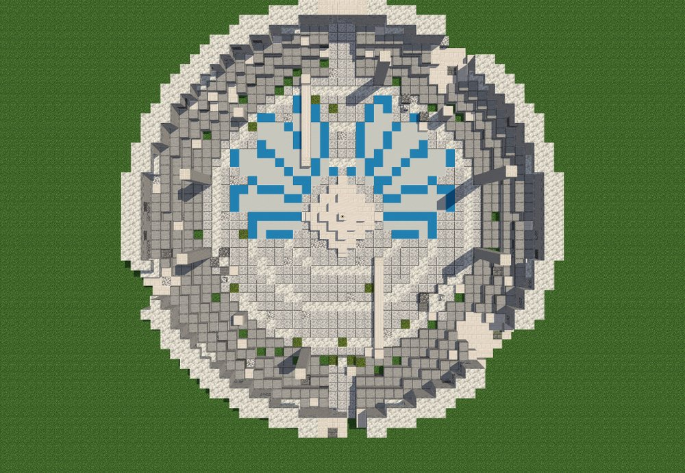

# Structures

Devil x Slime adds three structures to the overworld. The church and the colosseum are about as rare as a pillager
outpost; the old school building stands once per world.

## Ruined church

A ruined chapel in **plains, meadows and forests**. Inside, a dragon's skeleton lies across the nave, and **Ascalon** is
driven down through its skull at the chancel steps, glowing under a hole in the roof. The first church drawn from in a
world holds the true Ascalon; every other one holds a replica.

```
/locate structure dxdtensura:ascalon_church
```

<figure markdown="span">
  { loading=lazy }
  <figcaption>A ruined church.</figcaption>
</figure>

See [Ascalon](../boosted-gear/ascalon.md).

## White Dragon Colosseum

A broken ring of white stone on **high ground** (meadows, cherry groves, windswept hills and forests, savanna plateaus),
with Albion's wings inlaid in blue around an altar in the middle. A Nether Star on the altar calls the **White Dragon
Emperor**, once the Ender Dragon is dead.

```
/locate structure dxdtensura:white_dragon_colosseum
```

<figure markdown="span">
  { loading=lazy }
  <figcaption>The colosseum from above: Albion's wings around the altar.</figcaption>
</figure>

See [The White Dragon Emperor](white-dragon-emperor.md).

## Old school building

The Occult Research Club's old school building, with a clock tower and a walled yard, home of
[Rias Gremory](../races/rias.md). Upstairs is her clubroom, with the Gremory circle in the floor.

- There's **one per world**, about 300 to 600 blocks from the middle of the world (0, 0). It moves up to 112 blocks to
  stand in forest or taiga if there's some nearby.
- **In a world played before 0.1.60**, or if its spot is water, it waits further out, in land nobody has explored yet,
  and appears when that land is first generated. `/locate` can't find it then; her flyer's arrow and
  `/dxdtensura rias where` can.

```
/locate structure dxdtensura:old_school_building
```

<figure markdown="span">
  { loading=lazy }
  <figcaption>The old school building.</figcaption>
</figure>
