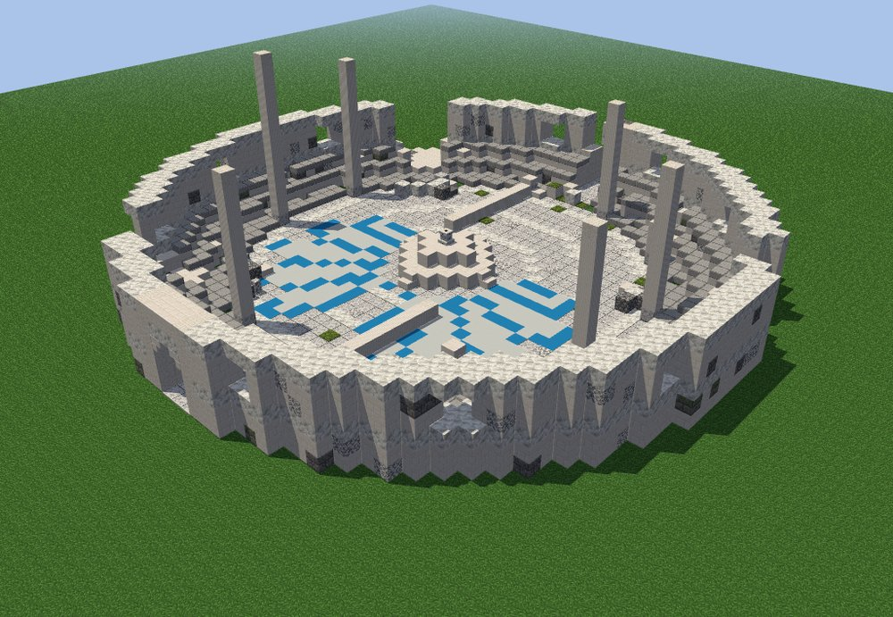
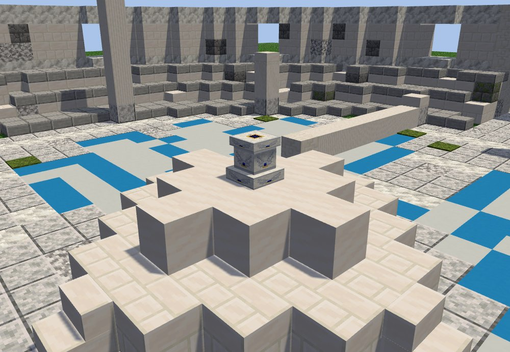
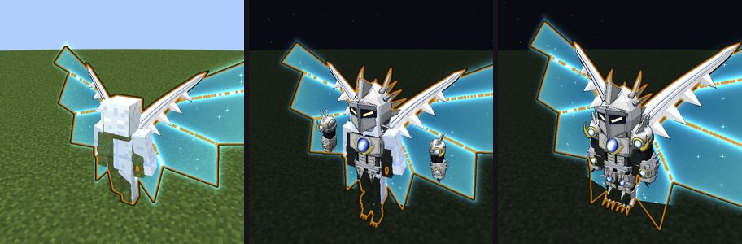
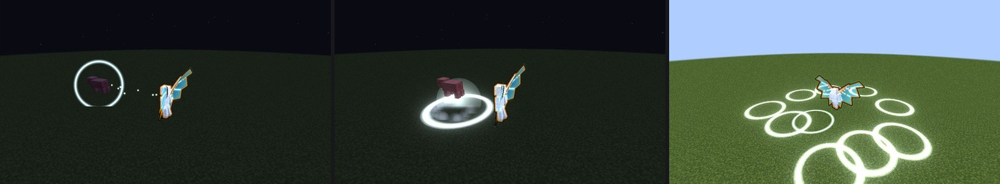
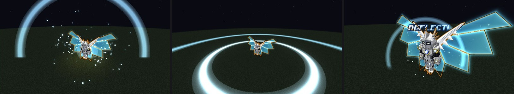
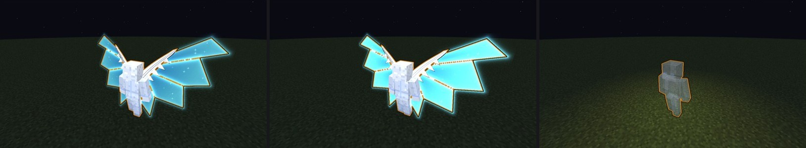
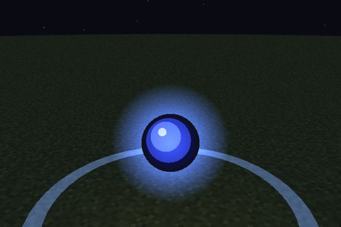
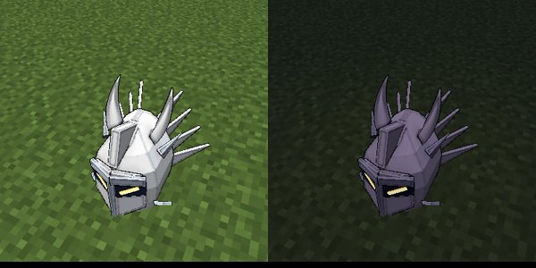

# The White Dragon Emperor

A past host of Albion, called back by an altar in a ruined white colosseum. He fights in the gear he once wore. Beat
him for **Albion's jewel**: Divine Dividing itself, or the Divide for a Boosted Gear holder.

## Finding him

The **White Dragon Colosseum** stands on high ground: meadows, cherry groves, windswept hills and forests, and savanna
plateaus. It is about twice as common as Ascalon's church: a broken ring of white stone, with Albion's wings inlaid in blue
around the altar in the middle.

```
/locate structure dxdtensura:white_dragon_colosseum
```

<figure markdown="span">
  { loading=lazy }
  <figcaption>The colosseum.</figcaption>
</figure>

## Calling him

Use a **Nether Star** on the altar.

- The altar stays silent until the **Ender Dragon has been killed** in your world (you keep the star).
- It refuses on **Peaceful**.
- One fight at a time.

A pillar of light rises and he forms above it.

<figure markdown="span">
  { loading=lazy }
  <figcaption>The altar at the colosseum's heart.</figcaption>
</figure>

## The fight

He has **3,000 health**, and **no single hit takes more than 150 of it** (5%), whatever you use, soul damage included. Not even Tensura's
Disintegration gets past the cap; only `/kill` and the void do.

- **His hits grow with you:** his punches, orbs and burst take a share of **your max health**, so a tough player still
  feels them.
- **In a group** he goes for a **Boosted Gear holder** first.

Since **0.2.67** each phase has its own moves, and the big ones warn you first.

### His Divide

Every **10 seconds** (every 5 in his armour) he Divides you: half your magicules and aura go, and everything you deal is
halved, skills and magic included (down to a quarter). A Boosted Gear holder also loses a held Boost stack.

- **The warning:** a white ring closes on you and a line runs from his hand, a second before it lands. **Break his line
  of sight** and it misses.
- **Absorbed Power:** each Divide he lands makes him **stronger and faster** for 30 seconds, and his wings shine
  brighter.
- **The vent:** with enough held (4, or 2 when he fights one player alone), his wings flare for 1.5 seconds, then a burst
  throws back and hurts everything within **8 blocks**. He hangs still for 3 seconds after: your opening.

### The phases

=== "Phase 1: the wings"

    On his wings of light he circles you and:

    - throws **three orbs** of light at a time;
    - **Light Rain** every 20 seconds: white rings on the ground, and an orb lands on each a second later;
    - **dives** to punch, a glint on his fist as he draws back, his landing throwing you back.

=== "Phase 2: the white Scale Mail"

    At **two thirds** of his health he shouts "Vanishing Dragon Balance Breaker!" and the white Scale Mail flies onto
    him. Nothing hurts him while it forms. In it he fights close, and Divides every 5 seconds:

    - **three-hit rushes**;
    - **Reflect** every 20 seconds: 3 seconds of shimmer that turns blows and projectiles back on you.
      [Penetrate](../boosted-gear/penetrate.md) goes through;
    - **Half Dimension** every 30 seconds: rings spread over the floor for 2 seconds, then everything inside 12 blocks
      loses **half its health**;
    - **Compression Divider**: his hands glow, then four slashes.

=== "Phase 3: broken"

    At **one third** his armour shatters and **Albion's jewel falls out**. Broken, he Divides, throws single orbs and
    dives, and **flees after 60 seconds**.

<figure markdown="span">
  { loading=lazy }
  <figcaption>On his wings, the Scale Mail flying on, and in the Scale Mail.</figcaption>
</figure>

<figure markdown="span">
  { loading=lazy }
  <figcaption>His Divide's warning ring, the dive's shockwave, and Light Rain.</figcaption>
</figure>

<figure markdown="span">
  { loading=lazy }
  <figcaption>The vent's burst, Half Dimension's rings, and Reflect.</figcaption>
</figure>

<figure markdown="span">
  { loading=lazy }
  <figcaption>His wings brighter with one, then four Divides held; and dying, he fades into the light.</figcaption>
</figure>

**Leave him alone** for 30 seconds and he fades, healed. **Dying,** he fades into the light where he hangs.

!!! tip "Tips"
    - The cap is per hit: many quick hits beat one huge one.
    - Watch for the white ring: a wall or a pillar between you when it closes makes his Divide miss, and fewer Divides
      held means a weaker Emperor and fewer vents.
    - After a vent he hangs still for 3 seconds.
    - The jewel drops when his armour shatters, but his hits interrupt the 5 second channel. It is often easier to take
      it once he has fled or fallen: it stays for 5 minutes.

## Albion's jewel

A blue orb of light. **Hold use on it for 5 seconds**; a ring fills as you channel, and a hit from him stops it.

| Who takes it | What they get |
|---|---|
| A **human** player with **no Sacred Gear** | [Divine Dividing](../divine-dividing/index.md) |
| A **Boosted Gear holder in Balance Breaker** | [Divide (Albion's power)](../boosted-gear/divide.md) |

The jewel fades 5 minutes after the fight.

<figure markdown="span">
  { loading=lazy }
  <figcaption>Albion's jewel.</figcaption>
</figure>

**One Divine Dividing per world.** While someone holds Divine Dividing, the jewel only serves Boosted Gear holders.

**Humans only.** A Sacred Gear is born only in a human, so a Devil, an Angel or any other race can't take Divine
Dividing from it: "The jewel's light won't settle in you. Albion only takes a human host." A Twilight Healing,
Sword Birth, Forbidden Balor View or Absorption Line holder is turned away at once, and so is anyone with the
[Holy Factor](../durandal/index.md#the-holy-factor): "The holy power in you rejects the white dragon." The Boosted Gear's Divide is the same for every race. See
[Only in humans](../getting-started/first-gear.md#only-in-humans).

## Rewards

His kill gives:

- Tensura's reward for his magicules;
- **1,000 XP**;
- **his white helm**, a trophy block you can place on a floor or a wall;
- **[Excalibur Ruler](../excalibur/index.md#the-white-dragon-emperor)**: the true one if it hasn't been claimed yet, or a replica one time in four.

<figure markdown="span">
  { loading=lazy }
  <figcaption>His helm, on the floor and on a wall.</figcaption>
</figure>
