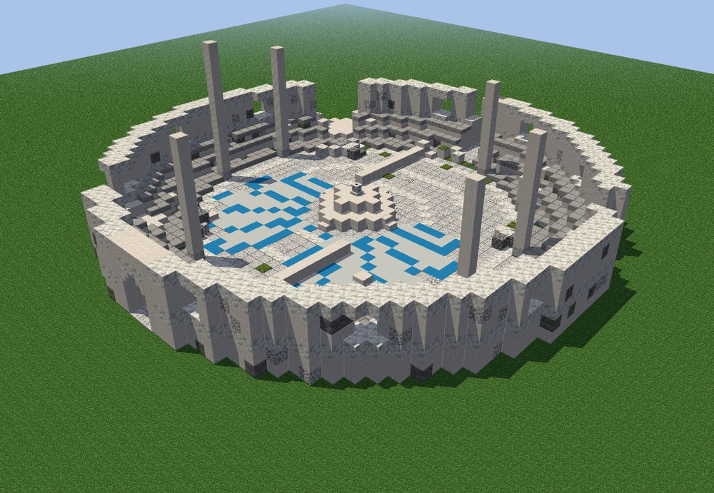
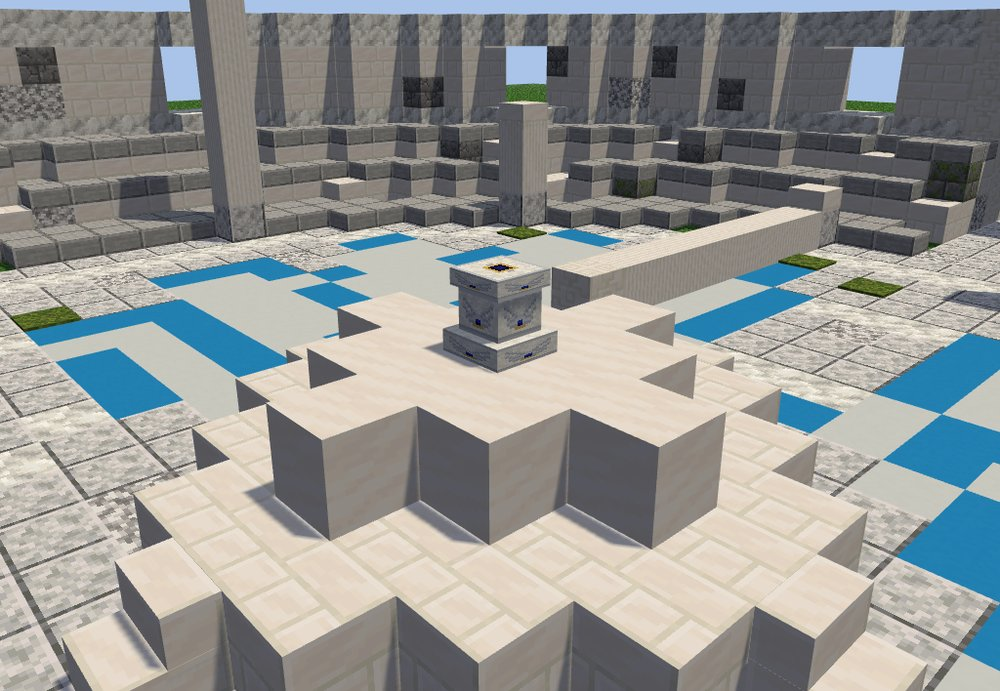
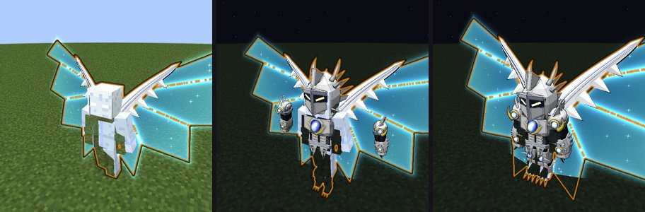
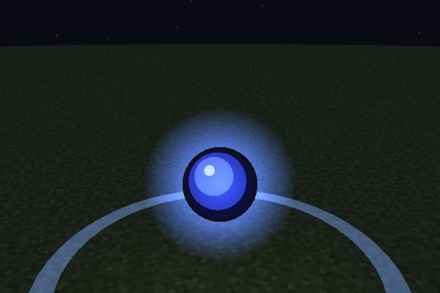
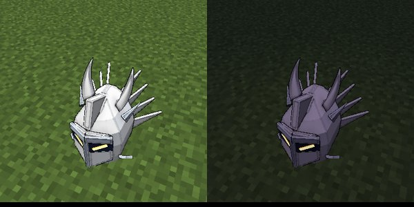

# The White Dragon Emperor

A past host of Albion, called back by an altar in a ruined white colosseum. He fights in the gear he once wore. Beat
him for **Albion's jewel**: Divine Dividing itself, or the Divide for a Boosted Gear holder.

## Finding him

The **White Dragon Colosseum** stands on high ground: meadows, cherry groves, windswept hills and forests, and savanna
plateaus. It is about as rare as Ascalon's church: a broken ring of white stone, with Albion's wings inlaid in blue
around the altar in the middle.

```
/locate structure dxdtensura:white_dragon_colosseum
```

<figure markdown="span">
  { loading=lazy }
  <figcaption>The colosseum.</figcaption>
</figure>

## Calling him

Use a **Nether Star** on the altar.

- The altar stays silent until the **Ender Dragon has been killed** in your world (you keep the star).
- It refuses on **Peaceful**.
- One fight at a time.

A pillar of light rises and he forms above it.

<figure markdown="span">
  { loading=lazy }
  <figcaption>The altar at the colosseum's heart.</figcaption>
</figure>

## The fight

He has **3,000 health**, and **no single hit takes more than 300 of it**, whatever you use. Not even Tensura's
Disintegration gets past the cap; only `/kill` and the void do.

=== "Phase 1: the wings"

    On his wings of light he circles you, **Divides you every 10 seconds**, throws orbs of light and dives in to punch.
    Each Divide takes down to a quarter of your attack and half your magicules and aura; a Boosted Gear holder loses a
    held Boost stack.

=== "Phase 2: the white Scale Mail"

    At **two thirds** of his health he shouts "Vanishing Dragon Balance Breaker!" and the white Scale Mail flies onto
    him. Nothing hurts him while it forms. In it he is tougher and faster, **Divides every 5 seconds**, and uses
    **Half Dimension** and **Compression Divider**.

=== "Phase 3: broken"

    At **one third** his armour shatters and **Albion's jewel falls out**. Broken, he fights on with Divide and his
    fists, and **flees after 60 seconds**.

<figure markdown="span">
  { loading=lazy }
  <figcaption>On his wings, the Scale Mail flying on, and in the Scale Mail.</figcaption>
</figure>

**Leave him alone** for 30 seconds and he fades, healed.

!!! tip "Tips"
    - The cap is per hit: many quick hits beat one huge one.
    - The jewel drops when his armour shatters, but his hits interrupt the 5 second channel. It is often easier to take
      it once he has fled or fallen: it stays for 5 minutes.

## Albion's jewel

A blue orb of light. **Hold use on it for 5 seconds**; a ring fills as you channel, and a hit from him stops it.

| Who takes it | What they get |
|---|---|
| A player with **no Sacred Gear** | [Divine Dividing](../divine-dividing/index.md) |
| A **Boosted Gear holder in Balance Breaker** | [Divide (Albion's power)](../boosted-gear/divide.md) |

The jewel fades 5 minutes after the fight.

<figure markdown="span">
  { loading=lazy }
  <figcaption>Albion's jewel.</figcaption>
</figure>

**One Divine Dividing per world.** While someone holds Divine Dividing, the jewel only serves Boosted Gear holders.

## Rewards

His kill gives:

- Tensura's reward for his magicules;
- **1,000 XP**;
- **his white helm**, a trophy block you can place on a floor or a wall.

<figure markdown="span">
  { loading=lazy }
  <figcaption>His helm, on the floor and on a wall.</figcaption>
</figure>
